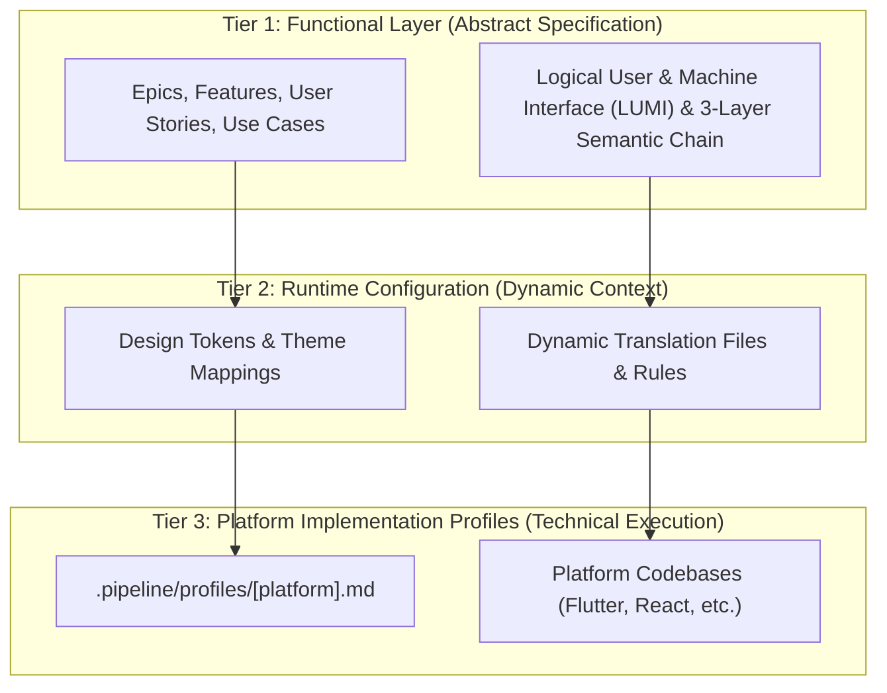

# Project Constitution: Digital Engineering Agent Platform (DEAP)

> This document governs specification generation and is platform-independent and protocol-agnostic.
> All agents MUST read this file before beginning any pipeline execution.
> For platform-specific rules, see `.pipeline/profiles/<platform>.md`.

## Architecture: Three-Tier Platform Isolation

The pipeline enforces a strict three-tier platform isolation architecture to decouple abstract functional specifications from dynamic runtime parameters and platform-specific execution details.

### Tier Boundary Guidelines

1. **Tier 1: Functional Layer (Abstract Specification)**: Epics, Features, User Stories, Use Cases, and Logical User & Machine Interface (LUMI) specifications. LUMI is 100% platform-independent and framework-agnostic, covering three primary interface categories: Visual GUI (`gui`), Machine-to-Machine API (`mcp`/`api`), and Hardware Bus (`hardware`). LUMI supports the Evolved 3-Layer Semantic Chain (Domain State & Signal Model -> Logic & Safety State Management -> Display & Actuator Interface Binding) across canonical architectural patterns (ARINC 661 Cockpit Display Systems, Real-Time Safety Statecharts & Flight Control, Decoupled Operator Consoles & EFBs, Automated M2M Agentic Tooling, and Hardware Bus Register Mapping). Must be platform-independent and standard-agnostic. No framework keywords, specific standards designations, or hardcoded visual values allowed.
2. **Tier 2: Runtime Configuration Parameters (Dynamic Context)**: Design tokens, dynamic mapping configurations, translation files. Single source of truth for standard-specific definitions and visual attributes.
3. **Tier 3: Platform Implementation Profiles (Technical Execution)**: `.pipeline/profiles/<platform>.md` and codebase implementations. Govern build mechanics, performance patterns, and dependencies.

### Core System Boundaries & Invariants

- **Pure Schema-Driven Compiler**: The pipeline is an abstract compiler and verification framework. Agents are strictly forbidden from inventing, proposing, or hardcoding domain-specific concepts into pipeline logic or templates.
- **Upstream Clean Landing Zone Invariant**: Upstream distribution templates (`DEAP-*`) contain only the abstract compiler, linters, and empty landing zones (`schema/`, `docs/epics/`, `docs/features/`, `docs/user-stories/`, `docs/use-cases/` containing only `.gitkeep`). Concrete project schemas and specifications reside exclusively in downstream application workspaces initialized from domain distribution templates.

## Domain Rules

### Specification Sources
- Primary sources are normative technical specifications and standards documents.
- Structural schemas and interface definitions are the authoritative machine-readable models.
- When the normative text and the schema conflict, the schema is authoritative for structural completeness; the normative text is authoritative for behavioral semantics.

### Schema Compliance
- Every data model constraint in the schema MUST be captured in at least one Feature's acceptance criteria. Zero loss tolerance.
- Constraints include: data type, validation ranges, regex patterns, default values, mandatory fields, conditional expressions, minimum/maximum elements, and structural relationship references.
- If a schema node has no explicit constraint, document its type and note "no additional constraints specified in schema."

### Data Model Integrity
- Every schema definition, model node, data object, property, variant, custom type, and extension defined in the input schemas MUST map to at least one Feature.
- Cross-module or external schema references must be explicitly documented with source and target module names.
- Circular dependencies must be flagged and escalated -- do not silently drop them.

### Model Metamodel & Profile Mapping Standard
- Module Declarations & Container Nodes: YANG modules, OpenAPI schemas, or Protobuf packages map to a logical Component.
- Complex Data Structures & Interfaces: RPC input/output payloads, YANG containers/lists, or OpenAPI objects map to a logical Class defined within the parent Component.
- Data Properties & Leaf Nodes: Individual fields, properties, elements, attributes, or variables map to a logical Property (or owned attribute of a class) with appropriate visibility, type, and multiplicity.
- Interfaces & Operations: Services, RPC methods, actions, or operational paths map to a logical Operation defined on the target classifier.
- Rules & Validation Logic: Any syntax constraints, range checks, pattern validations, conditional dependencies, or length constraints map to a logical Constraint.

### Universal Model Consistency Rules
- Dynamic-to-Static Alignment: No class, component, interface, attribute, operation, signal, or message may be used in dynamic behavior specifications unless it is explicitly defined in the structural models.
- Every lifeline in a sequence diagram MUST represent an instance of a defined logical Class or Component, except lifelines declared as external actors (UML `actor`), which represent entities outside the system boundary and are therefore not defined in the structural models. Every non-actor lifeline MUST resolve to a defined classifier.
- Every message (synchronous, asynchronous, or return) in a sequence diagram must map to an active Operation or Signal defined on the target classifier's interface/class definition.
- Every trigger, event, or action on a state machine transition must be defined as an Operation or Signal in the class metamodel.
- Auto-verification Failure: Any diagram or spec that references undefined operations, classes, or signals will violate the quality gates and halt the pipeline.

### Traceability
- Every Epic MUST reference the specification section(s) it covers. Enforced by `./target/release/verify-baseline` (Check 15) via required sections configuration.
- Every Feature MUST include a 'Source References' section with verbatim specification clause numbers and schema paths. Every Epic, User Story, and Use Case MUST also carry a 'Source References' section (or Realization / Target Features Matrix linking to upstream sources). Enforced by `./target/release/verify-baseline` (Check 30).
- Every User Story MUST link to the Features it validates. Enforced by `./target/release/verify-baseline` (Check 20).
- Every Use Case MUST link to the User Stories and Features it realizes. Enforced by `./target/release/verify-baseline` (Check 20).

### Standard & Platform Parameter Isolation
- See top-level section [Architecture: Three-Tier Platform Isolation](#architecture-three-tier-platform-isolation) for tier isolation rules and boundary guidelines.

### Unique Backlog Identifiers
- All local specification files MUST include a permanent unique identifier (`issue_id: <int>`) in their YAML frontmatter, mapped directly to their remote issue number.
- Matching by title normalization is the primary selector used by the backlog reconciliation tool. To prevent collisions, all specification files of the same spec type MUST have unique normalised titles, as enforced by `./target/release/reconcile-backlog` and `rules/tracker-source-of-truth.md`.

### 1.9 Zero-Mocking Live Persistence Mandate
- All client-side application targets (e.g., React, Flutter) MUST connect to a live, persistent database, emulator, or local register map at runtime.
- The use of in-memory UI mocks, stubs, or hardcoded local variables in place of a live database/transport layer is strictly prohibited in active application builds.
- The presentation layer must depend strictly on abstract repository interfaces resolved dynamically at application bootstrap, keeping UI components completely decoupled from specific database/API SDK dependencies (such as Firestore or RPC wrappers).
- Transport concrete adapters must serialize/deserialize network payloads and translate them to and from platform-internal clean domain models, shielding presentation logic from external format changes.
- All integration and end-to-end (E2E) testing suites must compile and execute against a live database instance or emulator (in-memory stubs are prohibited for these tiers).

## Specification Standards

### Granularity Bounds
- An Epic SHOULD contain 3-15 Features. Epics exceeding 15 Features MUST be split by the schema-specification-engineering worker during Step 1 decomposition; Epics with fewer than 3 Features MUST be reviewed for consolidation. Enforced by schema-specification-engineering decomposition heuristics.
- A Feature SHOULD carry 3-10 acceptance criteria. Features exceeding 10 acceptance criteria MUST be split into targeted sub-features; Features with fewer than 3 acceptance criteria MUST be expanded to ensure full scenario coverage. Enforced by `./target/release/verify-baseline` (Check 18) and spec worker review gates.

### Epic Granularity
- One Epic per major functional domain or protocol module.
- Epic titles use the format: `[Module/Domain]: [Functional Area]`.

### Feature Granularity
- A Feature represents a single, independently testable functional capability.
- Features MUST be platform-independent and standard-agnostic.
- Feature titles use the format: `[Verb] [Object] [Qualifier]`.

### BDD Scenario Format
- All acceptance criteria MUST use Given-When-Then format adhering to canonical 3-layer semantic BDD templates:
  - **Pattern A (Synchronous Display Kernel / Embedded Protocol)**: `Given [Domain Input Parameter Buffer State], When [Binary Command Message Received], Then [Widget State & Display Kernel Render Updated]`.
  - **Pattern B (Real-Time Safety Statechart / Discrete Event Control)**: `Given [Domain State Vector / Discrete Event], When [Safety Statechart FSM Transition Triggered], Then [Actuator Command / Output Signal Generated]`.
  - **Pattern C (Decoupled Operator Console / Web Interface)**: `Given [Console Domain Model State], When [Operator Action Initiated], Then [ViewModel State & GUI Component Binding Updated]`.
- Negative scenarios (error cases, boundary violations, emergency failsafe modes) are MANDATORY for every constraint.

### User Story Format
- User Stories follow: `As a [Actor/Subsystem], I want to [Action/Command], so that [Outcome/Safety Constraint]`.
- Each User Story MUST have at least one canonical aerospace BDD scenario (Given-When-Then).

### Use Case Formality
- Use Cases follow formal structure: Actor, Preconditions, Main Success Scenario (numbered steps), Alternate Flows, Postconditions.
- The Realization Matrix maps each Use Case to its constituent User Stories and Features.

### Labeling Taxonomy
- Issue tracking labels are defined with `codebase_rules.json` acting as the authoritative label registry, categorized into specification, operational, and state labels:
  - Specification labels: `epic`, `feature`, `user-story`, `use-case`.
  - Operational labels: `bug`, `enhancement`, `chore`.
  - State labels: `status:fixed-resolved`.
- Labels are bootstrapped via the configured label bootstrap command to ensure idempotency.

## Agent Behavior

### Commit Format
- Specification commits: `docs: [action] [artifact type] -- [brief description]`
- Implementation commits: `feat:`, `fix:`, `test:`, `refactor:`, `chore:` per Conventional Commits.

### Branch Strategy
- Specification work: directly on the default branch or a single `spec/<module>` branch if the change is large.
- Implementation work: `feat/<issue-number>-<short-description>` branches.

### Documentation & Repository Artifact Management Standards
- All generated markdown files include YAML frontmatter.
- All generated markdown files include a "Source References" section at the bottom.
- No orphan documents -- every file must be linked from at least one tracker issue.
- **Repository Artifact Management Mandate (Durable Engineering Artifacts vs. Isolated Session Plans)**: All durable engineering artifacts -- design blueprints, solution documents, architectural specifications, schemas, defect dossiers, and reports -- MUST be created, managed, and committed directly within the active Git repository (e.g. under `docs/architecture/`, `docs/reports/`, `docs/designs/`, `schema/`, or `.pipeline/defects/`). Storing primary architectural decisions, solution documents, or engineering specifications exclusively in ephemeral application cache directories outside the repository is strictly prohibited. Conversely, transient per-conversation session plans and post-completion walkthroughs (`implementation_plan.md` and `walkthrough.md`) reside in each tab's isolated `<appDataDir>/brain/<conversation-id>/` directory (or workstream-scoped `.pipeline/plans/<slug>.md` when Git persistence is requested) so parallel workstreams never clobber a shared root `./implementation_plan.md`.

### Idempotency
- Re-running any pipeline skill MUST NOT create duplicate issues or documents.

### Error Handling
- If a validation gate fails, HALT immediately. Do not proceed to the next phase.
- If you suspect the failure is due to a pipeline tooling bug or schema limitation, report it as an issue to the upstream repository.

### Strict Planning Mode Gate & Plan Continuity Mandate
- Under NO circumstances may the agent invoke any file-writing, file-modifying, or command-running tools that alter the codebase/repository files unless BOTH of the following hold: (1) the specific file and its exact changes are documented in an approved implementation plan, AND (2) the user has explicitly typed "Proceed", "Approved", or "Approve plan" in the conversation history of the current turn sequence. An authorization keyword alone is NOT sufficient. See `.agents/AGENTS.md` § Strict Planning Gate, which takes precedence, and `rules/user-authorization-lock.md` § Precedence.
- If a plan is written, the agent MUST immediately terminate its turn and stop calling tools to wait for approval.
- **Prohibition of Unapproved Plan Abandonment & Mandatory Plan Continuity**: Once an implementation plan has been established, approved, or has in-flight work packages, the agent is strictly forbidden from abandoning, altering, replacing, or discarding the plan without explicit user review and authorization in the current conversation turn. The agent is strictly prohibited from reacting to user feedback, criticism, or diagnostic friction by unilaterally dropping planned work packages, abandoning uncommitted changes, or impulsively proposing wholesale file deletions, purges, or scope redirections. Any proposed deviation, scope refinement, or plan adjustment MUST be documented as an updated implementation plan and explicitly approved by the user before changing execution course.
- **Per-Conversation Plan Isolation, Single-Task Atomic Invariant & Parallel Git Safety**: Session `implementation_plan.md` and `walkthrough.md` reside per-conversation at `<appDataDir>/brain/<conversation-id>/` (or `.pipeline/plans/<slug>.md`); overwriting a root `./implementation_plan.md` belonging to another active parallel workstream is strictly forbidden. Each `implementation_plan.md` MUST contain **at most 1 atomic work package** at any time (backlog queues reside exclusively in `gh issue list`). When staging and committing in a workspace with concurrent workstreams, agents MUST use explicit target paths (`git add -- <target-files>` and `git commit --only -- <target-files>`); unscoped `git add .`, `git add -A`, `git checkout .`, and `git stash` are strictly forbidden.

## Universal Quality Gates

### Quality Gates & Verification Standards
The pipeline mechanically enforces 16 active quality gates that halt execution on failure. All agents MUST ensure deliverables comply with these gates before declaring completion:

| Quality Gate | Enforcing Validator Path | Documentation Reference |
|---|---|---|
| Specification Validation | `./target/release/verify-baseline` (Check 16) | `rules/platform-independence.md` |
| Model Coverage Verification | `./target/release/verify-baseline` (Check 19) | `rules/platform-independence.md` |
| Cross-Reference Integrity | `./target/release/verify-baseline` (Check 20) | `rules/document-references.md` |
| Human Approval | `rules/user-authorization-lock.md` | `.pipeline/constitution.md` |
| Downstream Conformance | `./target/release/verify-baseline` (Check 10) | `rules/downstream-conformance.md` |
| UML Model Integrity | `./target/release/verify-baseline` (Check 15) | `rules/uml-model-integrity.md` |
| Mermaid Syntax Constraints | `./target/release/verify-baseline` (Check 13B) | `rules/platform-independence.md` |
| Behavioral Trigger Coverage | `./target/release/verify-baseline` (Check 21) | `rules/behavioral-trigger-coverage.md` |
| Codebase Compliance | `./target/release/verify-baseline` (Check 11) | `rules/codebase-compliance.md` |
| Document Cross-Reference Integrity | `./target/release/verify-baseline` (Check 28) | `rules/document-references.md` |
| Constitution Amendment Integrity | `./target/release/verify-baseline` (Check 29) | `.pipeline/constitution-amendments.md` |
| Specification File Integrity | `./target/release/verify-baseline` (Check 18) | `rules/platform-independence.md` |
| Spec Title Uniqueness | `./target/release/reconcile-backlog` | `rules/tracker-source-of-truth.md` |
| Source Reference Integrity | `./target/release/verify-baseline` (Check 30) | `rules/codebase-compliance.md` |
| Logical UI Validation | `./target/release/verify-baseline` (Check 25) | `rules/platform-independence.md` |
| Safety Integrity Quality Gate | `./target/release/verify-baseline` (Check 17) | `docs/safety/README.md` |

### Phase 0 System Safety Assurance Gate
- **8-Pillar Safety Specification Schema**: All downstream safety engineering deliverables (`docs/safety/STPA_MATRIX.md`) MUST conform to the 8-pillar STPA, FMECA, and SORA schema:
  1. System Losses (**L-1..N**)
  2. System Hazards (**H-1..N**)
  3. Hierarchical Control Structure Topology
  4. Unsafe Control Actions (**UCA-1..N**) covering all 4 failure modes (Not providing, Providing, Too early/too late/out of order, Stopped too soon/applied too long)
  5. Loss Scenarios (**LS-1..N**) & Causal Factors
  6. Formal Safety Constraints (**SC-1..N**)
  7. FMECA Criticality Matrix with at least 15 component failure mode rows (15+ rows), 100% representation of declared AST `part def` components with $\ge 3$ distinct failure modes per part across the 4 universal failure dimensions, explicit `SSOT`/`Derived` basis annotations, and valid integer RPN calculations ($RPN = S \times O \times D$) with $S, O, D \in [1, 10]$.
  8. Domain Regulatory Objectives & Integrity Level Mapping determining domain safety classifications, integrity levels, and complete coverage of declared regulatory objectives and mitigation traceability.
- **Universal Failure Dimensions & Component Failure Mode Registry**: To eliminate shallow FMECA tables and guarantee exhaustive reliability analysis, Step 1.5 Technology Stack & Architecture Research MUST decompose all AST `part def` components from the authoritative SysML model and synthesize `docs/research/FAILURE_MODE_REGISTRY.md` as a mandatory intermediate artifact contract before `docs/safety/STPA_MATRIX.md` synthesis. Failure modes MUST be systematically cataloged across the 4 Universal Failure Dimensions:
  1. **Interface**: Signal corruption, bus babbling, port disconnect, serialization fault, packet loss, CRC checksum error, impedance mismatch.
  2. **State**: Illegal transition, deadlocks, state desynchronization, uninitialized mode, unrecoverable safe-state trap, livelock.
  3. **Action**: Command omission, inadvertent/spurious execution, timing/latency violation, out-of-sequence execution, truncated/extended actuation duration.
  4. **Resource**: Memory exhaustion, buffer overflow, CPU starvation, deadline miss, power sag/brownout, thermal throttling, storage corruption.
- **Component-Level Failure Mode Research Swarm Mandate**: During Step 1.5 Technology Stack & Architecture Research, monolithic failure mode drafting by a single worker is strictly prohibited. The coordinator MUST decompose all AST `part def` components $\{P_1, P_2, \dots, P_N\}$ declared in `.pipeline/schema.sysml` and dispatch $N$ context-isolated research subagents (role: `Component Failure Mode Researcher` or `Failure Mode Research Worker`). Each subagent receives its respective component AST fragment (name, ports, actions, operations, states, constraints) and is mandated to query applicable aerospace and systems failure mode catalogs (e.g. SAE ARP4761, MIL-HDBK-338B, RTCA DO-254, RTCA DO-178C). The subagents evaluate the 4 Universal Failure Dimensions (Interface, State, Action, Resource), assigning integer Severity ($S \in [1, 10]$), Occurrence ($O \in [1, 10]$), Detection ($D \in [1, 10]$), integer RPN ($RPN = S \times O \times D$), and explicit `SSOT`/`Derived` basis tags. The outputs MUST be aggregated into `docs/research/FAILURE_MODE_REGISTRY.md` with failure causes, local effects, system effects, and detection mechanisms. Every component MUST have at least 3 distinct failure modes documented before authorizing Step 2 STPA/FMECA matrix synthesis.
- **Derivation-Annotation Contract**: All analytical content in the 8-pillar deliverable is an engineering derivative of the SSOT fact base, never a fact itself. Every derived cell MUST carry four annotations: (1) Input anchors (SSOT document, section, and clause, or explicit silent source set), (2) Methodology citation (Leveson STPA for L/H/UCA/LS/SC; MIL-STD-1629A/SAE ARP4761 for FMECA S/O/D/RPN; Applicable domain safety framework for integrity levels; Declared safety architecture patterns for run-time assurance hooks), (3) Derivation grade (directly evidenced, analytically derived, or declared assumption), and (4) Caveat (mandatory where product documents are silent, recording the attempt made, silent source set, and downstream impact).
- **ASTM F3269-17 RTA & Model-Based Design Hook Mandate**: Formal safety constraints and Run-Time Assurance (RTA) Safety Net monitors MUST specify direct integration hooks for MATLAB / Simulink / Stateflow / Embedded Coder control law synthesis and Simulink Design Verifier (SLDV) invariant proving.
- **Forbidden Math Delimiters on Alphanumeric IDs**: Traceability keys and non-mathematical identifiers (such as requirement IDs `SC-XX`, hazard tags `H-X`, regulatory objective codes (e.g. `OBJ-XX`), loss tags `L-X`, and UCA codes `UCA-X`) MUST NOT be wrapped in LaTeX math delimiters `$...$`. Bold formatting (`**SC-01**`, `**H-1**`) MUST be used instead.

### Specification Validation Gates
- Post schema extraction: Every schema node maps to at least one Feature. Coverage = 100%.
- Post User Stories: Every User Story links to at least one Feature.
- Post Use Cases: Every Use Case links to at least one User Story and one Feature.
- Post Reconciliation: All local markdown checklist states match tracker issue states.

### Model Coverage Verification
- Verify model coverage scripts MUST pass with exit code 0 before declaring specification complete.
- Coverage is binary: 100% or fail.

### Cross-Reference Integrity
- No broken issue links (all `#N` references must resolve to existing tracker issues).
- No orphan Features (every Feature belongs to exactly one Epic).
- No orphan User Stories (every Story links to at least one Feature).

### Human Approval (The Grill)
- Required before implementation begins.
- NOT required for specification generation.

### Downstream Conformance Gates
- Prior to integrating any downstream application implementation, the project MUST be bootstrapped and verified.
- The downstream project must be initialized using the configured bootstrap script.
- Baseline conformance must be verified using the configured verification script, which asserts that all baseline files are present, validates type compatibility, and compiles/tests the project with a clean exit code.

### Downstream Single Source of Truth (SSOT) & Clean Baseline Mandate
- **Single Source of Truth (SSOT)**: Master architecture blueprints -- including legacy sentinel filenames (`DEAP_MASTER_ARCHITECTURE.md`, `THREE_TIER_GOVERNANCE_BLUEPRINT.md`) and all 12 canonical architecture blueprints residing in `docs/architecture/blueprints/` -- reside exclusively in the central upstream specification repository (`DEAP01-spec-core`). Downstream repositories are strictly forbidden from copying or duplicating master blueprints locally. All downstream projects MUST reference upstream specifications via URLs or relative submodule paths:
  - `DEAP_SYSML_V2_INGESTION_ENGINE_BLUEPRINT.md`
  - `SYSML_SSOT_BIDIRECTIONAL_SYNCHRONIZATION_ARCHITECTURE.md`
  - `DEAP_DETERMINISTIC_SAFETY_SPECIFICATION_COMPILER_BLUEPRINT.md`
  - `DEAP_MULTI_TOOLCHAIN_SYNTHESIS_ARCHITECTURE.md`
  - `DEAP_LOGICAL_INTERFACE_SPECIFICATION_BLUEPRINT.md`
  - `MULTI_PROVIDER_GITLAB_INFRASTRUCTURE_ARCHITECTURE.md`
  - `PERSISTENCE_ARCHITECTURE.md`
  - `SAFETY_CRITICAL_REALTIME_UI_FRAMEWORK.md`
  - `RUNTIME_METADATA_ENGINE.md`
  - `SPECKIT_NATIVE_INTEGRATION.md`
  - `DEAP_LOCAL_AIRGAPPED_DEEPSEEK_WORKSTATION_BLUEPRINT.md`
  - `DEAP_DEEPSEEK_HARNESS_INTEGRATION_BLUEPRINT.md`
- **Clean Baseline & Version Control Mandate**: Every downstream repository MUST maintain a valid `.gitignore` file in its root directory. OS-generated metadata files (such as `.DS_Store`) and build artifacts are strictly forbidden from being committed or present in the working tree or git index.
- **Downstream Binary-Only Distribution & Black-Box Source Firewall Lock**: Upstream Tier-0 compiler source code (`crates/{deap-core,ingest-sysml,compile-sysml,verify-baseline,reconcile-backlog,assemble-conops}`, `Cargo.toml`, `Cargo.lock`), `.pipeline/upstream/`, and `docs/architecture/blueprints/` reside **exclusively** in `DEAP01-spec-core` (`UPSTREAM_SPEC_CORE_COMPILER`). Agents (and subagents) are strictly forbidden from proposing, planning (`implementation_plan.md`), or executing any copy, sync, or commit of Tier-0 compiler `crates/*` source code into any downstream repository (`DOWNSTREAM_CUSTOMER_PROJECT`), and strictly forbidden from running `cargo build` to recompile already-verified `target/release/*` binaries during downstream distribution. Downstream distribution is restricted exclusively to: (1) pre-built `target/release/{compile-sysml,verify-baseline,ingest-sysml,reconcile-backlog,assemble-conops}` binary images, (2) `AGENTS.md` / `.agents/AGENTS.md`, (3) `.pipeline/constitution.md` / `.pipeline/ACTIVE_RULES_BUNDLE.md`, (4) `rules/*.md`, and (5) `skills/**`. Any subagent prompt requesting to copy `crates/*` to a downstream repository MUST immediately self-reject and halt. In `DOWNSTREAM_CUSTOMER_PROJECT` sessions, reading or searching `../DEAP01-spec-core/crates/*` to inspect compiler internals is strictly forbidden; treat Tier-0 binaries as black-box verifiers and report upstream defects via `adversarial-code-auditor`.

## CMMI Level 3 & Scrum Issue Lifecycle Rules

### CMMI Level 3 Process Area Mapping
The pipeline explicitly substantiates CMMI Level 3 alignment across key engineering and management process areas:

| Process Area (CMMI Acronym) | Enforcing Mechanisms & Pipeline Artifacts |
|---|---|
| Requirements Management (REQM) | `tracker-source-of-truth.md`, `./target/release/reconcile-backlog` |
| Verification (VER) | Native Rust workspace test suite & `./target/release/verify-baseline` |
| Validation (VAL) | Product Owner `Closed` state transition & verification walkthroughs |
| Configuration Management (CM) | Git-tracked specification files, `constitution-amendments.md` |
| Technical Solution (TS) | 3-Layer LUI Definition of Done & implementation profiles |
| Product Integration (PI) | Automated baseline verification `./target/release/verify-baseline . --no-domain` |

### Separation of Verification and Validation
- **Verification (Process Quality Gate)**: Conducted by the development subagent and pipeline. The issue is resolved when the code compiles, the linter passes, and all unit/integration tests pass. The issue moves to the `Fixed / Resolved` state.
- **Validation (Product Owner/Customer Approval Gate)**: Conducted by the Product Owner or Customer. The issue is moved to the `Closed` state ONLY after explicit verification, testing, and acceptance by the Product Owner/Customer in the chat.

### Issue States and Transition Protocols
- `New`: The issue is registered in the backlog.
- `Active`: The issue is scheduled and prioritized for work.
- `In Progress`: Active code or specification changes are underway.
- `Verifying`: Code changes are in peer review (PR) and automated tests are executing.
- `Fixed / Resolved`: Development work is complete, tests have passed, and the fix is integrated into `main`. The issue remains in this state awaiting customer feedback.
- `Closed`: The issue is archived. This state is unreachable without explicit Product Owner/Customer validation approval.
- **Commit Message Non-Closure Invariant**: Agents and automated scripts are strictly prohibited from using issue auto-closing keywords (`fix`, `fixes`, `fixed`, `close`, `closes`, `closed`, `resolve`, `resolves`, `resolved` preceding `#<id>`) in git commit messages. All commit messages referencing issues MUST use neutral citations: `(#<id>)` or `(refs #<id>)` to prevent server-side premature auto-closure.

