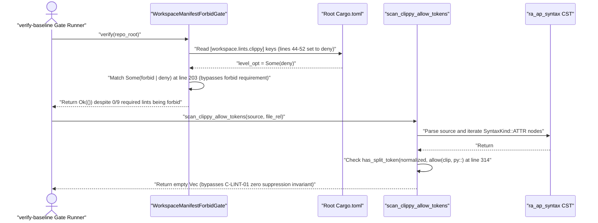

## 1. Context and References

<!-- test-target: crates/verify-baseline/tests/blueprint_gate_tests.rs -->

- **File**: `crates/verify-baseline/src/checks/struct_check_clippy.rs:94-332`
- **Pillar**: Semantic Traceability
- **Symptom**: `WorkspaceManifestForbidGate::verify` accepts `"deny"` in place of `"forbid"` for all nine `RequiredClippyForbidLint` keys (`Some("forbid" | "deny") => {}`) and omits `undocumented_unsafe_blocks` and `multiple_unsafe_ops_per_block` from `RequiredClippyForbidLint::ALL`, allowing `Cargo.toml:44-52` to leave `disallowed_types`, `unwrap_used`, `expect_used`, `panic`, `indexing_slicing`, `type_complexity`, `dbg_macro`, `todo`, and `unimplemented` at `"deny"` (`forbid_rule_coverage < 100%`) while tests pass without exercising `E0453` forbid semantics. Furthermore, `scan_clippy_allow_tokens` flattens `SyntaxKind::ATTR` text and matches only the contiguous substring `"allow(clippy::"`, bypassing multi-argument attributes (`#[allow(dead_code, clippy::unwrap_used)]`), `#[cfg_attr(..., allow(...))]`, non-prefixed `#[allow(...)]` suppressions, and `#![feature(rustc_private)]`, while false-positiving on string literals inside attributes (such as `#[doc = "allow(clippy::unwrap_used)"]`).
- **Test-Target**: `crates/verify-baseline/tests/blueprint_gate_tests.rs`

## 2. Root Cause Analysis (5 Whys)

1. **Why do workspace manifest and CST attribute verification tests pass while `Cargo.toml:44-52` leaves all nine safety-critical Clippy lints at `"deny"` and multi-token or `cfg_attr` suppressions evade detection?** Because `WorkspaceManifestForbidGate::verify` (`crates/verify-baseline/src/checks/struct_check_clippy.rs:203`) explicitly treats `Some("deny")` as equivalent to `Some("forbid")`, and `scan_clippy_allow_tokens` (`crates/verify-baseline/src/checks/struct_check_clippy.rs:308-314`) checks whitespace-stripped raw attribute text with `has_split_token(&normalized, "allow(clip", "py::")`.
2. **Why does `WorkspaceManifestForbidGate::verify` accept `"deny"` when the diagnostic message on line 206 states `must be "forbid"`?** Because the match arm `Some("forbid" | "deny") => {}` was relaxed so baseline verification would succeed before upgrading `[workspace.lints.clippy]` in `Cargo.toml:44-52` from `"deny"` to `"forbid"`.
3. **Why does relaxing `"forbid"` to `"deny"` in `[workspace.lints.clippy]` violate the normative BP-01 safety contract?** Because `rustc` only emits non-overridable compiler error `E0453` when a lint level is `"forbid"`; when left at `"deny"`, any inner `#![allow(...)]` or outer `#[allow(...)]` attribute silently suppresses the lint at compile time, violating **REQ-0601**, **C-LINT-02** (`forbid_rule_coverage == 100`), and **AC-01** in `docs/designs/blueprint-01-compiler-enforced-lint-forbid-gate.md:25,85,211,243-246,290-300`.
4. **Why does `scan_clippy_allow_tokens` fail to close the suppression loophole across CST attribute nodes?** Because instead of inspecting typed `ra_ap_syntax::ast::Attr` meta paths (`attr.meta()`) and `SyntaxKind::IDENT` tokens in token trees (`docs/designs/blueprint-01-compiler-enforced-lint-forbid-gate.md:51,59,469-544`), it concatenates all characters of `SyntaxKind::ATTR` and checks only for the literal prefix `"allow(clippy::"`, which misses `#[allow(unused, clippy::unwrap_used)]`, `#[cfg_attr(test, allow(clippy::panic))]`, bare `#[allow(...)]`, and `#![feature(rustc_private)]`, while falsely matching string literals inside `#[doc = "..."]` attributes.
5. **Why did existing unit and integration tests fail to catch this semantic traceability gap?** Because tests only exercised single-argument `#[allow(clippy::unwrap_used)]` attributes and never asserted that `WorkspaceManifestForbidGate::verify` rejects `"deny"` in `[workspace.lints.clippy]` or that `scan_clippy_allow_tokens` rejects `cfg_attr` / multi-ident suppressions while ignoring `STRING` / `RAW_STRING` literal tokens.

## 3. Correctness Analysis

 Normative blueprint `docs/designs/blueprint-01-compiler-enforced-lint-forbid-gate.md` establishes three coupled invariants under **REQ-0601**, **SC-01**, **C-LINT-01**, and **C-LINT-02**:
1. **Total Forbid Rule Coverage (`C-LINT-02`, `forbid_rule_coverage == 100`)**: `Cargo.toml` (`docs/designs/blueprint-01-compiler-enforced-lint-forbid-gate.md:287-300`) must set `unsafe_code = "forbid"` in `[workspace.lints.rust]` and `"forbid"` across `[workspace.lints.clippy]` for `undocumented_unsafe_blocks`, `multiple_unsafe_ops_per_block`, `disallowed_types`, `unwrap_used`, `expect_used`, `panic`, `indexing_slicing`, `type_complexity`, `dbg_macro`, `todo`, and `unimplemented`. In `crates/verify-baseline/src/checks/struct_check_clippy.rs:94-144`, `RequiredClippyForbidLint::ALL` omits `undocumented_unsafe_blocks` and `multiple_unsafe_ops_per_block`. Worse, at `crates/verify-baseline/src/checks/struct_check_clippy.rs:196-217`, `WorkspaceManifestForbidGate::verify` evaluates each required lint level with:
   - Line 203: `Some("forbid" | "deny") => {}`
   Because `"deny"` is accepted without error, `Cargo.toml:44-52` currently configures all nine lints (`disallowed_types`, `unwrap_used`, `expect_used`, `panic`, `indexing_slicing`, `type_complexity`, `dbg_macro`, `todo`, `unimplemented`) as `"deny"` while `WorkspaceManifestForbidGate::verify` returns `Ok(())`.
2. **Lossless Typed CST Attribute Gate (`SC-01`, `C-LINT-01`, `AC-02`, `allowed_suppression_count == 0`)**: `docs/designs/blueprint-01-compiler-enforced-lint-forbid-gate.md:51,59,248-252,469-544` specifies that attribute verification must cast CST nodes to typed `ra_ap_syntax::ast::Attr`, extract `attr.meta()` (`ast::Meta`), inspect path segments and token-tree `SyntaxKind::IDENT` tokens (excluding `STRING` and `RAW_STRING` literals), and reject `allow`, `cfg_attr(..., allow(...))`, and `feature(rustc_private)` using `ra_ap_line_index::LineIndex`. Instead, `scan_clippy_allow_tokens` (`crates/verify-baseline/src/checks/struct_check_clippy.rs:302-332`) strips whitespace from `node.text().to_string()` and checks `has_split_token(&normalized, "allow(clip", "py::")`:
   - `#[allow(dead_code, clippy::unwrap_used)]` normalizes to `#[allow(dead_code,clippy::unwrap_used)]`, which does not contain `"allow(clippy::"` and silently passes.
   - `#[cfg_attr(all(), allow(unused, clippy::panic))]` and `#![feature(rustc_private)]` silently pass.
   - `#[doc = "example allow(clippy::unwrap_used)"]` contains `"allow(clippy::"` inside a `STRING` token and triggers a false positive violation, violating **AC-02** (`docs/designs/blueprint-01-compiler-enforced-lint-forbid-gate.md:250`).

## 4. UML Diagrams



## 5. Affected Callers / Downstream Impact

- `crates/verify-baseline/src/checks/struct_check_clippy.rs:153` (`WorkspaceManifestForbidGate::verify`) -- Returns a false-positive `Ok(())` against root `Cargo.toml:44-52` even though all nine mandatory Clippy safety lints remain at `"deny"` instead of `"forbid"`.
- `crates/verify-baseline/src/checks/struct_check_clippy.rs:302` (`scan_clippy_allow_tokens`) -- Fails to detect multi-ident `#[allow(dead_code, clippy::...)]`, `#[cfg_attr(..., allow(...))]`, non-Clippy `#[allow(...)]`, and `#![feature(rustc_private)]`, and false-positives on `#[doc = "..."]` string literals.
- `crates/verify-baseline/src/clippy_gate.rs` and `crates/verify-baseline/src/checks/structural.rs` -- Downstream baseline verification gates relying on `WorkspaceManifestForbidGate` and `scan_clippy_allow_tokens` fail to enforce **REQ-0601**, **C-LINT-01**, **C-LINT-02**, **AC-01**, and **AC-02**.

## 6. Proposed Correction

<!-- MUST NOT use regex (Check 34: deterministic linear slice/char scanning, no regex crate). MUST be domain-agnostic for upstream crates (Check 19). -->

```rust
use ra_ap_line_index::LineIndex;
use ra_ap_syntax::{ast, AstNode, SyntaxKind};

#[derive(Debug, Clone, Copy, PartialEq, Eq)]
pub enum RequiredClippyForbidLint {
    UndocumentedUnsafeBlocks,
    MultipleUnsafeOpsPerBlock,
    DisallowedTypes,
    UnwrapUsed,
    ExpectUsed,
    Panic,
    IndexingSlicing,
    TypeComplexity,
    DbgMacro,
    Todo,
    Unimplemented,
}

impl RequiredClippyForbidLint {
    pub const ALL: &'static [Self] = &[
        Self::UndocumentedUnsafeBlocks,
        Self::MultipleUnsafeOpsPerBlock,
        Self::DisallowedTypes,
        Self::UnwrapUsed,
        Self::ExpectUsed,
        Self::Panic,
        Self::IndexingSlicing,
        Self::TypeComplexity,
        Self::DbgMacro,
        Self::Todo,
        Self::Unimplemented,
    ];

    pub const fn as_str(self) -> &'static str {
        match self {
            Self::UndocumentedUnsafeBlocks => "undocumented_unsafe_blocks",
            Self::MultipleUnsafeOpsPerBlock => "multiple_unsafe_ops_per_block",
            Self::DisallowedTypes => "disallowed_types",
            Self::UnwrapUsed => "unwrap_used",
            Self::ExpectUsed => "expect_used",
            Self::Panic => "panic",
            Self::IndexingSlicing => "indexing_slicing",
            Self::TypeComplexity => "type_complexity",
            Self::DbgMacro => "dbg_macro",
            Self::Todo => "todo",
            Self::Unimplemented => "unimplemented",
        }
    }
}

fn verify_required_forbid_level(
    key: &str,
    level_opt: Option<&str>,
    violations: &mut Vec<String>,
) {
    match level_opt {
        Some("forbid") => {}
        Some(level) => {
            violations.push(format!(
                "Cargo.toml: [workspace.lints.clippy] lint '{}' must be \"forbid\", found \"{}\"",
                key, level
            ));
        }
        None => {
            violations.push(format!(
                "Cargo.toml: [workspace.lints.clippy] missing mandatory forbid lint '{}'",
                key
            ));
        }
    }
}

fn attr_leaf_ident(meta: &ast::Meta) -> Option<String> {
    let path = meta.path()?;
    let segment = path.segment()?;
    let name_ref = segment.name_ref()?;
    Some(name_ref.text().to_string())
}

fn meta_token_tree_has_ident(meta: &ast::Meta, target_ident: &str) -> bool {
    let Some(token_tree) = meta.token_tree() else {
        return false;
    };
    token_tree
        .syntax()
        .descendants_with_tokens()
        .filter_map(|elem| elem.into_token())
        .any(|tok| tok.kind() == SyntaxKind::IDENT && tok.text() == target_ident)
}

pub fn scan_clippy_allow_tokens(source: &str, file_rel: &str) -> Vec<ClippySuppressionViolation> {
    let mut violations = Vec::new();
    let line_index = LineIndex::new(source);
    let parsed = deap_core::rust_cst::ParsedRustFile::parse_rust_source(source);
    let root = parsed.syntax();
    for attr in root.descendants().filter_map(ast::Attr::cast) {
        let Some(meta) = attr.meta() else {
            continue;
        };
        let Some(head_ident) = attr_leaf_ident(&meta) else {
            continue;
        };
        let is_allow = head_ident == "allow"
            || (head_ident == "cfg_attr" && meta_token_tree_has_ident(&meta, "allow"));
        let is_rustc_private =
            head_ident == "feature" && meta_token_tree_has_ident(&meta, "rustc_private");
        if is_allow || is_rustc_private {
            let offset = attr.syntax().text_range().start();
            let line_col = line_index.line_col(offset);
            let attr_line = (line_col.line as usize).saturating_add(1);
            let normalized: String = attr
                .syntax()
                .text()
                .to_string()
                .chars()
                .filter(|c| !c.is_whitespace())
                .collect();
            violations.push(ClippySuppressionViolation {
                file: file_rel.to_string(),
                line: attr_line,
                attribute: normalized,
            });
        }
    }
    violations
}
```

## 7. Relationship to Existing Issues

Discovered in audit -- new finding (traces to `#491`, `#506`, `#508`, and `docs/designs/blueprint-01-compiler-enforced-lint-forbid-gate.md`).

## Audit Source

Adversarial Semantic Traceability Audit
SEVERITY: Important
FILE_LOCATION: crates/verify-baseline/src/checks/struct_check_clippy.rs:94-332
