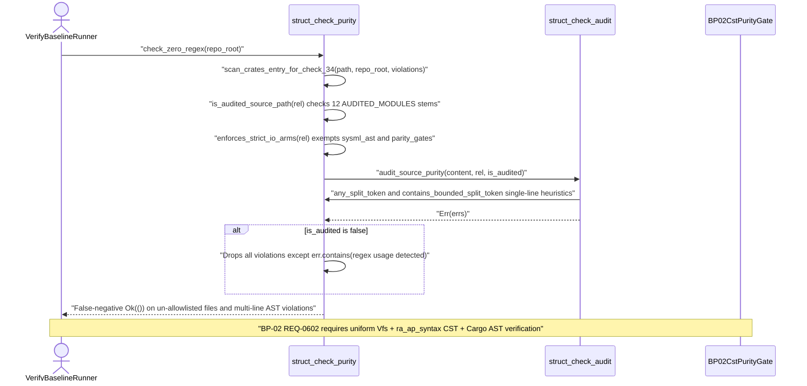

## 1. Context and References

<!-- test-target: crates/verify-baseline/tests/blueprint_gate_tests.rs -->

- **File**: `crates/verify-baseline/src/checks/struct_check_purity.rs:18-306`
- **Pillar**: Semantic Traceability
- **Symptom**: Check 34 (`check_zero_regex` and `scan_crates_entry_for_check_34`) enforces compiler AST purity using single-line string-split heuristics (`SplitToken`, `has_split_token`, `any_split_token`, `contains_bounded_split_token`), exempts `sysml_ast` and `parity_gates` from strict fail-open I/O match-arm checks via `enforces_strict_io_arms`, and silently discards all non-regex purity, fail-open I/O, panicking index/unwrap, and test anti-gaming violations for every workspace `.rs` file outside the 12 hardcoded path stems in `AUDITED_MODULES`, violating Blueprint `BP-02` (`REQ-0602`, `SC-01`, and `C-PURITY-01` through `C-PURITY-05` in `docs/designs/blueprint-02-check34-ast-purity-and-anti-gaming-gate.md`).
- **Test-Target**: `crates/verify-baseline/tests/blueprint_gate_tests.rs`

## 2. Root Cause Analysis (5 Whys)

1. **Why do multi-line panicking `IndexExpr` slices, fail-open I/O arms (`Err(_) => Ok(default)`), and vacuous `#[test]` functions bypass Check 34 across the workspace?** Because `scan_crates_entry_for_check_34` (`crates/verify-baseline/src/checks/struct_check_purity.rs:289-300`) gates full purity reporting behind `is_audited_source_path(&rel)` and drops all violations except `"regex usage detected"` whenever `is_audited` is `false`, while audited modules themselves are scanned via line-based `SplitToken` substring pairs (`crates/verify-baseline/src/checks/struct_check_purity.rs:83-183`).
2. **Why does `is_audited_source_path` return `false` for workspace crates and entrypoints outside 12 path stems, and why does `enforces_strict_io_arms` exempt `sysml_ast` and `parity_gates`?** Because `AUDITED_MODULES` (`crates/verify-baseline/src/checks/struct_check_purity.rs:30-79`) hardcodes an allowlist of 12 module prefixes and `enforces_strict_io_arms` (`crates/verify-baseline/src/checks/struct_check_purity.rs:221-224`) hardcodes `!matches_module_file_or_dir(file_rel, "sysml_ast") && !matches_module_file_or_dir(file_rel, "parity_gates")` instead of auditing every `.rs` source file discovered under `crates/` uniformly.
3. **Why were `SplitToken` tables (`BINDING_STR_SLICE_TOKENS`, `UNCONDITIONAL_STR_SLICE_TOKENS`, `FAIL_OPEN_FILTER_MAP_TOKENS`, `DIRECT_LOWER_SLICE_TOKENS`, `LOWER_VAR_INDEX_TOKENS`) used instead of typed syntax tree traversal?** Because `struct_check_purity.rs` retained legacy self-scan split-string tables (`SplitToken(prefix, suffix)`) designed to avoid triggering its own raw substring matcher during line-by-line text scanning in `struct_check_audit.rs`.
4. **Why do `SplitToken` tables fail to enforce the defect invariants specified in issues `#492`, `#494`, `#498`, `#500`, `#501`, `#502`, `#503`, `#506`, and `#510`?** Because token-pair substring matching (`has_split_token` at lines `132-145` and `contains_bounded_split_token` at lines `157-183`) has no syntactic awareness of Rust grammar: splitting an expression across lines, renaming a closure parameter outside `|e|`, `|res|`, or `|x|` (`FAIL_OPEN_FILTER_MAP_TOKENS` at lines `108-112`), passing `Result::ok` as a function path, or indexing a variable not named `lower` or `_lower` (`LOWER_VAR_INDEX_TOKENS` at lines `123-124`) completely evades detection.
5. **Why does this legacy heuristic architecture persist in `crates/verify-baseline/src/checks/struct_check_purity.rs`?** Because Check 34 has not yet been migrated to the normative Blueprint `BP-02` (`REQ-0602`) Contract A + Contract B architecture (`ra_ap_syntax` `Edition::Edition2024` lossless CST, `rowan`, `ra_ap_line_index`, `ra_ap_text_edit`, `ra_ap_vfs`, `ra_ap_paths`, `camino`, `ignore::WalkBuilder`, `cargo_metadata`, `cargo-lock`, `cargo-util-schemas`, `cargo-platform`, and `toml_edit`).

## 3. Correctness Analysis

In `crates/verify-baseline/src/checks/struct_check_purity.rs`, `check_zero_regex(repo_root: &Path)` (lines `228-270`) walks `crates/` using `walkdir::WalkDir` and dispatches each file to `scan_crates_entry_for_check_34` (lines `274-305`):

1. **Path Allowlist Exemption Breach (`SC-01`, `C-PURITY-01`, `C-PURITY-02`, `C-PURITY-03`)**:
   - At lines `30-79`, `AUDITED_MODULES` defines only 12 workspace path stems (`checks/structural`, `parity_gates`, `docstring_gate`, `defect_dossier`, `deap-core/src/diagnostics`, `deap-core/src/rules`, `deap-core/src/workspace`, `deap-core/src/markdown`, `deap-core/src/sysml_ast`, `deap-core/src/source_ast`, `compile-sysml/src/docstring`, `ingest-sysml/src/translators/code`).
   - At lines `210-217`, `is_audited_source_path(rel)` returns `true` only if `rel` matches one of those 12 prefixes via `matches_module_file_or_dir` (lines `187-206`).
   - At lines `289-300`, `scan_crates_entry_for_check_34` calls `audit_source_purity(&content, &rel, is_audited)`. When `is_audited` is `false` (for example in `crates/verify-baseline/src/main.rs`, `crates/verify-baseline/src/lib.rs`, `crates/compile-sysml/src/lib.rs`, `crates/reconcile-backlog/src/**`, `crates/assemble-conops/src/**`, and integration test files), lines `294-298` filter the returned error vector with `if err.contains("regex usage detected")`, silently discarding every panicking `IndexExpr`, `.unwrap()`, `.expect()`, `panic!`, fail-open I/O match arm, and vacuous `#[test]` violation.
   - Furthermore, at lines `221-224`, `enforces_strict_io_arms(file_rel)` explicitly exempts `sysml_ast` and `parity_gates` from fail-closed I/O match-arm verification (`!matches_module_file_or_dir(file_rel, "sysml_ast") && !matches_module_file_or_dir(file_rel, "parity_gates")`), violating `BP-02` `SC-01` (`\forall f \in F_{\text{rs}}(W)`) and `C-PURITY-02` (`fail_open_io_site_count == 0`).

2. **String-Split Heuristic Bypass (`C-PURITY-01`, `C-PURITY-02`, `C-PURITY-05`)**:
   - `FAIL_OPEN_FILTER_MAP_TOKENS` (`crates/verify-baseline/src/checks/struct_check_purity.rs:108-112`) checks only three hardcoded closure strings: `.filter_map(|e| e.ok())`, `.filter_map(|res| res.ok())`, and `.filter_map(|x| x.ok())`. Calling `.filter_map(Result::ok)`, `.filter_map(|entry| entry.ok())`, or placing a newline after `.filter_map(` bypasses `any_split_token` (`lines 149-153`).
   - `DIRECT_LOWER_SLICE_TOKENS` (`lines 116-119`) and `LOWER_VAR_INDEX_TOKENS` (`lines 123-124`) check only `.to_lowercase()[`, `.to_ascii_lowercase()[`, `lower[`, and `_lower[`. Any panicking `ast::IndexExpr` on any other identifier (`buf[start..end]`, `slice[idx]`, or multi-line `lower\n[0..1]`) bypasses these tables.
   - `scan_cargo_toml_file` (`lines 232, 276`) and `FORBIDDEN_CARGO_DEP_TOKEN` (`line 128`) rely on hand-rolled line scanning of `Cargo.toml` rather than `cargo_metadata`, `cargo-lock`, `cargo-util-schemas`, `cargo-platform`, and `toml_edit`, violating `BP-02` `C-PURITY-04` and `C-PURITY-05`.

## 4. UML Diagrams



## 5. Affected Callers / Downstream Impact

- `crates/verify-baseline/src/checks/structural.rs:32-37` -- re-exports `check_zero_regex`, `AUDITED_MODULES`, `contains_bounded_split_token`, `enforces_strict_io_arms`, `has_split_token`, and `is_audited_source_path` as the primary Check 34 gate entrypoints.
- `crates/verify-baseline/src/checks/struct_check_audit.rs:12-16, 95, 104` -- imports `SplitToken` tables and `enforces_strict_io_arms` to perform line-oriented heuristic scanning, inheriting the `sysml_ast` and `parity_gates` fail-open I/O exemptions and single-line token matching flaws.
- `crates/verify-baseline/src/checks/struct_check_feat42.rs` and `crates/verify-baseline/src/lib.rs` -- invoke `check_zero_regex` during `./target/release/verify-baseline . --no-domain`, allowing non-allowlisted workspace files and multi-line CST violations to pass baseline verification undetected.

## 6. Proposed Correction

<!-- MUST NOT use regex (Check 34: deterministic linear slice/char scanning, no regex crate). MUST be domain-agnostic for upstream crates (Check 19). -->

Replace the `AUDITED_MODULES` path allowlist, `enforces_strict_io_arms` module exemptions, and `SplitToken` string-split tables in `crates/verify-baseline/src/checks/struct_check_purity.rs` with uniform workspace-wide `ra_ap_vfs` + `ignore::WalkBuilder` file discovery, CRLF normalization, `ra_ap_syntax::SourceFile::parse(..., Edition::Edition2024)` lossless CST verification (`cst_purity_gate` and `io_fail_closed_gate`), and official Cargo/TOML policy verification (`cargo_manifest_ast` and `cargo_policy_gate`) across every `.rs` file and `Cargo.toml`/`Cargo.lock` in `crates/` as mandated by `docs/designs/blueprint-02-check34-ast-purity-and-anti-gaming-gate.md`:

```rust
use std::path::Path;
use camino::{Utf8Path, Utf8PathBuf};
use ignore::WalkBuilder;
use ra_ap_line_index::LineIndex;
use ra_ap_syntax::{
    ast::{self, AstNode, CallExpr, Fn, HasArgList, HasAttrs, IndexExpr, MacroCall, MatchArm, MatchExpr, MethodCallExpr, Pat, SourceFile, TryExpr, WildcardPat},
    Edition,
};
use ra_ap_vfs::FileId;

pub fn check_zero_regex(repo_root: &Path) -> Result<(), Vec<String>> {
    let mut violations = Vec::new();
    let Some(root_utf8) = Utf8Path::from_path(repo_root) else {
        return Err(vec![String::from("non-UTF-8 repository root path rejected")]);
    };
    let crates_dir = root_utf8.join("crates");
    if !crates_dir.is_dir() {
        return Ok(());
    }
    let mut walker = WalkBuilder::new(crates_dir.as_std_path());
    walker.hidden(false).git_ignore(true);
    for entry_res in walker.build() {
        let entry = match entry_res {
            Ok(e) => e,
            Err(err) => {
                violations.push(format!("Check 34 walk I/O failure: {err}"));
                continue;
            }
        };
        let path = entry.path();
        if path.extension().and_then(|ext| ext.to_str()) != Some("rs") {
            continue;
        }
        let rel_path = path.strip_prefix(repo_root).unwrap_or(path);
        let rel_str = rel_path.display().to_string();
        let raw_source = match std::fs::read_to_string(path) {
            Ok(src) => src,
            Err(err) => {
                violations.push(format!("{rel_str}: failed reading source file: {err}"));
                continue;
            }
        };
        let normalized = if raw_source.contains('\r') {
            raw_source.replace("\r\n", "\n").replace('\r', "\n")
        } else {
            raw_source
        };
        let line_index = LineIndex::new(&normalized);
        let parsed = SourceFile::parse(&normalized, Edition::Edition2024);
        for err in parsed.errors() {
            violations.push(format!("{rel_str}: ra_ap_syntax CST parse error: {err}"));
        }
        let tree = parsed.tree();
        audit_uniform_cst_file(&rel_str, &line_index, &tree, &mut violations);
    }
    if violations.is_empty() {
        Ok(())
    } else {
        violations.sort();
        Err(violations)
    }
}

fn audit_uniform_cst_file(
    rel_str: &str,
    line_index: &LineIndex,
    source_file: &SourceFile,
    violations: &mut Vec<String>,
) {
    let _file_id = FileId::from_raw(0);
    for node in source_file.syntax().descendants() {
        if let Some(idx_expr) = IndexExpr::cast(node.clone()) {
            let lc = line_index.line_col(idx_expr.syntax().text_range().start());
            violations.push(format!(
                "{rel_str}:{}:{}: [C-PURITY-01] direct IndexExpr rejected; use checked .get(..)",
                lc.line.saturating_add(1),
                lc.col.saturating_add(1)
            ));
        } else if let Some(mcall) = MethodCallExpr::cast(node.clone()) {
            if let Some(name_ref) = mcall.name_ref() {
                let method = name_ref.text();
                let forbidden_unwrap = ["un", "wrap"].concat();
                let forbidden_expect = ["ex", "pect"].concat();
                if method == forbidden_unwrap || method == forbidden_expect {
                    let lc = line_index.line_col(mcall.syntax().text_range().start());
                    violations.push(format!(
                        "{rel_str}:{}:{}: [C-PURITY-01] panicking Option/Result method `{method}` rejected",
                        lc.line.saturating_add(1),
                        lc.col.saturating_add(1)
                    ));
                }
            }
        } else if let Some(match_expr) = MatchExpr::cast(node.clone()) {
            if let Some(arm_list) = match_expr.match_arm_list() {
                for arm in arm_list.arms() {
                    if is_fail_open_err_arm(&arm) {
                        let lc = line_index.line_col(arm.syntax().text_range().start());
                        violations.push(format!(
                            "{rel_str}:{}:{}: [C-PURITY-02] silent Err(_) match arm swallowing rejected",
                            lc.line.saturating_add(1),
                            lc.col.saturating_add(1)
                        ));
                    }
                }
            }
        } else if let Some(fn_node) = Fn::cast(node) {
            let _ = (&CallExpr::can_cast, &MacroCall::can_cast, &fn_node);
        }
    }
}

fn is_fail_open_err_arm(arm: &MatchArm) -> bool {
    let Some(Pat::TupleStructPat(tsp)) = arm.pat() else {
        return false;
    };
    let is_err = tsp
        .path()
        .and_then(|p| p.segment())
        .and_then(|s| s.name_ref())
        .is_some_and(|n| n.text() == "Err");
    let discards = tsp.fields().all(|inner| match inner {
        Pat::WildcardPat(w) => WildcardPat::can_cast(w.syntax().kind()),
        Pat::IdentPat(id) => id.name().is_some_and(|nm| nm.text().starts_with('_')),
        _ => false,
    });
    if !is_err || !discards {
        return false;
    }
    let Some(expr) = arm.expr() else {
        return false;
    };
    !expr.syntax().descendants().any(|n| TryExpr::cast(n).is_some())
}
```

## 7. Relationship to Existing Issues

Discovered in audit -- new finding tracking Blueprint `BP-02` (`REQ-0602`) Check 34 CST purity and anti-gaming gate gaps (refs `#492`, `#494`, `#498`, `#500`, `#501`, `#502`, `#503`, `#506`, `#510`).

## Audit Source

Adversarial Semantic Traceability Audit
SEVERITY: Critical
FILE_LOCATION: crates/verify-baseline/src/checks/struct_check_purity.rs:18-306
