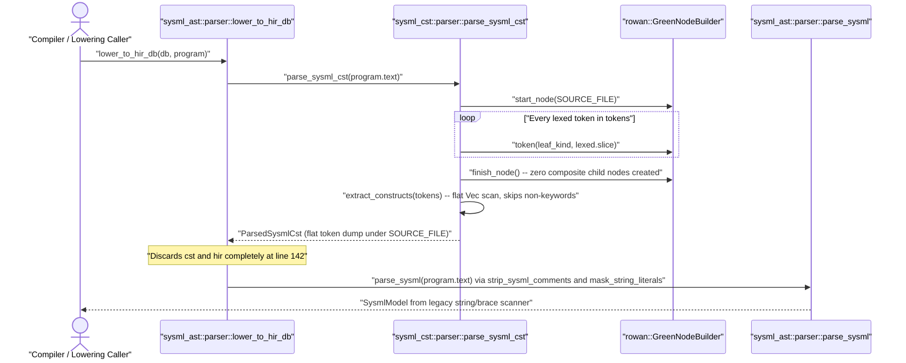

## 1. Context and References

<!-- test-target: crates/deap-core/tests/sysml_cst_parser_tests.rs -->

- **File**: `crates/deap-core/src/sysml_cst/parser.rs:150-246`
- **Pillar**: Semantic Traceability
- **Symptom**: `parse_sysml_cst` emits a flat token dump directly under a single root `SysmlSyntaxKind::SOURCE_FILE` node (`builder.start_node` is called only once at line 156 and `syntax().children().count() == 0`) instead of constructing a recursive 6-clause Rowan Red/Green CST as mandated by `BP-03` (`docs/designs/blueprint-03-sysml-ast-bijective-roundtrip-compiler-gate.md`, REQ-0603, Contract A, SC-01, SC-02), while `lower_to_hir_db` in `crates/deap-core/src/sysml_ast/parser.rs:136-143` discards the CST/HIR result and delegates back to the legacy string-slicing `parse_sysml(&program.text)` scanner.
- **Test-Target**: `crates/deap-core/tests/sysml_cst_parser_tests.rs`

## 2. Root Cause Analysis (5 Whys)

1. **Why do existing CST and roundtrip tests pass while `parse_sysml_cst` produces zero composite child nodes under `SOURCE_FILE`?** Because `ParsedSysmlCst::lossless_roundtrip_eq` (`crates/deap-core/src/sysml_cst/parser.rs:189`) only asserts that concatenating flat leaf token slices under `SOURCE_FILE` equals the input string (`SysmlSyntaxNode::new_root(green.clone()).text() == source`), and construct tests inspect the side-channel `Vec<SysmlConstructSummary>` returned by `extract_constructs` rather than traversing typed Rowan composite `SyntaxNode` children.
2. **Why are SysML v2 constructs returned via a flat `Vec<SysmlConstructSummary>` side vector (`crates/deap-core/src/sysml_cst/parser.rs:200-246`) instead of hierarchical Rowan `GreenNode` subtrees?** Because `parse_sysml_cst` (`crates/deap-core/src/sysml_cst/parser.rs:156-177`) wraps the entire token stream in a single `builder.start_node(SysmlSyntaxKind::SOURCE_FILE.into())` / `builder.finish_node()` pair and never opens or closes composite `SysmlSyntaxKind` nodes (`PACKAGE_DECL`, `PART_DEF`, `PORT_DEF`, `STATE_DEF`, `TRANSITION_DECL`, `REQUIREMENT_DEF`, `CALC_DEF`, `CONSTRAINT_DEF`) during parsing.
3. **Why did `parse_sysml_cst` omit recursive composite `GreenNodeBuilder` node construction for Clauses 1 through 6?** Because `extract_constructs` was implemented as a shallow keyword-header scanner (`classify_keyword_kind`, `extract_construct_name`, `find_construct_end`) to satisfy basic construct-discovery assertions without implementing the `BP-03` recursive 6-clause CST grammar (`parser_clauses_1_3`, `parser_clauses_4_6`) or typed `rowan::ast::AstNode` wrappers (`hir_lower`).
4. **Why does downstream model lowering (`lower_to_hir_db` in `crates/deap-core/src/sysml_ast/parser.rs:136-143`) still appear to populate `SysmlModel` even though the Rowan CST has zero composite structure?** Because `lower_to_hir_db` invokes `db.parse_sysml_green(program)` and `db.lower_sysml_hir(program)` only for a non-empty guard check and then immediately discards both outputs to call the legacy hand-rolled string/brace scanner `parse_sysml(&program.text)` (`crates/deap-core/src/sysml_ast/parser.rs:78-119`).
5. **Why was this semantic traceability gap not caught by verification tests?** Because no test asserted that `cst.syntax().children()` contains nested composite `SysmlSyntaxKind` CST nodes across the 6 normative SysML v2.0 + KerML 1.0 grammar clauses or verified that `SysmlModel` / HIR lowering derives exclusively from typed Rowan CST nodes without calling legacy string-masking scanners (`strip_sysml_comments`, `mask_string_literals`).

## 3. Correctness Analysis

`docs/designs/blueprint-03-sysml-ast-bijective-roundtrip-compiler-gate.md` (REQ-0603, Section 1 Contract A, Section 2 `C-RT-01`..`C-RT-04`, and Section 5 `AC-01`..`AC-04`) mandates that `deap_core::sysml_cst` implement all 6 normative OMG SysML v2.0 + KerML 1.0 BNF grammar clauses as a recursive, lossless Rowan Red/Green CST (`SyntaxNode<SysmlLanguage>`) with typed `rowan::ast::AstNode` CST-to-HIR lowering and net-negative deletion of the legacy `sysml_ast` hand-rolled char/string scanners (`-2,400+` SLOC).

In `crates/deap-core/src/sysml_cst/parser.rs`:
1. **Violation of Recursive 6-Clause Rowan CST Invariant (`BP-03` Contract A & `AC-01`)**: At `crates/deap-core/src/sysml_cst/parser.rs:156-177`, `parse_sysml_cst` calls `builder.start_node(SysmlSyntaxKind::SOURCE_FILE.into())`, iterates over `&tokens` calling `builder.token(kind.into(), lexed.slice)` for every leaf token, and calls `builder.finish_node()`. None of the composite `SysmlSyntaxKind` variants mapped in `classify_keyword_kind` (`crates/deap-core/src/sysml_cst/parser.rs:99-137`, such as `PACKAGE_DECL`, `IMPORT_DECL`, `METADATA_DEF`, `PART_DEF`, `PORT_DEF`, `ACTION_DEF`, `STATE_DEF`, `TRANSITION_DECL`, `CALC_DEF`, `CONSTRAINT_DEF`, `REQUIREMENT_DEF`, `USE_CASE_DEF`, `VERIFICATION_DEF`, `VIEW_DEF`) are ever passed to `builder.start_node(...)`. Consequently, `parsed.syntax().children().count()` is identically `0` for every input document.
2. **Shallow Side-Vector Scan & Span Overlap (`crates/deap-core/src/sysml_cst/parser.rs:200-246`)**: `extract_constructs` scans `non_trivia` linearly, computes `span_end` via `find_construct_end` (matching `{` / `}` depth to the end of an outer block), and then advances `idx = next_cursor.max(idx + 1)` into the body without building parent-child CST relationships, silently ignoring any unrecognized tokens (`base_kind == SysmlSyntaxKind::ERROR_NODE` at lines 215-218 violates `C-RT-02`: `silent_skip_branch_count == 0`).
3. **Bypassed CST-to-HIR Lowering (`crates/deap-core/src/sysml_ast/parser.rs:136-143`)**: `lower_to_hir_db` calls `let cst = db.parse_sysml_green(program); let hir = db.lower_sysml_hir(program);` and then discards both variables, returning `parse_sysml(&program.text)` at line 142. `parse_sysml` (`crates/deap-core/src/sysml_ast/parser.rs:78-119`) executes pre-parse text mutation (`strip_sysml_comments`, `mask_string_literals`) and substring searches (`s.find("package")`, `find_matching_brace`), directly violating `BP-03` Section 1 (`Zero pre-lexer text rewrites`, `Net-Negative Legacy Deletion Targets`).

## 4. UML Diagrams



## 5. Affected Callers / Downstream Impact

- `crates/deap-core/src/sysml_cst/parser.rs:150` (`parse_sysml_cst`) -- Produces a flat token stream under `SOURCE_FILE` with zero composite `SysmlSyntaxNode` children (`syntax().children().count() == 0`), preventing typed `rowan::ast::AstNode` traversal across all 6 normative SysML v2.0 + KerML 1.0 clauses.
- `crates/deap-core/src/sysml_cst/mod.rs` (`SysmlCompilerDb::parse_sysml_green`, `SysmlCompilerDb::lower_sysml_hir`) -- Memoizes flat `SysmlConstructSummary` records instead of a recursive 6-clause CST and typed HIR package.
- `crates/deap-core/src/sysml_ast/parser.rs:136` (`lower_to_hir_db`) -- Discards `db.parse_sysml_green(program)` and `db.lower_sysml_hir(program)` and falls back to `parse_sysml(&program.text)` legacy string-masking/brace scanning.
- `crates/compile-sysml` and `crates/ingest-sysml` -- Downstream compiler and ingestion pipelines cannot rely on typed Rowan CST nodes (`PackageDeclNode`, `PartDefNode`, `StateDefNode`, `TransitionDeclNode`, `RequirementDefNode`, `KermlExpressionNode`) or fail-closed `E0200` diagnostics when unrecognized inner tokens occur.

## 6. Proposed Correction

<!-- MUST NOT use regex (Check 34: deterministic linear slice/char scanning, no regex crate). MUST be domain-agnostic for upstream crates (Check 19). -->

Implement recursive descent composite node construction over `rowan::GreenNodeBuilder` so that `parse_sysml_cst` wraps every package, import, metadata, structural, behavioral, requirement, verification, and expression construct in its nested composite `SysmlSyntaxKind` node (`PACKAGE_DECL`, `PART_DEF`, `STATE_DEF`, `TRANSITION_DECL`, etc.) while preserving all trivia tokens in-place, and lower `SysmlModel` / HIR directly from the typed Rowan `SysmlSyntaxNode` tree rather than delegating to legacy string-masking scanners:

```rust
use rowan::GreenNodeBuilder;
use super::lexer::{tokenize_sysml, LexedSysmlToken, SysmlToken};
use super::syntax_kind::{token_to_syntax_kind, SysmlSyntaxKind, SysmlSyntaxNode};

pub fn build_recursive_cst_node(
    builder: &mut GreenNodeBuilder<'static>,
    tokens: &[LexedSysmlToken<'_>],
    mut idx: usize,
    stop_on_rbrace: bool,
) -> usize {
    while let Some(lexed) = tokens.get(idx) {
        if matches!(
            lexed.token,
            SysmlToken::Whitespace | SysmlToken::LineComment | SysmlToken::BlockComment
        ) {
            builder.token(token_to_syntax_kind(lexed.token).into(), lexed.slice);
            idx += 1;
            continue;
        }
        if stop_on_rbrace && lexed.token == SysmlToken::RBrace {
            break;
        }
        let is_def = scan_ahead_is_def(tokens, idx);
        let composite_kind = classify_keyword_kind(lexed.slice, is_def);
        if composite_kind != SysmlSyntaxKind::ERROR_NODE {
            builder.start_node(composite_kind.into());
            idx = consume_construct_subtree(builder, tokens, idx);
            builder.finish_node();
        } else {
            builder.token(token_to_syntax_kind(lexed.token).into(), lexed.slice);
            idx += 1;
        }
    }
    idx
}

fn scan_ahead_is_def(tokens: &[LexedSysmlToken<'_>], start: usize) -> bool {
    let mut cursor = start + 1;
    while let Some(tok) = tokens.get(cursor) {
        if matches!(
            tok.token,
            SysmlToken::Whitespace | SysmlToken::LineComment | SysmlToken::BlockComment
        ) {
            cursor += 1;
            continue;
        }
        if tok.slice == "case" || tok.slice == "package" {
            cursor += 1;
            continue;
        }
        return tok.token == SysmlToken::DefKw;
    }
    false
}

fn consume_construct_subtree(
    builder: &mut GreenNodeBuilder<'static>,
    tokens: &[LexedSysmlToken<'_>],
    mut idx: usize,
) -> usize {
    while let Some(lexed) = tokens.get(idx) {
        let leaf_kind = token_to_syntax_kind(lexed.token);
        builder.token(leaf_kind.into(), lexed.slice);
        idx += 1;
        match lexed.token {
            SysmlToken::Semi => break,
            SysmlToken::LBrace => {
                idx = build_recursive_cst_node(builder, tokens, idx, true);
                if let Some(close_tok) = tokens.get(idx) {
                    if close_tok.token == SysmlToken::RBrace {
                        builder.token(
                            token_to_syntax_kind(close_tok.token).into(),
                            close_tok.slice,
                        );
                        idx += 1;
                    }
                }
                break;
            }
            _ => {}
        }
    }
    idx
}
```

## 7. Relationship to Existing Issues

Discovered in audit -- new finding (tracks `BP-03` / `REQ-0603` implementation gap across `#493`, `#495`, `#496`, `#504`).

## Audit Source

Adversarial Semantic Traceability Audit
SEVERITY: Critical
FILE_LOCATION: crates/deap-core/src/sysml_cst/parser.rs:150-246
