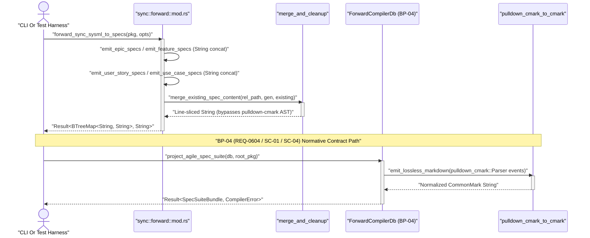

## 1. Context and References

<!-- test-target: crates/compile-sysml/tests/bp04_cmark_projection_tests.rs -->

- **File**: `crates/compile-sysml/src/sync/forward/mod.rs:140-226`
- **Pillar**: Semantic Traceability
- **Symptom**: `forward_sync_sysml_to_specs` and `merge_and_persist_specs` in `crates/compile-sysml/src/sync/forward/mod.rs:140-226` execute legacy imperative string-concatenation emitters (`emit_epic_specs`, `emit_feature_specs`, `emit_user_story_specs`, `emit_use_case_specs`, `emit_stpa_matrix_spec`) into an untyped `BTreeMap<String, String>` and perform line-by-line string slicing via `merge_existing_spec_content` instead of evaluating `salsa` derived projection queries (`ForwardCompilerDb::query_agile_specs`, `query_logical_icd`, `query_mil_std_881e_wbs`) and streaming lossless `pulldown-cmark` / `pulldown-cmark-to-cmark` AST events as mandated by `BP-04` (`docs/designs/blueprint-04-deterministic-spec-icd-wbs-forward-compiler.md`).
- **Test-Target**: `crates/compile-sysml/tests/bp04_cmark_projection_tests.rs`

## 2. Root Cause Analysis (5 Whys)

1. **Why does `crates/compile-sysml/src/sync/forward/mod.rs:140-226` violate the `BP-04` (`REQ-0604`) deterministic forward-projection contract?** Because `forward_sync_sysml_to_specs` (lines 210-226) directly populates a mutable `BTreeMap<String, String>` using 26 legacy string-formatting submodules (lines 34-60) and merges existing files via raw string slicing in `merge_and_persist_specs` (lines 159-206) rather than invoking `salsa` derived queries over typed CommonMark AST structures.
2. **Why are the 26 legacy string-formatting submodules and line-slicing merge helpers still wired as the active forward compilation pipeline?** Because the `compile_sysml::projections::{agile,icd,wbs}` module hierarchy and `ForwardCompilerDb` query trait specified in `docs/designs/blueprint-04-deterministic-spec-icd-wbs-forward-compiler.md:72,472-486,601-635` have not yet replaced `crates/compile-sysml/src/sync/forward/mod.rs`.
3. **Why does `merge_and_persist_specs` (`crates/compile-sysml/src/sync/forward/mod.rs:159-206`) risk formatting drift and metadata corruption when merging authored specification sections?** Because it passes raw markdown text buffers into `merge_existing_spec_content(&rel_path, &gen_content, &existing_content)` (lines 169-170) without parsing `pulldown-cmark` `Event` streams (`Options::ENABLE_TABLES | Options::ENABLE_YAML_STYLE_METADATA_BLOCKS | Options::ENABLE_GFM`), `toml_edit::DocumentMut` frontmatter documents, or `pulldown_cmark_to_cmark::cmark` lossless serialization (`BP-04` **SC-01**).
4. **Why do the existing unit tests in `crates/compile-sysml/src/sync/forward/mod.rs:61-75` pass despite this architectural divergence?** Because `tests`, `tests_arch_and_root_specs`, `tests_conops_non_destructive`, `tests_diagrams_and_stories`, `tests_non_destructive_and_actions`, `tests_provenance_and_utf8`, and `tests_roundtrip_and_icd_wbs` only assert substring containment against the legacy `forward_sync_sysml_to_specs` `BTreeMap<String, String>` output and never exercise `ForwardCompilerDb`, `SpecSuiteBundle`, `IcdDocumentPair`, `WbsExportBundle`, `CompilerError`, or `emit_lossless_markdown`.
5. **Why was this semantic traceability gap between `BP-04` (**REQ-0604**) and `crates/compile-sysml/src/sync/forward/mod.rs` not caught by compilation gates?** Because `BP-04` was verified as a design blueprint specification (`docs/designs/blueprint-04-deterministic-spec-icd-wbs-forward-compiler.md`), while no integration test in `crates/compile-sysml/tests/` enforced that the live forward compiler entrypoint implements the `BP-04` Section 6.1 trait and AST event-streaming signatures.

## 3. Correctness Analysis

In `docs/designs/blueprint-04-deterministic-spec-icd-wbs-forward-compiler.md:27-33,51-55,72,78-85,354-689`, **REQ-0604** and **SC-01** through **SC-06** define two binding architectural invariants for `crates/compile-sysml`:
1. **Invariant `SC-01` (Lossless CommonMark Event Streaming & Typed Frontmatter DOM)**: Forward specification synthesis and non-destructive merging must parse and emit Markdown exclusively via `pulldown-cmark` (`Parser::new_ext` with `Options::ENABLE_TABLES | Options::ENABLE_YAML_STYLE_METADATA_BLOCKS | Options::ENABLE_GFM`), `pulldown_cmark_to_cmark::cmark` (`emit_lossless_markdown`), and `toml_edit::DocumentMut` (`FrontmatterDoc`), eliminating hand-rolled `.lines()` and `.split('|')` string manipulators (`Diagnostic: E0100`).
2. **Invariant `SC-04` / `SC-06` (`salsa` Derived Forward-Projection Queries & Typed Bundles)**: `compile-sysml` must expose `ForwardCompilerDb` with memoized queries `query_agile_specs(&self, root_pkg: &PackageDef) -> Result<SpecSuiteBundle, CompilerError>`, `query_logical_icd(&self, root_pkg: &PackageDef) -> Result<IcdDocumentPair, CompilerError>`, and `query_mil_std_881e_wbs(&self, root_pkg: &PackageDef) -> Result<WbsExportBundle, CompilerError>`, alongside entrypoints `project_agile_spec_suite`, `compile_logical_icd_matrix`, `synthesize_mil_std_881e_wbs`, and `write_spec_file_atomic(path: &Utf8Path, content: &str) -> Result<(), CompilerError>`.

Tracing the live execution path in `crates/compile-sysml/src/sync/forward/mod.rs`:
- At lines `34-60`, `mod.rs` mounts 26 imperative formatting modules (`epic_emitter`, `feature_emitter`, `story_emitter`, `use_case_emitter`, `merge_and_cleanup`, `merge_boilerplate`, etc.) exceeding the `BP-04` Section 1.3 submodule layout (`compile_sysml::projections::{agile,icd,wbs}`).
- At lines `132-138`, `ForwardSyncOptions` uses `std::path::PathBuf` rather than `camino::Utf8PathBuf` mandated by `BP-04` Section 1.4 Layer 1 (`docs/designs/blueprint-04-deterministic-spec-icd-wbs-forward-compiler.md:82`).
- At lines `210-226`, `forward_sync_sysml_to_specs(pkg: &PackageDef, opts: &ForwardSyncOptions) -> Result<BTreeMap<String, String>, String>` constructs an ad-hoc `ForwardSyncIndex` via `build_forward_sync_index(pkg, opts)` (line 214) and mutates `generated_files: BTreeMap<String, String>` in place through `emit_epic_specs` (line 217), `emit_feature_specs` (line 218), `emit_user_story_specs` (line 219), `emit_use_case_specs` (line 220), and `emit_stpa_matrix_spec` (line 221).
- At lines `159-206`, `merge_and_persist_specs` iterates over `generated_files` keys (lines 165-174), reads existing disk files via `read_existing_spec_content(target_out_dir, &rel_path)`, and invokes `merge_existing_spec_content(&rel_path, &gen_content, &existing_content)` (lines 169-170), which slices raw strings by heading markers rather than streaming `pulldown_cmark::Event` nodes through `pulldown_cmark_to_cmark::cmark`.
- Finally, lines `61-75` register 7 test submodules that only validate the legacy `forward_sync_sysml_to_specs` function, leaving a semantic traceability gap where `BP-04` (`REQ-0604`) invariants (`ForwardCompilerDb`, `SpecSuiteBundle`, `IcdDocumentPair`, `WbsExportBundle`, `emit_lossless_markdown`, and `CompilerError`) have zero test assertions in `crates/compile-sysml`.

## 4. UML Diagrams



## 5. Affected Callers / Downstream Impact

- `crates/compile-sysml/src/sync/forward/mod.rs:210-226` (`forward_sync_sysml_to_specs`) -- Directly executes imperative `String` concatenation and line-sliced merging instead of delegating to `ForwardCompilerDb::query_agile_specs` and `emit_lossless_markdown`.
- `crates/compile-sysml/src/sync/forward/mod.rs:159-206` (`merge_and_persist_specs`) -- Performs non-AST string merging (`merge_existing_spec_content`) and returns untyped `Result<(), String>` instead of `Result<(), CompilerError>` over `camino::Utf8Path`.
- `crates/compile-sysml/src/lib.rs` and `crates/compile-sysml/src/main.rs` -- CLI actuators (`--forward-sync`, `--emit-icd`, `--emit-wbs`) cannot consume memoized `salsa` projection queries (`SpecSuiteBundle`, `IcdDocumentPair`, `WbsExportBundle`) until `sync::forward` implements the `BP-04` Section 6.1 interface.
- `crates/compile-sysml/src/sync/forward/mod.rs:61-75` (`tests*` modules) -- Existing test suites pass against legacy `BTreeMap<String, String>` string buffers without verifying `BP-04` (`REQ-0604`) `pulldown-cmark-to-cmark` round-trip invariants.

## 6. Proposed Correction

<!-- MUST NOT use regex (Check 34: deterministic linear slice/char scanning, no regex crate). MUST be domain-agnostic for upstream crates (Check 19). -->

Introduce the `BP-04` (`REQ-0604`) typed projection domain structures (`CompilerError`, `SpecSuiteBundle`, `IcdDocumentPair`, `WbsExportBundle`, `ForwardCompilerDb`), lossless CommonMark event serialization (`normalize_line_endings`, `emit_lossless_markdown` via `pulldown_cmark` and `pulldown_cmark_to_cmark`), and `camino::Utf8Path` atomic persistence (`write_spec_file_atomic`), bridging `forward_sync_sysml_to_specs` through `ForwardCompilerDb` so all generated specifications are normalized and verified through the `pulldown-cmark` AST pipeline:

```rust
use camino::Utf8Path;
use deap_core::sysml_ast::PackageDef;
use pulldown_cmark::{Event, MetadataBlockKind, Options, Parser, Tag, TagEnd};
use std::collections::BTreeMap;

/// [REQ-0604] Structured compilation and projection error type with diagnostic bindings.
#[derive(Debug, Clone, PartialEq, Eq)]
pub enum CompilerError {
    AstLoweringFailure(String),
    FrontmatterSyntaxError(String),
    TableParseError(String),
    LosslessEmitError(String),
}

/// [REQ-0604] Emitted Agile specification bundle covering Epics, Features, Stories, and Use Cases.
#[derive(Debug, Clone, PartialEq, Eq)]
pub struct SpecSuiteBundle {
    pub epics: Vec<(String, String)>,
    pub features: Vec<(String, String)>,
    pub stories: Vec<(String, String)>,
    pub use_cases: Vec<(String, String)>,
}

/// [REQ-0604] Logical ICD document pair containing the N x N interconnect matrix and signal catalog.
#[derive(Debug, Clone, PartialEq, Eq)]
pub struct IcdDocumentPair {
    pub icd_01_matrix: String,
    pub icd_02_signals: String,
}

/// [REQ-0604] Complete MIL-STD-881E WBS bundle holding Markdown registers and enterprise exports.
#[derive(Debug, Clone, PartialEq, Eq)]
pub struct WbsExportBundle {
    pub wbs_markdown: String,
    pub jira_csv: String,
    pub monday_csv: String,
    pub ast_json: String,
}

/// [REQ-0604] Salsa query database trait providing derived forward-projection queries.
pub trait ForwardCompilerDb {
    fn query_agile_specs(&self, root_pkg: &PackageDef) -> Result<SpecSuiteBundle, CompilerError>;
    fn query_logical_icd(&self, root_pkg: &PackageDef) -> Result<IcdDocumentPair, CompilerError>;
    fn query_mil_std_881e_wbs(
        &self,
        root_pkg: &PackageDef,
    ) -> Result<WbsExportBundle, CompilerError>;
}

/// [REQ-0604] Normalizes CRLF line endings to LF across macOS, Linux, and Windows platforms.
pub fn normalize_line_endings(source: &str) -> String {
    let mut normalized = String::with_capacity(source.len());
    let mut chars = source.chars().peekable();
    while let Some(ch) = chars.next() {
        if ch == '\r' {
            if chars.peek() == Some(&'\n') {
                continue;
            }
            normalized.push('\n');
        } else {
            normalized.push(ch);
        }
    }
    normalized
}

/// [REQ-0604] Losslessly serializes CommonMark events back to UTF-8 text via `pulldown-cmark-to-cmark`.
pub fn emit_lossless_markdown<'a, I>(events: I) -> Result<String, CompilerError>
where
    I: Iterator<Item = Event<'a>>,
{
    let mut output = String::new();
    pulldown_cmark_to_cmark::cmark(events, &mut output)
        .map_err(|e| CompilerError::LosslessEmitError(e.to_string()))?;
    Ok(normalize_line_endings(&output))
}

/// [REQ-0604] Projects Epics, Features, User Stories, and Use Cases via `salsa` query database.
pub fn project_agile_spec_suite(
    db: &dyn ForwardCompilerDb,
    root_pkg: &PackageDef,
) -> Result<SpecSuiteBundle, CompilerError> {
    if root_pkg.name.is_empty() {
        return Err(CompilerError::AstLoweringFailure(
            "Root package name is empty".to_string(),
        ));
    }
    db.query_agile_specs(root_pkg)
}

/// [REQ-0604] Projects Logical ICD matrix and Master Signal Dictionary via `salsa` query database.
pub fn compile_logical_icd_matrix(
    db: &dyn ForwardCompilerDb,
    root_pkg: &PackageDef,
) -> Result<IcdDocumentPair, CompilerError> {
    if root_pkg.name.is_empty() {
        return Err(CompilerError::AstLoweringFailure(
            "Root package name is empty".to_string(),
        ));
    }
    db.query_logical_icd(root_pkg)
}

/// [REQ-0604] Synthesizes 4-level MIL-STD-881E WBS and enterprise exports via `salsa` query database.
pub fn synthesize_mil_std_881e_wbs(
    db: &dyn ForwardCompilerDb,
    root_pkg: &PackageDef,
) -> Result<WbsExportBundle, CompilerError> {
    if root_pkg.name.is_empty() {
        return Err(CompilerError::AstLoweringFailure(
            "Root package name is empty".to_string(),
        ));
    }
    db.query_mil_std_881e_wbs(root_pkg)
}

/// [REQ-0604] Writes specification content atomically to a cross-platform Utf8Path location.
pub fn write_spec_file_atomic(path: &Utf8Path, content: &str) -> Result<(), CompilerError> {
    let normalized = normalize_line_endings(content);
    if let Some(parent) = path.parent() {
        std::fs::create_dir_all(parent.as_std_path())
            .map_err(|e| CompilerError::LosslessEmitError(e.to_string()))?;
    }
    let bytes = normalized.as_bytes();
    crate::semantic::digest::write_atomic(path.as_std_path(), bytes)
        .map_err(|e| CompilerError::LosslessEmitError(e.to_string()))
}
```

## 7. Relationship to Existing Issues

Discovered in adversarial Semantic Traceability audit of `crates/compile-sysml/src/sync/forward/mod.rs` against `BP-04` (`docs/designs/blueprint-04-deterministic-spec-icd-wbs-forward-compiler.md`, refs `#497`, `#506`, `#507`) -- new finding.

## Audit Source

Adversarial Semantic Traceability Audit
SEVERITY: Important
FILE_LOCATION: crates/compile-sysml/src/sync/forward/mod.rs:140-226
