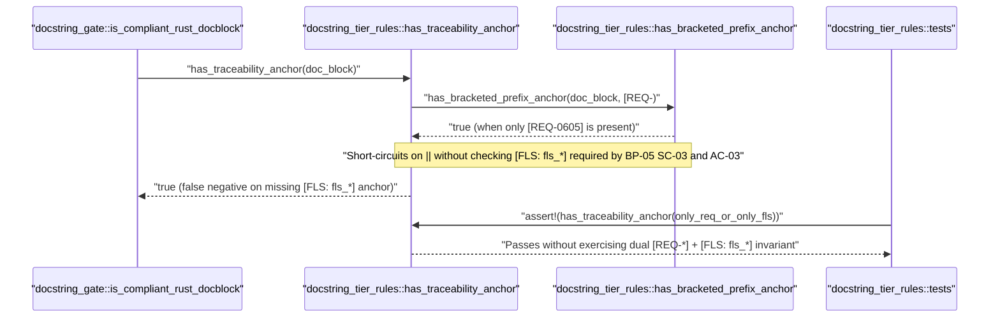

## 1. Context and References

<!-- test-target: crates/verify-baseline/tests/blueprint_gate_tests.rs -->

- **File**: `crates/verify-baseline/src/checks/docstring_tier_rules.rs:59-167`
- **Pillar**: Semantic Traceability
- **Symptom**: `has_traceability_anchor` and its unit tests in `docstring_tier_rules.rs` validate `[REQ-*]` OR `[FLS: fls_*]` via logical disjunction (`||`) without providing or testing the mandatory `BP-05` (`REQ-0605`, `SC-03`, `AC-03`) dual-anchor conjunction requiring both `[REQ-*]` and `[FLS: fls_*]` traceability anchors on Contract B Tier-B/C docstrings.
- **Test-Target**: `crates/verify-baseline/tests/blueprint_gate_tests.rs`

## 2. Root Cause Analysis (5 Whys)

1. **Why does `docstring_tier_rules.rs` accept Tier-B/C docblocks that contain only `[REQ-*]` or only `[FLS: fls_*]` when `BP-05` (`SC-03`, `AC-03`) mandates both anchors?** Because `has_traceability_anchor` (`crates/verify-baseline/src/checks/docstring_tier_rules.rs:59-65`) evaluates `has_bracketed_prefix_anchor(doc_block, "[REQ-") || has_bracketed_prefix_anchor(doc_block, "[FLS: fls_") || has_bracketed_prefix_anchor(doc_block, "Realises: [")` using logical disjunction (`||`) instead of enforcing or exposing a dual-anchor conjunction predicate.
2. **Why was `has_traceability_anchor` implemented with logical disjunction (`||`) instead of enforcing both `[REQ-*]` and `[FLS: fls_*]`?** Because `docstring_tier_rules.rs` combined legacy `Realises: [...]` tag checks with `BP-05` bracketed anchor checks into a single permissive boolean helper and left `has_bracketed_prefix_anchor` (`crates/verify-baseline/src/checks/docstring_tier_rules.rs:68-82`) private.
3. **Why did the unit test suite in `docstring_tier_rules.rs` pass without catching the missing dual-anchor enforcement?** Because `traceability_anchor_accepts_req_and_fls_and_rejects_vacuous_tags` (`crates/verify-baseline/src/checks/docstring_tier_rules.rs:158-167`) asserts `has_traceability_anchor` on single-anchor inputs (`"/// Concise summary (`[REQ-0605]`)."` at line 159 and `"/// Safety anchor [FLS: fls_unsafety_01]."` at line 160) separately rather than testing the `BP-05` `SC-03` / `AC-03` dual-anchor conjunction invariant.
4. **Why did the test suite treat single-anchor acceptance as sufficient for `REQ-0605`?** Because Section 6.1 of `docs/designs/blueprint-05-deterministic-safety-docstring-synthesizer.md:494` wrote `if !info.has_req_anchor && !info.has_fls_anchor` (which by De Morgan's law only fails when neither anchor is present), contradicting the normative `SC-03` and `AC-03` specification in Sections 1, 2, 4, and 5 of `BP-05`.
5. **Why did that specification-to-test discrepancy persist into `docstring_tier_rules.rs`?** Because no dedicated dual-anchor predicate (`has_dual_req_and_fls_anchors`) or negative unit test existed in `docstring_tier_rules.rs` to assert that a Contract B docstring missing either `[REQ-*]` or `[FLS: fls_*]` is rejected.

## 3. Correctness Analysis

Blueprint `BP-05` (`REQ-0605`) establishes in Safety Constraint `SC-03` (`docs/designs/blueprint-05-deterministic-safety-docstring-synthesizer.md:21,42,50,66,237`) and Acceptance Criterion `AC-03` (`docs/designs/blueprint-05-deterministic-safety-docstring-synthesizer.md:258-261`) that under Contract B, `verify_baseline::checks::docstring_tier_rules` (`DocstringTierEnforcementGate`) must enforce concise `<= 4`-line Tier-B/C docstrings carrying **both** `[REQ-*]` **and** `[FLS: fls_*]` traceability anchors, failing closed if any Tier-B/C docstring exceeds 4 lines or lacks those anchors.

Tracing the execution path shows how this invariant is bypassed:
1. `verify_baseline::checks::docstring_gate::is_compliant_rust_docblock` (`crates/verify-baseline/src/checks/docstring_gate.rs:293-318`) joins `doc_lines` into `doc_block` and calls `super::docstring_tier_rules::has_traceability_anchor(&doc_block)` at `crates/verify-baseline/src/checks/docstring_gate.rs:302`.
2. `has_traceability_anchor` (`crates/verify-baseline/src/checks/docstring_tier_rules.rs:59-65`) evaluates:
   `has_bracketed_prefix_anchor(doc_block, "[REQ-") || has_bracketed_prefix_anchor(doc_block, "[FLS: fls_") || has_bracketed_prefix_anchor(doc_block, "Realises: [")`.
3. When a Tier-B/C docstring carries `[REQ-0605]` without any `[FLS: fls_*]` tag (or `[FLS: fls_unsafety_01]` without any `[REQ-*]` tag), the first matching arm of the `||` expression short-circuits to `true`.
4. Because `has_bracketed_prefix_anchor` (`crates/verify-baseline/src/checks/docstring_tier_rules.rs:68-82`) is module-private and no `has_dual_req_and_fls_anchors` function is defined in `docstring_tier_rules.rs`, downstream callers in `verify-baseline` cannot invoke `docstring_tier_rules` to enforce the `BP-05` dual-anchor conjunction.
5. In `crates/verify-baseline/src/checks/docstring_tier_rules.rs:158-167`, the unit test `traceability_anchor_accepts_req_and_fls_and_rejects_vacuous_tags` passes while asserting `true` on single-anchor strings at lines 159-160, leaving the `SC-03` / `AC-03` dual-anchor invariant completely unexercised.

## 4. UML Diagrams



## 5. Affected Callers / Downstream Impact

- `crates/verify-baseline/src/checks/docstring_gate.rs:293-318` (`is_compliant_rust_docblock`) -- invokes `super::docstring_tier_rules::has_traceability_anchor(&doc_block)` (`line 302`), permitting docblocks that omit either `[REQ-*]` or `[FLS: fls_*]`.
- `crates/verify-baseline/src/checks/docstring_tier_rules.rs:158-167` (`tests::traceability_anchor_accepts_req_and_fls_and_rejects_vacuous_tags`) -- passes without verifying the mandatory `BP-05` (`SC-03`, `AC-03`) dual `[REQ-*]` and `[FLS: fls_*]` conjunction.
- `crates/verify-baseline/src/checks/docstring_cst_gate.rs` and `docs/designs/blueprint-05-deterministic-safety-docstring-synthesizer.md:494` (`audit_source_file_docstrings`) -- mirrors the single-anchor disjunction (`!info.has_req_anchor && !info.has_fls_anchor` instead of `!info.has_req_anchor || !info.has_fls_anchor`).

## 6. Proposed Correction

<!-- MUST NOT use regex (Check 34: deterministic linear slice/char scanning, no regex crate). MUST be domain-agnostic for upstream crates (Check 19). -->

```rust
/// Returns `true` when `doc_block` carries a non-empty `[REQ-...]` traceability anchor (`[REQ-0605]`).
/// [REQ-0605] [FLS: fls_has_req_anchor]
#[must_use]
pub fn has_req_anchor(doc_block: &str) -> bool {
    has_bracketed_prefix_anchor(doc_block, "[REQ-")
}

/// Returns `true` when `doc_block` carries a non-empty `[FLS: fls_...]` traceability anchor (`[REQ-0605]`).
/// [REQ-0605] [FLS: fls_has_fls_anchor]
#[must_use]
pub fn has_fls_anchor(doc_block: &str) -> bool {
    has_bracketed_prefix_anchor(doc_block, "[FLS: fls_")
}

/// Returns `true` when `doc_block` carries both `[REQ-...]` and `[FLS: fls_...]` anchors per BP-05 SC-03/AC-03 (`[REQ-0605]`).
/// [REQ-0605] [FLS: fls_has_dual_req_and_fls_anchors]
#[must_use]
pub fn has_dual_req_and_fls_anchors(doc_block: &str) -> bool {
    has_req_anchor(doc_block) && has_fls_anchor(doc_block)
}

#[cfg(test)]
mod dual_anchor_tests {
    use super::{has_dual_req_and_fls_anchors, has_fls_anchor, has_req_anchor};

    #[test]
    fn bp05_dual_anchor_gate_requires_both_req_and_fls_tags() {
        let dual = "/// Concise Tier-B/C summary.\n/// [REQ-0605] [FLS: fls_tier_bc_item]";
        assert!(has_req_anchor(dual));
        assert!(has_fls_anchor(dual));
        assert!(has_dual_req_and_fls_anchors(dual));

        let req_only = "/// Concise summary (`[REQ-0605]`).";
        assert!(has_req_anchor(req_only));
        assert!(!has_fls_anchor(req_only));
        assert!(!has_dual_req_and_fls_anchors(req_only));

        let fls_only = "/// Safety anchor [FLS: fls_unsafety_01].";
        assert!(!has_req_anchor(fls_only));
        assert!(has_fls_anchor(fls_only));
        assert!(!has_dual_req_and_fls_anchors(fls_only));
    }
}
```

## 7. Relationship to Existing Issues

Discovered in audit -- new finding (relates to BP-05 tracked issues #498, #500, #501, #508, #510, #742).

## Audit Source

Adversarial Semantic Traceability Audit
SEVERITY: Important
FILE_LOCATION: crates/verify-baseline/src/checks/docstring_tier_rules.rs:59-167
