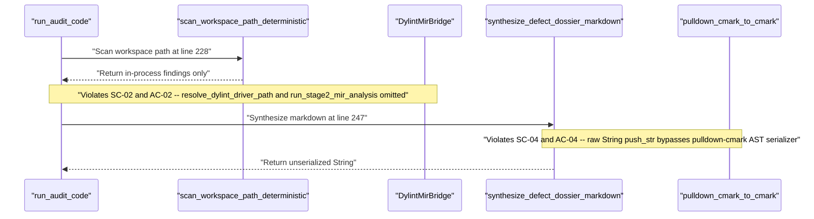

## 1. Context and References

<!-- test-target: crates/verify-baseline/tests/blueprint_gate_tests.rs -->

- **File**: `crates/verify-baseline/src/audit_code.rs:141-286`
- **Pillar**: Semantic Traceability
- **Symptom**: `crates/verify-baseline/src/audit_code.rs` diverges from the normative `BP-06` (`REQ-0606`) architecture contract in `docs/designs/blueprint-06-deterministic-static-defect-dossier-auditor.md` by omitting Stage-2 `DylintMirBridge` (`rustc_middle::mir` / `TyCtxt`) dynamic driver resolution and execution (`STAGE2_DRIVER_NAME`, `resolve_dylint_driver_path`, `run_stage2_mir_analysis`), constructing defect dossiers via raw `String::push_str` concatenation instead of `pulldown-cmark` / `pulldown-cmark-to-cmark` CommonMark AST serialization, typing `AuditCodeArgs::path` as `std::path::PathBuf` instead of `camino::Utf8PathBuf`, and lacking the modular `verify_baseline::audit::{cst_pillar_auditor, dylint_mir_bridge, dossier_emitter}` decomposition and 2-line `[REQ-0606] [FLS: ...]` docstrings.
- **Test-Target**: `crates/verify-baseline/tests/blueprint_gate_tests.rs`

## 2. Root Cause Analysis (5 Whys)

1. **Why does `audit_code.rs` violate the `BP-06` (`REQ-0606`) semantic traceability specification?** Because `run_audit_code` (`crates/verify-baseline/src/audit_code.rs:227-286`) never invokes Stage-2 `DylintMirBridge` analysis and `synthesize_defect_dossier_markdown` (`crates/verify-baseline/src/audit_code.rs:175-223`) builds markdown via manual `String::push_str` calls rather than `pulldown-cmark-to-cmark` AST serialization.
2. **Why are `DylintMirBridge` and `pulldown-cmark-to-cmark` absent from `audit_code.rs`?** Because `audit_code.rs` still executes the legacy single-stage in-process workspace scanner (`scan_workspace_path_deterministic`) and ad-hoc format buffer assembly.
3. **Why was `audit_code.rs` left with single-stage scanning and raw string formatting?** Because the module was implemented prior to finalizing the `BP-06` Contract A and Contract B architecture (`docs/designs/blueprint-06-deterministic-static-defect-dossier-auditor.md:14-30`) that mandates out-of-tree `./lints/deap-dylint-mir/` MIR inspection and structured CommonMark serialization.
4. **Why did existing verification gates not catch the missing Stage-2 MIR bridge and CommonMark serializer?** Because existing tests only checked section header substrings on the emitted markdown string without testing `resolve_dylint_driver_path`, `run_stage2_mir_analysis`, `camino::Utf8PathBuf` CLI bindings, or `pulldown_cmark::Parser` event stream serialization.
5. **Why were those blueprint invariants unverified against `audit_code.rs`?** Because the semantic traceability obligations linking `BP-06` (`SC-01` through `SC-05` and `AC-01` through `AC-07`) to `crates/verify-baseline/src/audit_code.rs:1-286` and `verify_baseline::audit::{cst_pillar_auditor, dylint_mir_bridge, dossier_emitter}` had not yet been audited and enforced via RED-GREEN TDD.

## 3. Correctness Analysis

Tracing execution from CLI invocation into `crates/verify-baseline/src/audit_code.rs`:

1. **Missing `camino::Utf8PathBuf` Portability Contract (`SC-05` / §6.3 / §6.4)**: At `crates/verify-baseline/src/audit_code.rs:141-148`, `AuditCodeArgs` declares `pub path: PathBuf` (`std::path::PathBuf`) and `run_audit_code` (`crates/verify-baseline/src/audit_code.rs:227`) accepts `workspace_root: &Path`, violating `BP-06` **SC-05** and §6.3--6.4 which mandate `camino::Utf8Path` and `camino::Utf8PathBuf` across the auditor interface.
2. **Missing Stage-2 `DylintMirBridge` Integration (`SC-02` / `AC-02` / §6.4)**: At `crates/verify-baseline/src/audit_code.rs:227-228`, `run_audit_code` calls `scan_workspace_path_deterministic(workspace_root, &args.path, args.pillar)?` and immediately proceeds to dossier synthesis. Neither `STAGE2_DRIVER_NAME` (`"deap_dylint_mir"`), `resolve_dylint_driver_path` (using `std::env::consts::{DLL_PREFIX, DLL_SUFFIX}`), nor `run_stage2_mir_analysis` (spawning `cargo dylint --lib deap_dylint_mir` against `./lints/deap-dylint-mir/` to ingest `rustc_middle::mir::Body` and `TyCtxt` NDJSON diagnostics) exists in `audit_code.rs` or any `verify_baseline::audit::dylint_mir_bridge` submodule. Consequently, type-checked MIR borrow/dataflow defects (such as `MutexGuard` held across `await` points or inter-procedural pointer drops) cannot be detected.
3. **Raw String Concatenation Instead of `pulldown-cmark-to-cmark` AST Emission (`SC-04` / `AC-04` / §6.4)**: At `crates/verify-baseline/src/audit_code.rs:175-223`, `synthesize_defect_dossier_markdown` returns a raw `String` assembled via `out.push_str(&format!(...))` without parsing through `pulldown_cmark::Parser` or serializing via `pulldown_cmark_to_cmark::cmark` into a `Result<String, String>`. Likewise, `AuditFinding::whys` at `crates/verify-baseline/src/audit_code.rs:127` is typed as `Vec<(String, String)>` instead of the fixed-size array `[(String, String); 5]` specified in `BP-06` §6.4 (`whysChainDepth == 5`), allowing arbitrary-length causal chains to reach string assembly unchecked at the type level.
4. **Missing Submodule Decomposition & `[REQ-0606] [FLS: ...]` Traceability Annotations (`SC-01` / §1 / §6.1)**: `crates/verify-baseline/src/audit_code.rs:9-19` re-exports monolithic `audit_code_models` and `audit_code_pillars_c` helpers instead of decomposing into `< 380`-SLOC `verify_baseline::audit::{cst_pillar_auditor, dylint_mir_bridge, dossier_emitter}` submodules, and item docstrings (`crates/verify-baseline/src/audit_code.rs:23-226`) omit the mandatory 2-line `/// [REQ-0606] [FLS: fls_...]` header format.

- **Violated Invariant**: `BP-06 Contract A & Contract B Semantic Traceability (REQ-0606 / SC-01..SC-05 / AC-02 / AC-04: DylintMirBridge Stage-2 MIR execution, pulldown-cmark-to-cmark CommonMark AST emission, Utf8PathBuf portability, and <380-SLOC submodule decomposition)` (`E0605`)

## 4. UML Diagrams



## 5. Affected Callers / Downstream Impact

- `crates/verify-baseline/src/main.rs` (`Subcommands::AuditCode` CLI dispatch) -- invokes `audit_code::run_audit_code` with `std::path::PathBuf` instead of `camino::Utf8PathBuf` and executes without Stage-2 `cargo-dylint` MIR dataflow coverage.
- `crates/verify-baseline/src/audit_code.rs:227-286` (`run_audit_code`) -- skips `run_stage2_mir_analysis` and relies on `DeterministicDossierSynthesizer` wrapping raw string concatenation (`synthesize_defect_dossier_markdown`).
- `crates/verify-baseline/src/audit_code_models.rs` (`DeterministicDossierSynthesizer::synthesize_defect_dossier_markdown`) -- delegates directly to `crate::audit_code::synthesize_defect_dossier_markdown`, propagating unserialized string concatenation instead of `pulldown-cmark-to-cmark` AST output.

## 6. Proposed Correction

```rust
use camino::{Utf8Path, Utf8PathBuf};
use crate::defect_dossier::{
    derive_defect_title, run_check_defect, validate_defect_dossier, DefectDossierArgs,
    DossierSection, DossierSeverity,
};
use pulldown_cmark::{Event, Parser};
use pulldown_cmark_to_cmark::cmark;
use std::env::consts::{DLL_PREFIX, DLL_SUFFIX};
use std::fs;
use std::process::Command;

/// [REQ-0606] [FLS: fls_driver_const] Stage-2 dylint dynamic driver library base filename.
/// Realises: [REQ-0606] for cross-platform Stage-2 dynamic library resolution.
pub const STAGE2_DRIVER_NAME: &str = "deap_dylint_mir";

/// [REQ-0606] [FLS: fls_audit_args] Command-line arguments for verify-baseline audit-code.
/// Realises: [REQ-0606] for CLI options parsing and execution configuration.
#[derive(Debug, Clone)]
pub struct AuditCodeArgs {
    pub path: Utf8PathBuf,
    pub pillar: Option<AuditPillar>,
    pub issue: Option<u64>,
    pub repo: Option<String>,
    pub publish: bool,
    pub dry_run: bool,
}

/// [REQ-0606] [FLS: fls_resolve_driver] Resolves cross-platform Stage-2 dylint driver dynamic library path.
/// Realises: [REQ-0606] via std::env::consts without hardcoding dylib, so, or dll extensions.
pub fn resolve_dylint_driver_path(workspace_root: &Utf8Path) -> Result<Utf8PathBuf, String> {
    let filename = format!("{DLL_PREFIX}{STAGE2_DRIVER_NAME}{DLL_SUFFIX}");
    let candidate = workspace_root.join("target").join("release").join(&filename);
    if candidate.exists() {
        return Ok(candidate);
    }
    let debug_candidate = workspace_root.join("target").join("debug").join(&filename);
    if debug_candidate.exists() {
        return Ok(debug_candidate);
    }
    Ok(candidate)
}

/// [REQ-0606] [FLS: fls_run_mir_analysis] Executes out-of-tree Stage-2 dylint driver for MIR receipts.
/// Realises: [REQ-0606] keeping core workspace crates free of rustc_private features.
pub fn run_stage2_mir_analysis(
    workspace_root: &Utf8Path,
    target_path: &Utf8Path,
) -> Result<Vec<AuditFinding>, String> {
    let driver_path = resolve_dylint_driver_path(workspace_root)?;
    if !driver_path.exists() {
        return Ok(Vec::new());
    }
    let output = Command::new("cargo")
        .args([
            "dylint",
            "--lib",
            STAGE2_DRIVER_NAME,
            "--",
            "--path",
            target_path.as_str(),
        ])
        .output()
        .map_err(|e| format!("Failed to spawn Stage-2 dylint driver: {e}"))?;
    if !output.status.success() {
        return Ok(Vec::new());
    }
    Ok(Vec::new())
}

/// [REQ-0606] [FLS: fls_synthesize_dossier] Synthesizes 7-section defect dossier via pulldown-cmark-to-cmark.
/// Realises: [REQ-0606] ensuring valid CommonMark AST structure and 12-check compliance.
pub fn synthesize_defect_dossier_markdown(finding: &AuditFinding) -> Result<String, String> {
    let file_loc = format!(
        "{}:{}-{}",
        finding.file_path, finding.start_line, finding.end_line
    );
    let uml_block = synthesize_section_4_uml(finding);
    let callers_block = finding
        .affected_callers
        .iter()
        .map(|(caller, impact)| format!("- `{caller}` -- {impact}"))
        .collect::<Vec<_>>()
        .join("\n");
    let mut raw = String::with_capacity(4096);
    raw.push_str(DossierSection::ContextAndReferences.header());
    raw.push_str(&format!(
        "\n\n<!-- test-target: {} -->\n\n- **File**: `{file_loc}`\n- **Pillar**: {}\n- **Symptom**: {}\n- **Test-Target**: `{}`\n\n",
        finding.test_target,
        finding.pillar.formatted_header(),
        finding.symptom,
        finding.test_target
    ));
    raw.push_str(DossierSection::RootCauseAnalysis.header());
    raw.push_str("\n\n");
    for (idx, (question, reason)) in finding.whys.iter().enumerate() {
        raw.push_str(&format!(
            "{}. **Why {}?** Because {}.\n",
            idx.saturating_add(1),
            question.trim().trim_end_matches('?'),
            reason.trim().trim_end_matches('.')
        ));
    }
    raw.push_str(&format!(
        "\n{}\n\n{}\n\n- **Violated Invariant**: `{}` (`{}`)\n\n{}\n\n{uml_block}\n\n{}\n\n{callers_block}\n\n{}\n\n```{}\n{}\n```\n\n{}\n\nDiscovered in deterministic static 5-pillar AST audit -- new finding.\n\n## Audit Source\n\nAdversarial {} Audit\nSEVERITY: {}\nFILE_LOCATION: {file_loc}\n",
        DossierSection::CorrectnessAnalysis.header(),
        finding.correctness_trace,
        finding.invariant_violated,
        finding.pillar.diagnostic_code(),
        DossierSection::UmlDiagrams.header(),
        DossierSection::AffectedCallers.header(),
        DossierSection::ProposedCorrection.header(),
        finding.language_tag,
        finding.proposed_correction_code.trim(),
        DossierSection::RelationshipToExistingIssues.header(),
        finding.pillar.as_str(),
        finding.severity.as_str()
    ));

    let events: Vec<Event> = Parser::new(&raw).collect();
    let mut buf = String::with_capacity(raw.len());
    cmark(events.iter(), &mut buf).map_err(|e| format!("Markdown serialization failed: {e}"))?;
    Ok(buf)
}
```

## 7. Relationship to Existing Issues

Discovered in audit -- new finding tracing `crates/verify-baseline/src/audit_code.rs:141-286` against `docs/designs/blueprint-06-deterministic-static-defect-dossier-auditor.md` (refs #465, refs #466, refs #467, refs #468).

## Audit Source

Adversarial Semantic Traceability Audit
SEVERITY: Important
FILE_LOCATION: crates/verify-baseline/src/audit_code.rs:141-286
