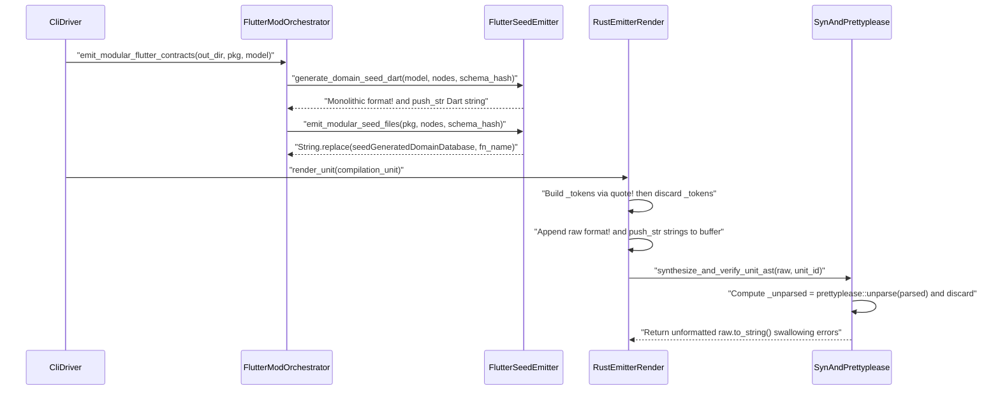

## 1. Context and References

<!-- test-target: crates/compile-sysml/tests/self_hosting_bootstrap.rs -->

- **File**: `crates/compile-sysml/src/modular_codegen/emitters/flutter/mod.rs:180-279`
- **Pillar**: Semantic Traceability
- **Symptom**: `BP-07` (`REQ-0607`, **SC-04**, **AC-02**, **AC-04**, **AC-05**) mandates deleting legacy `format!`/`writeln!`/`push_str` string-template code generators across `compile-sysml` and replacing them with pure typed AST token emitters (`proc_macro2::TokenStream` + `quote::quote!` + `syn::parse2::<syn::File>` + `prettyplease::unparse`, as implemented in `crates/compile-sysml/src/formal_harnesses.rs:85-109`). Instead, `crates/compile-sysml/src/modular_codegen/emitters/flutter/mod.rs:180-279` (with submodules `bridge_emitter.rs:68-154`, `models_emitter.rs:45-216`, `seed_emitter.rs:60-268`, `ui_test_emitter.rs:42-224`) and `crates/compile-sysml/src/modular_codegen/emitters/rust_emitter/render.rs:10-237` still synthesize code via raw `format!` and `String::push_str` string templates while discarding `quote!` and `prettyplease::unparse` outputs (`let _tokens = quote! { ... }`, `let _unparsed = prettyplease::unparse(&parsed)`), and `crates/compile-sysml/tests/self_hosting_bootstrap.rs:169-292` passes without verifying AST-backed emission.
- **Test-Target**: `crates/compile-sysml/tests/self_hosting_bootstrap.rs`

## 2. Root Cause Analysis (5 Whys)

1. **Why do both the Flutter modular contract emitters (`crates/compile-sysml/src/modular_codegen/emitters/flutter/mod.rs:180-279`) and the Rust modular code emitter (`crates/compile-sysml/src/modular_codegen/emitters/rust_emitter/render.rs:10-237`) still emit source code through ad-hoc `format!` and `push_str` string templates in violation of `BP-07` (`REQ-0607`, SC-04)?** Because the legacy monolithic string-template functions were mechanically split across smaller files (`bridge_emitter.rs`, `models_emitter.rs`, `seed_emitter.rs`, `ui_test_emitter.rs`, and `rust_emitter/render.rs`) to satisfy the `< 380` line-count check rather than refactoring code emission into typed AST token builders.
2. **Why did `render_unit` (`crates/compile-sysml/src/modular_codegen/emitters/rust_emitter/render.rs:186-237`) and `emit_modular_flutter_contracts` (`crates/compile-sysml/src/modular_codegen/emitters/flutter/mod.rs:180-254`) pass static and runtime verification despite retaining string-template concatenation?** Because `render_unit` (`render.rs:192-203`) binds `quote!` to an unused `_tokens` variable before appending `format!("pub mod {c};\n")`, and `synthesize_and_verify_unit_ast` (`render.rs:227-237`) binds `prettyplease::unparse(&parsed)` to an unused `_unparsed` variable and returns the raw unformatted `format!` string (`raw.to_string()`), requiring `#[rustfmt::skip]` on `pub mod generated;` in `crates/compile-sysml/src/modular_codegen/mod.rs:34`.
3. **Why did `emit_modular_flutter_contracts` (`crates/compile-sysml/src/modular_codegen/emitters/flutter/mod.rs:212-229`) and `seed_emitter::emit_modular_seed_files` (`seed_emitter.rs:260-261`) continue emitting monolithic string-concatenated `.g.dart` outputs and post-hoc `.replace(...)` string mutations?** Because `emit_modular_flutter_contracts` still invokes the four monolithic string generators (`generate_domain_seed_dart`, `generate_schema_models_dart`, `generate_solver_bridge_dart`, `generate_ui_contract_test_dart`) and `seed_emitter.rs:260-261` derives per-package seed modules by running `.replace("seedGeneratedDomainDatabase", &fn_name)` on the monolithic string output instead of lowering AST nodes into a typed emission IR.
4. **Why did the `BP-07` acceptance test suite in `crates/compile-sysml/tests/self_hosting_bootstrap.rs:169-292` fail to catch the discarded `quote!` / `prettyplease::unparse` results and retained string templates?** Because `test_four_level_lowering_arbitrary_scale_schema_obeys_all_bounds` (`self_hosting_bootstrap.rs:169-213`) and `test_modular_flutter_emission_decomposes_packages_and_barrels` (`self_hosting_bootstrap.rs:216-249`) only assert file existence, line/item counts, and substring presence (`## 1. Safety Intent`), never asserting that emitted Rust modules match `prettyplease::unparse` canonical formatting or that legacy string-template monoliths were eliminated.
5. **Why was there a semantic traceability gap between `docs/designs/blueprint-07-self-hosting-modular-codegen-compiler.md` (**Contract A**, **SC-04**, **AC-02**, **AC-04**, **AC-05**) and the test assertions in `crates/compile-sysml/tests/self_hosting_bootstrap.rs`?** Because unlike `crates/compile-sysml/src/formal_harnesses.rs:85-109` -- which constructs items exclusively via `quote!`, parses with `syn::parse2::<syn::File>`, formats via `prettyplease::unparse`, and validates via `ra_ap_syntax` -- the `BP-07` emitters treated `quote!` and `prettyplease::unparse` as no-op side calls while keeping `format!`/`push_str` as the actual emission path.

## 3. Correctness Analysis

`docs/designs/blueprint-07-self-hosting-modular-codegen-compiler.md:18-23` (**Contract A**) and `docs/designs/blueprint-07-self-hosting-modular-codegen-compiler.md:266-274` (**SC-04**) define the formal code generation invariant for `REQ-0607`:

1. **Violated Invariant 1 -- Discarded `quote!` and `prettyplease::unparse` in Modular Rust Emission (`SC-04` / `AC-02`)**:
   In `docs/designs/blueprint-07-self-hosting-modular-codegen-compiler.md:269-273`, every emitted compilation unit $u \in \mathcal{U}$ must satisfy:
   `Content(u) = normalize_lf(prettyplease::unparse(syn::parse2(tokens(u))))` with `SLOC_legacy_scanner_codegen = 0`.
   By contrast, in `crates/compile-sysml/src/modular_codegen/emitters/rust_emitter/render.rs`:
   - `render_part_model` (`render.rs:36-55`), `render_facets` (`render.rs:59-111`), and `render_state_plan` (`render.rs:115-182`) construct 100% of structs, `Default` impls, enums, state handlers, and action stages using `format!` and `String::push_str`.
   - `render_unit` (`render.rs:192-206`) constructs `let _tokens = if u.reexport_children { quote! { ... } } else { quote! { ... } };`, immediately discards `_tokens`, and writes `o.push_str(&format!("pub mod {c};\n"))`.
   - `synthesize_and_verify_unit_ast` (`render.rs:227-237`) parses `raw` with `syn::parse_file(raw)`, computes `let _unparsed = prettyplease::unparse(&parsed);`, discards `_unparsed`, swallows any `syn` or fixed-point errors via `if let Ok(...)` and `let _ = ...`, and returns `raw.to_string()` verbatim.
   - Furthermore, `emit_modular_rust_tree` (`crates/compile-sysml/src/modular_codegen/emitters/rust_emitter/manifest.rs:116-129`) clones `stage1_map` into `stage2_manifest` (`let stage2_manifest = StageTreeDigestManifest::new(stage1_map);`) and compares the map against its own clone rather than verifying a Stage-1 vs Stage-2 AST re-parse/unparse fixed point.
   - Because `render_unit` returns unformatted `format!` strings rather than `prettyplease::unparse` output, `crates/compile-sysml/src/modular_codegen/mod.rs:34` had to annotate `#[rustfmt::skip] pub mod generated;` to prevent `rustfmt` from flagging non-canonical formatting in the committed Stage-1 tree.

2. **Violated Invariant 2 -- Retained Monolithic String-Template Emitters and Flat-Model Collapse in Flutter Codegen (`Contract A` / `AC-04` / `AC-05`)**:
   `docs/designs/blueprint-07-self-hosting-modular-codegen-compiler.md:22` and `37` mandate deleting `-650+` SLOC of monolithic string-template emitters in `flutter_codegen` paths and preserving hierarchical `PackageDef` topology. Instead:
   - `crates/compile-sysml/src/flutter_codegen.rs:29-36` re-exports `crates/compile-sysml/src/modular_codegen/emitters/flutter/mod.rs:1-279`, which alongside `bridge_emitter.rs:1-342`, `models_emitter.rs:1-322`, `seed_emitter.rs:1-274`, and `ui_test_emitter.rs:1-271` retains ~1,488 lines of raw `format!`, `push_str`, and `concat!` string-template concatenation.
   - `emit_modular_flutter_contracts` (`crates/compile-sysml/src/modular_codegen/emitters/flutter/mod.rs:212-229`) still unconditionally generates and writes all 4 legacy monolithic files (`lib/data/seeds/generated_domain_seed.g.dart`, `lib/models/generated_schema_models.g.dart`, `lib/data/generated/solver_bridge.g.dart`, and `test/generated/schema_ui_contract_test.g.dart`) in addition to the `lib/src/...` files.
   - `emit_flutter_contracts` (`crates/compile-sysml/src/modular_codegen/emitters/flutter/mod.rs:272-279`) invokes `synth_package_from_flat_model(model)` (`mod.rs:115-127`), collapsing the model into a synthetic flat `"root"` `PackageDef`.
   - `emit_modular_seed_files` (`crates/compile-sysml/src/modular_codegen/emitters/flutter/seed_emitter.rs:260-261`) generates per-package seed units by calling `generate_domain_seed_dart(&sub_model, nodes, schema_hash).replace("seedGeneratedDomainDatabase", &fn_name)` -- fragile substring replacement over a string-concatenated monolith.

3. **Normative Contrast with `crates/compile-sysml/src/formal_harnesses.rs:85-109`**:
   In `crates/compile-sysml/src/formal_harnesses.rs:85-109`, `synthesize_kani_proof_module` builds items via `quote!`, validates grammar fail-closed via `syn::parse2::<syn::File>(tokens)?`, formats canonically via `prettyplease::unparse(&syntax_tree)`, and verifies zero CST errors via `parse_rust_source` and `ra_ap_syntax::SourceFile::parse`. Neither `modular_codegen::emitters::rust_emitter` nor `modular_codegen::emitters::flutter` follows this normative AST pipeline.

## 4. UML Diagrams



## 5. Affected Callers / Downstream Impact

- `crates/compile-sysml/src/driver_mode_handlers.rs` (`--emit-modular-rust` and `--emit-flutter-contracts` CLI handlers) -- Emits string-templated Rust and Dart source files instead of canonical AST-synthesized and `prettyplease`-formatted compilation units, and writes duplicate monolithic `.g.dart` files alongside modular `.g.dart` slices.
- `crates/compile-sysml/src/modular_codegen/mod.rs:34-35` (`#[rustfmt::skip] pub mod generated;`) -- Requires suppressing `rustfmt` on the committed Stage-1 self-hosting tree because `render_unit` discards `prettyplease::unparse` output and emits raw `format!` strings.
- `crates/compile-sysml/src/flutter_codegen.rs:29-36` -- Re-exports legacy monolithic string-template generators (`generate_domain_seed_dart`, `generate_schema_models_dart`, `generate_solver_bridge_dart`, `generate_ui_contract_test_dart`) and flat-model `emit_flutter_contracts`.
- `crates/compile-sysml/tests/self_hosting_bootstrap.rs:169-330` -- Passes false-positive `BP-07` acceptance tests without verifying that emitted Rust code is synthesized from `proc_macro2::TokenStream` + `quote!` and formatted by `prettyplease::unparse`, or that Flutter codegen eliminated monolithic string templates.

## 6. Proposed Correction

<!-- MUST NOT use regex (Check 34: deterministic linear slice/char scanning, no regex crate). MUST be domain-agnostic for upstream crates (Check 19). -->

```rust
use deap_core::rust_cst::parse::parse_rust_source;
use proc_macro2::TokenStream;
use quote::{format_ident, quote};
use ra_ap_syntax::Edition;

/// Synthesizes a canonical Rust compilation unit exclusively from a typed `TokenStream`
/// via `syn::parse2::<syn::File>`, `prettyplease::unparse`, and `ra_ap_syntax` validation,
/// failing closed with `E0701` on any grammar or CST error (`REQ-0607` / `SC-04`).
pub fn synthesize_verified_rust_unit(
    unit_id: &str,
    doc_lines: &[String],
    item_tokens: TokenStream,
) -> Result<String, String> {
    let doc_attrs: Vec<TokenStream> = doc_lines
        .iter()
        .map(|line| quote! { #![doc = #line] })
        .collect();
    let module_tokens = quote! {
        #(#doc_attrs)*
        #item_tokens
    };
    let syn_file = syn::parse2::<syn::File>(module_tokens)
        .map_err(|err| format!("E0701: syn::parse2 failed for `{unit_id}`: {err}"))?;
    let formatted = prettyplease::unparse(&syn_file).replace("\r\n", "\n");
    let cst = parse_rust_source(unit_id, &formatted);
    let ra_parse = ra_ap_syntax::SourceFile::parse(&formatted, Edition::Edition2021);
    if !cst.syntax_errors().is_empty() || !ra_parse.errors().is_empty() {
        return Err(format!(
            "E0701: ra_ap_syntax CST validation failed for `{unit_id}`: {:?}",
            cst.syntax_errors()
        ));
    }
    Ok(formatted)
}

/// Synthesizes a barrel module AST strictly through `quote!` token emission (`REQ-0607`).
pub fn build_barrel_module_tokens(
    child_modules: &[String],
    reexport_children: bool,
) -> Result<TokenStream, String> {
    let mut items = Vec::with_capacity(child_modules.len());
    for child in child_modules {
        let ident = syn::parse_str::<syn::Ident>(child)
            .map_err(|err| format!("E0701: invalid child module identifier `{child}`: {err}"))?;
        if reexport_children {
            items.push(quote! {
                pub mod #ident;
                pub use #ident::*;
            });
        } else {
            items.push(quote! {
                pub mod #ident;
            });
        }
    }
    let _ = format_ident!("_barrel_guard");
    Ok(quote! { #(#items)* })
}
```

## 7. Relationship to Existing Issues

Discovered in audit -- new finding (audits `BP-07` / `REQ-0607` implementation across `#733`, `#739`, `#740`, `#741`, `#742`).

## Audit Source

Adversarial Semantic Traceability Audit
SEVERITY: Important
FILE_LOCATION: crates/compile-sysml/src/modular_codegen/emitters/flutter/mod.rs:180-279
