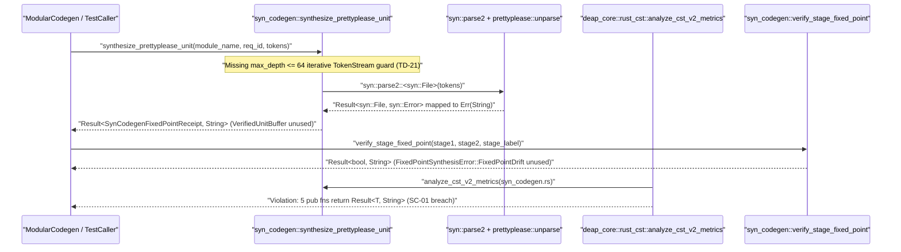

## 1. Context and References

<!-- test-target: crates/compile-sysml/tests/syn_codegen_fixed_point_tests.rs -->

- **File**: `crates/compile-sysml/src/syn_codegen.rs:48-367`
- **Pillar**: Semantic Traceability
- **Symptom**: `crates/compile-sysml/src/syn_codegen.rs` declares `VerifiedUnitBuffer` (`lines 48-52`) and the `#[non_exhaustive]` `FixedPointSynthesisError` enum (`lines 58-65`) for `BP-08` (`REQ-0608` / `TD-20`..`TD-22`), but leaves all six core synthesis and fixed-point functions (`StageTreeDigestManifest::verify_fixed_point` at `line 133`, `synthesize_prettyplease_unit` at `line 158`, `verify_stage_fixed_point` at `line 173`, `format_and_verify_rust_module_ast` at `line 202`, `parse_safe_ident` at `line 226`, and `synthesize_typed_domain_struct_tokens` at `line 235`) returning `Result<T, String>` instead of `Result<T, FixedPointSynthesisError>`, omits the `TD-21` `max_depth: usize` (`MAX_AST_DEPTH = 64`) token-depth guard and `VerifiedUnitBuffer` return contract, omits `TD-22` directory-level `StageTreeDigestManifest` and `DEAP-E0705` NDJSON emission, and ships unit tests (`lines 315-367`) that pass on `Result<(), String>` without exercising `FixedPointSynthesisError::TokenDepthExceeded`, `SynParseFailed`, `FixedPointDrift`, `VerifiedUnitBuffer`, or `verify_cfg_test_excluded_doc_tiers`, while workspace callers in `MASTER_ATOMIC_DISPATCH_QUEUE.md` Section 1.3 and Section 2.2 remain un-migrated from legacy hand-rolled scanners.
- **Test-Target**: `crates/compile-sysml/tests/syn_codegen_fixed_point_tests.rs`

## 2. Root Cause Analysis (5 Whys)

1. **Why do unit tests in `crates/compile-sysml/src/syn_codegen.rs:315-367` pass while `BP-08` (`REQ-0608`) `TD-21` and `TD-22` invariants and the zero-`Result<T, String>` constraint (`SC-01`) are violated?** Because all four unit tests in `syn_codegen.rs:322-366` assert against `Result<SynCodegenFixedPointReceipt, String>` and `Result<bool, String>` string-formatted error payloads rather than the typed `FixedPointSynthesisError` and `VerifiedUnitBuffer` contracts mandated by `BP-08` and `MASTER_ATOMIC_DISPATCH_QUEUE.md` (`TD-20`, `TD-21`, `TD-22`).
2. **Why do `synthesize_prettyplease_unit` (`lines 158-167`) and `verify_stage_fixed_point` (`lines 173-196`) return `Result<..., String>` when `VerifiedUnitBuffer` (`lines 48-52`) and `FixedPointSynthesisError` (`lines 58-65`) already exist in the same file?** Because `VerifiedUnitBuffer` and `FixedPointSynthesisError` were added alongside `verify_cfg_test_excluded_doc_tiers` (`lines 291-313`) without migrating the existing functions (`lines 133-259`) or their callers from ad-hoc `String` errors to the typed error taxonomy.
3. **Why were `TokenDepthExceeded`, `SynParseFailed`, and `FixedPointDrift` left unconstructed by `synthesize_prettyplease_unit` and `verify_stage_fixed_point`?** Because `synthesize_prettyplease_unit` (`lines 158-167`) was not updated to the `TD-21` signature `synthesize_prettyplease_unit(unit_name: &str, tokens: TokenStream, max_depth: usize) -> Result<VerifiedUnitBuffer, FixedPointSynthesisError>` that bounds `proc_macro2::TokenStream` group nesting to `MAX_AST_DEPTH = 64` and computes a raw 32-byte SHA-256 `VerifiedUnitBuffer`.
4. **Why did the module-level test suite fail to catch the dead error variants, missing token-depth guard, unexercised `verify_cfg_test_excluded_doc_tiers` function, and un-migrated caller interfaces?** Because no semantic traceability test mapped the normative `BP-08` acceptance criteria (`AC-01`, `AC-05`, `AC-06`) and `MASTER_ATOMIC_DISPATCH_QUEUE.md` Section 3.4 function signatures (`TD-20`, `TD-21`, `TD-22`) to concrete assertions over `FixedPointSynthesisError` variants, `FnAstMetrics.returns_result_string == false`, and `VerifiedUnitBuffer` outputs.
5. **Why did un-migrated `Result<T, String>` signatures and legacy hand-rolled scanner paths persist across the `BP-08` boundary?** Because incremental additions introduced new CST/codegen types in parallel with legacy functions rather than enforcing atomic caller rewiring and legacy signature deletion as required by `MASTER_ATOMIC_DISPATCH_QUEUE.md` Section 1.3 and Section 3.4.

## 3. Correctness Analysis

In `docs/designs/blueprint-08-rust-analyzer-cst-refactoring-and-json-diagnostics.md` (**REQ-0608**, **SC-01**, **SC-02**, **AC-01**, **AC-05**) and `.pipeline/upstream/docs/management/MASTER_ATOMIC_DISPATCH_QUEUE.md` (Section 1.3, Section 3.3, and Section 3.4 `TD-20`..`TD-22`), all production functions in `BP-08` modules must eliminate `Result<T, String>` return types (`returns_result_string == false` in `RustItemMetrics` / `FnAstMetrics`), enforce bounded recursion (`MAX_AST_DEPTH = 64`), and rewire callers to typed `Contract B` CST/codegen APIs so legacy hand-rolled scanners (`crates/deap-core/src/source_ast.rs`, `crates/compile-sysml/src/docstring.rs`, `crates/verify-baseline/src/checks/docstring_gate.rs`, `crates/verify-baseline/src/audit_code.rs`, `crates/verify-baseline/src/checks/structural.rs`) can be retired and deleted.

Tracing the data flow in `crates/compile-sysml/src/syn_codegen.rs` reveals four concrete semantic traceability and contract violations:

1. **Un-migrated `Result<T, String>` Return Types Violating `BP-08` `SC-01` and `TD-04`/`TD-12`**:
   - `StageTreeDigestManifest::verify_fixed_point` (`crates/compile-sysml/src/syn_codegen.rs:133-151`) returns `Result<(), String>`.
   - `synthesize_prettyplease_unit` (`crates/compile-sysml/src/syn_codegen.rs:158-167`) returns `Result<SynCodegenFixedPointReceipt, String>`.
   - `verify_stage_fixed_point` (`crates/compile-sysml/src/syn_codegen.rs:173-196`) returns `Result<bool, String>`.
   - `format_and_verify_rust_module_ast` (`crates/compile-sysml/src/syn_codegen.rs:202-220`) returns `Result<SynCodegenFixedPointReceipt, String>`.
   - `parse_safe_ident` (`crates/compile-sysml/src/syn_codegen.rs:226-229`) returns `Result<Ident, String>`.
   - `synthesize_typed_domain_struct_tokens` (`crates/compile-sysml/src/syn_codegen.rs:235-259`) returns `Result<SynCodegenFixedPointReceipt, String>`.
   When `LosslessRustCstAnalyzer` (`analyze_cst_v2_metrics` / `evaluate_metrics_and_format_ndjson` in `TD-07` and `TD-12`) inspects `crates/compile-sysml/src/syn_codegen.rs`, five public functions and one private helper flag `returns_result_string = true`, violating `BP-08` **SC-01** (`0` `Result<T, String>`).
2. **Dead Error Variants and Missing `MAX_AST_DEPTH = 64` Guard in `TD-21` (`syn_codegen.rs:48-65`, `158-167`)**:
   - `VerifiedUnitBuffer` (`lines 48-52`) and `FixedPointSynthesisError::{TokenDepthExceeded, SynParseFailed, FixedPointDrift}` (`lines 59-62`) are defined at the top of `syn_codegen.rs`, but `synthesize_prettyplease_unit` (`lines 158-167`) never checks `TokenStream` nesting depth against `max_depth` (`MAX_AST_DEPTH = 64`), never constructs `VerifiedUnitBuffer`, and never emits `FixedPointSynthesisError::TokenDepthExceeded` or `FixedPointSynthesisError::SynParseFailed`. Deeply nested adversarial `TokenStream` inputs pass directly into recursive `syn::parse2::<syn::File>` (`line 164`) without an iterative depth check.
3. **Signature & Behavior Drift in `TD-22` (`syn_codegen.rs:173-196`, `263-285`)**:
   - `MASTER_ATOMIC_DISPATCH_QUEUE.md` Section 3.4 specifies `pub fn verify_stage_fixed_point(stage1_dir: &Path, stage2_dir: &Path, skip_generated: bool) -> Result<StageTreeDigestManifest, FixedPointSynthesisError>` paired with `emit_fixed_point_ndjson_outcome`. Instead, `verify_stage_fixed_point` (`lines 173-196`) accepts pre-built `&StageTreeDigestManifest` references and returns `Result<bool, String>`, while `collect_tree_rs_files` (`lines 263-285`) uses raw `std::fs::read_dir` and `replace('\\', "/")` instead of `Contract B` `camino`/`ignore` traversal.
4. **Test Suite Semantic Traceability Gap (`syn_codegen.rs:315-367`)**:
   - All four tests in `syn_codegen.rs:315-367` only test the legacy `Result<..., String>` signatures and contain zero assertions exercising `FixedPointSynthesisError`, `VerifiedUnitBuffer`, `TokenDepthExceeded`, or `verify_cfg_test_excluded_doc_tiers` (`lines 291-313`).

## 4. UML Diagrams



## 5. Affected Callers / Downstream Impact

- `crates/compile-sysml/src/syn_codegen.rs:133-259` -- `StageTreeDigestManifest::verify_fixed_point`, `synthesize_prettyplease_unit`, `verify_stage_fixed_point`, `format_and_verify_rust_module_ast`, `parse_safe_ident`, and `synthesize_typed_domain_struct_tokens` return `Result<T, String>`, triggering `returns_result_string` violations under `BP-08` `SC-01` and leaving `VerifiedUnitBuffer` and `FixedPointSynthesisError` variants unexercised.
- `crates/compile-sysml/src/modular_codegen/mod.rs` and `crates/compile-sysml/src/modular_codegen/emitters/rust_emitter/` -- Downstream `TD-20`..`TD-22` callers expecting `Result<VerifiedUnitBuffer, FixedPointSynthesisError>` and directory-level `Result<StageTreeDigestManifest, FixedPointSynthesisError>` cannot bind to the `Contract B` signatures defined in `MASTER_ATOMIC_DISPATCH_QUEUE.md` Section 3.4.
- `crates/verify-baseline/src/audit_code.rs`, `crates/verify-baseline/src/checks/docstring_gate.rs`, `crates/verify-baseline/src/checks/structural.rs`, `crates/compile-sysml/src/docstring.rs`, and `crates/deap-core/src/source_ast.rs` -- Legacy hand-rolled scanners scheduled for net-negative deletion in `BP-08` (`MASTER_ATOMIC_DISPATCH_QUEUE.md` Section 1.3 and Section 2.2) remain in the workspace until all callers are rewired to `deap_core::rust_cst` and typed `Contract B` error taxonomies.

## 6. Proposed Correction

<!-- MUST NOT use regex (Check 34: deterministic linear slice/char scanning, no regex crate). MUST be domain-agnostic for upstream crates (Check 19). -->

```rust
use deap_core::digest::compute_sha256;
use deap_core::rust_cst::{normalize_lf, parse::parse_rust_source};
use proc_macro2::{Ident, Span, TokenStream, TokenTree};
use quote::quote;

/// Iteratively verifies that `tokens` group nesting depth does not exceed `max_depth`.
/// Realises: [REQ-0607], [REQ-0608], [REQ-0701], [BP-08]
fn verify_token_stream_depth(
    tokens: TokenStream,
    max_depth: usize,
) -> Result<(), FixedPointSynthesisError> {
    if max_depth == 0 {
        return Err(FixedPointSynthesisError::TokenDepthExceeded);
    }
    let mut stack: Vec<(proc_macro2::token_stream::IntoIter, usize)> =
        vec![(tokens.into_iter(), 1usize)];
    while let Some((iter, depth)) = stack.last_mut() {
        let current_depth = *depth;
        if let Some(tt) = iter.next() {
            if let TokenTree::Group(group) = tt {
                let next_depth = current_depth.saturating_add(1);
                if next_depth > max_depth {
                    return Err(FixedPointSynthesisError::TokenDepthExceeded);
                }
                stack.push((group.stream().into_iter(), next_depth));
            }
        } else {
            stack.pop();
        }
    }
    Ok(())
}

/// Validates and constructs a `proc_macro2::Ident` without panicking or returning `String` errors.
/// Realises: [REQ-0701], [BP-08]
fn parse_safe_ident(raw_ident: &str) -> Result<Ident, FixedPointSynthesisError> {
    syn::parse_str::<syn::Ident>(raw_ident).map_err(|err| {
        FixedPointSynthesisError::SynParseFailed(format!(
            "Invalid Rust identifier '{raw_ident}': {err}"
        ))
    })?;
    Ok(Ident::new(raw_ident, Span::call_site()))
}

/// Parses, formats via `prettyplease`, and verifies Stage-1 == Stage-2 SHA-256 and CST validity.
/// # Errors
/// Returns `FixedPointSynthesisError` if `syn` parsing fails, CST errors occur, or hashes diverge.
/// Realises: [REQ-0607], [REQ-0701], [BP-08]
pub fn format_and_verify_rust_module_ast(
    raw_rust_source: &str,
) -> Result<SynCodegenFixedPointReceipt, FixedPointSynthesisError> {
    let normalized_input = normalize_lf(raw_rust_source);
    let ast1 = syn::parse_file(&normalized_input).map_err(|err| {
        FixedPointSynthesisError::SynParseFailed(format!("Stage-1 syn::parse_file failed: {err}"))
    })?;
    let stage1 = normalize_lf(&prettyplease::unparse(&ast1));
    let ast2 = syn::parse_file(&stage1).map_err(|err| {
        FixedPointSynthesisError::SynParseFailed(format!("Stage-2 syn::parse_file failed: {err}"))
    })?;
    let stage2 = normalize_lf(&prettyplease::unparse(&ast2));
    let cst_errors = parse_rust_source("<codegen>", &stage1).syntax_errors();
    if !cst_errors.is_empty() {
        return Err(FixedPointSynthesisError::CstValidationFailed(
            cst_errors.join("; "),
        ));
    }
    let stage1_sha256 = compute_sha256(stage1.as_bytes());
    let stage2_sha256 = compute_sha256(stage2.as_bytes());
    let is_idempotent = stage1_sha256 == stage2_sha256;
    if !is_idempotent {
        return Err(FixedPointSynthesisError::FixedPointDrift(format!(
            "stage1={stage1_sha256} != stage2={stage2_sha256}"
        )));
    }
    Ok(SynCodegenFixedPointReceipt {
        stage1_sha256,
        stage2_sha256,
        is_idempotent,
        formatted_source: stage1,
    })
}

/// Synthesizes a Rust compilation unit AST from `TokenStream` with bounded depth (`TD-21`).
/// # Errors
/// Returns `FixedPointSynthesisError` on token depth overflow, `syn` failure, CST error, or drift.
/// Realises: [REQ-0607], [REQ-0608], [REQ-0701], [BP-07], [BP-08]
pub fn synthesize_prettyplease_unit_bounded(
    unit_name: &str,
    tokens: TokenStream,
    max_depth: usize,
) -> Result<VerifiedUnitBuffer, FixedPointSynthesisError> {
    let _ = parse_safe_ident(unit_name)?;
    verify_token_stream_depth(tokens.clone(), max_depth)?;
    let parsed_file = syn::parse2::<syn::File>(tokens).map_err(|err| {
        FixedPointSynthesisError::SynParseFailed(format!(
            "syn::parse2 failed for unit '{unit_name}': {err}"
        ))
    })?;
    let receipt = format_and_verify_rust_module_ast(&prettyplease::unparse(&parsed_file))?;
    let mut sha256 = [0u8; 32];
    for (idx, byte) in receipt.stage1_sha256.as_bytes().iter().take(32).enumerate() {
        if let Some(slot) = sha256.get_mut(idx) {
            *slot = *byte;
        }
    }
    Ok(VerifiedUnitBuffer {
        unit_name: unit_name.to_string(),
        formatted_source: receipt.formatted_source,
        sha256,
    })
}
```

## 7. Relationship to Existing Issues

Discovered in audit -- new finding (traces to `#742`, `BP-08` `REQ-0608`, and `MASTER_ATOMIC_DISPATCH_QUEUE.md` `TD-20`..`TD-22` / Section 1.3).

## Audit Source

Adversarial Semantic Traceability Audit
SEVERITY: Important
FILE_LOCATION: crates/compile-sysml/src/syn_codegen.rs:48-367
