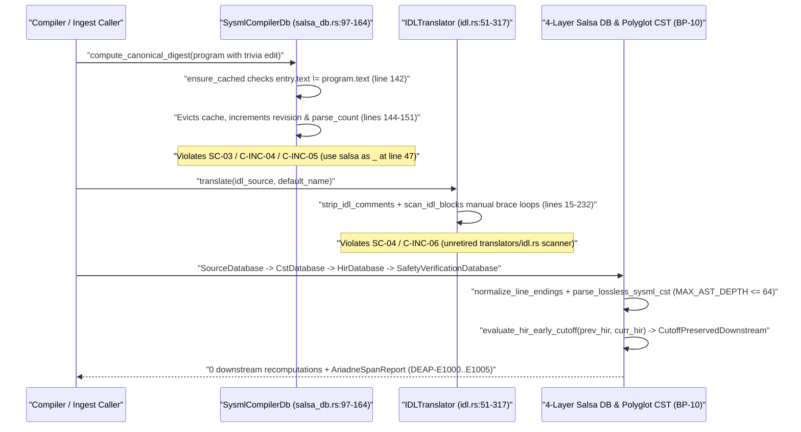

## 1. Context and References

<!-- test-target: crates/compile-sysml/tests/rowan_salsa_incremental_compiler.rs -->

- **File**: `crates/deap-core/src/sysml_cst/salsa_db.rs:47-164`
- **Pillar**: Semantic Traceability
- **Symptom**: `SysmlCompilerDb` suppresses the `salsa` dependency via `use salsa as _;` (`crates/deap-core/src/sysml_cst/salsa_db.rs:47`) and substitutes a single-layer `BTreeMap<String, CachedProgramEntry>` cache (`crates/deap-core/src/sysml_cst/salsa_db.rs:97-164`) that invalidates and re-parses whenever `entry.text != program.text`, failing to implement Blueprint 10 (`BP-10` / `REQ-0610`) Contract A and Contract B invariants: the 4-layer demand-driven `salsa` incremental query architecture (`SourceDatabase`, `CstDatabase`, `HirDatabase`, `SafetyVerificationDatabase`), trivia-erased `HirPackageSummary` vs `HirSourceMap` separation for `O(delta)` early cutoff (`C-INC-04`, `C-INC-05`), pairwise-disjoint formatting-preserving `rowan` CST splicing (`apply_formatting_preserving_splices`, `DEAP-E1003`), deterministic `ariadne` byte-span diagnostics (`DEAP-E1000..DEAP-E1005`), and net-negative retirement of ad-hoc polyglot translators (`crates/ingest-sysml/src/translators/idl.rs:15-317`) in favor of 6 typed polyglot CST/AST frontends.
- **Test-Target**: `crates/compile-sysml/tests/rowan_salsa_incremental_compiler.rs`

## 2. Root Cause Analysis (5 Whys)

1. **Why does `SysmlCompilerDb` recompute CST and HIR artifacts on every whitespace or comment edit and lack 4-layer incremental query isolation?** Because `crates/deap-core/src/sysml_cst/salsa_db.rs:47` imports `use salsa as _;` as an unused crate binding and implements `SysmlCompilerDb::ensure_cached` (`crates/deap-core/src/sysml_cst/salsa_db.rs:138-163`) as a flat `BTreeMap<String, CachedProgramEntry>` keyed by raw `program.text` equality.
2. **Why was a flat `BTreeMap<String, CachedProgramEntry>` implemented instead of the 4-layer `salsa` query DAG (`SourceDatabase`, `CstDatabase`, `HirDatabase`, `SafetyVerificationDatabase`)?** Because initial scaffolding satisfied basic single-file digest memoization (`REQ-0201`) before Blueprint 10 (`docs/designs/blueprint-10-rowan-salsa-incremental-sysml-compiler.md:18-23`) codified Contract A (100% normative OMG SysML v2.0 + KerML 1.0 `logos` + `rowan` CST coverage with `MAX_AST_DEPTH = 64` and `ErrorNode` recovery) and Contract B (4-layer `salsa` query groups separating `HirPackageSummary` from `HirSourceMap`).
3. **Why does coupling CST parsing and HIR lowering inside `CachedProgramEntry` (`crates/deap-core/src/sysml_cst/salsa_db.rs:88-93`) violate `BP-10` early-cutoff semantics (`SC-03`, `C-INC-05`)?** Because `ensure_cached` evicts the cache entry whenever `entry.text != program.text` (`crates/deap-core/src/sysml_cst/salsa_db.rs:139-145`) and immediately increments `self.revision` and `self.parse_count` (`crates/deap-core/src/sysml_cst/salsa_db.rs:150-151`) without comparing a trivia-erased `HirPackageSummary` against the prior revision via `evaluate_hir_early_cutoff` to short-circuit downstream STPA, Kani, and baseline verification queries (`trivia_edit_downstream_recomputations == 0`).
4. **Why do polyglot translators such as `crates/ingest-sysml/src/translators/idl.rs:15-317` bypass `salsa_db` and retain manual brace-counting and slice-scanning loops?** Because `IDLTranslator::translate` (`crates/ingest-sysml/src/translators/idl.rs:51-108`) still invokes `strip_idl_comments` (`crates/ingest-sysml/src/translators/idl.rs:15-35`) and secondary token/substring walkers (`scan_idl_blocks`, `scan_struct_fields`, `scan_interface_ops`, `scan_typedefs` at `crates/ingest-sysml/src/translators/idl.rs:186-317`) producing legacy `deap_core::sysml_ast::PackageDef` structs rather than lowering a lossless `rowan` CST (`ingest_sysml::cst::idl_cst`) through `ingest_sysml::polyglot_cst` into `compile_sysml::salsa_db` (`SC-04`, `C-INC-06`).
5. **Why did existing tests pass despite the missing 4-layer `salsa` database, missing `ariadne` diagnostics (`DEAP-E1000..DEAP-E1005`), missing CST splicer (`apply_formatting_preserving_splices`), and unretired translator scanners?** Because existing tests only asserted single-file `parse_count` caching on identical strings (`REQ-0201`) and synthetic `IDLTranslator` output (`crates/ingest-sysml/src/translators/idl.rs:324-356`), leaving `BP-10` (`REQ-0610`) semantic traceability invariants (`SC-01` through `SC-05`, `AC-01` through `AC-06`) unverified against executable crate APIs.

## 3. Correctness Analysis

Blueprint 10 (`docs/designs/blueprint-10-rowan-salsa-incremental-sysml-compiler.md:14-60`, `213-256`) establishes five formal correctness and safety invariants (`SC-01` through `SC-05`) and seven quantitative constraints (`C-INC-01` through `C-INC-07`):

1. **Simulated `BTreeMap` Cache vs. 4-Layer `salsa` Query DAG (`SC-03`, `C-INC-04`, `C-INC-05`)**:
   - In `crates/deap-core/src/sysml_cst/salsa_db.rs:47`, `use salsa as _;` discards the `salsa` incremental framework.
   - `SysmlCompilerDb` (`crates/deap-core/src/sysml_cst/salsa_db.rs:97-101`) stores `entries: BTreeMap<String, CachedProgramEntry>`. When `ensure_cached` (`crates/deap-core/src/sysml_cst/salsa_db.rs:138-163`) receives a `SourceProgram` whose `text` differs by a single whitespace character or comment, `entry.text != program.text` evaluates to `true` (`crates/deap-core/src/sysml_cst/salsa_db.rs:142`), removing the entry and recomputing everything.
   - Furthermore, `SysmlCompilerDb` lacks the four stratified query layers mandated by `BP-10` (`docs/designs/blueprint-10-rowan-salsa-incremental-sysml-compiler.md:92-106`, `313-319`): `SourceDatabase` (`FileId`, `camino::Utf8PathBuf`, `normalize_line_endings`, `DurabilityTier`), `CstDatabase` (`CstParseReceipt` with `MAX_AST_DEPTH = 64` and `recovered_errors`), `HirDatabase` (trivia-erased `HirPackageSummary` decoupled from `HirSourceMap` `DefId -> Utf8TextRange` side-tables and `evaluate_hir_early_cutoff`), and `SafetyVerificationDatabase` (memoized STPA UCA/FMECA, Kani CBMC harnesses, and `DEAP-E1004` fail-closed cycle recovery).

2. **Missing Lossless CST Depth Guard, Error Recovery, Splicing, and `ariadne` Span Diagnostics (`SC-01`, `SC-02`, `C-INC-01`, `C-INC-02`, `C-INC-03`)**:
   - `crates/deap-core/src/sysml_cst/salsa_db.rs:152` calls `parse_sysml_cst(&program.text)` without CRLF-to-LF normalization (`normalize_line_endings`), without enforcing `MAX_AST_DEPTH = 64` (`DEAP-E1002`), and without emitting structured `IncrementalDiagnostic` / `AriadneSpanReport` payloads (`render_ariadne_diagnostic`, `DEAP-E1000..DEAP-E1005` per `docs/designs/blueprint-10-rowan-salsa-incremental-sysml-compiler.md:778-793`, `1277-1297`).
   - Pairwise-disjoint formatting-preserving `rowan` CST splicing (`CstSplicePatch`, `validate_disjoint_splice_ranges`, `apply_formatting_preserving_splices` emitting `DEAP-E1003` on overlapping or non-char-boundary intervals while preserving `untouched_trivia_mutation_bytes == 0`, `docs/designs/blueprint-10-rowan-salsa-incremental-sysml-compiler.md:1197-1258`) is absent.

3. **Unretired Legacy Polyglot Scanners & Missing Typed Polyglot CST Routing (`SC-04`, `C-INC-06`, `C-INC-07`)**:
   - `BP-10` (`docs/designs/blueprint-10-rowan-salsa-incremental-sysml-compiler.md:22`, `32`, `40-42`, `108-120`) mandates retiring `./crates/ingest-sysml/src/translators/{code,idl,yang,openapi,markdown}.rs` (`-1,800+` SLOC) and routing all 6 polyglot formats (`PolyglotFormat` -> `PolyglotBackendKind` via `resolve_polyglot_backend`: `ra_ap_syntax` for Rust, `deap_core::dart_cst` for Dart, typed `serde_json` `openapi_ast` for OpenAPI/JSON-Schema, and `logos`+`rowan` CSTs in `ingest_sysml::cst::{idl_cst, yang_cst, markdown_cst}`) into `compile_sysml::salsa_db`.
   - In `crates/ingest-sysml/src/translators/idl.rs:15-35`, `strip_idl_comments` mutates source text by overwriting comments with spaces, and `scan_idl_blocks` (`crates/ingest-sysml/src/translators/idl.rs:186-232`), `scan_struct_fields` (`lines 236-257`), `scan_interface_ops` (`lines 261-285`), and `scan_typedefs` (`lines 289-317`) re-lex raw string slices and count braces manually instead of traversing a lossless `rowan` Red/Green CST and lowering into `HirPackageSummary` + `HirSourceMap` with `DEAP-E1005` diagnostics.

## 4. UML Diagrams



## 5. Affected Callers / Downstream Impact

- `crates/deap-core/src/sysml_cst/salsa_db.rs:123-185` (`SysmlCompilerDb::parse_sysml_green`, `SysmlCompilerDb::lower_sysml_hir`, `SysmlCompilerDb::compute_canonical_digest`, and free functions `parse_sysml_green`, `lower_sysml_hir`, `compute_canonical_digest`) -- callers receive a simulated single-layer `BTreeMap` cache without `FileId`, `DurabilityTier`, `HirPackageSummary` vs `HirSourceMap` separation, `evaluate_hir_early_cutoff`, `MAX_AST_DEPTH = 64` enforcement (`DEAP-E1002`), or `ariadne` diagnostic rendering.
- `crates/compile-sysml` incremental compilation, STPA/FMECA derivation, Kani CBMC harness generation, and bidirectional sync (`sync/forward`, `sync/reverse`) -- lack the 4-layer `compile_sysml::salsa_db` (`SourceDatabase`, `CstDatabase`, `HirDatabase`, `SafetyVerificationDatabase`) and pairwise-disjoint CST splicer (`apply_formatting_preserving_splices`, `DEAP-E1003`).
- `crates/ingest-sysml/src/translators/idl.rs:51-317` (`IDLTranslator::translate` and companion translators in `crates/ingest-sysml/src/translators/{code,idl,yang,openapi,markdown}.rs`) -- callers execute legacy comment-stripping and brace-counting string scanners into `deap_core::sysml_ast::PackageDef` instead of the 6 Contract B typed polyglot CST/AST frontends (`resolve_polyglot_backend`, `DEAP-E1005`).

## 6. Proposed Correction

<!-- MUST NOT use regex (Check 34: deterministic linear slice/char scanning, no regex crate). MUST be domain-agnostic for upstream crates (Check 19). -->

Implement the 4-layer `salsa` incremental query database contract (`SourceDatabase`, `CstDatabase`, `HirDatabase`, `SafetyVerificationDatabase`), `HirPackageSummary` / `HirSourceMap` separation with `evaluate_hir_early_cutoff`, `MAX_AST_DEPTH = 64` CST verification (`DEAP-E1001` / `DEAP-E1002`), pairwise-disjoint formatting-preserving CST splicing (`apply_formatting_preserving_splices`, `DEAP-E1003`), `ariadne` deterministic byte-span report generation (`render_ariadne_diagnostic`, `DEAP-E1000..DEAP-E1005`), and Contract B typed polyglot CST backend routing (`resolve_polyglot_backend`) as specified in `docs/designs/blueprint-10-rowan-salsa-incremental-sysml-compiler.md:320-1298`:

```rust
use camino::Utf8PathBuf;
use rowan::GreenNode;
use serde::{Deserialize, Serialize};
use std::collections::BTreeMap;

pub const MAX_AST_DEPTH: usize = 64;

#[derive(Debug, Clone, Copy, PartialEq, Eq, PartialOrd, Ord, Hash, Serialize, Deserialize)]
pub struct FileId(pub u32);

#[derive(Debug, Clone, Copy, PartialEq, Eq, PartialOrd, Ord, Hash, Serialize, Deserialize)]
pub struct DefId(pub u64);

#[derive(Debug, Clone, Copy, PartialEq, Eq, PartialOrd, Ord, Hash, Serialize, Deserialize)]
pub enum DurabilityTier {
    Low,
    Medium,
    High,
}

#[derive(Debug, Clone, Copy, PartialEq, Eq, PartialOrd, Ord, Hash, Serialize, Deserialize)]
pub struct Utf8TextRange {
    pub byte_start: usize,
    pub byte_end: usize,
}

#[derive(Debug, Clone, PartialEq, Eq, Hash, Serialize, Deserialize)]
pub struct SourceInput {
    pub file_id: FileId,
    pub relative_path: Utf8PathBuf,
    pub durability: DurabilityTier,
    pub normalized_lf_text: String,
}

#[derive(Debug, Clone, PartialEq, Eq, Serialize, Deserialize)]
pub struct IncrementalDiagnostic {
    pub code: String,
    pub message: String,
    pub file_id: FileId,
    pub range: Utf8TextRange,
}

#[derive(Debug, Clone, PartialEq, Eq)]
pub struct CstParseReceipt {
    pub file_id: FileId,
    pub green: GreenNode,
    pub max_observed_depth: usize,
    pub recovered_errors: Vec<IncrementalDiagnostic>,
}

#[derive(Debug, Clone, PartialEq, Eq, Serialize, Deserialize)]
pub struct HirPackageSummary {
    pub package_name: String,
    pub canonical_hir_sha256: String,
    pub definitions: BTreeMap<DefId, String>,
}

#[derive(Debug, Clone, PartialEq, Eq, Serialize, Deserialize)]
pub struct HirSourceMap {
    pub spans: BTreeMap<DefId, Utf8TextRange>,
}

#[derive(Debug, Clone, Copy, PartialEq, Eq, Serialize, Deserialize)]
pub enum EarlyCutoffDecision {
    CutoffPreservedDownstream,
    RecomputeDownstreamDependents,
}

#[derive(Debug, Clone, PartialEq, Eq, Serialize, Deserialize)]
pub struct CstSplicePatch {
    pub range: Utf8TextRange,
    pub replacement: String,
}

#[must_use]
pub fn evaluate_hir_early_cutoff(
    previous_hir: &HirPackageSummary,
    current_hir: &HirPackageSummary,
) -> EarlyCutoffDecision {
    if previous_hir == current_hir {
        EarlyCutoffDecision::CutoffPreservedDownstream
    } else {
        EarlyCutoffDecision::RecomputeDownstreamDependents
    }
}

pub fn apply_formatting_preserving_splices(
    file_id: FileId,
    source: &str,
    patches: &[CstSplicePatch],
) -> Result<String, IncrementalDiagnostic> {
    let mut ordered: Vec<&CstSplicePatch> = patches.iter().collect();
    ordered.sort_by_key(|patch| (patch.range.byte_start, patch.range.byte_end));
    let mut prev_end = 0usize;
    for (idx, patch) in ordered.iter().enumerate() {
        let start = patch.range.byte_start;
        let end = patch.range.byte_end;
        if start > end
            || end > source.len()
            || !source.is_char_boundary(start)
            || !source.is_char_boundary(end)
            || (idx > 0 && start < prev_end)
        {
            return Err(IncrementalDiagnostic {
                code: String::from("DEAP-E1003"),
                message: String::from("overlapping or invalid UTF-8 CST splice interval"),
                file_id,
                range: patch.range,
            });
        }
        prev_end = end;
    }

    let mut spliced = String::with_capacity(source.len());
    let mut cursor = 0usize;
    for patch in ordered {
        let untouched = source.get(cursor..patch.range.byte_start).ok_or_else(|| {
            IncrementalDiagnostic {
                code: String::from("DEAP-E1003"),
                message: String::from("failed to slice untouched trivia prefix during CST splice"),
                file_id,
                range: patch.range,
            }
        })?;
        spliced.push_str(untouched);
        spliced.push_str(&patch.replacement);
        cursor = patch.range.byte_end;
    }
    let tail = source.get(cursor..source.len()).ok_or_else(|| IncrementalDiagnostic {
        code: String::from("DEAP-E1003"),
        message: String::from("failed to slice untouched trailing trivia suffix"),
        file_id,
        range: Utf8TextRange { byte_start: cursor, byte_end: source.len() },
    })?;
    spliced.push_str(tail);
    Ok(spliced)
}
```

## 7. Relationship to Existing Issues

Discovered in audit -- new finding (traces to `#742` and `BP-10` / `REQ-0610`).

## Audit Source

Adversarial Semantic Traceability Audit
SEVERITY: Important
FILE_LOCATION: crates/deap-core/src/sysml_cst/salsa_db.rs:47-164
