## 1. Context and References

<!-- test-target: crates/verify-baseline/tests/ferrocene_three_ring_certification.rs -->

- **File**: `crates/verify-baseline/src/checks/formal_stage5_ferrocene.rs:43-308`
- **Pillar**: Test Integrity
- **Symptom**: Stage 5 Ferrocene certification gate (`formal_stage5_ferrocene.rs`) is an un-wired 308-line stub whose unit tests pass on un-locked toolchain channels (`channel = "stable"` in `rust-toolchain.toml` vs `release = "stable-25.05.0"` in `criticalup.toml`), isolated `proc_macro2` string slices, and synthetic 4-field JSON strings while omitting the BP-11 3-Ring Assurance Partition Compiler (`crates/compile-sysml/src/ring_partition/`), the 7-submodule `crates/verify-baseline/src/checks/ferrocene_cert/` verification suite, runner gate wiring, and the `crates/verify-baseline/tests/ferrocene_three_ring_certification.rs` acceptance test suite.
- **Test-Target**: `crates/verify-baseline/tests/ferrocene_three_ring_certification.rs`

## 2. Root Cause Analysis (5 Whys)

1. **Why do the Stage 5 Ferrocene unit tests in `formal_stage5_ferrocene.rs:282-308` pass while BP-11 certification invariants (`SC-01` through `SC-05`, `C-CERT-01` through `C-CERT-08`, and `DEAP-E1101` through `DEAP-E1106`) are unimplemented?** Because `formal_stage5_ferrocene.rs` asserts only superficial boolean field presence on TOML manifests, single-tag `[FLS: fls_*]` prefix matching, and a 4-field JSON mock rather than executing the normative BP-11 dual-toolchain lock, 5-link FLS traceability, `symbol-report` core-subset, Table A-7 MC/DC, and 3-Ring assurance partition contracts.
2. **Why does `verify_ferrocene_qualification_manifests` (`formal_stage5_ferrocene.rs:137-185`) accept the mismatched repository manifests `criticalup.toml:1-14` and `rust-toolchain.toml:1-5`?** Because `toml::Value::from_str` (`formal_stage5_ferrocene.rs:68-90`) discards the parsed strings after checking `!s.trim().is_empty()` and never compares the Ferrocene upstream `rustc` version or qualified target-triple set against `rust-toolchain.toml` (`channel = "stable"`, missing `targets`), nor verifies `E0705` Stage-1 vs Stage-2 SHA-256 fixed-point parity.
3. **Why are FLS paragraph traceability (`validate_fls_paragraph_anchor`, lines `189-225`) and MC/DC coverage (`validate_mcdc_symbol_report_json`, lines `230-254`) never enforced during baseline verification?** Because `crates/verify-baseline/src/checks/mod.rs:57` declares `pub mod formal_stage5_ferrocene;` without re-exporting its gates or invoking them in `crates/verify-baseline/src/runner.rs:63-99` or `crates/verify-baseline/src/runner_gates.rs:285-355`.
4. **Why are the 3-Ring DAL-A..E partition compiler (`crates/compile-sysml/src/ring_partition/`) and the 7-module `crates/verify-baseline/src/checks/ferrocene_cert/` architecture absent from the workspace?** Because `formal_stage5_ferrocene.rs` was written as a monolithic placeholder file instead of decomposing Stage 5 into the `< 380`-SLOC submodules specified in `docs/designs/blueprint-11-ferrocene-do178c-do330-3ring-certification-architecture.md:744-760` and implementing `ThreeRingAssurancePartitionCompiler` (`Ring 1 safety_kernel`, `Ring 2 ffi_guard_bridge`, `Ring 3 hmi_presentation_shell`, and Ring-1 `SafetyMonitor` readback verification).
5. **Why did repository verification not catch the missing submodules, un-wired gates, and absent `crates/verify-baseline/tests/ferrocene_three_ring_certification.rs` target?** Because the inline test module (`formal_stage5_ferrocene.rs:256-308`) only exercises its own local helper functions against synthetic string literals instead of testing end-to-end `DEAP-E1101`..`DEAP-E1106` diagnostic emission and runner integration.

## 3. Correctness Analysis

Cross-checking `crates/verify-baseline/src/checks/formal_stage5_ferrocene.rs:1-308`, `criticalup.toml:1-14`, and `rust-toolchain.toml:1-5` against `docs/designs/blueprint-11-ferrocene-do178c-do330-3ring-certification-architecture.md` reveals four concrete test-integrity and implementation defects:

1. **Un-Locked Toolchain Channels & Missing Dual-Mode Parity (`SC-01`, `C-CERT-01`, `C-CERT-02`, `DEAP-E1101`, `E0705`)**:
   - In `formal_stage5_ferrocene.rs:49-90`, `toml::Value` reduces `criticalup.toml` and `rust-toolchain.toml` to two booleans (`has_ferrocene_table` and `has_toolchain_table`) by checking only whether `release`, `packages`, `channel`, and `components` are non-empty.
   - In `criticalup.toml:5-6`, `release = "stable-25.05.0"` is declared without qualified target triples, while `rust-toolchain.toml:3-4` declares an un-pinned floating `channel = "stable"` without an exact semantic `rustc` version or `targets` list.
   - `verify_ferrocene_qualification_manifests` (`formal_stage5_ferrocene.rs:137-185`) never checks `max_toolchain_version_drift == 0` (`v(M_crit) == v(M_rust)` and `T_cert <= T(M_crit) intersect T(M_rust)`), never checks `stage_fixed_point_mismatch_files == 0` (`E0705`), and never probes `rustc` alongside `criticalup` (`probe_criticalup_toolchain` in `blueprint-11:492-556`). In `formal_stage5_ferrocene.rs:283-291`, `test_manifests_parity_and_require_formal_toolchains` asserts `verify_ferrocene_qualification_manifests(&repo_root, false).is_empty()`, creating a false-positive pass over un-locked toolchain manifests.
2. **Un-Wired & Superficial FLS Paragraph Traceability Gate (`SC-02`, `C-CERT-03`, `DEAP-E1102`)**:
   - `validate_fls_paragraph_anchor` (`formal_stage5_ferrocene.rs:189-225`) lexes an isolated `doc_text` string via `proc_macro2::TokenStream` and checks only `s.starts_with("fls_") && s.len() > 4`.
   - It violates `BP-11` Section 1.2 and `verify_fls_traceability_chain` (`blueprint-11:617-652`) by: (a) not using `ra_ap_syntax` (`HasDocComments` / `HasAttrs`) to inspect Ring-1 AST items and Ring-2 `// SAFETY: [SC-*] [FLS: fls_*]` comments, (b) not validating `fls_*` identifiers against a pinned FLS paragraph catalog (`pinned_fls_catalog`), (c) not verifying the 5-link traceability chain (`REQ-* -> SC-* -> RustItem -> fls_* -> Kani/Coverage`), and (d) never being invoked anywhere in `verify-baseline` outside its own unit test at line `294`.
3. **Un-Wired & Incomplete Certified `core` Subset and Table A-7 MC/DC Gate (`SC-03`, `C-CERT-04`, `C-CERT-05`, `DEAP-E1103`, `DEAP-E1104`)**:
   - `validate_mcdc_symbol_report_json` (`formal_stage5_ferrocene.rs:230-254`) parses an ad-hoc 4-key JSON object and checks `mcdc_coverage_pct < 100.0` only when `dal == "DAL-A"`.
   - It omits `symbol-report` auditing of Ring-1 linked symbols against the certified `core` prefix subset (`DEAP-E1103` on `std::*`, `alloc::*`, `__rust_alloc`, or `core::fmt::Formatter` as specified in `blueprint-11:656-673`), omits `overcounted_spans == 0` and SysML `TEST-* -> REQ-*` verification-case link checks (`DEAP-E1104`), omits `DalB` (100% Statement + Decision) and `DalC` (100% Statement) Table A-7 rules (`blueprint-11:681-693`), and is never called by `verify_baseline::runner::run`.
4. **Missing 3-Ring Assurance Partition Compiler, Ring-1 SafetyMonitor, Submodule Decomposition, and Acceptance Test Target (`SC-04`, `SC-05`, `C-CERT-06`, `C-CERT-07`, `DEAP-E1105`, `DEAP-E1106`)**:
   - `crates/compile-sysml/src/lib.rs:18-72` contains no `ring_partition` module (`mod.rs`, `safety_kernel_emitter.rs`, `ffi_guard_bridge_emitter.rs`, `hmi_shell_emitter.rs`, `fls_annotation_pass.rs` required by `blueprint-11:755-759`).
   - `crates/verify-baseline/src/checks/mod.rs:32-112` contains no `ferrocene_cert/` submodule directory (`mod.rs`, `toolchain_discovery.rs`, `manifest_parity.rs`, `fls_traceability.rs`, `symbol_report_audit.rs`, `table_a7_coverage.rs`, `monitor_readback.rs` required by `blueprint-11:748-754`), and `crates/verify-baseline/tests/ferrocene_three_ring_certification.rs` (`blueprint-11:250-252`) does not exist on disk.

## 4. UML Diagrams

```mermaid
classDiagram
    class FormalStage5FerroceneStub {
        +Boolean has_ferrocene_table
        +Boolean has_toolchain_table
        +discover_criticalup_binary() Option~PathBuf~
        +verify_ferrocene_qualification_manifests(Path workspace_root, bool require_formal_toolchains) Vec~Diagnostic~
        +validate_fls_paragraph_anchor(str doc_text, str relative_path) Vec~Diagnostic~
        +validate_mcdc_symbol_report_json(str json_str, str relative_path) Vec~Diagnostic~
    }
    class DualModeFerroceneToolchainGate {
        +Integer max_toolchain_version_drift
        +Integer stage_fixed_point_mismatch_files
        +probe_criticalup_toolchain(ToolchainProbeConfig config) Result~ToolchainDiscoveryReceipt~
        +verify_dual_toolchain_parity(DualToolchainLockSpec spec) Result~Do330ToolQualificationReceipt~
    }
    class FlsParagraphTraceabilitySynthesizer {
        +Integer unmapped_fls_item_count
        +Integer trace_chain_depth
        +verify_fls_traceability_chain(FlsTraceRecord records, BTreeSet pinned_fls_catalog) Result~FlsTaggedTraceBundle~
    }
    class CertifiedCoreSubsetAndCoverageGate {
        +Integer uncertified_core_symbol_count
        +Integer dal_a_mcdc_coverage_min_pct
        +verify_certified_core_and_table_a7_coverage(TableA7CoverageSummary summary, BTreeSet certified_core_prefixes) Result~Do178cTableA7Receipt~
    }
    class ThreeRingAssurancePartitionCompiler {
        +Integer assurance_ring_count
        +Integer max_ring1_heap_allocations
        +synthesize_three_ring_workspace(ThreeRingPartitionSpec spec) Result~ThreeRingWorkspacePlan~
        +verify_three_ring_edge_and_monitor_readback(AssuranceRing from_ring, AssuranceRing to_ring, MonitorReadbackEnvelope envelope) Result~SafetyMonitorReadbackReceipt~
    }

    FormalStage5FerroceneStub ..> DualModeFerroceneToolchainGate : "missing version lock and E0705 parity (DEAP-E1101)"
    FormalStage5FerroceneStub ..> FlsParagraphTraceabilitySynthesizer : "missing 5-link ra_ap_syntax catalog audit (DEAP-E1102)"
    FormalStage5FerroceneStub ..> CertifiedCoreSubsetAndCoverageGate : "missing core symbol-report and Table A-7 gate (DEAP-E1103, DEAP-E1104)"
    FormalStage5FerroceneStub ..> ThreeRingAssurancePartitionCompiler : "missing 3-Ring partition compiler and SafetyMonitor (DEAP-E1105, DEAP-E1106)"
```



## 5. Affected Callers / Downstream Impact

- `crates/verify-baseline/src/checks/formal_stage5_ferrocene.rs:282-308` -- inline unit tests pass while providing zero coverage of `DEAP-E1101` through `DEAP-E1106` or `E0705`.
- `criticalup.toml:1-14` and `rust-toolchain.toml:1-5` -- `rust-toolchain.toml` uses an un-locked `"stable"` channel without version or target parity against `criticalup.toml` (`release = "stable-25.05.0"`), violating `C-CERT-01` (`max_toolchain_version_drift == 0`).
- `crates/verify-baseline/src/runner.rs:63-99` and `crates/verify-baseline/src/runner_gates.rs:285-355` -- `verify-baseline` executes Checks 10 through 42 without ever calling the Stage 5 Ferrocene qualification, FLS traceability, `symbol-report`, MC/DC coverage, or 3-Ring partition gates.
- `crates/compile-sysml/src/lib.rs:18-72` -- downstream safety-critical Rust + Flutter code generation cannot partition SysML models into Ring 1 (`safety_kernel/`), Ring 2 (`ffi_guard_bridge/`), and Ring 3 (`app_flutter/`) or synthesize Ring-1 `SafetyMonitor` challenge-response and `TelemetryFrame` SHA-256 readback interlocks.

## 6. Proposed Correction

<!-- MUST NOT use regex (Check 34: deterministic linear slice/char scanning, no regex crate). MUST be domain-agnostic for upstream crates (Check 19). -->

 Pin `rust-toolchain.toml` and `criticalup.toml` to a locked semantic `rustc` version and matching target-triple set, decompose Stage 5 verification into `crates/verify-baseline/src/checks/ferrocene_cert/` (`toolchain_discovery.rs`, `manifest_parity.rs`, `fls_traceability.rs`, `symbol_report_audit.rs`, `table_a7_coverage.rs`, `monitor_readback.rs`), implement `crates/compile-sysml/src/ring_partition/` (`mod.rs`, `safety_kernel_emitter.rs`, `ffi_guard_bridge_emitter.rs`, `hmi_shell_emitter.rs`, `fls_annotation_pass.rs`), wire the Stage 5 gate into `crates/verify-baseline/src/runner_gates.rs`, and add the comprehensive integration test suite in `crates/verify-baseline/tests/ferrocene_three_ring_certification.rs`:

```rust
use std::collections::{BTreeMap, BTreeSet};
use std::path::PathBuf;

#[derive(Debug, Clone, Copy, PartialEq, Eq, PartialOrd, Ord, Hash)]
pub enum AssuranceRing {
    Ring1SafetyKernel = 1,
    Ring2FfiGuardBridge = 2,
    Ring3HmiPresentationShell = 3,
}

#[derive(Debug, Clone, Copy, PartialEq, Eq, PartialOrd, Ord, Hash)]
pub enum DalLevel {
    DalA,
    DalB,
    DalC,
    DalD,
    DalE,
}

#[derive(Debug, Clone, PartialEq, Eq)]
pub struct CertificationDiagnostic {
    pub code: String,
    pub message: String,
    pub artifact_path: String,
}

#[derive(Debug, Clone, PartialEq, Eq)]
pub struct DualToolchainLockSpec {
    pub ferrocene_upstream_rustc: String,
    pub rust_toolchain_channel: String,
    pub ferrocene_targets: BTreeSet<String>,
    pub rust_toolchain_targets: BTreeSet<String>,
    pub stage1_manifest_sha256: String,
    pub stage2_manifest_sha256: String,
}

#[derive(Debug, Clone, PartialEq, Eq)]
pub struct Do330ToolQualificationReceipt {
    pub toolchain_version: String,
    pub qualified_targets: BTreeSet<String>,
    pub stage_sha256_match: bool,
    pub is_reproducible: bool,
}

#[derive(Debug, Clone, PartialEq, Eq)]
pub struct ThreeRingPartitionSpec {
    pub workspace_root: PathBuf,
    pub safety_kernel_crate: String,
    pub ffi_bridge_crate: String,
    pub flutter_app_dir: String,
    pub forbid_unsafe_in_ring1: bool,
}

#[derive(Debug, Clone, PartialEq, Eq)]
pub struct ThreeRingWorkspacePlan {
    pub ring1_path: PathBuf,
    pub ring2_path: PathBuf,
    pub ring3_path: PathBuf,
    pub partition_verified: bool,
}

#[derive(Debug, Clone, PartialEq, Eq)]
pub struct FlsTraceRecord {
    pub req_id: String,
    pub safety_constraint_id: String,
    pub rust_item_path: String,
    pub ring: AssuranceRing,
    pub fls_paragraphs: BTreeSet<String>,
    pub kani_proof_id: Option<String>,
    pub verification_case_id: String,
}

#[derive(Debug, Clone, PartialEq, Eq)]
pub struct TableA7CoverageSummary {
    pub dal_level: DalLevel,
    pub linked_symbols: BTreeSet<String>,
    pub statement_pct: u8,
    pub decision_pct: u8,
    pub mcdc_pct: u8,
    pub overcounted_spans: usize,
    pub verified_req_links: BTreeMap<String, BTreeSet<String>>,
}

#[derive(Debug, Clone, PartialEq, Eq)]
pub struct MonitorReadbackEnvelope {
    pub expected_challenge_nonce: u64,
    pub received_challenge_nonce: u64,
    pub expected_frame_seq: u64,
    pub received_frame_seq: u64,
    pub expected_frame_sha256: String,
    pub received_frame_sha256: String,
    pub ring2_preconditions_passed: bool,
}

pub fn verify_dual_toolchain_parity(
    spec: &DualToolchainLockSpec,
) -> Result<Do330ToolQualificationReceipt, CertificationDiagnostic> {
    if spec.ferrocene_upstream_rustc.trim().is_empty()
        || spec.ferrocene_upstream_rustc.trim() != spec.rust_toolchain_channel.trim()
        || !spec.ferrocene_targets.is_subset(&spec.rust_toolchain_targets)
    {
        return Err(CertificationDiagnostic {
            code: String::from("DEAP-E1101"),
            message: String::from(
                "criticalup.toml and rust-toolchain.toml version or target drift detected",
            ),
            artifact_path: String::from("criticalup.toml"),
        });
    }
    if spec.stage1_manifest_sha256.is_empty()
        || spec.stage1_manifest_sha256 != spec.stage2_manifest_sha256
    {
        return Err(CertificationDiagnostic {
            code: String::from("E0705"),
            message: String::from("DO-330 Stage-1 vs Stage-2 SHA-256 fixed-point parity mismatch"),
            artifact_path: String::from("crates/compile-sysml/src/ring_partition/mod.rs"),
        });
    }
    Ok(Do330ToolQualificationReceipt {
        toolchain_version: spec.ferrocene_upstream_rustc.clone(),
        qualified_targets: spec.ferrocene_targets.clone(),
        stage_sha256_match: true,
        is_reproducible: true,
    })
}

pub fn synthesize_three_ring_workspace(
    spec: &ThreeRingPartitionSpec,
) -> Result<ThreeRingWorkspacePlan, CertificationDiagnostic> {
    if !spec.forbid_unsafe_in_ring1 || spec.safety_kernel_crate.trim().is_empty() {
        return Err(CertificationDiagnostic {
            code: String::from("DEAP-E1105"),
            message: String::from(
                "Ring 1 must enforce #![forbid(unsafe_code)] and non-empty crate ident",
            ),
            artifact_path: String::from(
                "crates/compile-sysml/src/ring_partition/safety_kernel_emitter.rs",
            ),
        });
    }
    Ok(ThreeRingWorkspacePlan {
        ring1_path: spec.workspace_root.join(&spec.safety_kernel_crate),
        ring2_path: spec.workspace_root.join(&spec.ffi_bridge_crate),
        ring3_path: spec.workspace_root.join(&spec.flutter_app_dir),
        partition_verified: true,
    })
}

pub fn verify_fls_traceability_chain(
    records: &[FlsTraceRecord],
    pinned_fls_catalog: &BTreeSet<String>,
) -> Result<usize, CertificationDiagnostic> {
    for rec in records {
        if matches!(
            rec.ring,
            AssuranceRing::Ring1SafetyKernel | AssuranceRing::Ring2FfiGuardBridge
        ) {
            if rec.req_id.trim().is_empty()
                || rec.safety_constraint_id.trim().is_empty()
                || rec.verification_case_id.trim().is_empty()
                || rec.fls_paragraphs.is_empty()
            {
                return Err(CertificationDiagnostic {
                    code: String::from("DEAP-E1102"),
                    message: format!(
                        "incomplete 5-link FLS traceability chain on '{}'",
                        rec.rust_item_path
                    ),
                    artifact_path: rec.rust_item_path.clone(),
                });
            }
            for para in &rec.fls_paragraphs {
                if !para.starts_with("fls_") || !pinned_fls_catalog.contains(para) {
                    return Err(CertificationDiagnostic {
                        code: String::from("DEAP-E1102"),
                        message: format!(
                            "unregistered FLS paragraph '{}' on '{}'",
                            para, rec.rust_item_path
                        ),
                        artifact_path: rec.rust_item_path.clone(),
                    });
                }
            }
        }
    }
    Ok(records.len())
}

pub fn verify_certified_core_and_table_a7_coverage(
    summary: &TableA7CoverageSummary,
    certified_core_prefixes: &BTreeSet<String>,
) -> Result<(), CertificationDiagnostic> {
    for sym in &summary.linked_symbols {
        let is_alloc_or_std = sym.starts_with("std::")
            || sym.starts_with("alloc::")
            || sym.starts_with("__rust_alloc")
            || sym.starts_with("core::fmt::Formatter");
        let in_core = certified_core_prefixes
            .iter()
            .any(|pfx| sym.starts_with(pfx.as_str()));
        if is_alloc_or_std || !in_core {
            return Err(CertificationDiagnostic {
                code: String::from("DEAP-E1103"),
                message: format!(
                    "Ring-1 symbol '{}' falls outside certified core subset",
                    sym
                ),
                artifact_path: String::from("crates/verify-baseline/src/checks/formal_stage5_ferrocene.rs"),
            });
        }
    }
    if summary.overcounted_spans > 0 || summary.verified_req_links.is_empty() {
        return Err(CertificationDiagnostic {
            code: String::from("DEAP-E1104"),
            message: String::from("overcounted coverage span or orphaned SysML TEST-* case"),
            artifact_path: String::from("crates/verify-baseline/src/checks/formal_stage5_ferrocene.rs"),
        });
    }
    let coverage_ok = match summary.dal_level {
        DalLevel::DalA => {
            summary.statement_pct == 100 && summary.decision_pct == 100 && summary.mcdc_pct == 100
        }
        DalLevel::DalB => summary.statement_pct == 100 && summary.decision_pct == 100,
        DalLevel::DalC => summary.statement_pct == 100,
        DalLevel::DalD | DalLevel::DalE => true,
    };
    if !coverage_ok {
        return Err(CertificationDiagnostic {
            code: String::from("DEAP-E1104"),
            message: format!(
                "DO-178C Table A-7 coverage shortfall (stmt={}%, mcdc={}%)",
                summary.statement_pct, summary.mcdc_pct
            ),
            artifact_path: String::from("crates/verify-baseline/src/checks/formal_stage5_ferrocene.rs"),
        });
    }
    Ok(())
}

pub fn verify_three_ring_edge_and_monitor_readback(
    from_ring: AssuranceRing,
    to_ring: AssuranceRing,
    envelope: &MonitorReadbackEnvelope,
) -> Result<(), CertificationDiagnostic> {
    let valid_edge = matches!(
        (from_ring, to_ring),
        (AssuranceRing::Ring1SafetyKernel, AssuranceRing::Ring1SafetyKernel)
            | (AssuranceRing::Ring2FfiGuardBridge, AssuranceRing::Ring2FfiGuardBridge)
            | (AssuranceRing::Ring2FfiGuardBridge, AssuranceRing::Ring1SafetyKernel)
            | (
                AssuranceRing::Ring3HmiPresentationShell,
                AssuranceRing::Ring3HmiPresentationShell
            )
            | (
                AssuranceRing::Ring3HmiPresentationShell,
                AssuranceRing::Ring2FfiGuardBridge
            )
    );
    if !valid_edge || !envelope.ring2_preconditions_passed {
        return Err(CertificationDiagnostic {
            code: String::from("DEAP-E1105"),
            message: String::from("illegal cross-ring edge or unguarded Ring-2 FFI precondition"),
            artifact_path: String::from("crates/compile-sysml/src/lib.rs"),
        });
    }
    if envelope.received_challenge_nonce != envelope.expected_challenge_nonce
        || envelope.received_frame_seq != envelope.expected_frame_seq
        || envelope.expected_frame_sha256.is_empty()
        || envelope.received_frame_sha256 != envelope.expected_frame_sha256
    {
        return Err(CertificationDiagnostic {
            code: String::from("DEAP-E1106"),
            message: String::from(
                "SafetyMonitor rejected stale frame, digest mismatch, or unconfirmed nonce",
            ),
            artifact_path: String::from("crates/verify-baseline/src/checks/formal_stage5_ferrocene.rs"),
        });
    }
    Ok(())
}
```

## 7. Relationship to Existing Issues

Discovered in audit -- new finding (refs #742).

## Audit Source

Adversarial Test Integrity Audit
SEVERITY: Critical
FILE_LOCATION: crates/verify-baseline/src/checks/formal_stage5_ferrocene.rs:43-308
