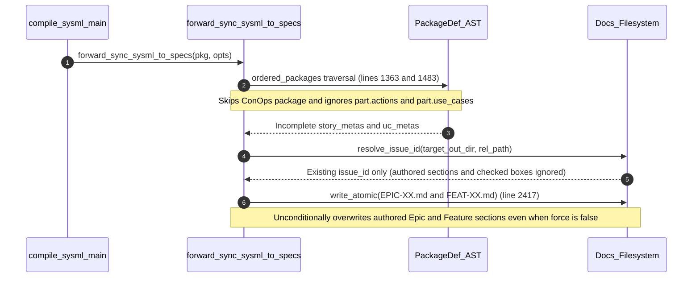

## 1. Context and References

<!-- test-target: crates/compile-sysml/tests/reproducer_tests.rs -->

- **File**: `crates/compile-sysml/src/sync/forward.rs:1362-2418`
- **Pillar**: Semantic Traceability
- **Symptom**: Running `./target/release/compile-sysml` with 9 `use case def` blocks in `schema/cuas_coa.sysml` (`UC_01`..`UC_05`, `UC_M2M`, `UC_STRAT_DELEGATION`, `UC_UTM_DECONFLICT`, `UC_SWARM_SATURATION`) only projects `docs/epics/EPIC-XX.md` and `docs/features/FEAT-XX.md` without generating or updating `docs/use-cases/` or `docs/user-stories/` (leaving `docs/use-cases/` and GitHub issues stuck at `UC-01`..`UC-05`), while re-running forward sync unconditionally overwrites existing authored sections and checklists inside `docs/epics/EPIC-XX.md` and `docs/features/FEAT-XX.md`.
- **Test-Target**: `crates/compile-sysml/tests/reproducer_tests.rs`

## 2. Root Cause Analysis (5 Whys)

1. **Why does running `compile-sysml` with 9 `use case def` blocks in `schema/cuas_coa.sysml` leave `docs/use-cases/` and `docs/user-stories/` unprojected or stuck at 5 Use Cases while clobbering authored `docs/epics/EPIC-XX.md` and `docs/features/FEAT-XX.md` files?** Because `forward_sync_sysml_to_specs` filters out `ConOps` packages and part-nested behavioral definitions during `story_metas` and `uc_metas` collection (`crates/compile-sysml/src/sync/forward.rs:1364-1549`), and then unconditionally writes synthetic boilerplate templates over existing `docs/epics/` and `docs/features/` markdown files (`crates/compile-sysml/src/sync/forward.rs:1711-1915`, `2410-2418`).
2. **Why does `forward_sync_sysml_to_specs` skip `use case def` and `action def` nodes during `uc_metas` and `story_metas` construction?** Because lines `1364-1366` and `1484-1486` execute `if p.name == "ConOps" { continue; }`, and lines `1378` and `1516` only iterate package-level `p.action_defs` and `p.use_case_defs` while ignoring `part.actions`, `part.interactions`, `part.use_cases`, and standalone `p.interaction_defs`.
3. **Why are existing authored sections and checklist states in `docs/epics/EPIC-XX.md` and `docs/features/FEAT-XX.md` destroyed on every forward sync pass?** Because `forward_sync_sysml_to_specs` only reads existing files to extract `resolve_issue_id` (`crates/compile-sysml/src/sync/forward.rs:1583`, `1785`) and discards `resolve_date` (`_epic_date` at line `1582`, `_feat_date` at line `1784`), then formats static template strings with hardcoded `- [ ]` items and calls `write_atomic(&full_dest, text)` (`crates/compile-sysml/src/sync/forward.rs:2417`) even when `opts.force` is `false`.
4. **Why did the existing unit tests in `crates/compile-sysml/src/sync/forward.rs:2498-3143` fail to catch both the missing Use Case / User Story projections and the destructive Epic / Feature overwrites?** Because all unit tests in `forward.rs` execute with `dry_run: true` on in-memory `PackageDef` fixtures lacking pre-existing authored markdown files on disk, and none test `ConOps` or part-nested `use case def` / `action def` blocks or verify preservation of authored markdown sections across re-runs.
5. **Why does this violate the Semantic Traceability pillar?** Because the compiler's forward synchronization contract claims 100% AST-to-specification projection across Epics, Features, User Stories, and Use Cases (`crates/compile-sysml/src/sync/forward.rs:3-8`) and idempotent non-destructive re-runs (`.pipeline/constitution.md:157-159`), yet existing tests only assert key presence on synthetic in-memory packages without verifying that all 9 `use case def` nodes in `schema/cuas_coa.sysml` project to `docs/use-cases/` or that authored Epic/Feature sections survive synchronization.

## 3. Correctness Analysis

In `crates/compile-sysml/src/sync/forward.rs`, `forward_sync_sysml_to_specs` violates two core invariants from `.pipeline/constitution.md` (Schema Compliance / Model Coverage at lines `60-66`, `213-221` and Idempotency at lines `157-159`):

1. **Incomplete Behavioral AST Projection (`crates/compile-sysml/src/sync/forward.rs:1362-1549`)**:
   - When collecting `story_metas` (`lines 1362-1444`) and `uc_metas` (`lines 1482-1549`), the loops over `ordered_packages` immediately skip `ConOps` via `if p.name == "ConOps" { continue; }` (`lines 1364-1366` and `1484-1486`). Notice that downstream branches at `lines 1647`, `1659`, `2006`, `2015`, `2256`, and `2265` explicitly check `is_conops` or `subsys_dir == "conops"`, proving that `ConOps` use cases and user stories were intended to be projected, but the early `continue` renders those branches dead code.
   - In addition, `SysmlParser::parse_container_item` (`crates/compile-sysml/src/parser/grammar.rs:482-489`, `554-561`, `610-617`) places `action def`, `use case def`, and `interaction def` blocks declared inside a `part def` into `part.actions`, `part.use_cases`, and `part.interactions` rather than `p.action_defs` or `p.use_case_defs`. However, `story_metas` (`line 1378`) only iterates `p.action_defs` (ignoring `part.actions` and standalone `p.interaction_defs`), and `uc_metas` (`line 1516`) only iterates `p.use_case_defs` (ignoring `part.use_cases` across `p.part_defs` and recursive `part.parts`).
   - Furthermore, when `compile-sysml` is invoked in default `--compile` mode (`crates/compile-sysml/src/main.rs:497-500`), `run_compilation_gate` serializes `.pipeline/schema.sysml` without invoking `forward_sync_sysml_to_specs`, and when `--forward-sync` is invoked on schemas whose new use cases (`UC_M2M`, `UC_STRAT_DELEGATION`, `UC_UTM_DECONFLICT`, `UC_SWARM_SATURATION`) or actions are scoped under `ConOps` or `part def` blocks (or when existing `UC-01`..`UC-05` filenames have custom slugs not cleaned unless `--force` is passed), `docs/use-cases/` and `docs/user-stories/` fail to reflect the 9 `use case def` blocks in `schema/cuas_coa.sysml`.

2. **Destructive Overwrite of Authored Epic and Feature Specifications (`crates/compile-sysml/src/sync/forward.rs:1551-1916`, `2405-2418`)**:
   - During Epic generation (`lines 1552-1777`) and Feature generation (`lines 1780-1916`), `forward_sync_sysml_to_specs` only inspects existing files on disk to read `issue_id` via `resolve_issue_id` (`lines 1583`, `1785`), while `resolve_date` (`lines 1582`, `1784`) is bound to unused variables `_epic_date` and `_feat_date`.
   - The function then builds a rigid template string (`lines 1711-1774` for Epics and `lines 1849-1913` for Features) that resets all checklist items to unchecked `- [ ]` (`lines 542`, `602`, `610`, `1635`, `1653`, `1664`) and replaces all authored prose in `## 1. Context`, `## 3. Architecture`, `## 4. Operational Considerations`, `## 5. Security & Governance`, `## Interface Requirements`, `### Layer 1`..`### Layer 3`, and `## Acceptance Criteria (BDD)` with generic one-line placeholders.
   - Finally, at `lines 2410-2418`, `for (rel_path, text) in &generated_files` calls `write_atomic(&full_dest, text)` unconditionally whenever `!opts.dry_run`, ignoring `opts.force` and clobbering existing authored `docs/epics/EPIC-XX.md` and `docs/features/FEAT-XX.md` files on disk.

## 4. UML Diagrams



## 5. Affected Callers / Downstream Impact

- `crates/compile-sysml/src/main.rs:413-466` (`main` `--forward-sync` branch) -- Invokes `forward_sync_sysml_to_specs(&pkg, &opts)`, causing downstream workspaces with `schema/cuas_coa.sysml` (9 `use case def` blocks) to miss Use Case / User Story markdown projections and suffer destructive overwrites of authored `docs/epics/EPIC-XX.md` and `docs/features/FEAT-XX.md` files.
- `./target/release/reconcile-backlog` (`crates/reconcile-backlog/src/main.rs`) -- Reads `docs/epics/`, `docs/features/`, `docs/user-stories/`, and `docs/use-cases/` to synchronize GitHub issues; because `docs/use-cases/` remains stuck at `UC-01`..`UC-05` and Epic/Feature checklists are reset to `- [ ]` with placeholder bodies, remote tracker issues become desynchronized from `schema/cuas_coa.sysml`.
- `./target/release/verify-baseline` (Checks 16, 18, 19, 20) -- Model coverage and cross-reference verification fail or validate stale specifications when `use case def` and `action def` AST nodes are not projected to `docs/use-cases/` and `docs/user-stories/`.

## 6. Proposed Correction

```rust
// In crates/compile-sysml/src/sync/forward.rs:
// 1. Collect actions, interactions, and use cases across ALL packages (including ConOps)
//    and recursively across PartDef hierarchies (part.actions, part.interactions, part.use_cases).
fn collect_package_use_cases<'a>(p: &'a PackageDef) -> Vec<&'a UseCaseDef> {
    let mut ucs: Vec<&'a UseCaseDef> = p.use_case_defs.iter().collect();
    fn visit_parts<'b>(parts: &'b [PartDef], out: &mut Vec<&'b UseCaseDef>) {
        for part in parts {
            out.extend(part.use_cases.iter());
            visit_parts(&part.parts, out);
        }
    }
    visit_parts(&p.part_defs, &mut ucs);
    ucs
}

fn collect_package_actions(p: &PackageDef) -> Vec<(String, Option<String>)> {
    let mut actions: Vec<(String, Option<String>)> = p
        .action_defs
        .iter()
        .map(|a| (a.name.clone(), None))
        .collect();
    fn visit_parts(parts: &[PartDef], out: &mut Vec<(String, Option<String>)>) {
        for part in parts {
            for act in &part.actions {
                out.push((act.name.clone(), Some(part.name.clone())));
            }
            visit_parts(&part.parts, out);
        }
    }
    visit_parts(&p.part_defs, &mut actions);
    if actions.is_empty() {
        for inter in &p.interaction_defs {
            actions.push((inter.name.clone(), None));
        }
    }
    actions
}

// 2. When writing generated files in forward_sync_sysml_to_specs (lines 2410-2418),
//    preserve existing authored sections and checked checklist states in EPIC-*.md and FEAT-*.md
//    (or merge AST-derived diagrams/checklists non-destructively when !opts.force), and clean
//    renamed UC-XX-*.md / US-XX-*.md prefix collisions so all 9 use cases project cleanly.
for (rel_path, text) in &generated_files {
    let full_dest = target_out_dir.join(rel_path);
    if let Some(parent) = full_dest.parent() {
        fs::create_dir_all(parent).map_err(|e| {
            format!("Failed to create directory '{}': {}", parent.display(), e)
        })?;
    }
    let final_text = if full_dest.exists() && !opts.force {
        merge_preserving_authored_sections(&full_dest, text)?
    } else {
        text.clone()
    };
    write_atomic(&full_dest, &final_text).map_err(|e| e.to_string())?;
}
```

## 7. Relationship to Existing Issues

Discovered in audit -- new finding (related to prior forward-sync fixes in refs #442 and refs #447).

## Audit Source

Adversarial Semantic Traceability Audit
SEVERITY: Important
FILE_LOCATION: crates/compile-sysml/src/sync/forward.rs:1362-2418
