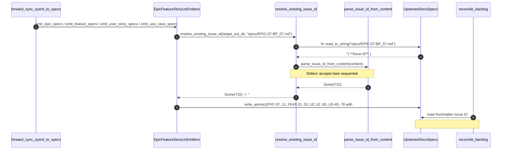

## 1. Context and References

<!-- test-target: crates/compile-sysml/src/sync/forward/tests_arch_and_root_specs.rs -->

- **File**: `crates/compile-sysml/src/sync/forward/mod.rs:131-226`
- **Pillar**: Semantic Traceability
- **Symptom**: `compile-sysml --forward-sync` (`forward_sync_sysml_to_specs` in `crates/compile-sysml/src/sync/forward/mod.rs:210-226` delegating to `resolve_existing_issue_id` and `parse_issue_id_from_content` in `crates/compile-sysml/src/sync/forward/escaping_and_dates.rs:84-170`) blindly preserves and re-stamps sequential fake/unregistered `#NNN` numbers (specifically `#732`..`#827` across `EPIC-07..11` `#732..#736`, `FEAT-31..53` `#737..#759`, `UC-32..65` `#760..#793`, and `US-45..78` `#794..#827`) into `| **Issue ID** |` frontmatter tables, Epic `## 2. Requirements & Checklist` / `#### Associated Use Cases` / `#### Associated User Stories` checklists, and Use Case `## 8. Realization Matrix` rows instead of preserving only verified tracker-allocated issue numbers or emitting `TBD` for unallocated specs, causing direct collisions with `[AUDIT]` issues `#732`..`#759` and preventing `reconcile-backlog` from projecting `BP-07`..`BP-11` specs to GitHub.
- **Test-Target**: `crates/compile-sysml/src/sync/forward/tests_arch_and_root_specs.rs`

## 2. Root Cause Analysis (5 Whys)

1. **Why does `compile-sysml --forward-sync` stamp `#732`..`#827` into `EPIC-07..11`, `FEAT-31..53`, `UC-32..65`, and `US-45..78` frontmatter tables, Epic checklists, and Use Case realization matrices (even when `--force` is passed)?** Because `emit_epic_specs` (`crates/compile-sysml/src/sync/forward/epic_emitter.rs:87-88, 141-142, 161-162, 233-234`), `emit_feature_specs` (`crates/compile-sysml/src/sync/forward/feature_emitter.rs:148-149`), `emit_user_story_specs` (`crates/compile-sysml/src/sync/forward/story_emitter.rs:181-182`), and `emit_use_case_specs` (`crates/compile-sysml/src/sync/forward/use_case_emitter.rs:157-160, 177-180, 217-218`) unconditionally call `format_issue_id_cell(resolve_existing_issue_id(&index.target_out_dir, &rel_path))` regardless of `opts.force` or tracker allocation validity.
2. **Why does `resolve_existing_issue_id` (`crates/compile-sysml/src/sync/forward/escaping_and_dates.rs:133-161`) return `Some(732)`..`Some(827)` for unallocated `BP-07`..`BP-11` specifications?** Because `parse_issue_id_from_content` (`crates/compile-sysml/src/sync/forward/escaping_and_dates.rs:84-129`) extracts any positive integer after `#` from `| **Issue ID** | #732 |` without checking whether the number is a verified bottom-up tracker allocation or an unverified top-down sequential placeholder block (`#732..#736` Epics -> `#737..#759` Features -> `#760..#793` Use Cases -> `#794..#827` User Stories).
3. **Why can top-down sequential fake `#NNN` blocks (`EPIC_ID < FEAT_ID < UC_ID < US_ID`) never represent valid `reconcile-backlog` tracker allocations?** Because `reconcile-backlog` (`register_unallocated_specs_bottom_up`) allocates GitHub issues strictly bottom-up (`UserStory` -> `UseCase` -> `Feature` -> `Epic`) so that a parent Epic's issue ID is allocated after (and is therefore greater than) its child Features, Use Cases, and User Stories (e.g., `EPIC-06` is `#690` while its child `UC-26..28` are `#649..#651` and `FEAT-26..30` are `#680..#684`), whereas `BP-07`..`BP-11` carry a contiguous 96-element top-down arithmetic sequence `732..=827` where `EPIC-07` (`#732`) < `FEAT-31` (`#737`) < `UC-32` (`#760`) < `US-45` (`#794`).
4. **Why does `resolve_existing_issue_id` also risk cross-specification issue ID contamination when AST elements are inserted or reordered?** Because its fallback loop (`crates/compile-sysml/src/sync/forward/escaping_and_dates.rs:140-159`) iterates `fs::read_dir(&dir_path)` in unsorted OS directory order and matches any `.md` file sharing the 2-dash index prefix (`FEAT-31-`, `UC-32-`, `US-45-`, `EPIC-07-`) without verifying slug or title identity before `clean_colliding_prefix_specifications` (`crates/compile-sysml/src/sync/forward/merge_and_cleanup.rs:248-296`) deletes the old file.
5. **Why did existing unit tests in `crates/compile-sysml/src/sync/forward/tests_arch_and_root_specs.rs` pass despite this Semantic Traceability defect?** Because `test_resolve_existing_issue_id_and_checked_slicing_utf8_boundaries` (`crates/compile-sysml/src/sync/forward/tests_arch_and_root_specs.rs:300-332`) only tests a single isolated file (`UC-07-軌道制御_Legacy.md` -> `Some(77)`), with zero assertions testing that contiguous top-down sequential fake `#NNN` blocks (`#732`..`#827` across `EPIC-*`, `FEAT-*`, `UC-*`, `US-*`) or mismatched-slug prefix collisions are rejected and reset to `TBD`.

## 3. Correctness Analysis

- **Violated Invariant**: Bijective Tracker Issue ID Single Source of Truth (SSOT) (`.pipeline/constitution.md:93-95` Unique Backlog Identifiers and `.pipeline/constitution.md:224-228` Cross-Reference Integrity). A specification's `| **Issue ID** |` cell, parent Epic checklists, and Use Case realization matrices must either carry a verified tracker-allocated issue number for that exact specification or emit `TBD` so `reconcile-backlog` can allocate a genuine remote issue bottom-up.
- **Trigger to Failure Data Flow**:
  1. `handle_forward_sync` (`crates/compile-sysml/src/driver_mode_handlers.rs:314-336`) constructs `ForwardSyncOptions` (`crates/compile-sysml/src/sync/forward/mod.rs:131-138`) and invokes `forward_sync_sysml_to_specs(&pkg, &opts)` (`crates/compile-sysml/src/sync/forward/mod.rs:210-226`).
  2. `build_forward_sync_index(pkg, opts)` (`crates/compile-sysml/src/sync/forward/model_indexer.rs:298-349`) indexes `ordered_packages` (`EPIC-01..11`), `part_contexts` (`FEAT-01..53`), `story_metas` (`US-01..78`), and `uc_metas` (`UC-01..65`) without validating existing on-disk `Issue ID` values across the package hierarchy.
  3. During `emit_epic_specs` (`crates/compile-sysml/src/sync/forward/epic_emitter.rs:277-309`), for `EPIC-07`..`EPIC-11`:
     - `render_single_epic_spec` (`epic_emitter.rs:233-234`) calls `resolve_existing_issue_id(&index.target_out_dir, &rel_path)`, which reads `.pipeline/upstream/docs/epics/EPIC-07-*.md`..`EPIC-11-*.md` via `parse_issue_id_from_content` (`escaping_and_dates.rs:84-129`) and returns `Some(732)`..`Some(736)`.
     - `build_epic_feature_checklist` (`epic_emitter.rs:87-88`) calls `resolve_existing_issue_id` on `features/FEAT-31-*.md`..`FEAT-53-*.md` and stamps `- [ ] #737 - [Feature 31: ...]`..`- [ ] #759 - [Feature 53: ...]`.
     - `build_epic_associated_backlog` (`epic_emitter.rs:141-142, 161-162`) calls `resolve_existing_issue_id` on `use-cases/UC-32-*.md`..`UC-65-*.md` and `user-stories/US-45-*.md`..`US-78-*.md` and stamps `- [ ] #760`..`#793` and `- [ ] #794`..`#827`.
  4. During `emit_feature_specs` (`feature_emitter.rs:148-149`), `emit_user_story_specs` (`story_emitter.rs:181-182`), and `emit_use_case_specs` (`use_case_emitter.rs:157-160, 177-180, 217-218`), `resolve_existing_issue_id` similarly stamps `#737`..`#759`, `#794`..`#827`, and `#760`..`#793` into every generated file and `## 8. Realization Matrix` table.
  5. When `reconcile-backlog` runs against `gintatkinson/DEAP01-spec-core`, `#732`..`#759` collide directly with existing `[AUDIT]` defect issues on GitHub, while `#760`..`#827` do not exist on GitHub; because the local specs do not have `TBD` in `| **Issue ID** |`, `reconcile-backlog` fails to project `BP-07`..`BP-11` (`EPIC-07..11`, `FEAT-31..53`, `UC-32..65`, `US-45..78`) to GitHub.

## 4. UML Diagrams



## 5. Affected Callers / Downstream Impact

- `forward_sync_sysml_to_specs` (`crates/compile-sysml/src/sync/forward/mod.rs:210-226`) -- preserves and propagates unverified sequential `#732`..`#827` issue numbers across all generated `EPIC-*`, `FEAT-*`, `UC-*`, and `US-*` files even when `--force` is active.
- `resolve_existing_issue_id` and `parse_issue_id_from_content` (`crates/compile-sysml/src/sync/forward/escaping_and_dates.rs:84-161`) -- accept bare sequential placeholder numbers and unsorted 2-dash prefix sibling matches without verifying bottom-up parent/child ordering or normalized slug compatibility.
- `emit_epic_specs` (`crates/compile-sysml/src/sync/forward/epic_emitter.rs:80-186, 226-273`), `emit_feature_specs` (`crates/compile-sysml/src/sync/forward/feature_emitter.rs:139-205`), `emit_user_story_specs` (`crates/compile-sysml/src/sync/forward/story_emitter.rs:171-222`), and `emit_use_case_specs` (`crates/compile-sysml/src/sync/forward/use_case_emitter.rs:150-279`) -- stamp `#732`..`#827` into frontmatter tables, Epic checklists, and Use Case realization matrices instead of `TBD`.
- `.pipeline/upstream/docs/{epics,features,use-cases,user-stories}` (`EPIC-07..11`, `FEAT-31..53`, `UC-32..65`, `US-45..78`) -- blocked from clean GitHub projection by `reconcile-backlog` due to `#732`..`#759` colliding with `[AUDIT]` tracker issues and `#760`..`#827` referencing unregistered issue numbers.

## 6. Proposed Correction

<!-- MUST NOT use regex (Check 34: deterministic linear slice/char scanning, no regex crate). MUST be domain-agnostic for upstream crates (Check 19). -->

In `crates/compile-sysml/src/sync/forward/escaping_and_dates.rs`, inspect whether an on-disk `Issue ID` cell carries an explicit tracker URL (`https://` or `http://`), sort directory entries deterministically during 2-dash prefix fallback while requiring shared slug tokens, and reject top-down sequential fake `#NNN` blocks where a parent Epic's bare `#NNN` is less than its child Feature, Use Case, or User Story bare `#NNN` values:

```rust
/// Extracted issue ID metadata from an existing specification file on disk.
#[derive(Debug, Clone, Copy, PartialEq, Eq)]
pub(crate) struct ParsedIssueId {
    pub(crate) id: usize,
    pub(crate) has_tracker_url: bool,
}

/// Parses a positive tracker issue ID and whether it carries an explicit tracker URL from the leading metadata of `content`.
pub(crate) fn parse_issue_id_with_provenance(content: &str) -> Option<ParsedIssueId> {
    for line in content.lines().take(25) {
        let trimmed = line.trim();
        if let Some(rest) = trimmed.strip_prefix("issue_id:") {
            let d = rest
                .trim()
                .trim_matches('"')
                .trim_matches('\'')
                .trim_start_matches('#');
            if let Ok(parsed) = d.parse::<usize>() {
                if parsed > 0 {
                    return Some(ParsedIssueId {
                        id: parsed,
                        has_tracker_url: false,
                    });
                }
            }
        } else if trimmed.starts_with('|') && trimmed.ends_with('|') {
            let inner = trimmed.trim_matches('|');
            let parts: Vec<&str> = inner.split('|').map(str::trim).collect();
            if let [key_cell, value_cell, ..] = parts.as_slice() {
                let mut key = String::new();
                for c in key_cell.chars() {
                    if !matches!(c, '*' | '`' | '_' | ':' | '#') {
                        key.push(c);
                    }
                }
                let key = key.trim().to_lowercase().replace([' ', '-'], "_");
                if key == "issue_id" || key == "issue" || key == "id" || key == "github_issue" {
                    let has_url =
                        value_cell.contains("https://") || value_cell.contains("http://");
                    let raw_num = if let Some((_, after_hash)) = value_cell.split_once('#') {
                        after_hash
                            .chars()
                            .take_while(char::is_ascii_digit)
                            .collect::<String>()
                    } else {
                        value_cell
                            .trim()
                            .trim_matches(|c: char| matches!(c, '*' | '`' | '"' | '\''))
                            .trim()
                            .to_string()
                    };
                    if let Ok(parsed) = raw_num.parse::<usize>() {
                        if parsed > 0 {
                            return Some(ParsedIssueId {
                                id: parsed,
                                has_tracker_url: has_url,
                            });
                        }
                    }
                }
            }
        }
    }
    None
}

/// Rejects bare (non-URL) issue IDs on an Epic and its child Features, Use Cases, and User Stories when the Epic's bare `#NNN` is smaller than its children's bare `#NNN` values (indicating a top-down sequential fake block rather than bottom-up tracker allocation).
pub(crate) fn filter_top_down_fake_issue_ids(
    epic_id: Option<ParsedIssueId>,
    child_ids: &[Option<ParsedIssueId>],
) -> bool {
    let Some(epic_parsed) = epic_id else {
        return false;
    };
    if epic_parsed.has_tracker_url {
        return false;
    }
    let mut bare_children_gt_epic = 0usize;
    let mut bare_children_lt_epic = 0usize;
    for child in child_ids.iter().flatten() {
        if !child.has_tracker_url {
            if child.id > epic_parsed.id {
                bare_children_gt_epic = bare_children_gt_epic.saturating_add(1);
            } else if child.id < epic_parsed.id {
                bare_children_lt_epic = bare_children_lt_epic.saturating_add(1);
            }
        }
    }
    bare_children_gt_epic > 0 && bare_children_lt_epic == 0
}
```

## 7. Relationship to Existing Issues

Discovered in audit -- new finding.

## Audit Source

Adversarial Semantic Traceability Audit
SEVERITY: Critical
FILE_LOCATION: crates/compile-sysml/src/sync/forward/mod.rs:131-226
