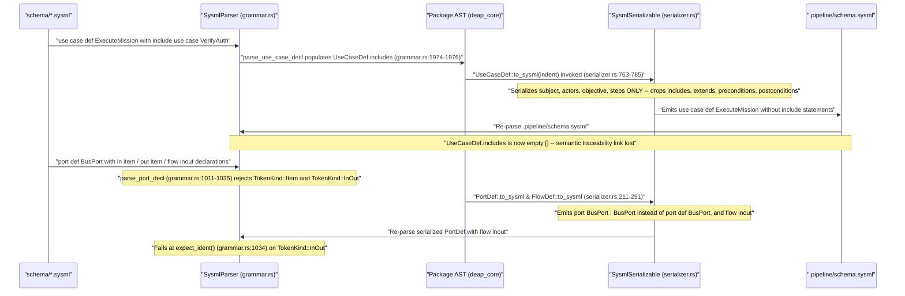

## 1. Context and References

<!-- test-target: crates/compile-sysml/tests/reproducer_tests.rs -->

- **File**: `crates/compile-sysml/src/semantic/serializer.rs:736-786`
- **Symptom**: `UseCaseDef::to_sysml` silently drops all `includes`, `extends`, `preconditions`, and `postconditions` clauses when serializing `UseCaseDef` nodes to `.pipeline/schema.sysml`, while `PortDef::to_sysml` (`crates/compile-sysml/src/semantic/serializer.rs:250-291`), `FlowDef::to_sysml` (`crates/compile-sysml/src/semantic/serializer.rs:211-220`), and `SysmlParser::parse_port_decl` (`crates/compile-sysml/src/parser/grammar.rs:938-1065`) exhibit grammar asymmetry on `port def` headers with bodies and `flow inout` / `in item` / `out item` declarations.
- **Pillar**: Semantic Traceability
- **Test-Target**: `crates/compile-sysml/tests/reproducer_tests.rs`
- **Secondary Locations**:
  - `crates/compile-sysml/src/semantic/serializer.rs:211-291` (`FlowDef::to_sysml` and `PortDef::to_sysml`)
  - `crates/compile-sysml/src/parser/grammar.rs:938-1065` (`SysmlParser::parse_port_decl`)
  - `crates/compile-sysml/src/parser/grammar.rs:1885-2008` (`SysmlParser::parse_use_case_decl`)
  - `crates/compile-sysml/src/main.rs:647-666` (`run_compilation_gate` canonical `.pipeline/schema.sysml` emission)
  - `crates/deap-core/src/sysml_ast.rs:747-765` (`UseCaseDef` AST definition)
  - `crates/deap-core/src/sysml_ast.rs:2771-2827` (`parse_port_flow_line` flow grammar extractor)

### Normative Requirements Violated
- `[REQ-SEMANTIC-SERIALIZER-USECASEDEF-TO-SYSML]` (`crates/compile-sysml/src/semantic/serializer.rs:762`): Requires `UseCaseDef::to_sysml` to preserve deterministic state conservation across all `UseCaseDef` members when serializing canonical SysML v2 text.
- `[REQ-SEMANTIC-SERIALIZER-FLOWDEF-TO-SYSML]` and `[REQ-SEMANTIC-SERIALIZER-PORTDEF-TO-SYSML]` (`crates/compile-sysml/src/semantic/serializer.rs:210, 249`): Require `FlowDef::to_sysml` and `PortDef::to_sysml` to emit canonical SysML v2 port definitions and item flow declarations that round-trip losslessly through `SysmlParser::parse_port_decl` (`crates/compile-sysml/src/parser/grammar.rs:938-1065`) and `deap_core::sysml_ast::parse_port_defs` (`crates/deap-core/src/sysml_ast.rs:2851-2960`).

## 2. Root Cause Analysis (5 Whys)

1. **Why do `include use case` relationships, `extend`, `precondition`, and `postcondition` clauses vanish from `.pipeline/schema.sysml`, and why do `port def` blocks with `item_flows` fail round-trip AST conservation during `./target/release/compile-sysml --compile`?** Because `UseCaseDef::to_sysml` (`crates/compile-sysml/src/semantic/serializer.rs:763-785`) omits serialization of `includes`, `extends`, `preconditions`, and `postconditions`, while `PortDef::to_sysml` (`crates/compile-sysml/src/semantic/serializer.rs:264-290`) and `FlowDef::to_sysml` (`crates/compile-sysml/src/semantic/serializer.rs:211-220`) have asymmetric grammar rules relative to `SysmlParser::parse_port_decl` (`crates/compile-sysml/src/parser/grammar.rs:938-1065`).
2. **Why does `UseCaseDef::to_sysml` drop `self.includes`, `self.extends`, `self.preconditions`, and `self.postconditions` even though `SysmlParser::parse_use_case_decl` (`crates/compile-sysml/src/parser/grammar.rs:1974-1985`) parses them into `UseCaseDef` (`crates/deap-core/src/sysml_ast.rs:758-764`)?** Because `UseCaseDef::to_sysml` (`crates/compile-sysml/src/semantic/serializer.rs:771-782`) only iterates over `self.subject`, `self.actors`, `self.objective`, and `self.steps`, never emitting lines for `self.includes`, `self.extends`, `self.preconditions`, or `self.postconditions`.
3. **Why does `SysmlParser::parse_use_case_decl` (`crates/compile-sysml/src/parser/grammar.rs:1974-1976`) also store unnormalized `include` targets when parsing `include use case TargetUC;`?** Because `self.read_until_semi()` (`crates/compile-sysml/src/parser/grammar.rs:3294-3317`) concatenates `TokenKind::UseCase` (`"use case"`) with the target identifier without stripping optional leading `use case` keywords, so naive re-serialization or downstream lookup against `UseCaseDef.name` mismatches `"use case TargetUC"` vs `"TargetUC"`.
4. **Why do `PortDef::to_sysml` (`crates/compile-sysml/src/semantic/serializer.rs:250-291`) and `FlowDef::to_sysml` (`crates/compile-sysml/src/semantic/serializer.rs:211-220`) break round-trip parity with `SysmlParser::parse_port_decl` (`crates/compile-sysml/src/parser/grammar.rs:938-1065`)?** Because when `has_body` is true (`!self.item_flows.is_empty()`), `PortDef::to_sysml` (`crates/compile-sysml/src/semantic/serializer.rs:269`) unconditionally emits `port <name> : <type_name> {` even for a `port def` where `self.name == self.type_name`, and `FlowDef::to_sysml` (`crates/compile-sysml/src/semantic/serializer.rs:219`) emits `flow <dir> <name> : <item_type>;` (such as `flow inout pkt : Data;`), whereas `SysmlParser::parse_port_decl` (`crates/compile-sysml/src/parser/grammar.rs:1011-1035`) only checks `TokenKind::Flow`, `TokenKind::In`, and `TokenKind::Out` (rejecting `TokenKind::InOut` and `TokenKind::Item` in `in item` / `out item` / `flow inout` declarations with `SyntaxError`).
5. **Why were both serializer-parser round-trip asymmetries undetected by the existing test suite?** Because `crates/compile-sysml/src/semantic/serializer.rs:1335-1569` contains zero unit tests for `UseCaseDef::to_sysml`, `FlowDef::to_sysml`, or `PortDef::to_sysml` with non-empty `item_flows`, and `crates/compile-sysml/src/parser/grammar.rs:4342-4381` only tests `UseCaseDef` parsing with `subject`, `actor`, and `step` without testing `include use case` or round-trip `to_sysml` re-parsing.

## 3. Correctness Analysis

### Defect 1: Silent Loss of `UseCaseDef.includes`, `extends`, `preconditions`, and `postconditions` in `UseCaseDef::to_sysml`

In `crates/deap-core/src/sysml_ast.rs:747-765`, `UseCaseDef` defines:

```rust
pub struct UseCaseDef {
    pub name: String,
    pub doc: Option<String>,
    pub subject: Option<String>,
    pub actor: Option<String>,
    pub actors: Vec<String>,
    pub objective: Option<String>,
    pub includes: Vec<String>,
    pub extends: Vec<String>,
    pub steps: Vec<String>,
    pub preconditions: Vec<String>,
    pub postconditions: Vec<String>,
}
```

In `crates/compile-sysml/src/parser/grammar.rs:1974-1985`, `SysmlParser::parse_use_case_decl` parses `include`, `extend`, `precondition`, and `postcondition` statements inside `use case def` blocks:

```rust
} else if self.check(&TokenKind::Include) {
    self.advance();
    includes.push(self.read_until_semi());
} else if self.check(&TokenKind::Extend) {
    self.advance();
    extends.push(self.read_until_semi());
} else if self.check(&TokenKind::Precondition) {
    self.advance();
    preconditions.push(self.read_until_semi());
} else if self.check(&TokenKind::Postcondition) {
    self.advance();
    postconditions.push(self.read_until_semi());
}
```

However, in `crates/compile-sysml/src/semantic/serializer.rs:763-785`, `UseCaseDef::to_sysml` completely omits `self.includes`, `self.extends`, `self.preconditions`, and `self.postconditions`:

```rust
    fn to_sysml(&self, indent: usize) -> String {
        let pad = " ".repeat(indent);
        let doc = format_doc_comment(&self.doc, indent);
        let mut lines = Vec::new();
        if !doc.is_empty() {
            lines.push(doc.trim_end().to_string());
        }
        lines.push(format!("{}use case def {} {{", pad, self.name));
        if let Some(s) = &self.subject {
            lines.push(format!("{}    subject {};", pad, s));
        }
        for a in &self.actors {
            lines.push(format!("{}    actor {};", pad, a));
        }
        if let Some(obj) = &self.objective {
            lines.push(format!("{}    objective \"{}\";", pad, obj));
        }
        for step in &self.steps {
            lines.push(format!("{}    step {};", pad, step));
        }
        lines.push(format!("{}}}", pad));
        lines.join("\n")
    }
```

When `run_compilation_gate` (`crates/compile-sysml/src/main.rs:656-663`) serializes the compiled `Package` AST via `pkg.to_sysml(0)` into `.pipeline/schema.sysml`, every `include use case <Target>;`, `extend`, `precondition`, and `postcondition` declaration in `schema/*.sysml` is permanently stripped from `.pipeline/schema.sysml`. In addition, when `SysmlParser::parse_use_case_decl` (`crates/compile-sysml/src/parser/grammar.rs:1974-1976`) parses `include use case AuthenticateOperator;`, `TokenKind::UseCase` is lexed as `"use case"` (`crates/compile-sysml/src/lexer/scanner.rs:566-585`), so `read_until_semi()` records `"use case AuthenticateOperator"` instead of normalizing the included use case identifier `"AuthenticateOperator"`.

### Defect 2: `PortDef::to_sysml` / `FlowDef::to_sysml` and `SysmlParser::parse_port_decl` Grammar Asymmetry

In `crates/compile-sysml/src/semantic/serializer.rs:211-220` and `250-291`:

```rust
impl SysmlSerializable for FlowDef {
    fn to_sysml(&self, indent: usize) -> String {
        let pad = " ".repeat(indent);
        let doc = format_doc_comment(&self.doc, indent);
        let dir = if !self.direction.is_empty() {
            format!("{} ", self.direction)
        } else {
            String::new()
        };
        format!("{}{}flow {}{} : {};", doc, pad, dir, self.name, self.item_type)
    }
}
```

And in `PortDef::to_sysml` (`crates/compile-sysml/src/semantic/serializer.rs:264-290`):

```rust
        if has_body {
            let mut lines = Vec::new();
            if !doc.is_empty() {
                lines.push(doc.trim_end().to_string());
            }
            lines.push(format!("{}port {}{}{} : {} {{", pad, dir, conj, self.name, self.type_name));
            for flow in &self.item_flows {
                lines.push(flow.to_sysml(indent + 4));
            }
            lines.push(format!("{}}}", pad));
            lines.join("\n")
        } else {
            if self.name == self.type_name {
                format!("{}{}port def {};", doc, pad, self.name)
            } else {
                format!("{}{}port {}{}{} : {};", doc, pad, dir, conj, self.name, self.type_name)
            }
        }
```

Meanwhile, in `crates/compile-sysml/src/parser/grammar.rs:1011-1035`, `SysmlParser::parse_port_decl` parses port flow declarations with the following restricted branch:

```rust
} else if self.check(&TokenKind::Flow) || self.check(&TokenKind::In) || self.check(&TokenKind::Out) {
    let mut flow_dir = "out".to_string();
    if self.check(&TokenKind::Flow) {
        self.advance();
        if self.check(&TokenKind::In) {
            self.advance();
            flow_dir = "in".to_string();
        } else if self.check(&TokenKind::Out) {
            self.advance();
            flow_dir = "out".to_string();
        }
    } else {
        if self.check(&TokenKind::In) {
            self.advance();
            flow_dir = "in".to_string();
        } else if self.check(&TokenKind::Out) {
            self.advance();
            flow_dir = "out".to_string();
        }
        if self.check(&TokenKind::Flow) {
            self.advance();
        }
    }
    let flow_name = self.expect_ident()?;
```

This creates three concrete round-trip and grammar asymmetries between `serializer.rs`, `grammar.rs`, and `deap_core::sysml_ast`:
1. **`port def` header degradation when `has_body == true`**: A `port def TelemetryPort { in flow cmd : CommandFrame; }` parsed by `SysmlParser::parse_port_decl` (`crates/compile-sysml/src/parser/grammar.rs:956-986`) sets `port.name = "TelemetryPort"` and `port.type_name = "TelemetryPort"`. When `TelemetryPort` has `item_flows` (`has_body == true`), `PortDef::to_sysml` (`crates/compile-sysml/src/semantic/serializer.rs:269`) serializes it as `port TelemetryPort : TelemetryPort {` instead of `port def TelemetryPort {`, losing the `port def` declaration form whenever a port definition has a body.
2. **`inout` flow rejection in `SysmlParser::parse_port_decl`**: `FlowDef::to_sysml` (`crates/compile-sysml/src/semantic/serializer.rs:219`) serializes a bidirectional flow (`direction: "inout"`) as `flow inout pkt : TelemetryPacket;`. When `SysmlParser::parse_port_decl` (`crates/compile-sysml/src/parser/grammar.rs:1011-1035`) re-parses `flow inout pkt : TelemetryPacket;` (or `inout flow pkt : TelemetryPacket;` or `inout item pkt : TelemetryPacket;`), `TokenKind::InOut` is not handled after `TokenKind::Flow` or at statement start; `self.expect_ident()?` at line `1034` fails with `ParseError::SyntaxError { message: "Expected identifier, found 'InOut'" }`.
3. **`in item` / `out item` / `flow item` rejection in `SysmlParser::parse_port_decl`**: While `deap_core::sysml_ast::parse_port_flow_line` (`crates/deap-core/src/sysml_ast.rs:2794-2797`) explicitly supports `in item <name> : <Type>;`, `out item <name> : <Type>;`, and `flow item <name> : <Type>;`, `SysmlParser::parse_port_decl` (`crates/compile-sysml/src/parser/grammar.rs:1030-1034`) only checks `self.check(&TokenKind::Flow)` and never consumes optional `TokenKind::Item`, causing `self.expect_ident()?` at line `1034` to fail with `ParseError::SyntaxError { message: "Expected identifier, found 'Item'" }`.

## 4. UML Diagrams



## 5. Affected Callers / Downstream Impact

- **`run_compilation_gate` (`crates/compile-sysml/src/main.rs:647-666`)**: Invokes `pkg.to_sysml(0)` (`line 656`) and writes the serialized output directly to `.pipeline/schema.sysml` (`line 663`). Every `include use case`, `extend`, `precondition`, and `postcondition` inside `use case def` blocks in `schema/*.sysml` is silently erased from `.pipeline/schema.sysml`.
- **Downstream Use Case & Traceability Verification (`crates/verify-baseline` and `skills/spec-usecase-engineering/SKILL.md`)**: Downstream tools reading `.pipeline/schema.sysml` lose `<<include>>` and `<<extend>>` use case relationships, breaking model-to-specification traceability for `docs/use-cases/UC_*.md`.
- **Downstream ICD & Port Flow Extraction (`crates/deap-core/src/sysml_ast.rs:2771-2960` and `skills/spec-icd-engineering/SKILL.md`)**: `port def` declarations containing `in item`, `out item`, or `flow inout` fail during `compile-sysml` parsing or degrade from `port def <Name>` into `port <Name> : <Name>` upon serialization.

## 6. Proposed Correction

### 1. Update `UseCaseDef::to_sysml` and `PortDef::to_sysml` in `crates/compile-sysml/src/semantic/serializer.rs`

```rust
// In crates/compile-sysml/src/semantic/serializer.rs (PortDef::to_sysml, lines 264-284):
        if has_body {
            let mut lines = Vec::new();
            if !doc.is_empty() {
                lines.push(doc.trim_end().to_string());
            }
            if self.name == self.type_name && self.direction.is_empty() && !self.is_conjugated {
                lines.push(format!("{}port def {} {{", pad, self.name));
            } else {
                lines.push(format!("{}port {}{}{} : {} {{", pad, dir, conj, self.name, self.type_name));
            }
            if !self.protocol_family.is_empty() {
                lines.push(format!("{}    attribute protocol_family : String = \"{}\";", pad, self.protocol_family));
            }
            if !self.port_category.is_empty() && self.port_category != "DataPort" {
                lines.push(format!("{}    attribute port_category : String = \"{}\";", pad, self.port_category));
            }
            for (k, v) in &self.electrical_attributes {
                lines.push(format!("{}    attribute {} = \"{}\";", pad, k, v));
            }
            for flow in &self.item_flows {
                lines.push(flow.to_sysml(indent + 4));
            }
            lines.push(format!("{}}}", pad));
            lines.join("\n")
        }

// In crates/compile-sysml/src/semantic/serializer.rs (UseCaseDef::to_sysml, lines 763-785):
    fn to_sysml(&self, indent: usize) -> String {
        let pad = " ".repeat(indent);
        let doc = format_doc_comment(&self.doc, indent);
        let mut lines = Vec::new();
        if !doc.is_empty() {
            lines.push(doc.trim_end().to_string());
        }
        lines.push(format!("{}use case def {} {{", pad, self.name));
        if let Some(s) = &self.subject {
            lines.push(format!("{}    subject {};", pad, s));
        }
        for a in &self.actors {
            lines.push(format!("{}    actor {};", pad, a));
        }
        if let Some(obj) = &self.objective {
            let clean_obj = obj.trim().trim_matches('"');
            lines.push(format!("{}    objective \"{}\";", pad, clean_obj));
        }
        for inc in &self.includes {
            let target = inc.trim().strip_prefix("use case").map(str::trim).unwrap_or(inc.trim());
            lines.push(format!("{}    include use case {};", pad, target));
        }
        for ext in &self.extends {
            let target = ext.trim().strip_prefix("use case").map(str::trim).unwrap_or(ext.trim());
            lines.push(format!("{}    extend {};", pad, target));
        }
        for pre in &self.preconditions {
            let clean_pre = pre.trim().trim_matches('"');
            lines.push(format!("{}    precondition \"{}\";", pad, clean_pre));
        }
        for post in &self.postconditions {
            let clean_post = post.trim().trim_matches('"');
            lines.push(format!("{}    postcondition \"{}\";", pad, clean_post));
        }
        for step in &self.steps {
            lines.push(format!("{}    step {};", pad, step));
        }
        lines.push(format!("{}}}", pad));
        lines.join("\n")
    }
```

### 2. Update `SysmlParser::parse_port_decl` and `SysmlParser::parse_use_case_decl` in `crates/compile-sysml/src/parser/grammar.rs`

```rust
// In crates/compile-sysml/src/parser/grammar.rs (SysmlParser::parse_port_decl, lines 1011-1035):
                } else if self.check(&TokenKind::Flow)
                    || self.check(&TokenKind::Item)
                    || self.check(&TokenKind::In)
                    || self.check(&TokenKind::Out)
                    || self.check(&TokenKind::InOut)
                {
                    let mut flow_dir = "out".to_string();
                    if self.check(&TokenKind::Flow) || self.check(&TokenKind::Item) {
                        self.advance();
                    }
                    if self.check(&TokenKind::In) {
                        self.advance();
                        flow_dir = "in".to_string();
                    } else if self.check(&TokenKind::Out) {
                        self.advance();
                        flow_dir = "out".to_string();
                    } else if self.check(&TokenKind::InOut) {
                        self.advance();
                        flow_dir = "inout".to_string();
                    }
                    if self.check(&TokenKind::Flow) || self.check(&TokenKind::Item) {
                        self.advance();
                    }
                    let flow_name = self.expect_ident()?;

// In crates/compile-sysml/src/parser/grammar.rs (SysmlParser::parse_use_case_decl, lines 1974-1985):
                } else if self.check(&TokenKind::Include) {
                    self.advance();
                    if self.check(&TokenKind::UseCase) {
                        self.advance();
                    }
                    includes.push(self.read_until_semi());
                } else if self.check(&TokenKind::Extend) {
                    self.advance();
                    if self.check(&TokenKind::UseCase) {
                        self.advance();
                    }
                    extends.push(self.read_until_semi());
                } else if self.check(&TokenKind::Precondition) {
                    self.advance();
                    preconditions.push(self.read_until_semi().trim_matches('"').to_string());
                } else if self.check(&TokenKind::Postcondition) {
                    self.advance();
                    postconditions.push(self.read_until_semi().trim_matches('"').to_string());
                }
```

### 3. Failing Regression Test (`crates/compile-sysml/tests/reproducer_tests.rs`)

```rust
use compile_sysml::parser::grammar::SysmlParser;
use compile_sysml::semantic::serializer::SysmlSerializable;

#[test]
fn test_use_case_def_includes_round_trip_serialization() {
    let src = r#"
package MissionPkg {
    use case def ExecuteMission {
        subject vehicle : Vehicle;
        actor operator : Operator;
        objective "Execute primary mission profile";
        include use case VerifyOperatorAuth;
        include ValidateTelemetryLink;
        extend HandleContingencyAbort;
        precondition "Vehicle is armed and healthy";
        postcondition "Mission log is committed";
        step "Initialize guidance loop";
    }
}
"#;
    let mut parser = SysmlParser::new(src);
    let pkg = parser.parse_package().expect("initial parse must succeed");
    assert_eq!(pkg.use_cases.len(), 1);
    let uc = &pkg.use_cases[0];
    assert_eq!(uc.includes, vec!["VerifyOperatorAuth", "ValidateTelemetryLink"]);
    assert_eq!(uc.extends, vec!["HandleContingencyAbort"]);
    assert_eq!(uc.preconditions, vec!["Vehicle is armed and healthy"]);
    assert_eq!(uc.postconditions, vec!["Mission log is committed"]);

    let serialized = pkg.to_sysml(0);
    assert!(
        serialized.contains("include use case VerifyOperatorAuth;"),
        "Serialized SysML v2 must retain use case include clauses, got:\n{}",
        serialized
    );

    let mut reparsed_parser = SysmlParser::new(&serialized);
    let reparsed_pkg = reparsed_parser
        .parse_package()
        .expect("re-parsing serialized package must succeed");
    let reparsed_uc = &reparsed_pkg.use_cases[0];
    assert_eq!(reparsed_uc.includes, uc.includes);
    assert_eq!(reparsed_uc.extends, uc.extends);
    assert_eq!(reparsed_uc.preconditions, uc.preconditions);
    assert_eq!(reparsed_uc.postconditions, uc.postconditions);
}

#[test]
fn test_port_def_flow_in_out_inout_and_item_grammar_round_trip() {
    let src = r#"
package InterfacePkg {
    port def TelemetryPort {
        in flow cmd : CommandFrame;
        out flow tlm : TelemetryFrame;
        in item syncPulse : SyncPulse;
        out item ackPulse : AckPulse;
        flow inout busFrame : BusFrame;
    }
}
"#;
    let mut parser = SysmlParser::new(src);
    let pkg = parser
        .parse_package()
        .expect("port def with in/out/inout flow and in/out item must parse");
    assert_eq!(pkg.ports.len(), 1);
    let port = &pkg.ports[0];
    assert_eq!(port.name, "TelemetryPort");
    assert_eq!(port.type_name, "TelemetryPort");
    assert_eq!(port.item_flows.len(), 5);
    assert_eq!(port.item_flows[0].direction, "in");
    assert_eq!(port.item_flows[1].direction, "out");
    assert_eq!(port.item_flows[2].direction, "in");
    assert_eq!(port.item_flows[3].direction, "out");
    assert_eq!(port.item_flows[4].direction, "inout");

    let serialized = pkg.to_sysml(0);
    assert!(
        serialized.contains("port def TelemetryPort {"),
        "Self-typed PortDef with body must serialize as `port def TelemetryPort {{`, got:\n{}",
        serialized
    );

    let mut reparsed_parser = SysmlParser::new(&serialized);
    let reparsed_pkg = reparsed_parser
        .parse_package()
        .expect("re-parsing serialized PortDef with item_flows must succeed");
    assert_eq!(reparsed_pkg.ports[0].item_flows.len(), 5);
    assert_eq!(reparsed_pkg.ports[0].item_flows[4].direction, "inout");
}
```

## 7. Relationship to Existing Issues

- Complements prior `compile-sysml` AST and parser fidelity audits in `gintatkinson/DEAP01-spec-core` (refs #465, #466, #467, #468) by addressing two distinct round-trip serialization and grammar defects in `UseCaseDef::to_sysml` (`crates/compile-sysml/src/semantic/serializer.rs:736-786`), `PortDef::to_sysml` (`crates/compile-sysml/src/semantic/serializer.rs:250-291`), and `SysmlParser::parse_port_decl` (`crates/compile-sysml/src/parser/grammar.rs:938-1065`).

## Audit Source
SEVERITY: Important
FILE_LOCATION: crates/compile-sysml/src/semantic/serializer.rs:736-786
PROPOSED_TITLE: [AUDIT] [serializer.rs]: Dropped include use case serialization and port def flow in/out grammar asymmetry
