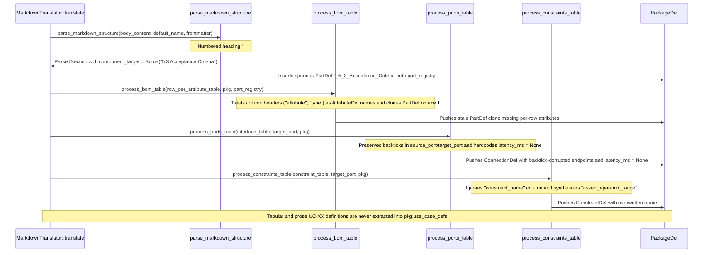

## 1. Context and References

<!-- test-target: crates/ingest-sysml/tests/reproducer_tests.rs -->

- **File**: `crates/ingest-sysml/src/translators/markdown.rs:1547-2990`
- **Pillar**: Semantic Traceability
- **Symptom**: Blueprint and Level 0 Markdown ingestion exhibits five semantic traceability and AST extraction failures: (1) numbered functional section headings (`### 5.3 Acceptance Criteria`, `## 2.1 Operational Context`) bypass `is_ac` and `is_functional` filters and are emitted as spurious `PartDef` blocks (`_5_3_Acceptance_Criteria`, `_2_1_Operational_Context`); (2) row-per-attribute component tables (`Component | Attribute | Type | Default / Bound | Description`) treat column header names (`attribute`, `type`, `default_bound`) as attribute identifiers instead of populating `PartDef.attributes` per row, and premature `pkg.part_defs.push(part.clone())` on the first row drops subsequent row attributes; (3) explicit constraint identifiers in `Constraint Name` columns are ignored in favor of synthesized `assert_<param>_range` names; (4) Markdown inline code backticks on interface `Port`, `Source`, `Target`, and `Protocol` cells are not stripped and `Latency Budget` columns are ignored (`ConnectionDef.latency_ms` hardcoded to `None`); and (5) use-case tables (`Use Case ID`, `Included Use Cases`, `Verification Test Cases`) and multi-line numbered scenario steps (`1.`..`N.`) under `### UC-XX` subsections are completely unextracted (`pkg.use_case_defs` remains empty).
- **Test-Target**: `crates/ingest-sysml/tests/reproducer_tests.rs`

## 2. Root Cause Analysis (5 Whys)

1. **Why does translating an architectural blueprint or multi-section Level 0 Markdown specification produce polluted `PartDef` blocks, malformed component attributes, unnamed range assertions, backtick-corrupted `ConnectionDef` endpoints with `latency_ms: None`, and zero `UseCaseDef` nodes?** Because `MarkdownTranslator::translate` (`crates/ingest-sysml/src/translators/markdown.rs:1547-1776`) and its section/table helpers (`parse_markdown_structure`, `process_bom_table`, `process_ports_table`, `process_constraints_table`) rely on rigid, unstripped string prefix checks and single-archetype table column assumptions while omitting use-case extraction entirely.
2. **Why do numbered functional headings (`### 5.3 Acceptance Criteria`, `## 2.1 Operational Context`) and row-per-attribute component tables corrupt `part_registry` and `pkg.part_defs`?** Because `parse_markdown_structure` (`crates/ingest-sysml/src/translators/markdown.rs:2144-2188`) leaves leading section numbers (`5.3`, `2.1`) attached when evaluating `is_ac` and `NON_COMPONENT_SECTION_KEYWORDS` and only clears `current_component_target` when `level <= 2`, while `process_bom_table` (`crates/ingest-sysml/src/translators/markdown.rs:2406-2461`) assumes every BOM row represents a wide one-row-per-component record and prematurely pushes `part.clone()` into `pkg.part_defs` on the first row.
3. **Why are explicit `Constraint Name` identifiers and interface `Latency Budget` / backtick-delimited `Source` and `Target` tokens lost during table projection?** Because `process_constraints_table` (`crates/ingest-sysml/src/translators/markdown.rs:2808`) unconditionally formats `con_name` as `format!("assert_{}_range", param_name)` without inspecting `constraint_name`/`constraint_id` columns, and `process_ports_table` (`crates/ingest-sysml/src/translators/markdown.rs:2636-2666`) copies raw backtick-wrapped cell strings into `source_port`/`target_port` while hardcoding `latency_ms: None` at line 2661.
4. **Why are tabular and prose `UC-XX` operational use cases omitted from the resulting `PackageDef`?** Because `MarkdownTranslator` never imports or constructs `deap_core::sysml_ast::UseCaseDef`, has no `TableType::UseCases` or use-case table handler for `Use Case ID` (`uc_id` / `use_case_id`), `Included Use Cases`, and `Verification Test Cases`, and never parses `### UC-XX` subsections or their multi-line numbered `Main Success Scenario` bullets (`1.`..`N.`).
5. **Why did existing unit tests in `crates/ingest-sysml/src/translators/markdown.rs:3032-3433` pass without catching these five semantic traceability gaps?** Because existing unit tests only exercised single-requirement files (`REQ-0001.md`, `REQ-0032.md`) and a minimal synthetic 3-table snippet (`test_translate_bom_and_ports` at lines 3194-3236) that used unnumbered H2 headers, wide BOM columns (`Mass (kg) | Power (W)`), anonymous parameter bounds, unquoted port names without connections/latencies, and zero use-case definitions.

## 3. Correctness Analysis

Tracing the data flow through `MarkdownTranslator::translate` (`crates/ingest-sysml/src/translators/markdown.rs:1547-1776`) exposes five deterministic violations of invariants **H-INGEST-MD-01** (Structural Section & Hierarchy Integrity), **H-INGEST-MD-02** (BDD Acceptance Criteria & Traceability Preservation), **H-INGEST-MD-03** (BOM, Port & Parametric Constraint Integrity), and **H-INGEST-MD-05** (Pure Schema-Driven Metamodel Fidelity):

1. **Defect 1 -- Numbered Functional Section Headings Emitted as Spurious `PartDef` Blocks (`crates/ingest-sysml/src/translators/markdown.rs:2144-2188`)**:
   - When `parse_markdown_structure` encounters a heading at level 2..=4 (`##`, `###`, `####`), lines 2151-2164 construct `clean_header_key` by retaining all `c.is_ascii_alphanumeric()` characters. For `### 5.3 Acceptance Criteria` or `## 2.1 Operational Context`, `norm_header` is `"5.3 acceptance criteria"` / `"2.1 operational context"` and `clean_header_key` is `"5 3 acceptance criteria"` / `"2 1 operational context"`.
   - At lines 2166-2170, `is_ac` checks `norm_header.starts_with("ac-") || norm_header.starts_with("ac ") || norm_header.starts_with("acceptance criteria") || clean_header_key.starts_with("ac ") || clean_header_key.starts_with("acceptance criteria")`. Because the leading section number `"5 3 "` was not stripped, `is_ac` evaluates to `false`.
   - At lines 2172-2176, `is_functional` checks `NON_COMPONENT_SECTION_KEYWORDS` (`crates/ingest-sysml/src/table.rs:62-69`). Keywords such as `"operational context"`, `"use cases"`, `"operational use cases"`, `"executive summary"`, `"command and control"`, `"mathematical formulations"`, and `"acceptance criteria"` are absent from `NON_COMPONENT_SECTION_KEYWORDS`, and `starts_with(&format!("{} ", kw))` fails whenever a numeric clause prefix (`2.1`, `5.3`) precedes the title.
   - Furthermore, at lines 2180-2183, `else if is_functional { if level <= 2 { current_component_target = None; } }` fails to clear `current_component_target` for `level == 3` (`###`) and `level == 4` (`####`), and when `is_functional` is `false` (line 2184), `current_component_target` is set to `Some(comp_cand)`.
   - In `translate` (`crates/ingest-sysml/src/translators/markdown.rs:1567-1588`), every `Some(target)` is sanitized into `_5_3_Acceptance_Criteria` or `_2_1_Operational_Context` and inserted into `part_registry` as a hardware/software `PartDef`.

2. **Defect 2 -- Row-Per-Attribute Component Tables Corrupt `PartDef.attributes` and Drop Multi-Row Attributes (`crates/ingest-sysml/src/translators/markdown.rs:2320-2463`)**:
   - Blueprints and component specifications frequently declare component attributes in row-per-attribute format: `Component | Attribute | Type | Default / Bound | Description` (normalized headers: `component`, `attribute`, `type`, `default_bound`, `description`).
   - `classify_table` (`crates/ingest-sysml/src/table.rs:944-946`) classifies this table as `TableType::Bom`.
   - In `process_bom_table` (`crates/ingest-sysml/src/translators/markdown.rs:2406-2453`), the loop iterates over `(col, val)` in each row and sets `let attr_name = sanitize_identifier(col, "attr")` (line 2411), using the column header name (`attribute_item`, `type`, `default_bound`) as the `AttributeDef.name` instead of reading the attribute's identifier from the `attribute` column, its type from the `type` column, and its default/bound from the `default`/`bound`/`default_bound`/`value` column.
   - Worse still, lines 2459-2461 execute:
     ```rust
     if !pkg.part_defs.iter().any(|p| p.name == comp_name) {
         pkg.part_defs.push(part.clone());
     }
     ```
     on the **first row** of `comp_name`. When subsequent rows in the table (or subsequent tables in the document) append additional attributes, ports, or constraints to `part_registry.get_mut(&comp_name)`, `translate` Step 4 (`crates/ingest-sysml/src/translators/markdown.rs:1639-1643`) skips `comp_name` because `pkg.part_defs` already contains the stale clone from row 1.

3. **Defect 3 -- Explicit `Constraint Name` Columns Ignored in `process_constraints_table` (`crates/ingest-sysml/src/translators/markdown.rs:2698-2875`)**:
   - In `process_constraints_table` (lines 2719-2744), there is no column lookup for `constraint_name`, `constraint_id`, or `rule_name`.
   - At line 2808, the constraint identifier is unconditionally constructed as:
     ```rust
     let con_name = format!("assert_{}_range", param_name);
     ```
   - Any explicit constraint name declared in a `Constraint Name` column (e.g., `SubsecondEdgeSolverLatencyBound` or `ZeroRoeViolationsCeiling`) is discarded, breaking downstream traceability between normative constraint tables and `ConstraintDef.name`.

4. **Defect 4 -- Unstripped Markdown Backticks on Interface Cells and Unparsed `Latency Budget` in `process_ports_table` (`crates/ingest-sysml/src/translators/markdown.rs:2493-2668`)**:
   - In `process_ports_table`, `raw_name` (`Port` column) is passed through `sanitize_identifier`, which strips backticks, but `protocol` (line 2572), `src_val` (line 2637), and `tgt_val` (line 2638) are extracted via `row.get(col).map_or("", |v| v.trim())`. Because `clean_cell_value` (`crates/ingest-sysml/src/table.rs:454-466`) only strips hyperlinks and HTML tags, inline code backticks (such as `` `StrategicAirspaceCoordinatorNode.policy_out` `` or `` `TacticalEdgeCoordinatorNode.policy_in` ``) remain embedded in `ConnectionDef.source_port`, `ConnectionDef.target_port`, `ConnectionDef.source_part`, `ConnectionDef.target_part`, and `PortDef.protocol_family`.
   - At line 2661, `ConnectionDef.latency_ms` is hardcoded to `None`. Columns named `Latency Budget`, `Latency (ms)`, `Latency`, or `Max Latency` (`latency_budget`, `latency_ms`, `latency`, `max_latency`) are never inspected or unit-normalized (`us`/`µs` `/ 1000.0`, `s` `* 1000.0`, `ms` `* 1.0`) into `ConnectionDef.latency_ms`.

5. **Defect 5 -- Missing Tabular and Prose `UC-XX` Use-Case Extraction (`crates/ingest-sysml/src/translators/markdown.rs:1547-2290`)**:
   - `UseCaseDef` and `TestCaseDef` are never imported or populated in `crates/ingest-sysml/src/translators/markdown.rs`.
   - Tabular use-case specifications with columns `Use Case ID` (`use_case_id`, `uc_id`), `Use Case` / `Name` / `Title`, `Primary Actor` / `Actor` / `Actors`, `Included Use Cases` (`included_use_cases`, `includes`), and `Verification Test Cases` (`verification_test_cases`, `test_cases`) fall through to `TableType::Generic` -> `process_properties_table`, polluting `pkg.attribute_defs` with use-case IDs instead of populating `pkg.use_case_defs` and `pkg.test_case_defs`.
   - Prose use-case sections (`### UC-XX: ...`, `#### UC-XX ...`, or bold `**6.1 UC-M2M: ...**` headings in `docs/architecture/blueprints/DUAL_USE_DRONE_ORCHESTRATION_AND_CUAS_BLUEPRINT.md:179-235`) containing `- **Primary Actor:**`, `- **Secondary Actor:**`, `- **Preconditions:**`, `- **Main Success Scenario:**` with multi-line numbered steps (`1.`..`N.`), `- **Postconditions:**`, `- **Included Use Cases:**`, and `- **Verification Test Cases:**` are treated as component headings (spawning fake `PartDef` blocks like `_6_1_UC_M2M_...` or `UC_01_...`) while `pkg.use_case_defs` remains empty.

## 4. UML Diagrams



## 5. Affected Callers / Downstream Impact

- `MarkdownTranslator::translate` (`crates/ingest-sysml/src/translators/markdown.rs:1547-1776`) -- Directly emits corrupted `PackageDef` ASTs when translating single-file architectural blueprints or Level 0 Markdown specifications.
- `MarkdownTranslator::translate_files` (`crates/ingest-sysml/src/translators/markdown.rs:1805-1973`) -- Propagates spurious `PartDef` nodes into subsystem packages and fails to merge `use_case_defs` and `test_case_defs` across multi-file ingestion runs.
- `ingest-sysml` CLI binary (`crates/ingest-sysml/src/main.rs`) -- Emits invalid `schema/model.sysml` files containing non-component `part def _5_3_Acceptance_Criteria`, missing component attributes, backtick-tainted `connect` statements, missing latency budgets, and zero `use case def` blocks when run against `docs/architecture/blueprints/DUAL_USE_DRONE_ORCHESTRATION_AND_CUAS_BLUEPRINT.md`.
- `compile-sysml` and `verify-baseline` downstream compilers -- Step 1.5 Failure Mode Research Swarm, Step 2 STPA/FMECA synthesis (`Check 17`), Logical Interface Matrix generation (`spec-icd-engineering`), and Use Case generation (`spec-usecase-engineering`) either fail model coverage gates (`Check 19`) or synthesize specifications for phantom section-heading parts while missing all `UC-XX` operational use cases.

## 6. Proposed Correction

1. **Strip leading numeric section prefixes and recognize functional/use-case headings in `parse_markdown_structure` (`crates/ingest-sysml/src/translators/markdown.rs:2144-2191`)**:
   - Strip leading clause numbers (e.g. `5.3`, `2.1`, `Section 4.2:`) from `norm_header` before computing `clean_header_key`.
   - Treat headings matching `is_ac`, `is_functional` (including `"operational context"`, `"executive summary"`, `"command and control"`, `"use cases"`, `"operational use cases"`, `"mathematical formulations"`, `"normative model"`, `"acceptance criteria"`), or use-case identifiers (`uc-`, `uc_`, `use case`) as non-component sections at **all** heading levels (`level 2..=4`), setting `current_component_target = None`.
2. **Support row-per-attribute component tables and remove premature `pkg.part_defs.push` in `process_bom_table` (`crates/ingest-sysml/src/translators/markdown.rs:2320-2463`)**:
   - Detect when a BOM table has an explicit attribute-name column (`attribute`, `attribute_name`, `property`, `field`, `parameter`). When present, extract `attr_name` from that column, `type_name` from `type` / `data_type` (inferring from `default` / `bound` when omitted), `default_value` from `default` / `default_bound` / `default_value` / `bound` / `value`, and `doc` from `description` / `doc` / `notes`, appending each row's `AttributeDef` onto the component's `PartDef` in `part_registry`.
   - Remove the premature `pkg.part_defs.push(part.clone())` inside `process_bom_table` (lines 2459-2461) so `translate` Step 4 (lines 1639-1643) merges the complete, fully populated `PartDef` from `part_registry`.
3. **Honor explicit `Constraint Name` columns in `process_constraints_table` (`crates/ingest-sysml/src/translators/markdown.rs:2698-2828`)**:
   - Detect `constraint_name_col` (`constraint_name`, `constraint_id`, `rule_name`, `invariant_name`). When a row provides a non-empty value in `constraint_name_col`, sanitize it via `sanitize_identifier(raw_con_name, "Constraint")` as `con_name`; otherwise fall back to `format!("assert_{}_range", param_name)`.
4. **Strip backticks on interface cells and parse `Latency Budget` into `ConnectionDef.latency_ms` in `process_ports_table` (`crates/ingest-sysml/src/translators/markdown.rs:2532-2667`)**:
   - Strip inline backticks and asterisks (`trim_matches(['`', '*', ' '])`) from `protocol`, `src_val`, and `tgt_val` before populating `PortDef` and `ConnectionDef`.
   - Detect `latency_col` (`latency`, `latency_ms`, `latency_budget`, `max_latency`, `propagation_latency`) and parse numeric values with unit scaling (`us` / `µs` / `μs` -> `val / 1000.0`, `s` / `sec` -> `val * 1000.0`, default / `ms` -> `val`) into `ConnectionDef.latency_ms`.
5. **Extract `UseCaseDef` (and linked `TestCaseDef`) from both use-case tables and `### UC-XX` / `**X.Y UC-...**` prose blocks (`crates/ingest-sysml/src/translators/markdown.rs`)**:
   - Detect use-case tables containing `use_case_id` / `uc_id` / `use_case` columns and extract `UseCaseDef` (`name`, `actor`, `actors`, `objective`, `preconditions`, `postconditions`, `includes` from `included_use_cases` / `includes`, `steps`, and `doc` / `test_case_defs` from `verification_test_cases`).
   - Parse prose subsections headed by `### UC-XX...`, `#### UC-XX...`, or `**6.1 UC-...**` to extract actors, preconditions, postconditions, included use cases, verification test cases, and multi-line numbered steps (`1.`..`N.`) into `pkg.use_case_defs`, and merge `use_case_defs` and `test_case_defs` in `translate_files`.

```rust
// Proposed fix excerpt in crates/ingest-sysml/src/translators/markdown.rs
fn strip_leading_section_number(s: &str) -> &str {
    let trimmed = s.trim();
    let without_sec = trimmed
        .strip_prefix("section ")
        .or_else(|| trimmed.strip_prefix("clause "))
        .unwrap_or(trimmed)
        .trim_start();
    let num_prefix_len = without_sec
        .chars()
        .take_while(|c| c.is_ascii_digit() || *c == '.')
        .count();
    if num_prefix_len > 0 && without_sec[..num_prefix_len].chars().any(|c| c.is_ascii_digit()) {
        without_sec[num_prefix_len..]
            .trim_start_matches([':', '-', ')', ' '])
            .trim_start()
    } else {
        trimmed
    }
}

fn parse_latency_to_ms(raw: &str, col_unit: &str) -> Option<f64> {
    let cleaned = raw
        .trim()
        .trim_start_matches(['<', '>', '=', '~', '≤', '≥', ' ']);
    let (val, val_unit, _) = parse_numeric_with_unit(cleaned);
    let num = val?;
    let unit = if !val_unit.as_deref().unwrap_or("").is_empty() {
        val_unit.unwrap_or_default().to_ascii_lowercase()
    } else {
        col_unit.to_ascii_lowercase()
    };
    if unit == "s" || unit == "sec" || unit == "seconds" {
        Some(num * 1000.0)
    } else if unit == "us" || unit == "µs" || unit == "μs" || unit == "usec" {
        Some(num / 1000.0)
    } else {
        Some(num)
    }
}
```

## 7. Relationship to Existing Issues

Discovered in audit -- new finding.

## Audit Source

Adversarial Semantic Traceability Audit
SEVERITY: Critical
FILE_LOCATION: crates/ingest-sysml/src/translators/markdown.rs:1547-2990
