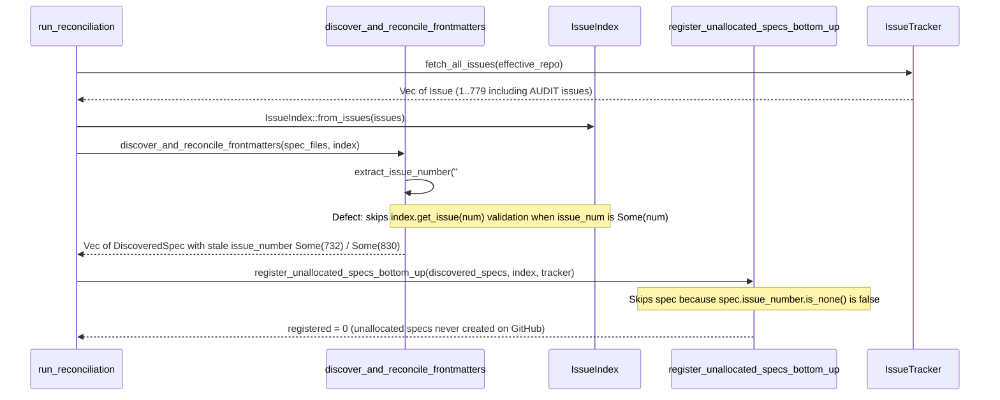

## 1. Context and References

<!-- test-target: crates/reconcile-backlog/src/lib_tests.rs -->

- **File**: `crates/reconcile-backlog/src/lib.rs:71-131`
- **Pillar**: Semantic Traceability
- **Symptom**: `discover_and_reconcile_frontmatters` blindly trusts any numeric `Issue ID` or `GitHub Issue` extracted via `extract_issue_number` from specification frontmatter without verifying against `IssueIndex::get_issue(num)` that the remote tracker issue exists and matches the specification (rather than missing from `IssueIndex` or colliding with an unrelated `[AUDIT]` defect or mismatched specification tier/ordinal), preventing `register_unallocated_specs_bottom_up` from allocating real GitHub issues for specifications carrying offline-hallucinated or colliding issue numbers (`#732`..`#830+` across `.pipeline/upstream/docs/epics/EPIC-07-BP_07_Self_Hosting_4_Level_Modular_Multi_File_Code_Generator_Blueprint.md` through `EPIC-11-*.md` and their child specifications).
- **Test-Target**: `crates/reconcile-backlog/src/lib_tests.rs`

## 2. Root Cause Analysis (5 Whys)

1. **Why does `run_reconciliation` fail to allocate GitHub issues for `.pipeline/upstream/docs/epics/EPIC-07-*.md` through `EPIC-11-*.md` and their child Features, User Stories, and Use Cases when their frontmatter contains `#732`..`#830+`?** Because `register_unallocated_specs_bottom_up` (`crates/reconcile-backlog/src/registration.rs:243`) only registers or searches for an issue when `spec.issue_number.is_none()`, and `discover_and_reconcile_frontmatters` (`crates/reconcile-backlog/src/lib.rs:92-127`) populates `spec.issue_number = Some(num)` directly from the unverified frontmatter string.
2. **Why does `discover_and_reconcile_frontmatters` populate `spec.issue_number = Some(num)` when `#732`..`#779` belong to unrelated `[AUDIT]` defect issues and `#780`..`#830+` do not exist in the remote GitHub tracker at all?** Because line 92 executes `let mut issue_num = fm.github_issue.as_deref().and_then(extract_issue_number);` and lines 94-96 only consult `index.find_issue_for_spec(&title, Some(&spec_type))` when `issue_num.is_none() && !options.offline`.
3. **Why is `index.get_issue(num)` never consulted when `issue_num` is `Some(num)` and `!options.offline`?** Because `discover_and_reconcile_frontmatters` assumes that any numeric `#N` present in local Markdown frontmatter was previously allocated by the canonical tracker for that exact specification, omitting an `IssueIndex` existence and identity check.
4. **Why is assuming local frontmatter `#N` validity unsafe during live tracker reconciliation?** Because specification files synthesized offline by subagents (such as `EPIC-07` through `EPIC-11` with `| **Issue ID** | #732 |`..`#830+`) can contain sequentially guessed or stale issue numbers that either exceed the tracker watermark or collide with non-specification issues such as `[AUDIT]` defect dossiers created in the interim.
5. **Why did the test suite in `crates/reconcile-backlog/src/lib_tests.rs` not catch this violated SSOT invariant?** Because `test_run_reconciliation_updates_frontmatter_and_checklists_and_syncs_body` (`crates/reconcile-backlog/src/lib_tests.rs:236-292`) only tested a pre-populated `#20` that already matched a valid `FEAT-001: Login` issue in `MockTracker`, with zero negative tests for non-existent frontmatter issue IDs or frontmatter IDs colliding with `[AUDIT]` / mismatched tracker issues.

## 3. Correctness Analysis

- **Violated Invariant**: Issue Tracker as Canonical SSOT (`REQ-RECONCILE-BACKLOG-CORE`, `REQ-RECONCILE-BACKLOG-LIB-RUN-RECONCILIATION`, and `.pipeline/constitution.md:94-95` Unique Backlog Identifiers). Local specification frontmatter must resolve to an existing tracker issue whose identity and specification type are consistent with the local specification; unverified or colliding local IDs must be reconciled against the remote `IssueIndex` or re-allocated bottom-up.
- **Trigger to Failure Data Flow**:
  1. `run_reconciliation` (`crates/reconcile-backlog/src/lib.rs:189-221`) fetches all remote issues via `tracker.fetch_all_issues(...)`, constructs `IssueIndex` (`line 212`), and invokes `discover_and_reconcile_frontmatters` (`lines 215-221`).
  2. Inside `discover_and_reconcile_frontmatters` (`crates/reconcile-backlog/src/lib.rs:80-128`), `parse_frontmatter` reads `| **Issue ID** | #732 |` into `fm.github_issue` (`crates/reconcile-backlog/src/frontmatter.rs:124`).
  3. At `crates/reconcile-backlog/src/lib.rs:92`, `extract_issue_number` extracts `Some(732)`.
  4. At `crates/reconcile-backlog/src/lib.rs:94-96`, the guard `if issue_num.is_none() && !options.offline` evaluates to `false` because `issue_num` is `Some(732)`. `index.get_issue(732)` is never inspected, even though issue `#732` on `gintatkinson/DEAP01-spec-core` is an unrelated `[AUDIT]` issue (or for `#780`..`#830+`, `index.get_issue(num)` returns `None`).
  5. At `crates/reconcile-backlog/src/lib.rs:101-111`, because `effective_repo.is_some() && !current_raw.contains("http")`, `discover_and_reconcile_frontmatters` rewrites the frontmatter cell to `[#732](https://github.com/gintatkinson/DEAP01-spec-core/issues/732)` and records `DiscoveredSpec { issue_number: Some(732), ... }` (`lines 117-127`).
  6. In Phase 3 (`register_unallocated_specs_bottom_up` -> `register_single_spec`, `crates/reconcile-backlog/src/registration.rs:243`), `if spec.issue_number.is_none()` is `false`, so the specification is completely skipped and no GitHub issue is created.
  7. In Phase 5 (`reconcile_checklists_and_sync_remote`, `crates/reconcile-backlog/src/lib.rs:158-179`), when `options.sync_bodies` is active, `tracker.edit_issue_body(issue_num, &projected, effective_repo)` either fails on non-existent issue numbers (`#780`..`#830+`) or corrupts the body of an unrelated `[AUDIT]` issue (`#732`..`#779`) by overwriting it with the specification body.

## 4. UML Diagrams



## 5. Affected Callers / Downstream Impact

- `run_reconciliation` (`crates/reconcile-backlog/src/lib.rs:189-253`) -- fails to register new GitHub issues for specifications carrying unverified offline issue numbers and risks overwriting unrelated `[AUDIT]` issue bodies during Phase 5 remote body sync.
- `discover_and_reconcile_frontmatters` (`crates/reconcile-backlog/src/lib.rs:71-131`) -- cements non-existent or colliding issue URLs into local specification frontmatter tables.
- `register_unallocated_specs_bottom_up` / `register_single_spec` (`crates/reconcile-backlog/src/registration.rs:229-319`) -- bypassed for all specs whose `DiscoveredSpec::issue_number` was erroneously populated from stale frontmatter.
- `reconcile_checklists_and_sync_remote` (`crates/reconcile-backlog/src/lib.rs:135-183`) -- backpatches parent/child checklists with bogus issue numbers and calls `tracker.edit_issue_body` on non-existent or colliding tracker issues.
- `.pipeline/upstream/docs/epics/EPIC-07-BP_07_Self_Hosting_4_Level_Modular_Multi_File_Code_Generator_Blueprint.md` .. `EPIC-11-*.md` (and child `FEAT-31`..`FEAT-55`, `UC-32`..`UC-61`, `US-45`..`US-84`) -- remain unallocated on GitHub because their offline-populated `#732`..`#830+` IDs are never invalidated and re-registered.

## 6. Proposed Correction

<!-- MUST NOT use regex (Check 34: deterministic linear slice/char scanning, no regex crate). MUST be domain-agnostic for upstream crates (Check 19). -->

```rust
/// Validates whether `num` in `index` exists and is semantically compatible with `(spec_title, spec_type)`.
fn is_frontmatter_issue_valid_in_index(
    index: &IssueIndex,
    num: u64,
    spec_title: &str,
    spec_type: &str,
) -> bool {
    let Some(remote_issue) = index.get_issue(num) else {
        return false;
    };
    let remote_trimmed = remote_issue.title.trim_start();
    if remote_trimmed.starts_with("[AUDIT]") || remote_trimmed.starts_with("[audit]") {
        return false;
    }
    let canonical_spec_type = crate::tracker::canonicalize_spec_type(spec_type);
    if let Some(remote_type) = crate::tracker::infer_spec_type_from_title(&remote_issue.title) {
        if !canonical_spec_type.is_empty() && remote_type != canonical_spec_type {
            return false;
        }
    }
    if !crate::tracker::ordinal_compatible(spec_title, &remote_issue.title) {
        return false;
    }
    if let (Some(ord_spec), Some(ord_remote)) = (
        crate::tracker::extract_spec_ordinal(spec_title),
        crate::tracker::extract_spec_ordinal(&remote_issue.title),
    ) {
        if ord_spec == ord_remote {
            return true;
        }
    }
    let norm_spec = crate::tracker::normalize_title(spec_title);
    let norm_remote = crate::tracker::normalize_title(&remote_issue.title);
    !norm_spec.is_empty()
        && !norm_remote.is_empty()
        && (norm_spec == norm_remote
            || norm_remote.contains(&norm_spec)
            || norm_spec.contains(&norm_remote))
}
```

And in `discover_and_reconcile_frontmatters` (`crates/reconcile-backlog/src/lib.rs:92-112`), validate `issue_num` when `!options.offline`:

```rust
        let mut issue_num = fm.github_issue.as_deref().and_then(extract_issue_number);
        let mut had_placeholder_or_stale_issue =
            fm.github_issue.as_deref().is_none_or(is_placeholder_issue_id);
        if !options.offline {
            if let Some(num) = issue_num {
                if !is_frontmatter_issue_valid_in_index(index, num, &title, &spec_type) {
                    issue_num = None;
                    had_placeholder_or_stale_issue = true;
                }
            }
            if issue_num.is_none() {
                issue_num = index.find_issue_for_spec(&title, Some(&spec_type));
            }
        }
```

## 7. Relationship to Existing Issues

Discovered in audit -- new finding.

## Audit Source

Adversarial Semantic Traceability Audit
SEVERITY: Important
FILE_LOCATION: crates/reconcile-backlog/src/lib.rs:71-131
