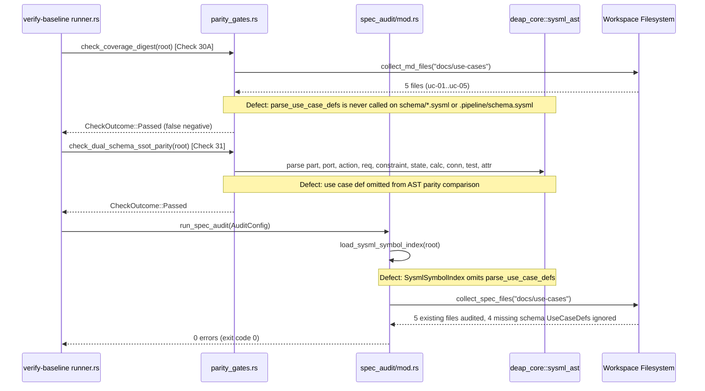

## 1. Context and References

<!-- test-target: crates/verify-baseline/tests/reproducer_tests.rs -->

- **File**: `crates/verify-baseline/src/checks/parity_gates.rs:3837-3949`
- **Pillar**: Semantic Traceability
- **Symptom**: Even when `docs/architecture/blueprints/DUAL_USE_DRONE_ORCHESTRATION_AND_CUAS_BLUEPRINT.md`, `schema/cuas_coa.sysml`, and `.pipeline/schema.sysml` declare 9 Use Cases (`UC_01`..`UC_05`, `UC_M2M`, `UC_STRAT_DELEGATION`, `UC_UTM_DECONFLICT`, `UC_SWARM_SATURATION`) while `docs/use-cases/` only contains 5 files (`UC-01`..`UC-05`), `./target/release/verify-baseline .` exits `0` (`ALL CHECKS PASSED`) without detecting the 4 missing Use Case specification files (`UC_M2M`, `UC_STRAT_DELEGATION`, `UC_UTM_DECONFLICT`, `UC_SWARM_SATURATION`).
- **Test-Target**: `crates/verify-baseline/tests/reproducer_tests.rs`

Additional affected locations in the same verification pipeline:
- `crates/verify-baseline/src/checks/parity_gates.rs:42-47` (`deap_core::sysml_ast` import list omits `parse_use_case_defs` and `UseCaseDef`)
- `crates/verify-baseline/src/checks/parity_gates.rs:4343-4519` (`check_dual_schema_ssot_parity` compares 10 AST element kinds across `schema/*.sysml` and `.pipeline/schema.sysml` but omits `parse_use_case_defs`)
- `crates/verify-baseline/src/spec_audit/mod.rs:613-708` (`load_sysml_symbol_index` parses `part`, `port`, `action`, `constraint`, `requirement`, `attribute`, `state`, and `test case` definitions from `.sysml` files, completely omitting `parse_use_case_defs`)
- `crates/verify-baseline/src/spec_audit/mod.rs:864-1253` (`run_spec_audit` only audits existing markdown files discovered by `collect_spec_files` and never checks 1:1 forward coverage from SysML `use case def` AST nodes to `docs/use-cases/*.md`)

## 2. Root Cause Analysis (5 Whys)

1. **Why does `./target/release/verify-baseline .` exit `0` (`ALL CHECKS PASSED`) when 4 out of 9 `use case def` declarations (`UC_M2M`, `UC_STRAT_DELEGATION`, `UC_UTM_DECONFLICT`, `UC_SWARM_SATURATION`) in `schema/cuas_coa.sysml` and `.pipeline/schema.sysml` lack specification files in `docs/use-cases/`?** Because neither `crates/verify-baseline/src/checks/parity_gates.rs` nor `crates/verify-baseline/src/spec_audit/mod.rs` contains a forward schema-to-specification parity gate verifying that every `UseCaseDef` AST node declared in `schema/*.sysml` and `.pipeline/schema.sysml` is realized by a corresponding `docs/use-cases/uc-*.md` specification document.
2. **Why does `check_coverage_digest` (`Check 30A` at `crates/verify-baseline/src/checks/parity_gates.rs:3837-3949`) fail to flag the missing `docs/use-cases/` specification files?** Because `check_coverage_digest` only performs a backward reference check: it populates `declared_specs` from existing filenames already on disk in `docs/features`, `docs/use-cases`, and `docs/user-stories` (`lines 3844-3872`) and checks whether markdown links in `docs/` reference a nonexistent `uc-*.md` filename (`lines 3922-3940`), without ever parsing `use case def` declarations from `.pipeline/schema.sysml` or `schema/*.sysml`.
3. **Why does `run_spec_audit` (`crates/verify-baseline/src/spec_audit/mod.rs:864-1253`) also fail to detect the un-realized `UseCaseDef` AST nodes during Phase 2 specification auditing?** Because `load_sysml_symbol_index` (`crates/verify-baseline/src/spec_audit/mod.rs:613-708`) only calls `parse_part_defs`, `parse_port_defs`, `parse_action_defs`, `parse_constraint_defs`, `parse_requirement_defs`, `parse_attribute_defs`, `parse_state_defs`, and `parse_test_case_defs` (`lines 656-663`), never invoking `deap_core::sysml_ast::parse_use_case_defs`, and `run_spec_audit` iterates exclusively over existing files returned by `collect_spec_files` (`lines 885-952`).
4. **Why was `parse_use_case_defs` omitted from `parity_gates.rs` and `spec_audit/mod.rs` even though `deap_core::sysml_ast` defines `UseCaseDef` and `parse_use_case_defs` (`crates/deap-core/src/sysml_ast.rs:747-765`, `1362-1371`, `2165-2218`)?** Because `parity_gates.rs` (`lines 42-47`) and `spec_audit/mod.rs` (`lines 656-663`) hardcoded an incomplete subset of `deap_core::sysml_ast` parsers focused on structural (`part def`, `port def`), behavioral (`action def`, `state def`), and verification (`requirement def`, `constraint def`, `test case def`) nodes, leaving `use case def` disconnected from both Check 30A/Check 31 parity verification and `SysmlSymbolIndex`.
5. **Why did existing unit and integration tests in `crates/verify-baseline` not catch this blind spot?** Because existing tests in `crates/verify-baseline/src/checks/parity_gates.rs` (`lines 4831-5394`) and `crates/verify-baseline/src/spec_audit/mod.rs` (`lines 1255-1471`) only test backward link integrity (broken `uc-*.md` references in prose) and structural rules on already-existing `docs/use-cases/uc-*.md` files, with zero negative mutation tests asserting that a `use case def` present in `.pipeline/schema.sysml` or `schema/*.sysml` without a matching `docs/use-cases/` specification file causes `verify-baseline` to fail.

## 3. Correctness Analysis

### Deterministic Traceability Invariant Violation

Under `.pipeline/constitution.md` (Section 2, *Specification Integrity & Traceability* and *Pure Schema-Driven Compiler Invariant*), all specification tiers (`docs/epics/`, `docs/features/`, `docs/user-stories/`, `docs/use-cases/`) must maintain deterministic, zero-gap traceability to the authoritative SysML v2 AST in `schema/*.sysml` and `.pipeline/schema.sysml`. Specifically, `skills/spec-usecase-engineering/SKILL.md` mandates that every `use case def` AST node declared in the schema is extracted into a formal UML System Use Case specification under `docs/use-cases/`.

Let $U_{\text{schema}}$ denote the set of canonical Use Case identifiers parsed via `deap_core::sysml_ast::parse_use_case_defs` from `.pipeline/schema.sysml` and `schema/*.sysml`, and let $U_{\text{docs}}$ denote the set of Use Case identifiers realized by markdown specification files in `docs/use-cases/*.md`. The forward completeness invariant requires:

$$
\begin{aligned}
\Delta_{\text{UC}} &= U_{\text{schema}} \setminus U_{\text{docs}} = \emptyset
\end{aligned}
$$

When a downstream or blueprint workspace declares:

$$
\begin{aligned}
|U_{\text{schema}}| &= 9 \quad (\texttt{UC\_01}, \dots, \texttt{UC\_05}, \texttt{UC\_M2M}, \texttt{UC\_STRAT\_DELEGATION}, \texttt{UC\_UTM\_DECONFLICT}, \texttt{UC\_SWARM\_SATURATION}) \\
|U_{\text{docs}}| &= 5 \quad (\texttt{UC-01}, \dots, \texttt{UC-05})
\end{aligned}
$$

the missing set $\Delta_{\text{UC}}$ has cardinality $|\Delta_{\text{UC}}| = 4 \neq 0$.

### Empirical Code Inspection of `parity_gates.rs` and `spec_audit/mod.rs`

1. **Missing AST Parser Import and Invocation in `parity_gates.rs`**:
   At `crates/verify-baseline/src/checks/parity_gates.rs:42-47`, the module imports:
   ```rust
   use deap_core::sysml_ast::{
       parse_action_defs, parse_attribute_defs, parse_calc_defs, parse_connection_defs,
       parse_constraint_defs, parse_part_defs, parse_port_defs, parse_requirement_defs,
       parse_state_defs, parse_test_case_defs,
   };
   ```
   `parse_use_case_defs` is never imported or called anywhere in `crates/verify-baseline/`.

2. **One-Way Backward Check in `check_coverage_digest` (`Check 30A`, `parity_gates.rs:3837-3949`)**:
   `check_coverage_digest` only checks whether markdown files in `docs/` mention a `uc-*.md` filename that does not exist on disk:
   ```rust
   let spec_dirs = [
       docs_dir.join("features"),
       docs_dir.join("use-cases"),
       docs_dir.join("user-stories"),
   ];
   for dir in &spec_dirs {
       for md_file in collect_md_files(dir) {
           if let Some(name) = md_file.file_name().and_then(|n| n.to_str()) {
               if !name.starts_with('_') && name != "README.md" {
                   declared_specs.insert(name.to_lowercase());
               }
           }
       }
   }
   ```
   If 4 `use case def` nodes (`UC_M2M`, `UC_STRAT_DELEGATION`, `UC_UTM_DECONFLICT`, `UC_SWARM_SATURATION`) are never written to `docs/use-cases/` and never linked as `uc-*.md` filenames in prose, `check_coverage_digest` returns `CheckOutcome::Passed` (or `CheckOutcome::Skipped` if no prose references exist).

3. **Omission in `check_dual_schema_ssot_parity` (`Check 31`, `parity_gates.rs:4343-4519`)**:
   `check_dual_schema_ssot_parity` compares `part`, `port`, `action`, `requirement`, `constraint`, `state`, `calc`, `connection`, `test case`, and `attribute` AST definitions between `schema/*.sysml` and `.pipeline/schema.sysml`, but never invokes `parse_use_case_defs`.

4. **Omission in `load_sysml_symbol_index` and `run_spec_audit` (`spec_audit/mod.rs:613-708`, `864-1253`)**:
   `load_sysml_symbol_index` builds `SysmlSymbolIndex` without parsing `use case def` nodes (`lines 656-663`), and `run_spec_audit` only validates existing files in `docs/use-cases/` without verifying that every schema `UseCaseDef` is covered by a `docs/use-cases/` file.

## 4. UML Diagrams



## 5. Affected Callers / Downstream Impact

- **`crates/verify-baseline/src/runner.rs:943-956` and `983-1035`**: `run_all_checks` executes `parity_gates::check_coverage_digest`, `parity_gates::check_dual_schema_ssot_parity`, and `spec_audit::run_spec_audit`. Because all three ignore `UseCaseDef` AST nodes when `docs/use-cases/` is populated, `./target/release/verify-baseline .` exits `0` (`ALL CHECKS PASSED`) on incomplete downstream specifications.
- **`skills/spec-orchestrator/SKILL.md` & `skills/spec-usecase-engineering/SKILL.md`**: Phase 1B Use Case generation and Phase 4 verification gates rely on `./target/release/verify-baseline .` to enforce 100% schema-to-specification realization. Silent omission of `UC_M2M`, `UC_STRAT_DELEGATION`, `UC_UTM_DECONFLICT`, and `UC_SWARM_SATURATION` allows an incomplete Agile/MBSE backlog to pass baseline verification and enter WBS (`spec-wbs-engineering`), ConOps (`spec-conops-engineering`), and implementation phases with un-specified system use cases.
- **`crates/verify-baseline/src/checks/parity_gates.rs:4343-4519` (`check_dual_schema_ssot_parity`)**: Divergence in `use case def` declarations between `schema/*.sysml` and `.pipeline/schema.sysml` goes undetected by Check 31.

## 6. Proposed Correction

1. **Import `parse_use_case_defs` in `crates/verify-baseline/src/checks/parity_gates.rs` and `crates/verify-baseline/src/spec_audit/mod.rs`**.
2. **Enforce Schema `UseCaseDef` to `docs/use-cases/` Parity**:
   In `crates/verify-baseline/src/checks/parity_gates.rs` (within `check_coverage_digest` or a dedicated active parity gate registered in `crates/verify-baseline/src/runner.rs` and `crates/verify-baseline/src/spec_audit/mod.rs`), when `docs/use-cases/` contains specification files (i.e., non-`.gitkeep` active specification repository), parse all `UseCaseDef` AST nodes from `.pipeline/schema.sysml` and `schema/*.sysml` via `parse_use_case_defs`. Normalize Use Case identifiers (matching both raw AST names such as `UC_M2M`, `UC_01_...` and normalized prefixes/headings/content references in `docs/use-cases/*.md`) and fail the check if any schema `UseCaseDef` is not realized by a specification file in `docs/use-cases/`.
3. **Include `parse_use_case_defs` in `check_dual_schema_ssot_parity` (`Check 31`)** so `use case def` declarations are also verified for 1:1 SSOT parity between `schema/*.sysml` and `.pipeline/schema.sysml`.

```rust
use deap_core::sysml_ast::parse_use_case_defs;

pub fn check_schema_use_case_realization_parity(root: &Path) -> CheckResult {
    let id = "30D";
    let name = "Schema UseCaseDef to docs/use-cases Realization Parity Gate";

    let uc_dir = root.join("docs/use-cases");
    let uc_files = collect_md_files(&uc_dir);
    let active_uc_files: Vec<PathBuf> = uc_files
        .into_iter()
        .filter(|p| {
            p.file_name()
                .and_then(|n| n.to_str())
                .map(|n| !n.starts_with('_') && n != "README.md")
                .unwrap_or(false)
        })
        .collect();

    if active_uc_files.is_empty() {
        return CheckResult {
            id,
            name,
            outcome: CheckOutcome::Skipped(
                "No active Use Case specification files in docs/use-cases".to_string(),
            ),
        };
    }

    let mut schema_files = Vec::new();
    let pipeline_schema = root.join(".pipeline/schema.sysml");
    if pipeline_schema.is_file() {
        schema_files.push(pipeline_schema);
    }
    let schema_dir = root.join("schema");
    if schema_dir.is_dir() {
        if let Ok(entries) = std::fs::read_dir(&schema_dir) {
            for entry in entries.flatten() {
                let path = entry.path();
                if path.extension().and_then(|e| e.to_str()) == Some("sysml") {
                    schema_files.push(path);
                }
            }
        }
    }

    let mut declared_use_cases = std::collections::BTreeSet::new();
    for sf in &schema_files {
        if let Ok(content) = std::fs::read_to_string(sf) {
            for uc in parse_use_case_defs(&content) {
                declared_use_cases.insert(uc.name);
            }
        }
    }

    if declared_use_cases.is_empty() {
        return CheckResult {
            id,
            name,
            outcome: CheckOutcome::Passed,
        };
    }

    let mut combined_uc_docs = String::new();
    let mut uc_filenames_norm = Vec::new();
    for f in &active_uc_files {
        if let Some(stem) = f.file_stem().and_then(|s| s.to_str()) {
            uc_filenames_norm.push(stem.to_ascii_lowercase().replace('-', "_"));
        }
        if let Ok(c) = std::fs::read_to_string(f) {
            combined_uc_docs.push_str(&c);
            combined_uc_docs.push('\n');
        }
    }
    let combined_lower = combined_uc_docs.to_ascii_lowercase().replace('-', "_");

    let mut missing = Vec::new();
    for uc_name in &declared_use_cases {
        let norm = uc_name.to_ascii_lowercase().replace('-', "_");
        let prefix = norm
            .split('_')
            .take(2)
            .collect::<Vec<_>>()
            .join("_");
        let matched_by_file = uc_filenames_norm.iter().any(|f| {
            f.contains(&norm)
                || (prefix.starts_with("uc_") && prefix.chars().nth(3).map(|c| c.is_ascii_digit()).unwrap_or(false) && f.starts_with(&prefix))
        });
        let matched_by_content = combined_lower.contains(&norm);
        if !matched_by_file && !matched_by_content {
            missing.push(uc_name.clone());
        }
    }

    if missing.is_empty() {
        CheckResult {
            id,
            name,
            outcome: CheckOutcome::Passed,
        }
    } else {
        CheckResult {
            id,
            name,
            outcome: CheckOutcome::Failed(vec![format!(
                "{} schema UseCaseDef node(s) lack realization in docs/use-cases/: {}",
                missing.len(),
                missing.join(", ")
            )]),
        }
    }
}

#[cfg(test)]
mod reproducer_tests {
    use super::*;
    use tempfile::TempDir;

    #[test]
    fn test_missing_schema_use_case_defs_rejected_when_docs_use_cases_incomplete() {
        let tmp = TempDir::new().unwrap();
        let root = tmp.path();
        std::fs::create_dir_all(root.join(".pipeline")).unwrap();
        std::fs::create_dir_all(root.join("docs/use-cases")).unwrap();

        let schema_src = r#"
package CUAS_COA {
    use case def UC_01_Track_Intercept;
    use case def UC_02_Swarm_Defense;
    use case def UC_03_Airspace_Hold;
    use case def UC_04_Payload_Inspect;
    use case def UC_05_Emergency_Land;
    use case def UC_M2M;
    use case def UC_STRAT_DELEGATION;
    use case def UC_UTM_DECONFLICT;
    use case def UC_SWARM_SATURATION;
}
"#;
        std::fs::write(root.join(".pipeline/schema.sysml"), schema_src).unwrap();

        for i in 1..=5 {
            std::fs::write(
                root.join(format!("docs/use-cases/uc-0{i}-spec.md")),
                format!("## UC_0{i}\n"),
            )
            .unwrap();
        }

        let res = check_schema_use_case_realization_parity(root);
        assert!(
            matches!(res.outcome, CheckOutcome::Failed(_)),
            "Expected CheckOutcome::Failed when 4 of 9 UseCaseDef nodes lack docs/use-cases files, got: {:?}",
            res.outcome
        );
    }
}
```

## 7. Relationship to Existing Issues

- Complements Check 30A (`check_coverage_digest` in `crates/verify-baseline/src/checks/parity_gates.rs:3837-3949`), which only checks backward markdown link references (`uc-*.md`) against existing files on disk, by adding forward SysML v2 `UseCaseDef` AST-to-`docs/use-cases/` realization parity.
- Complements Check 31 (`check_dual_schema_ssot_parity` in `crates/verify-baseline/src/checks/parity_gates.rs:4343-4519`), which compares 10 SysML AST element types between `schema/*.sysml` and `.pipeline/schema.sysml` but omitted `use case def`.
- No duplicate open issue in `gintatkinson/DEAP01-spec-core` tracks missing forward `UseCaseDef` parity in `parity_gates.rs` / `spec_audit/mod.rs`.

## Audit Source
Adversarial Semantic Traceability Audit
SEVERITY: Critical
FILE_LOCATION: crates/verify-baseline/src/checks/parity_gates.rs:3837-3949
