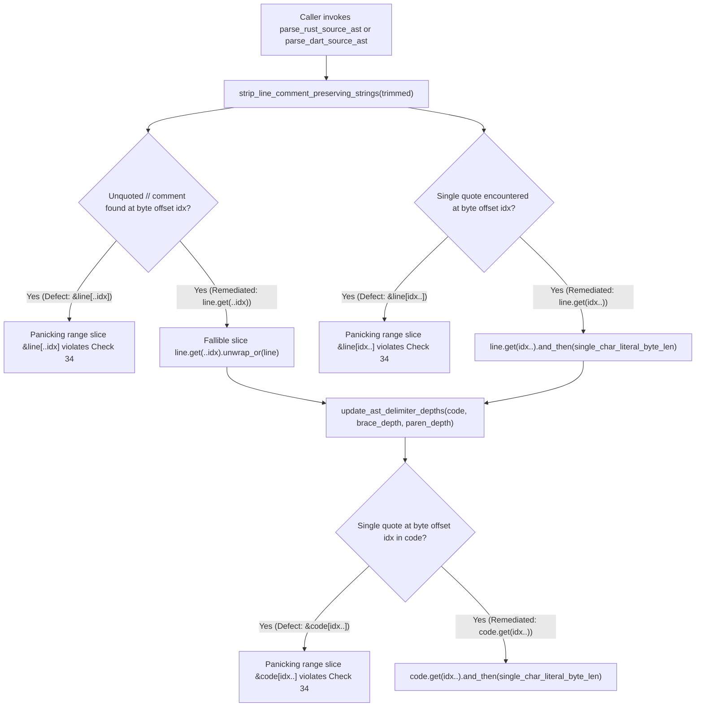

## 1. Context and References

<!-- test-target: crates/deap-core/src/source_ast.rs -->
- **Test-Target**: crates/deap-core/src/source_ast.rs
- **File**: `/Users/perkunas/jail/DEAP01-spec-core/crates/deap-core/src/source_ast.rs` (lines 3491-3833)
- **Pillar**: Pillar 2 -- Resource & Memory Safety (Zero-Regex & Non-Panicking AST Slice Purity, Check 34)
- **Symptom**: Check 34 (`check_zero_regex`) fails on `crates/deap-core/src/source_ast.rs` due to raw range indexing (`[..idx]`, `[idx..]`) at lines 3503, 3529, and 3811.
- **Audited Functions**: `strip_line_comment_preserving_strings` (lines 3491-3580) and `update_ast_delimiter_depths` (lines 3747-3833) in `/Users/perkunas/jail/DEAP01-spec-core/crates/deap-core/src/source_ast.rs`.

During Work Package 1 verification of `/Users/perkunas/jail/DEAP01-spec-core/crates/deap-core/src/source_ast.rs`, three raw range-slice expressions were found inside lexical helper functions:
1. Line 3503 in `strip_line_comment_preserving_strings`: `return &line[..idx];`
2. Line 3529 in `strip_line_comment_preserving_strings`: `if let Some(char_len) = single_char_literal_byte_len(&line[idx..]) {`
3. Line 3811 in `update_ast_delimiter_depths`: `if let Some(char_len) = single_char_literal_byte_len(&code[idx..]) {`

## 2. Root Cause Analysis (5 Whys)

1. **Why did Check 34 (`check_zero_regex` / `check_compiler_ast_purity`) fail on `crates/deap-core/src/source_ast.rs`?** Because `strip_line_comment_preserving_strings` at lines 3503 and 3529 and `update_ast_delimiter_depths` at line 3811 use raw Rust range indexing (`[..idx]` and `[idx..]`) instead of fallible `.get(..)` slicing.
2. **Why were raw range-indexing expressions present in `strip_line_comment_preserving_strings` and `update_ast_delimiter_depths`?** Because the lexical helpers in `/Users/perkunas/jail/DEAP01-spec-core/crates/deap-core/src/source_ast.rs` were authored using direct slice syntax (`&line[..idx]`, `&line[idx..]`, and `&code[idx..]`) when porting comment-stripping and delimiter-tracking logic.
3. **Why did direct byte-index range slicing appear safe during initial authoring?** Because `idx` is incremented along ASCII delimiter boundaries (`'/'`, `'\''`), leading the author to assume `idx` always lies on a valid UTF-8 character boundary within bounds of `line` or `code`.
4. **Why is direct range slicing (`[..idx]` and `[idx..]`) unsafe and forbidden in `crates/deap-core/src/source_ast.rs` regardless of loop invariants?** Because in Rust, `&str[..idx]` and `&str[idx..]` invoke `SliceIndex::index`, which contains an unconditional runtime panic branch if `idx` ever exceeds slice length or lands mid-codepoint in a multi-byte UTF-8 sequence, violating DO-178C Level A defensive bounds-checking and Check 34 static AST purity enforcement.
5. **Why was this violation not caught before the helper functions were written into `crates/deap-core/src/source_ast.rs`?** Because the newly added helper functions at lines 3491-3833 were not immediately gated against `check_zero_regex` / `check_compiler_ast_purity` in `/Users/perkunas/jail/DEAP01-spec-core/crates/verify-baseline/src/lib.rs` prior to full workspace test execution.

## 3. Correctness Analysis

- **Violation Classification**: Direct panicking string range indexing (`&line[..idx]`, `&line[idx..]`, `&code[idx..]`) in a Check 34 audited compiler AST module (`/Users/perkunas/jail/DEAP01-spec-core/crates/deap-core/src/source_ast.rs`).
- **Empirical Failure Reproduction**:
  - In `/Users/perkunas/jail/DEAP01-spec-core/crates/deap-core/src/source_ast.rs` at line 3503:
    `return &line[..idx];` triggers Check 34 violation for `[..` range indexing.
  - In `/Users/perkunas/jail/DEAP01-spec-core/crates/deap-core/src/source_ast.rs` at line 3529:
    `if let Some(char_len) = single_char_literal_byte_len(&line[idx..])` triggers Check 34 violation for `..]` range indexing.
  - In `/Users/perkunas/jail/DEAP01-spec-core/crates/deap-core/src/source_ast.rs` at line 3811:
    `if let Some(char_len) = single_char_literal_byte_len(&code[idx..])` triggers Check 34 violation for `..]` range indexing.
  - Furthermore, lines 3499 (`let b = bytes[idx];`), 3510 (`let p = bytes[idx.saturating_sub(1)];`), 3620 (`bytes[idx]`), 3698 (`bytes[end]`), and 3796 (`let p = bytes[idx.saturating_sub(1)];`) use direct byte slice indexing `bytes[...]` where `.get(...)` should be used for total non-panicking safety consistency.
- **Mathematical Soundness of `.get(..)` Replacement**:
  - Replacing `&line[..idx]` with `line.get(..idx).unwrap_or(line)` guarantees $O(1)$ sub-slice projection without any panicking code path.
  - Replacing `single_char_literal_byte_len(&line[idx..])` with `line.get(idx..).and_then(single_char_literal_byte_len)` (matching line 729 of `/Users/perkunas/jail/DEAP01-spec-core/crates/deap-core/src/source_ast.rs`) and `code.get(idx..).and_then(single_char_literal_byte_len)` eliminates all `[..` and `..]` range indexing tokens from production code.

## 4. UML Diagrams



## 5. Affected Callers / Downstream Impact

- `/Users/perkunas/jail/DEAP01-spec-core/crates/deap-core/src/source_ast.rs`:
  - `parse_rust_source_ast` (calls `strip_line_comment_preserving_strings` at line 901 and `update_ast_delimiter_depths` at line 1125)
  - `parse_dart_source_ast` (calls `strip_line_comment_preserving_strings` at line 1205 and `update_ast_delimiter_depths` at line 1314)
  - `ingest_source_directory` (calls `parse_rust_source_ast` and `parse_dart_source_ast` at lines 1720-1722)
- `/Users/perkunas/jail/DEAP01-spec-core/crates/compile-sysml/src/lib.rs`:
  - Uses `deap_core::source_ast` functions for `--inject-safety-docstrings` and source AST ingestion.
- `/Users/perkunas/jail/DEAP01-spec-core/crates/verify-baseline/src/lib.rs`:
  - Check 34 (`check_zero_regex` / `check_compiler_ast_purity`) scans `crates/deap-core/src/source_ast.rs` and rejects any occurrence of `[..` or `..]` outside `#[cfg(test)]`.
  - Check 36 (`audit_rust_source_docstrings` / `audit_dart_source_docstrings`) relies on shared lexical scanning parity.

## 6. Proposed Correction

Replace all raw range-slice indexing (`&line[..idx]`, `&line[idx..]`, `&code[idx..]`) in `/Users/perkunas/jail/DEAP01-spec-core/crates/deap-core/src/source_ast.rs` with non-panicking `.get(..)` calls:

```rust
pub fn strip_line_comment_preserving_strings(line: &str) -> &str {
    let bytes = line.as_bytes();
    let mut idx: usize = 0;
    let mut in_double_quote = false;
    let mut in_single_quote = false;
    let mut is_raw = false;

    while let Some(&b) = bytes.get(idx) {
        if !in_double_quote && !in_single_quote {
            if b == b'/' && bytes.get(idx.saturating_add(1)) == Some(&b'/') {
                return line.get(..idx).unwrap_or(line);
            }

            if (b == b'r' || b == b'R')
                && (bytes.get(idx.saturating_add(1)) == Some(&b'\'')
                    || bytes.get(idx.saturating_add(1)) == Some(&b'"'))
            {
                let prev_is_ident = if idx > 0 {
                    bytes
                        .get(idx.saturating_sub(1))
                        .map(|&p| p.is_ascii_alphanumeric() || p == b'_')
                        .unwrap_or(false)
                } else {
                    false
                };
                if !prev_is_ident {
                    is_raw = true;
                    idx = idx.saturating_add(1);
                    continue;
                }
            }

            if b == b'"' {
                in_double_quote = true;
                idx = idx.saturating_add(1);
                continue;
            }

            if b == b'\'' {
                if let Some(char_len) = line.get(idx..).and_then(single_char_literal_byte_len) {
                    idx = idx.saturating_add(char_len);
                    is_raw = false;
                    continue;
                }
                if is_rust_lifetime_at(bytes, idx) {
                    idx = idx.saturating_add(1);
                    continue;
                }
                if has_unescaped_closing_quote(bytes, idx.saturating_add(1), b'\'') {
                    in_single_quote = true;
                }
                idx = idx.saturating_add(1);
                continue;
            }

            is_raw = false;
            idx = idx.saturating_add(1);
            continue;
        }
        // ... remaining quote state handling ...
        idx = idx.saturating_add(1);
    }

    line
}
```

And in `update_ast_delimiter_depths` at line 3811 of `/Users/perkunas/jail/DEAP01-spec-core/crates/deap-core/src/source_ast.rs`:

```rust
        } else if b == b'\'' {
            if let Some(char_len) = code.get(idx..).and_then(single_char_literal_byte_len) {
                idx = idx.saturating_add(char_len);
                is_raw = false;
                continue;
            }
```

## 7. Relationship to Existing Issues

- Related to multi-crate source ingestion and Check 34/Check 36 AST lexical parity work (refs #472).
- Distinct from namespace collision resolution in `resolve_source_package_name` (refs #472); this defect specifically addresses Check 34 range-slice compliance (`[..` / `..]`) inside `/Users/perkunas/jail/DEAP01-spec-core/crates/deap-core/src/source_ast.rs`.

## Audit Source

Adversarial Test Integrity Audit
SEVERITY: Critical
FILE_LOCATION: crates/deap-core/src/source_ast.rs:3491-3833
