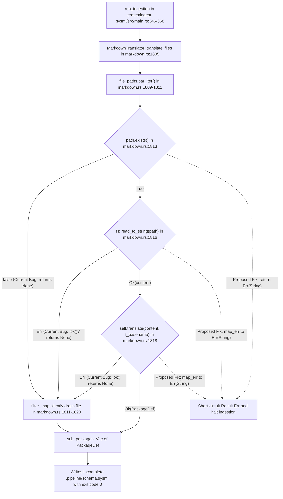

## 1. Context and References

<!-- test-target: crates/ingest-sysml/src/translators/markdown.rs -->

- **File**: `crates/ingest-sysml/src/translators/markdown.rs:1805-1820`
- **Pillar**: Semantic Traceability
- **Symptom**: `MarkdownTranslator::translate_files` in `/Users/perkunas/jail/DEAP01-spec-core/crates/ingest-sysml/src/translators/markdown.rs` silently drops unreadable or failed files via `filter_map` `(refs #483)` `(refs #489)`.
- **Test-Target**: crates/ingest-sysml/src/translators/markdown.rs

## 2. Root Cause Analysis (5 Whys)

1. **Why does multi-file Markdown ingestion succeed with exit code 0 and emit a partial or empty `.pipeline/schema.sysml` when one or more input blueprint files in `schema/` are unreadable or fail translation `(refs #483)` `(refs #489)`?** Because `MarkdownTranslator::translate_files` in `/Users/perkunas/jail/DEAP01-spec-core/crates/ingest-sysml/src/translators/markdown.rs` (lines 1809-1820) collects `sub_packages: Vec<PackageDef>` using `.par_iter().filter_map(...)`, which converts every file existence failure, filesystem I/O error, and translator `Err(String)` into `Option::None` and silently drops that file from the consolidated AST.
2. **Why does the closure inside `MarkdownTranslator::translate_files` convert `Result` errors into `Option::None`?** Because line 1813 checks `if !path.exists() { return None; }`, line 1816 calls `fs::read_to_string(path).ok()?`, and line 1818 calls `self.translate(&content, f_basename).ok()`, discarding the underlying `std::io::Error` and translator diagnostic `String` instead of propagating `Result<PackageDef, String>` across the Rayon parallel iterator.
3. **Why did `MarkdownTranslator::translate_files` use `.filter_map(...)` instead of fallible `.map(...).collect::<Result<Vec<PackageDef>, String>>()?`?** Because the parallel batch ingestion pass was authored to aggregate whichever files succeeded into `Vec<PackageDef>` without enforcing a fail-closed contract across all discovered elements of `file_paths: &[String]`.
4. **Why was this fail-open behavior not caught by the CLI caller in `/Users/perkunas/jail/DEAP01-spec-core/crates/ingest-sysml/src/main.rs`?** Because `run_ingestion` in `/Users/perkunas/jail/DEAP01-spec-core/crates/ingest-sysml/src/main.rs` (lines 346-368) trusts that `translator.translate_files(&file_strs, def_name)?` validates every file in `disc_files` and immediately logs `Successfully ingested {} markdown files` using `disc_files.len()` rather than verifying that every input path produced a valid `PackageDef`.
5. **Why did existing unit tests in `/Users/perkunas/jail/DEAP01-spec-core/crates/ingest-sysml/src/lib.rs` and `/Users/perkunas/jail/DEAP01-spec-core/crates/ingest-sysml/src/translators/markdown.rs` not detect this defect?** Because `test_batch_translate_multiple_files_synthetic` in `/Users/perkunas/jail/DEAP01-spec-core/crates/ingest-sysml/src/lib.rs` (lines 519-543) only tests happy-path readable synthetic files and lacks a negative mutation test asserting that `translate_files` returns `Err` when any input path is missing, unreadable (non-UTF-8 or permission-denied), or structurally malformed.

## 3. Correctness Analysis

In `/Users/perkunas/jail/DEAP01-spec-core/crates/ingest-sysml/src/translators/markdown.rs`, `MarkdownTranslator::translate_files` (lines 1805-1973) is declared with return type `Result<PackageDef, String>` and a DO-178C Level A / ISO 26262 ASIL D / DO-330 TQL-4 contract (lines 1780-1804) requiring deterministic state conservation without partial mutation on error. Furthermore, `/Users/perkunas/jail/DEAP01-spec-core/crates/ingest-sysml/src/main.rs` (lines 17-19, 49-56) establishes the **Fail-Safe Exit Code Contract**: on any unhandled failure such as invalid syntax, missing files, or permission denial, the CLI must halt immediately and terminate with exit code `1`, and partial writes or silent omissions are strictly prohibited.

However, lines 1809-1820 of `/Users/perkunas/jail/DEAP01-spec-core/crates/ingest-sysml/src/translators/markdown.rs` execute:
- Line 1810-1811: `file_paths.par_iter().filter_map(|fpath| { ... })`
- Line 1813-1815: `if !path.exists() { return None; }` -- silently drops non-existent file paths passed in `file_paths`.
- Line 1816: `let content = fs::read_to_string(path).ok()?;` -- silently drops any file that fails `fs::read_to_string` (such as permission denial, directory path, or invalid UTF-8 byte sequences in a corrupted blueprint file).
- Line 1818: `self.translate(&content, f_basename).ok()` -- silently drops any file where `MarkdownTranslator::translate` returns `Err(String)`.

When `run_ingestion` in `/Users/perkunas/jail/DEAP01-spec-core/crates/ingest-sysml/src/main.rs` (lines 346-368) dispatches multi-file Markdown ingestion (`fmt == "markdown" && (disc_files.len() > 1 || is_dir)`), any unreadable or malformed `.md` file in `schema/` is silently omitted from `sub_packages`. `translate_files` still returns `Ok(combined_pkg)` (or `Ok(PackageDef)` with partial `packages`), and `run_ingestion` writes the incomplete `.pipeline/schema.sysml` and `.pipeline/schema-digest.json` while reporting `Successfully ingested N markdown files`. This directly violates the Fail-Safe Exit Code Contract and Core Safety Invariants `H-INGEST-MD-01` through `H-INGEST-MD-04` `(refs #483)` `(refs #489)`.

## 4. UML Diagrams



## 5. Affected Callers / Downstream Impact

- `run_ingestion` in `/Users/perkunas/jail/DEAP01-spec-core/crates/ingest-sysml/src/main.rs:346-368` -- invokes `translator.translate_files(&file_strs, def_name)?` whenever multiple Markdown files or a Markdown schema directory are ingested, falsely printing `Successfully ingested N markdown files` and committing an incomplete `.pipeline/schema.sysml` and `.pipeline/schema-digest.json` when any file fails to read or parse `(refs #483)` `(refs #489)`.
- Downstream Work Package 2 specification compilers (`compile-sysml`, `verify-baseline`, `reconcile-backlog`, `assemble-conops`) -- consume `.pipeline/schema.sysml` as the 100% Single Source of Truth (SSOT); silent omission of a requirement or architectural component blueprint file during parallel ingestion corrupts traceability closure and FMECA/STPA hazard matrices without surfacing an ingestion error `(refs #483)` `(refs #489)`.

## 6. Proposed Correction

Replace `.filter_map(...)` in `MarkdownTranslator::translate_files` (`/Users/perkunas/jail/DEAP01-spec-core/crates/ingest-sysml/src/translators/markdown.rs`, lines 1809-1820) with a fallible parallel `.map(...)` collected into `Result<Vec<PackageDef>, String>` so that any missing file, I/O read error, or translation error fails closed immediately with a deterministic diagnostic citing the offending file path:

```rust
        // Translate each file concurrently with isolated thread contexts and fail-closed error propagation
        let sub_packages: Vec<PackageDef> = file_paths
            .par_iter()
            .map(|fpath| {
                let path = Path::new(fpath);
                if !path.exists() {
                    return Err(format!(
                        "Markdown specification file does not exist: '{}'",
                        path.display()
                    ));
                }
                let content = fs::read_to_string(path).map_err(|e| {
                    format!(
                        "Failed to read Markdown specification file '{}': {}",
                        path.display(),
                        e
                    )
                })?;
                let f_basename = path.file_stem().and_then(|s| s.to_str()).unwrap_or("Module");
                self.translate(&content, f_basename).map_err(|e| {
                    format!(
                        "Failed to translate Markdown specification file '{}': {}",
                        path.display(),
                        e
                    )
                })
            })
            .collect::<Result<Vec<PackageDef>, String>>()?;
```

## 7. Relationship to Existing Issues

Discovered in audit -- new finding related to Level 0 / Work Package 2 ingestion hardening `(refs #483)` and `(refs #489)`.

## Audit Source

Adversarial Semantic Traceability Audit
SEVERITY: Critical
FILE_LOCATION: crates/ingest-sysml/src/translators/markdown.rs:1805-1820
