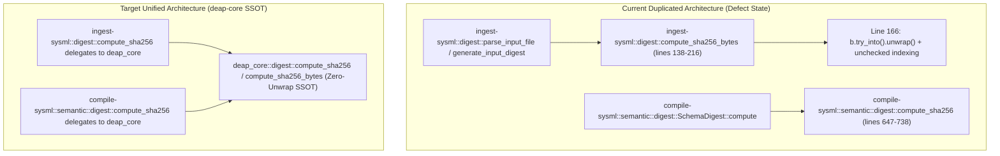

## 1. Context and References

<!-- test-target: crates/ingest-sysml/src/digest.rs -->
- **File**: `/Users/perkunas/jail/DEAP01-spec-core/crates/ingest-sysml/src/digest.rs` (lines 102-216) and `/Users/perkunas/jail/DEAP01-spec-core/crates/compile-sysml/src/semantic/digest.rs` (lines 647-738)
- **Pillar**: Pillar 2 -- Algorithmic, Cryptographic & Memory Safety Invariants (DO-178C Level A / ISO 26262 ASIL D Zero-Panic & SSOT Architecture)
- **Symptom**: Duplicated FIPS 180-4 SHA-256 compression implementations across `ingest-sysml` and `compile-sysml` with panicking `.try_into().unwrap()` at `digest.rs:166` instead of a unified panic-free `deap-core` primitive
- **Test-Target**: crates/ingest-sysml/src/digest.rs

In the DEAP Specification Core Compiler, Work Package 2 cryptographic digest generation is split across two divergent, hand-rolled FIPS 180-4 SHA-256 implementations:
1. `/Users/perkunas/jail/DEAP01-spec-core/crates/ingest-sysml/src/digest.rs` defines `pub fn compute_sha256(data: &[u8]) -> String` at lines 102-110 and `fn compute_sha256_bytes(data: &[u8]) -> [u8; 32]` at lines 138-216. At line 166, inside the 64-byte block schedule loop (`for (i, b) in chunk.chunks_exact(4).enumerate()`), it invokes a panicking `.unwrap()` in production code: `w[i] = u32::from_be_bytes(b.try_into().unwrap());`, alongside direct unchecked indexing (`w[i - 15]`, `w[i - 2]`, `w[i - 16]`, `w[i - 7]`, `k[i]`, `w[i]`, and `out[i * 4..(i + 1) * 4]`) across lines 166-214 and non-wrapping bit-length multiplication `(data.len() as u64) * 8` at line 155.
2. `/Users/perkunas/jail/DEAP01-spec-core/crates/compile-sysml/src/semantic/digest.rs` defines a second, standalone `pub fn compute_sha256(bytes: &[u8]) -> String` at lines 647-738 that duplicates the entire 64-word `K` round constant table (lines 648-657), initial state words `h0..h7` (lines 659-666), message padding logic (lines 668-674), and 64-round compression function (lines 676-737) using `as_chunks::<64>().0` and `as_chunks::<4>().0`.
3. `/Users/perkunas/jail/DEAP01-spec-core/crates/deap-core/src/lib.rs` (lines 37-82) is the shared foundational library crate across all DEAP pipeline binaries, yet it lacks a canonical, panic-free `compute_sha256` / `compute_sha256_bytes` implementation.

## 2. Root Cause Analysis (5 Whys)

1. **Why does `/Users/perkunas/jail/DEAP01-spec-core/crates/ingest-sysml/src/digest.rs` contain a production `.try_into().unwrap()` at line 166 while duplicating the FIPS 180-4 SHA-256 algorithm already present in `/Users/perkunas/jail/DEAP01-spec-core/crates/compile-sysml/src/semantic/digest.rs`?** Because `ingest-sysml` and `compile-sysml` each implemented their own local software SHA-256 compression routines independently rather than consuming a single shared cryptographic primitive from `deap-core`.
2. **Why did `crates/compile-sysml/src/semantic/digest.rs` (lines 647-738) and `crates/ingest-sysml/src/digest.rs` (lines 102-216) diverge in their memory-safety posture?** Because `compile-sysml` was refactored to use fixed-size array chunking (`as_chunks::<64>().0` and `as_chunks::<4>().0`) and checked `.get(...)` accessors (lines 676-691), whereas `ingest-sysml` retained the legacy `chunks_exact(4)` slice iterator paired with `b.try_into().unwrap()` at line 166 and unchecked indexing at lines 166-214.
3. **Why was `b.try_into().unwrap()` used at `crates/ingest-sysml/src/digest.rs:166` instead of total, panic-free array construction?** Because `chunks_exact(4)` yields a dynamic slice `&[u8]` whose length is not statically encoded in the Rust type system as `[u8; 4]`, prompting the author to call `.try_into().unwrap()` instead of using `as_chunks::<4>()` or pattern-matching `[b0, b1, b2, b3]`.
4. **Why was the panic-free SHA-256 implementation not extracted into `crates/deap-core` when `compile-sysml` was hardened?** Because `crates/deap-core/src/lib.rs` originally scoped its modules to `diagnostics`, `markdown`, `rules`, `source_ast`, `sysml_ast`, and `workspace`, leaving cryptographic digest computation local to individual binary crates.
5. **Why did baseline verification allow duplicated SHA-256 implementations and the production `.unwrap()` in `crates/ingest-sysml/src/digest.rs:166` to persist?** Because no architectural consolidation gate enforced that FIPS 180-4 SHA-256 hashing across `ingest-sysml` and `compile-sysml` delegates to a single zero-unwrap implementation in `deap-core`.

## 3. Correctness Analysis

### 3.1 Memory Safety and Zero-Panic Violation in `ingest-sysml`
In `/Users/perkunas/jail/DEAP01-spec-core/crates/ingest-sysml/src/digest.rs`:
- **Line 155**: `let bit_len = (data.len() as u64) * 8;` uses standard multiplication rather than `.wrapping_mul(8)` (contrast with `/Users/perkunas/jail/DEAP01-spec-core/crates/compile-sysml/src/semantic/digest.rs:668` which uses `(bytes.len() as u64).wrapping_mul(8)`).
- **Lines 165-167**:
  ```rust
  for (i, b) in chunk.chunks_exact(4).enumerate() {
      w[i] = u32::from_be_bytes(b.try_into().unwrap());
  }
  ```
  Invoking `.unwrap()` in production code violates the DO-178C Level A / ISO 26262 ASIL D Zero-Unwrap / Zero-Panic invariant. Furthermore, `w[i]` (line 166), `w[i - 15]`, `w[i - 2]`, `w[i - 16]`, `w[i - 7]` (lines 169-171), `k[i]`, `w[i]` (line 186), and `out[i * 4..(i + 1) * 4]` (line 213) rely on runtime bounds checks that generate panic landing pads in the compiled binary.

### 3.2 Duplication Across Work Package 2 Crates
- `/Users/perkunas/jail/DEAP01-spec-core/crates/ingest-sysml/src/digest.rs` (lines 102-216, 115 lines including docs) computes `.pipeline/input-digest.json` SHA-256 checksums.
- `/Users/perkunas/jail/DEAP01-spec-core/crates/compile-sysml/src/semantic/digest.rs` (lines 647-738, 92 lines) computes `.pipeline/schema-digest.json` SHA-256 checksums.
- Maintaining two separate copies of the 64-constant `K` array, initial state vectors, padding rules, and compression rounds creates a dual-maintenance hazard where bug fixes or hardening applied to `compile-sysml` (such as `.wrapping_mul(8)`, `as_chunks::<64>()`, and checked `.get()` indexing) are omitted from `ingest-sysml`.

## 4. UML Diagrams



## 5. Affected Callers / Downstream Impact

1. **Level 0 Ingestion (`crates/ingest-sysml`)**:
   - `parse_input_file` (`/Users/perkunas/jail/DEAP01-spec-core/crates/ingest-sysml/src/digest.rs:326`) calls `compute_sha256(&content_bytes)`.
   - `generate_input_digest` (`/Users/perkunas/jail/DEAP01-spec-core/crates/ingest-sysml/src/digest.rs:465`) calls `compute_sha256(&combined_bytes)`.
   - `compute_multi_file_sha256` (`/Users/perkunas/jail/DEAP01-spec-core/crates/ingest-sysml/src/digest.rs:511`) calls `compute_sha256(&combined_bytes)`.
2. **Work Package 2 Semantic Schema Digest (`crates/compile-sysml`)**:
   - `SchemaDigest::compute` (`/Users/perkunas/jail/DEAP01-spec-core/crates/compile-sysml/src/semantic/digest.rs:260`) calls `compute_sha256(sysml_text.as_bytes())`.
   - `compute_file_manifest` (`/Users/perkunas/jail/DEAP01-spec-core/crates/compile-sysml/src/semantic/digest.rs:528`) calls `compute_sha256(&content)`.
3. **Downstream Verification Gates**:
   - Any divergence between `.pipeline/input-digest.json` (`ingest-sysml`) and `.pipeline/schema-digest.json` (`compile-sysml`) or any panic during digest computation halts the compilation pipeline and breaks deterministic provenance verification.

## 6. Proposed Correction

Extract the canonical, panic-free FIPS 180-4 SHA-256 implementation into `crates/deap-core` (e.g., `deap_core::compute_sha256` and `deap_core::compute_sha256_bytes`) with zero `.unwrap()` calls and zero unchecked slice indexing, and delegate both `/Users/perkunas/jail/DEAP01-spec-core/crates/ingest-sysml/src/digest.rs` and `/Users/perkunas/jail/DEAP01-spec-core/crates/compile-sysml/src/semantic/digest.rs` to `deap_core`:

```rust
/// Computes a FIPS 180-4 compliant 32-byte SHA-256 digest without panicking or `.unwrap()`.
pub fn compute_sha256_bytes(bytes: &[u8]) -> [u8; 32] {
    const K: [u32; 64] = [
        0x428a2f98, 0x71374491, 0xb5c0fbcf, 0xe9b5dba5, 0x3956c25b, 0x59f111f1, 0x923f82a4, 0xab1c5ed5,
        0xd807aa98, 0x12835b01, 0x243185be, 0x550c7dc3, 0x72be5d74, 0x80deb1fe, 0x9bdc06a7, 0xc19bf174,
        0xe49b69c1, 0xefbe4786, 0x0fc19dc6, 0x240ca1cc, 0x2de92c6f, 0x4a7484aa, 0x5cb0a9dc, 0x76f988da,
        0x983e5152, 0xa831c66d, 0xb00327c8, 0xbf597fc7, 0xc6e00bf3, 0xd5a79147, 0x06ca6351, 0x14292967,
        0x27b70a85, 0x2e1b2138, 0x4d2c6dfc, 0x53380d13, 0x650a7354, 0x766a0abb, 0x81c2c92e, 0x92722c85,
        0xa2bfe8a1, 0xa81a664b, 0xc24b8b70, 0xc76c51a3, 0xd192e819, 0xd6990624, 0xf40e3585, 0x106aa070,
        0x19a4c116, 0x1e376c08, 0x2748774c, 0x34b0bcb5, 0x391c0cb3, 0x4ed8aa4a, 0x5b9cca4f, 0x682e6ff3,
        0x748f82ee, 0x78a5636f, 0x84c87814, 0x8cc70208, 0x90befffa, 0xa4506ceb, 0xbef9a3f7, 0xc67178f2,
    ];

    let mut h: [u32; 8] = [
        0x6a09e667, 0xbb67ae85, 0x3c6ef372, 0xa54ff53a,
        0x510e527f, 0x9b05688c, 0x1f83d9ab, 0x5be0cd19,
    ];

    let bit_len = (bytes.len() as u64).wrapping_mul(8);
    let mut msg = bytes.to_vec();
    msg.push(0x80);
    while (msg.len() % 64) != 56 {
        msg.push(0x00);
    }
    msg.extend_from_slice(&bit_len.to_be_bytes());

    for chunk in msg.as_chunks::<64>().0 {
        let mut w = [0u32; 64];
        for (slot, part) in w.iter_mut().zip(chunk.as_chunks::<4>().0) {
            *slot = u32::from_be_bytes(*part);
        }
        for i in 16..64 {
            let (w15, w2, w16, w7) = match (w.get(i - 15), w.get(i - 2), w.get(i - 16), w.get(i - 7)) {
                (Some(&w15), Some(&w2), Some(&w16), Some(&w7)) => (w15, w2, w16, w7),
                _ => continue,
            };
            let s0 = w15.rotate_right(7) ^ w15.rotate_right(18) ^ (w15 >> 3);
            let s1 = w2.rotate_right(17) ^ w2.rotate_right(19) ^ (w2 >> 10);
            if let Some(slot) = w.get_mut(i) {
                *slot = w16.wrapping_add(s0).wrapping_add(w7).wrapping_add(s1);
            }
        }

        let mut a = h[0];
        let mut b = h[1];
        let mut c = h[2];
        let mut d = h[3];
        let mut e = h[4];
        let mut f = h[5];
        let mut g = h[6];
        let mut hh = h[7];

        for (&k, &wi) in K.iter().zip(w.iter()) {
            let s1 = e.rotate_right(6) ^ e.rotate_right(11) ^ e.rotate_right(25);
            let ch = (e & f) ^ ((!e) & g);
            let temp1 = hh.wrapping_add(s1).wrapping_add(ch).wrapping_add(k).wrapping_add(wi);
            let s0 = a.rotate_right(2) ^ a.rotate_right(13) ^ a.rotate_right(22);
            let maj = (a & b) ^ (a & c) ^ (b & c);
            let temp2 = s0.wrapping_add(maj);

            hh = g;
            g = f;
            f = e;
            e = d.wrapping_add(temp1);
            d = c;
            c = b;
            b = a;
            a = temp1.wrapping_add(temp2);
        }

        h[0] = h[0].wrapping_add(a);
        h[1] = h[1].wrapping_add(b);
        h[2] = h[2].wrapping_add(c);
        h[3] = h[3].wrapping_add(d);
        h[4] = h[4].wrapping_add(e);
        h[5] = h[5].wrapping_add(f);
        h[6] = h[6].wrapping_add(g);
        h[7] = h[7].wrapping_add(hh);
    }

    let mut out = [0u8; 32];
    for (dest, word) in out.as_chunks_mut::<4>().0.iter_mut().zip(h.iter()) {
        *dest = word.to_be_bytes();
    }
    out
}

/// Computes a FIPS 180-4 compliant lowercase hexadecimal SHA-256 digest string.
pub fn compute_sha256(bytes: &[u8]) -> String {
    let digest = compute_sha256_bytes(bytes);
    let mut hex = String::with_capacity(64);
    for b in digest {
        hex.push_str(&format!("{:02x}", b));
    }
    hex
}
```

## 7. Relationship to Existing Issues

- Relates to Work Package 2 cryptographic schema digest consolidation and DO-178C Level A zero-unwrap hardening across `deap-core`, `ingest-sysml`, and `compile-sysml` (refs #465, refs #466).

## Audit Source
Adversarial Memory Safety Audit
SEVERITY: Important
FILE_LOCATION: crates/ingest-sysml/src/digest.rs:102-216
