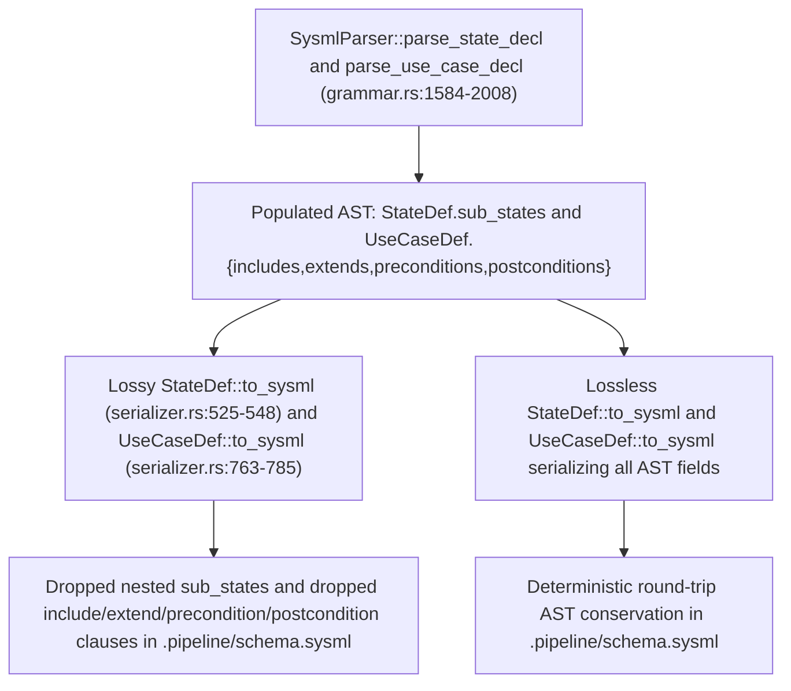

## 1. Context and References

<!-- test-target: crates/compile-sysml/src/semantic/serializer.rs -->
- **File**: `/Users/perkunas/jail/DEAP01-spec-core/crates/compile-sysml/src/semantic/serializer.rs` (lines 498-549 for `StateDef::to_sysml` and lines 736-786 for `UseCaseDef::to_sysml`)
- **Pillar**: Pillar 1 -- Domain State & Data Model Conservation (Lossless SysML v2 AST Round-Trip Serialization)
- **Symptom**: `StateDef::to_sysml` (lines 525-548) omits `sub_states` and `UseCaseDef::to_sysml` (lines 763-785) omits `includes`, `extends`, `preconditions`, and `postconditions`, dropping nested state machines from `.pipeline/schema.sysml`
- **Test-Target**: crates/compile-sysml/src/semantic/serializer.rs

In `/Users/perkunas/jail/DEAP01-spec-core/crates/compile-sysml/src/semantic/serializer.rs`, the SysML v2 canonical pretty-printer implements `SysmlSerializable` for `StateDef` (lines 498-549) and `UseCaseDef` (lines 736-786). While the recursive descent parser in `/Users/perkunas/jail/DEAP01-spec-core/crates/compile-sysml/src/parser/grammar.rs` (`SysmlParser::parse_state_decl` at lines 1584-1643 and `SysmlParser::parse_use_case_decl` at lines 1885-2008) and the AST extractor in `/Users/perkunas/jail/DEAP01-spec-core/crates/deap-core/src/sysml_ast.rs` (`StateDef` at lines 708-718, `UseCaseDef` at lines 747-765, and `parse_state_defs` at lines 4354-4433) parse and store nested `sub_states: Vec<StateDef>` as well as use-case `includes: Vec<String>`, `extends: Vec<String>`, `preconditions: Vec<String>`, and `postconditions: Vec<String>`, `StateDef::to_sysml` and `UseCaseDef::to_sysml` never iterate over those fields during serialization. Consequently, running `/Users/perkunas/jail/DEAP01-spec-core/target/release/compile-sysml` silently strips nested state machines and use-case composition/contract clauses from `/Users/perkunas/jail/DEAP01-spec-core/.pipeline/schema.sysml`.

## 2. Root Cause Analysis (5 Whys)

1. **Why does `/Users/perkunas/jail/DEAP01-spec-core/target/release/compile-sysml` drop nested state definitions and use-case preconditions, postconditions, includes, and extends when writing `/Users/perkunas/jail/DEAP01-spec-core/.pipeline/schema.sysml`?** Because `StateDef::to_sysml` (lines 525-548) and `UseCaseDef::to_sysml` (lines 763-785) in `/Users/perkunas/jail/DEAP01-spec-core/crates/compile-sysml/src/semantic/serializer.rs` do not serialize `self.sub_states`, `self.includes`, `self.extends`, `self.preconditions`, or `self.postconditions`.
2. **Why do `StateDef::to_sysml` and `UseCaseDef::to_sysml` omit those struct fields during SysML v2 textual emission?** Because `StateDef::to_sysml` only formats `entry_action`, `do_action`, `exit_action`, and `transitions` (lines 533-545), and `UseCaseDef::to_sysml` only formats `subject`, `actors`, `objective`, and `steps` (lines 771-782), before appending the closing brace.
3. **Why was this asymmetry between `SysmlParser` in `/Users/perkunas/jail/DEAP01-spec-core/crates/compile-sysml/src/parser/grammar.rs` and `SysmlSerializable` in `/Users/perkunas/jail/DEAP01-spec-core/crates/compile-sysml/src/semantic/serializer.rs` introduced?** Because when `StateDef` and `UseCaseDef` in `/Users/perkunas/jail/DEAP01-spec-core/crates/deap-core/src/sysml_ast.rs` were extended with hierarchical `sub_states` and behavioral contract vectors (`includes`, `extends`, `preconditions`, `postconditions`) and wired into `parse_state_decl` (lines 1610-1612) and `parse_use_case_decl` (lines 1974-1985), the corresponding `to_sysml` implementations were left at their initial flat-stub implementations.
4. **Why did existing unit tests in `/Users/perkunas/jail/DEAP01-spec-core/crates/compile-sysml/src/semantic/serializer.rs` (lines 1334-1569) fail to catch the silent data loss?** Because the serializer unit test suite (`mod tests` at lines 1335-1569) tests `PackageDef`, `PortDef`, `RequirementDef`, `ConstraintDef`, `ImportDef`, and `PartDef`, but contains zero round-trip unit tests exercising `StateDef::to_sysml` with nested `sub_states` or `UseCaseDef::to_sysml` with `includes`, `extends`, `preconditions`, and `postconditions`.
5. **Why does this violate the DO-178C Level A / DO-330 TQL-4 compiler invariants documented in `/Users/perkunas/jail/DEAP01-spec-core/crates/compile-sysml/src/semantic/serializer.rs`?** Because Section 2 of the function contracts for `StateDef::to_sysml` (line 505) and `UseCaseDef::to_sysml` (line 743) explicitly mandates deterministic state conservation across the AST representation, whereas dropping populated AST vectors during canonical serialization makes `parse_source(pkg.to_sysml(0))` non-idempotent and lossy.

## 3. Correctness Analysis

- **AST Definition vs. Serializer Divergence**:
  - In `/Users/perkunas/jail/DEAP01-spec-core/crates/deap-core/src/sysml_ast.rs` (lines 708-718), `StateDef` declares:
    - `pub name: String`
    - `pub doc: Option<String>`
    - `pub entry_action: Option<String>`
    - `pub do_action: Option<String>`
    - `pub exit_action: Option<String>`
    - `pub transitions: Vec<TransitionDef>`
    - `pub sub_states: Vec<StateDef>`
  - In `/Users/perkunas/jail/DEAP01-spec-core/crates/compile-sysml/src/parser/grammar.rs` (lines 1610-1612), `SysmlParser::parse_state_decl` parses nested `TokenKind::State` declarations recursively via `let sub_st = self.parse_state_decl(None)?; sub_states.push(sub_st);`. Similarly, `parse_state_defs` in `/Users/perkunas/jail/DEAP01-spec-core/crates/deap-core/src/sysml_ast.rs` (line 4417) recursively invokes `parse_state_defs(body)` to populate `sub_states`.
  - However, in `/Users/perkunas/jail/DEAP01-spec-core/crates/compile-sysml/src/semantic/serializer.rs` (lines 525-548), `StateDef::to_sysml` never iterates over `self.sub_states`. Any nested `state` or `state def` inside a parent `StateDef` is permanently discarded upon serialization.
  - In `/Users/perkunas/jail/DEAP01-spec-core/crates/deap-core/src/sysml_ast.rs` (lines 747-765), `UseCaseDef` declares:
    - `pub name: String`
    - `pub doc: Option<String>`
    - `pub subject: Option<String>`
    - `pub actor: Option<String>`
    - `pub actors: Vec<String>`
    - `pub objective: Option<String>`
    - `pub includes: Vec<String>`
    - `pub extends: Vec<String>`
    - `pub steps: Vec<String>`
    - `pub preconditions: Vec<String>`
    - `pub postconditions: Vec<String>`
  - In `/Users/perkunas/jail/DEAP01-spec-core/crates/compile-sysml/src/parser/grammar.rs` (lines 1974-1985), `SysmlParser::parse_use_case_decl` parses `TokenKind::Include`, `TokenKind::Extend`, `TokenKind::Precondition`, and `TokenKind::Postcondition` into `includes`, `extends`, `preconditions`, and `postconditions`.
  - However, in `/Users/perkunas/jail/DEAP01-spec-core/crates/compile-sysml/src/semantic/serializer.rs` (lines 763-785), `UseCaseDef::to_sysml` omits `self.includes`, `self.extends`, `self.preconditions`, and `self.postconditions` (and if `self.actors` is empty while `self.actor` is `Some`, it also fails to emit the fallback single actor).
- **Round-Trip Identity Violation**:
  - For any `PackageDef` $P$ containing a `StateDef` with `!sub_states.is_empty()` or a `UseCaseDef` with `!includes.is_empty() || !extends.is_empty() || !preconditions.is_empty() || !postconditions.is_empty()`, serializing via `P.to_sysml(0)` and re-parsing via `SysmlParser::parse_source` yields $P' \neq P$ because all nested state machines and use-case composition/precondition/postcondition clauses have been erased.

## 4. UML Diagrams



## 5. Affected Callers / Downstream Impact

- `/Users/perkunas/jail/DEAP01-spec-core/crates/compile-sysml/src/semantic/serializer.rs`:
  - `StateDef::to_sysml` (lines 525-548) is called by `PartDef::to_sysml` (lines 1124-1126) and `PackageDef::to_sysml` (lines 1292-1294).
  - `UseCaseDef::to_sysml` (lines 763-785) is called by `PartDef::to_sysml` (lines 1130-1132) and `PackageDef::to_sysml` (lines 1298-1300).
- `/Users/perkunas/jail/DEAP01-spec-core/crates/compile-sysml/src/main.rs` and `/Users/perkunas/jail/DEAP01-spec-core/target/release/compile-sysml`:
  - When `compile-sysml` compiles `schema/*.sysml` into `.pipeline/schema.sysml`, every hierarchical state machine (`StateDef::sub_states`) and every use-case relationship or contract (`includes`, `extends`, `preconditions`, `postconditions`) is silently lost from `.pipeline/schema.sysml`.
- Downstream specification and verification gates (`verify-baseline`, `reconcile-backlog`, `spec-user-story-engineering`, `spec-usecase-engineering`):
  - Downstream tools and audits reading `.pipeline/schema.sysml` as the 100% Single Source of Truth observe truncated state machines and missing use-case preconditions/postconditions/includes/extends, breaking behavioral parity between `schema/` and `.pipeline/schema.sysml`.

## 6. Proposed Correction

Update `StateDef::to_sysml` (lines 525-548) and `UseCaseDef::to_sysml` (lines 763-785) in `/Users/perkunas/jail/DEAP01-spec-core/crates/compile-sysml/src/semantic/serializer.rs` to recursively serialize `self.sub_states` and emit `self.includes`, `self.extends`, `self.preconditions`, and `self.postconditions`:

```rust
impl SysmlSerializable for StateDef {
    fn to_sysml(&self, indent: usize) -> String {
        let pad = " ".repeat(indent);
        let doc = format_doc_comment(&self.doc, indent);
        let mut lines = Vec::new();
        if !doc.is_empty() {
            lines.push(doc.trim_end().to_string());
        }
        lines.push(format!("{}state def {} {{", pad, self.name));
        if let Some(entry) = &self.entry_action {
            lines.push(format!("{}    entry {};", pad, entry));
        }
        if let Some(do_act) = &self.do_action {
            lines.push(format!("{}    do {};", pad, do_act));
        }
        if let Some(exit) = &self.exit_action {
            lines.push(format!("{}    exit {};", pad, exit));
        }
        for sub in &self.sub_states {
            lines.push(sub.to_sysml(indent + 4));
        }
        for t in &self.transitions {
            let t_name = t.name.as_deref().unwrap_or("transition");
            lines.push(format!("{}    transition {};", pad, t_name));
        }
        lines.push(format!("{}}}", pad));
        lines.join("\n")
    }
}

impl SysmlSerializable for UseCaseDef {
    fn to_sysml(&self, indent: usize) -> String {
        let pad = " ".repeat(indent);
        let doc = format_doc_comment(&self.doc, indent);
        let mut lines = Vec::new();
        if !doc.is_empty() {
            lines.push(doc.trim_end().to_string());
        }
        lines.push(format!("{}use case def {} {{", pad, self.name));
        if let Some(s) = &self.subject {
            lines.push(format!("{}    subject {};", pad, s));
        }
        if self.actors.is_empty() {
            if let Some(a) = &self.actor {
                lines.push(format!("{}    actor {};", pad, a));
            }
        } else {
            for a in &self.actors {
                lines.push(format!("{}    actor {};", pad, a));
            }
        }
        if let Some(obj) = &self.objective {
            let trimmed_obj = obj.trim().trim_matches('"');
            lines.push(format!("{}    objective \"{}\";", pad, trimmed_obj));
        }
        for pre in &self.preconditions {
            lines.push(format!("{}    precondition {};", pad, pre));
        }
        for inc in &self.includes {
            lines.push(format!("{}    include {};", pad, inc));
        }
        for ext in &self.extends {
            lines.push(format!("{}    extend {};", pad, ext));
        }
        for step in &self.steps {
            lines.push(format!("{}    step {};", pad, step));
        }
        for post in &self.postconditions {
            lines.push(format!("{}    postcondition {};", pad, post));
        }
        lines.push(format!("{}}}", pad));
        lines.join("\n")
    }
}
```

## 7. Relationship to Existing Issues

- Discovered during Work Package 1 (`Adversarial Semantic Traceability Audit`) while auditing `compile-sysml` AST round-trip fidelity for nested state machines and use-case definitions (refs #465, #466, #467, #468).
- Directly blocks lossless `.pipeline/schema.sysml` compilation in Work Package 2 whenever `StateDef::sub_states` or `UseCaseDef` `includes`, `extends`, `preconditions`, and `postconditions` are populated.

## Audit Source

Adversarial Semantic Traceability Audit
SEVERITY: Critical
FILE_LOCATION: crates/compile-sysml/src/semantic/serializer.rs:525-785
