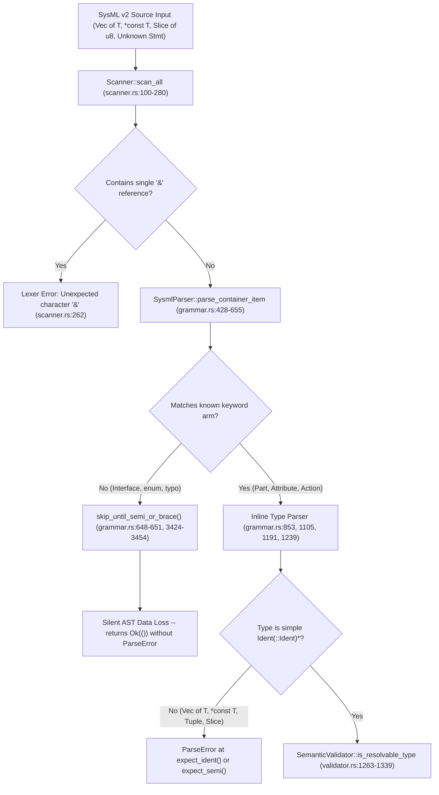

## 1. Context and References

<!-- test-target: crates/compile-sysml/src/parser/grammar.rs -->
- **File**: `crates/compile-sysml/src/parser/grammar.rs` (full workspace path: `/Users/perkunas/jail/DEAP01-spec-core/crates/compile-sysml/src/parser/grammar.rs`, lines `428-655`, `839-910`, `971-986`, `1035-1064`, `1093-1132`, `1160-1280`, `2385-2442`, `2537-2671`, and `3424-3454`; cross-referenced with `/Users/perkunas/jail/DEAP01-spec-core/crates/compile-sysml/src/semantic/validator.rs` lines `1263-1660` and `/Users/perkunas/jail/DEAP01-spec-core/crates/compile-sysml/src/lexer/scanner.rs` lines `257-264`)
- **Pillar**: Pillar 1 & Pillar 3 -- Syntactic/Semantic Contract Parity and Fail-Closed Grammar Verification
- **Symptom**: SysmlParser rejects generic, pointer, reference, slice, and tuple type expressions in part/attribute/action declarations and silently skips unknown container statements via skip_until_semi_or_brace()
- **Test-Target**: crates/compile-sysml/src/parser/grammar.rs

In `/Users/perkunas/jail/DEAP01-spec-core/crates/compile-sysml/src/semantic/validator.rs`, `SemanticValidator::is_resolvable_type` (lines `1263-1339`), `normalize_source_type` (lines `1368-1490`), `split_top_level_type_args` (lines `1518-1576`), and `is_primitive_or_builtin_type` (lines `1604-1710`) implement full semantic validation for composite source-language and SysML v2 type expressions required by Blueprints `(refs #483)` (C-ABI) and `(refs #489)` (App-Glue), including:
- Generic container types (`Vec<T>`, `Option<T>`, `Result<T, E>`, `HashMap<K, V>`, `BTreeMap<K, V>`)
- Raw C-ABI pointers and references (`*const T`, `*mut T`, `&T`, `&mut T`, `&'a mut T`)
- Slice, array, and multiplicity suffixes (`&[u8]`, `[u8; 64]`, `[T]`, `Type[1..*]`, `Type[]`)
- Tuple and unit types (`()`, `(T1, T2, ...)`)

However, the upstream recursive-descent parser in `/Users/perkunas/jail/DEAP01-spec-core/crates/compile-sysml/src/parser/grammar.rs` is structurally incapable of parsing these composite type expressions in `parse_part_decl` (lines `851-860`), `parse_attribute_decl` (lines `1103-1117`), and `parse_action_decl` (lines `1189-1200` and `1237-1248`) -- as well as `parse_port_decl` (lines `971-986`, `1035-1046`), `parse_operation_decl` (lines `2408-2413`, `2427-2430`), and `parse_calc_decl` (lines `2559-2570`, `2607-2616`, `2644-2655`). Furthermore, when encountering unrecognized tokens or statements at package or part container scope, `parse_container_item` (lines `648-651`) invokes `skip_until_semi_or_brace()` (lines `3424-3454`), silently discarding the entire statement or braced block and returning `Ok(())` without emitting a `ParseError`.

## 2. Root Cause Analysis (5 Whys)

1. **Why do SysML v2 schemas containing generic (`Vec<T>`), C-ABI pointer (`*const T`), reference/slice (`&[u8]`), or tuple (`(T1, T2)`) type annotations fail to compile or lose AST nodes when parsed by `SysmlParser::parse_source`?** Because `parse_part_decl` (lines `851-860`), `parse_attribute_decl` (lines `1103-1117`), and `parse_action_decl` (lines `1189-1200` and `1237-1248`) in `/Users/perkunas/jail/DEAP01-spec-core/crates/compile-sysml/src/parser/grammar.rs` hardcode type parsing as `self.expect_ident()?` followed only by `while self.check(&TokenKind::DoubleColon)` (and a narrow empty `[]` check in `parse_attribute_decl` lines `1112-1116`), rejecting `<`, `>`, `*`, `&`, `(`, `)`, and non-empty `[...]` tokens.
2. **Why does a disconnect exist between `SemanticValidator::is_resolvable_type` in `validator.rs` and `SysmlParser` in `grammar.rs`?** Because composite type decomposition (`normalize_source_type`, `split_top_level_type_args`, tuple unrolling, and generic `<...>` resolution) was added to `/Users/perkunas/jail/DEAP01-spec-core/crates/compile-sysml/src/semantic/validator.rs` (lines `1263-1660`) and tested against pre-constructed `PackageDef` AST structs in memory without adding a corresponding `parse_type_expr` production to `/Users/perkunas/jail/DEAP01-spec-core/crates/compile-sysml/src/parser/grammar.rs` or a single-character `&` (`TokenKind::Amp`) token to `/Users/perkunas/jail/DEAP01-spec-core/crates/compile-sysml/src/lexer/scanner.rs` (lines `257-263`).
3. **Why do malformed or unsupported container declarations silently vanish from the compiled `PackageDef` AST instead of raising a `ParseError`?** Because `parse_container_item` in `/Users/perkunas/jail/DEAP01-spec-core/crates/compile-sysml/src/parser/grammar.rs` (lines `648-651`) has a wildcard catch-all arm `_ => { self.skip_until_semi_or_brace(); }` that consumes all tokens up to the next `;` or matching `{ ... }` block (lines `3424-3454`) and returns `Ok(())` at line `654`.
4. **Why is `skip_until_semi_or_brace()` also masking syntax errors inside inner declaration blocks?** Because the same silent fallback `else { self.skip_until_semi_or_brace(); }` is replicated across 12 inner declaration parsers (`parse_port_decl` line `1056`, `parse_action_decl` line `1262`, `parse_requirement_decl` line `1531`, `parse_state_decl` line `1626`, `parse_connection_decl` line `1723`, `parse_use_case_decl` line `1987`, `parse_item_decl` line `2053`, `parse_hazard_decl` line `2122`, `parse_risk_decl` line `2194`, `parse_test_case_decl` line `2282`, `parse_capability_decl` line `2342`, and `parse_interaction_decl` line `2494`), violating fail-closed compiler design.
5. **Why did unit tests in `grammar.rs` not catch either defect?** Because the parser unit tests in `/Users/perkunas/jail/DEAP01-spec-core/crates/compile-sysml/src/parser/grammar.rs` (lines `3746-4883`) only test scalar identifiers (`Integer`, `Real`, `String`) and empty array brackets (`String[]` at lines `4414-4438`), and include zero negative tests asserting that invalid container statements or composite type expressions are parsed or rejected deterministically.

## 3. Correctness Analysis

### Defect Part A: Incomplete Type Expression Grammar in `grammar.rs` (and `&` in `scanner.rs`)

In `/Users/perkunas/jail/DEAP01-spec-core/crates/compile-sysml/src/parser/grammar.rs`, type annotations after `:` (or `:>`) are parsed inline without a unified `parse_type_expr` method:

1. **`parse_part_decl` (lines `839-910`, specifically lines `851-860`)**:
   - Current logic:
     - Checks `TokenKind::Colon` or `TokenKind::ColonGt` (line `851`).
     - Calls `let mut ty = self.expect_ident()?;` (line `853`) and loops only over `TokenKind::DoubleColon` (lines `854-858`).
   - Failure mode: Any generic specialization (`part buffer : RingBuffer<u8>;`), pointer type, or multiplicity suffix (`part channels : Channel[4];`) leaves `<` or `[` unconsumed, causing line `906` (`self.expect_semi()?`) to fail with `ParseError { message: "Expected ';' statement terminator, found 'Lt'" }`.

2. **`parse_attribute_decl` (lines `1093-1132`, specifically lines `1103-1117`)**:
   - Current logic:
     - Calls `type_name = self.expect_ident()?;` (line `1105`) and loops over `TokenKind::DoubleColon` (lines `1106-1110`).
     - Lines `1112-1116` only accept an empty bracket pair `[]`:
       `if self.check(&TokenKind::OpenBracket) { self.advance(); self.expect(&TokenKind::CloseBracket)?; type_name.push_str("[]"); }`
   - Failure modes for Blueprints `(refs #483)` (C-ABI) and `(refs #489)` (App-Glue):
     - **Generic types (`Vec<T>`, `Option<T>`, `Result<T, E>`)**: `attribute items : Vec<u8>;` consumes `Vec` at line `1105`, skips lines `1106-1120`, and fails at line `1123` (`self.expect_semi()?`) because the next token is `TokenKind::Lt` (`<`).
     - **C-ABI raw pointer types (`*const T`, `*mut T`)**: `attribute raw_ptr : *const u8;` fails immediately at line `1105` (`self.expect_ident()?`) because the token after `:` is `TokenKind::Star` (`*`), returning `Expected identifier, found 'Star'`.
     - **Reference and slice types (`&[u8]`, `&str`, `&mut Buffer`)**: First, `/Users/perkunas/jail/DEAP01-spec-core/crates/compile-sysml/src/lexer/scanner.rs` (lines `257-263`) only recognizes `&&` (`TokenKind::AmpAmp`) and rejects a single `&` with `Err("Unexpected character '&'")`. Second, even for slice/array types without `&` (`[u8; 64]` or `[u8]`) or bounded SysML multiplicities (`u8[64]`), `parse_attribute_decl` fails at line `1105` (`found 'OpenBracket'`) or line `1114` (`Expected 'CloseBracket', found 'IntLit(64)'`).
     - **Tuple and unit types (`(u32, u64)`, `()`)**: Fails at line `1105` (`Expected identifier, found 'OpenParen'`).

3. **`parse_action_decl` (lines `1160-1280`, specifically lines `1189-1200` and `1237-1249`)**:
   - In parenthesized parameter lists (`action def Encode(in buf : &[u8], out len : usize)` at lines `1175-1217`), lines `1189-1200` only consume `expect_ident()` and `DoubleColon`. If a parameter type is `Vec<u8>`, `<` remains in the stream and the next loop iteration at line `1188` (`let param_name = self.expect_ident()?;`) fails on `TokenKind::Lt`.
   - In braced action body parameter declarations (`in payload : Vec<u8>;` at lines `1230-1260`), lines `1237-1248` only consume `expect_ident()` and `DoubleColon`, failing at `self.expect_semi()?` (line `1249`).
   - Furthermore, if an `action def` body contains a standard `attribute` declaration (`attribute status : i32;`) rather than `in`/`out`/`perform`/`step`, `parse_action_decl` hits `else { self.skip_until_semi_or_brace(); }` at line `1262` and silently drops it!

### Defect Part B: Silent Token Skipping in `parse_container_item` via `skip_until_semi_or_brace()`

In `/Users/perkunas/jail/DEAP01-spec-core/crates/compile-sysml/src/parser/grammar.rs`:
- `parse_container_item` (lines `428-655`) dispatches on `self.peek_kind()` (line `441`).
- At lines `648-651`:
  ```rust
  _ => {
      // Skip unknown statement or delimiter to maintain fault tolerance
      self.skip_until_semi_or_brace();
  }
  ```
- `skip_until_semi_or_brace` (lines `3424-3454`) tracks brace depth (`depth`) and advances over all tokens until either `TokenKind::Semi` at `depth == 0` or a balanced `TokenKind::CloseBrace` at `depth == 0`.
- Consequently:
  1. Any misspelled keyword (e.g., `atribute x : Integer;`, `requirment def R1 { ... }`, `partt def P1 { ... }`) is **silently discarded** with zero diagnostic output and `parse_source` returns `Ok(PackageDef)`.
  2. Any SysML v2 / KerML construct whose keyword is lexed as `TokenKind::Interface` (`token.rs:147`, which has no arm in `parse_container_item`) or `TokenKind::Ident` (such as `enum def`, `struct def`, `type`, `alias`, `ref`, `allocate`) is **silently erased** along with its entire `{ ... }` body.
  3. Downstream stages (`SemanticValidator`, `generate_digest`, `compile-sysml`) receive a silently truncated AST and compute a valid SHA-256 digest over incomplete model data, violating DO-178C Level A / DO-330 TQL-4 fail-closed compilation guarantees.

## 4. UML Diagrams



## 5. Affected Callers / Downstream Impact

- **Blueprint `(refs #483)` (C-ABI Foreign Function Interface)**: Requires `*const T`, `*mut T`, and slice/buffer descriptors in `attribute`, `action def`, and `operation def` declarations. Currently unparseable by `SysmlParser`.
- **Blueprint `(refs #489)` (App-Glue & State Binding)**: Requires generic containers (`Vec<T>`, `Option<T>`, `Result<T, E>`), references (`&[u8]`), and tuple types (`(T1, T2)`) in `attribute`, `part`, and `action` declarations. Currently rejected by `parse_part_decl`, `parse_attribute_decl`, and `parse_action_decl`.
- **`SemanticValidator::is_resolvable_type` (`/Users/perkunas/jail/DEAP01-spec-core/crates/compile-sysml/src/semantic/validator.rs:1263-1339`)**: The composite type validator is unreachable from textual `.sysml` files because `SysmlParser` rejects composite types before semantic validation runs.
- **`SysmlParser::parse_source`, `parse_sysml_tree`, and `parse_sysml_directory` (`/Users/perkunas/jail/DEAP01-spec-core/crates/compile-sysml/src/parser/grammar.rs:181-189`, `3663-3744`)**: Every caller in `compile-sysml`, `ingest-sysml`, `verify-baseline`, `assemble-conops`, and `reconcile-backlog` is vulnerable to silent AST truncation via `skip_until_semi_or_brace()`.

## 6. Proposed Correction

1. In `/Users/perkunas/jail/DEAP01-spec-core/crates/compile-sysml/src/lexer/token.rs` and `/Users/perkunas/jail/DEAP01-spec-core/crates/compile-sysml/src/lexer/scanner.rs`, add `TokenKind::Amp` (`"&"`) when a single `&` is not followed by `&`, enabling reference types (`&T`, `&mut T`, `&[u8]`).
2. In `/Users/perkunas/jail/DEAP01-spec-core/crates/compile-sysml/src/parser/grammar.rs`, introduce a unified recursive-descent `parse_type_expr(&mut self) -> Result<String, ParseError>` helper that deterministically parses:
   - Pointerprefixes (`*const T`, `*mut T`) and reference prefixes (`&T`, `&mut T`, `&const T`)
   - Tuple and unit types (`()`, `(T1, T2, ...)`)
   - Slice and fixed-size array types (`[T]`, `[T; N]`)
   - Qualified identifiers (`Ident(::Ident)*`) with nested generic type arguments (`<T1, T2, ...>`)
   - Multiplicity and array suffixes (`[]`, `[N]`, `[0..1]`, `[1..*]`)
3. Replace the ad-hoc `expect_ident()` loops in `parse_part_decl`, `parse_port_decl`, `parse_attribute_decl`, `parse_action_decl`, `parse_operation_decl`, and `parse_calc_decl` with `self.parse_type_expr()?`.
4. Replace the silent `_ => { self.skip_until_semi_or_brace(); }` catch-all in `parse_container_item` (lines `648-651`) with a fail-closed `Err(ParseError)` reporting the unexpected token and span.

```rust
impl<'a> SysmlParser<'a> {
    /// Parses a complete simple or composite type expression:
    /// - Pointers/references: `*const T`, `*mut T`, `&T`, `&mut T`
    /// - Tuples/unit: `()`, `(T1, T2)`
    /// - Slices/arrays: `[T]`, `[T; N]`
    /// - Qualified generics: `Pkg::Vec<T>`, `Result<T, E>`
    /// - Multiplicity suffixes: `Type[]`, `Type[1..*]`
    fn parse_type_expr(&mut self) -> Result<String, ParseError> {
        let mut out = String::new();

        // 1. Pointer prefixes: *const T, *mut T
        if self.check(&TokenKind::Star) {
            self.advance();
            let kw = self.expect_ident()?;
            if kw != "const" && kw != "mut" {
                let tok = self.peek();
                return Err(ParseError {
                    message: format!("Expected 'const' or 'mut' after '*', found '{}'", kw),
                    span: tok.span,
                });
            }
            out.push('*');
            out.push_str(&kw);
            out.push(' ');
            let inner = self.parse_type_expr()?;
            out.push_str(&inner);
            return Ok(out);
        }

        // 2. Reference prefixes: &T, &mut T, &const T
        if self.check(&TokenKind::Amp) {
            self.advance();
            out.push('&');
            if let TokenKind::Ident(s) = self.peek_kind().clone() {
                if s == "mut" || s == "const" {
                    self.advance();
                    out.push_str(&s);
                    out.push(' ');
                }
            }
            let inner = self.parse_type_expr()?;
            out.push_str(&inner);
            return Ok(out);
        }

        // 3. Tuple or unit type: () or (T1, T2, ...)
        if self.check(&TokenKind::OpenParen) {
            self.advance();
            if self.check(&TokenKind::CloseParen) {
                self.advance();
                return Ok("()".to_string());
            }
            let mut elems = Vec::new();
            while !self.check(&TokenKind::CloseParen) && !self.is_at_end() {
                elems.push(self.parse_type_expr()?);
                if self.check(&TokenKind::Comma) {
                    self.advance();
                } else {
                    break;
                }
            }
            self.expect(&TokenKind::CloseParen)?;
            return Ok(format!("({})", elems.join(", ")));
        }

        // 4. Slice or array type: [T] or [T; N]
        if self.check(&TokenKind::OpenBracket) {
            self.advance();
            let elem_ty = self.parse_type_expr()?;
            if self.check(&TokenKind::Semi) {
                self.advance();
                let tok = self.advance();
                let len_str = match &tok.kind {
                    TokenKind::IntLit(n) => n.to_string(),
                    TokenKind::Ident(s) => s.clone(),
                    other => {
                        return Err(ParseError {
                            message: format!("Expected array length, found '{:?}'", other),
                            span: tok.span,
                        });
                    }
                };
                self.expect(&TokenKind::CloseBracket)?;
                out = format!("[{}; {}]", elem_ty, len_str);
            } else {
                self.expect(&TokenKind::CloseBracket)?;
                out = format!("[{}]", elem_ty);
            }
        } else {
            // 5. Base qualified identifier: Ident(::Ident)*
            out = self.expect_ident()?;
            while self.check(&TokenKind::DoubleColon) {
                self.advance();
                out.push_str("::");
                out.push_str(&self.expect_ident()?);
            }

            // 6. Generic type arguments: <T1, T2, ...>
            if self.check(&TokenKind::Lt) {
                self.advance();
                let mut args = Vec::new();
                while !self.check(&TokenKind::Gt) && !self.is_at_end() {
                    args.push(self.parse_type_expr()?);
                    if self.check(&TokenKind::Comma) {
                        self.advance();
                    } else {
                        break;
                    }
                }
                self.expect(&TokenKind::Gt)?;
                if args.is_empty() {
                    let tok = self.peek();
                    return Err(ParseError {
                        message: "Empty generic type argument list '<>' is invalid".to_string(),
                        span: tok.span,
                    });
                }
                out.push('<');
                out.push_str(&args.join(", "));
                out.push('>');
            }
        }

        // 7. Trailing multiplicity or array suffix: Type[], Type[N], Type[1..*]
        while self.check(&TokenKind::OpenBracket) {
            self.advance();
            let mut suffix = String::new();
            while !self.check(&TokenKind::CloseBracket) && !self.is_at_end() {
                let tok = self.advance();
                match &tok.kind {
                    TokenKind::IntLit(n) => suffix.push_str(&n.to_string()),
                    TokenKind::Ident(s) => suffix.push_str(s),
                    _ => suffix.push_str(tok.kind.as_str()),
                }
            }
            self.expect(&TokenKind::CloseBracket)?;
            out.push('[');
            out.push_str(&suffix);
            out.push(']');
        }

        Ok(out)
    }
}
```

And in `parse_container_item` (replacing lines `648-651`):

```rust
            _ => {
                let tok = self.peek();
                return Err(ParseError {
                    message: format!(
                        "Unexpected token '{:?}' in container scope; expected a valid SysML v2 declaration",
                        tok.kind
                    ),
                    span: tok.span,
                });
            }
```

## 7. Relationship to Existing Issues

- Relates to Blueprint `(refs #483)` (C-ABI Foreign Function Interface specification and pointer/buffer type lowering) and Blueprint `(refs #489)` (App-Glue composite generic, tuple, and slice type bindings).
- Complements the semantic type resolution rules implemented in `/Users/perkunas/jail/DEAP01-spec-core/crates/compile-sysml/src/semantic/validator.rs` (`SemanticValidator::is_resolvable_type` and `normalize_source_type`), ensuring parser-to-validator grammatical parity and fail-closed AST construction.

## Audit Source
Adversarial Semantic Traceability Audit
SEVERITY: Critical
FILE_LOCATION: crates/compile-sysml/src/parser/grammar.rs:428-3454
