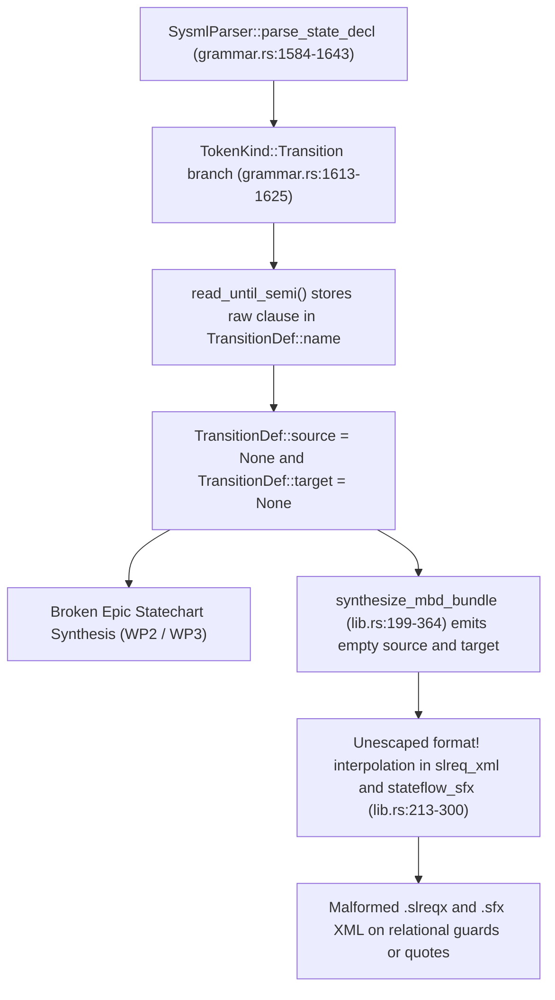

## 1. Context and References

<!-- test-target: crates/compile-sysml/src/parser/grammar.rs -->

- **File**: `crates/compile-sysml/src/parser/grammar.rs:1584-1643`
- **Pillar**: Semantic Traceability
- **Symptom**: `SysmlParser::parse_state_decl` leaves `TransitionDef::source` and `target` as `None` (`grammar.rs:1613-1625`) and `synthesize_mbd_bundle` (`lib.rs:213-300`) emits unescaped XML.
- **Test-Target**: `crates/compile-sysml/src/parser/grammar.rs`

## 2. Root Cause Analysis (5 Whys)

1. **Why do synthesized `.sfx` Stateflow transitions and downstream epic statechart models lack `source` and `target` endpoints while `.slreqx` and `.sfx` exports risk malformed XML?** Because `SysmlParser::parse_state_decl` in `/Users/perkunas/jail/DEAP01-spec-core/crates/compile-sysml/src/parser/grammar.rs` (lines 1613-1625) assigns `source: None` and `target: None` on every parsed `TransitionDef`, and `synthesize_mbd_bundle` in `/Users/perkunas/jail/DEAP01-spec-core/crates/compile-sysml/src/lib.rs` (lines 213-300) formats requirement and state fields into XML without escaping reserved XML characters.
2. **Why does `SysmlParser::parse_state_decl` leave `TransitionDef::source` and `TransitionDef::target` as `None`?** Because when encountering `TokenKind::Transition` at line 1613, the parser immediately invokes `let t_stmt = self.read_until_semi();` and stores the unparsed string slice in `TransitionDef::name` instead of decomposing `first <source>` and `then <target>` clauses.
3. **Why did `synthesize_mbd_bundle` in `/Users/perkunas/jail/DEAP01-spec-core/crates/compile-sysml/src/lib.rs` interpolate raw fields directly into XML templates?** Because lines 240-258 and 265-295 construct `<slreq:Requirement>` and `<Transition>` nodes via `format!` without passing attribute values or element text through a deterministic XML entity escaping helper.
4. **Why did `test_synthesize_mbd_bundle_and_export_artifacts` in `/Users/perkunas/jail/DEAP01-spec-core/crates/compile-sysml/src/lib.rs` (lines 514-570) pass despite `source` and `target` being `None`?** Because the unit test only checked `bundle.stateflow_sfx.contains("Init")` and `bundle.stateflow_sfx.contains("Active")`, which matched the `<State name="Init" ... />` declarations and the raw `name="first Init then Active"` attribute while `<Transition ... source="" target="" />` had empty endpoints.
5. **Why was this semantic traceability gap not caught during initial grammar and MBD export implementation?** Because no negative or structural assertion verified that `TransitionDef.source == Some("Init")` and `TransitionDef.target == Some("Active")` after parsing `transition first Init then Active;`, nor tested XML escaping when requirement text or transition guards contain `&`, `<`, `>`, `"`, or `'`.

## 3. Correctness Analysis

In `/Users/perkunas/jail/DEAP01-spec-core/crates/compile-sysml/src/parser/grammar.rs` at lines 1584-1643 (`SysmlParser::parse_state_decl`), state declarations parse nested `entry`, `do`, `exit`, `state`, and `transition` statements. At lines 1613-1625:
- When `self.check(&TokenKind::Transition)` holds, the parser advances past `transition`, reads all remaining tokens up to `;` via `self.read_until_semi()`, and pushes a `TransitionDef` where `name: Some(t_stmt.clone())`, `source: None`, `target: None`, `trigger: None`, `guard: None`, and `effect: None`.
- For standard SysML v2 syntax `transition first Init then Active;` or named syntax `transition t1 first Init accept FaultSignal if pitch_deg > 15.0 do EngageBackup then SafeMode;`, discarding the structured `source` and `target` fields violates the AST postcondition of `StateDef` and breaks both epic statechart synthesis (WP2/WP3) and Stateflow `.sfx` transition generation in `/Users/perkunas/jail/DEAP01-spec-core/crates/compile-sysml/src/lib.rs` (lines 285-295), which emits `source="" target=""`.
- Simultaneously, in `/Users/perkunas/jail/DEAP01-spec-core/crates/compile-sysml/src/lib.rs` at lines 213-300 (`synthesize_mbd_bundle`), `pkg_name`, `id_str`, `req.name`, `layer_str`, `summary_str`, `satisfied_by`, `req.safety_realises`, `req.triggers_hazards`, `state_def.name`, `part.name`, `root_entry`, `root_do`, `root_exit`, and all `TransitionDef` attributes are formatted directly into XML strings without escaping `&`, `<`, `>`, `"`, and `'`. Any relational operator in a requirement summary or guard expression produces ill-formed XML in `requirements.slreqx` and `stateflow_chart.sfx`.

## 4. UML Diagrams



## 5. Affected Callers / Downstream Impact

- `SysmlParser::parse_state_decl` in `/Users/perkunas/jail/DEAP01-spec-core/crates/compile-sysml/src/parser/grammar.rs:1584-1643` -- produces `TransitionDef` nodes with `source: None` and `target: None` for all parsed SysML v2 state machines.
- `synthesize_mbd_bundle` and `export_mbd_artifacts` in `/Users/perkunas/jail/DEAP01-spec-core/crates/compile-sysml/src/lib.rs:199-438` -- emits `<Transition ... source="" target="" />` in `stateflow_chart.sfx` and unescaped XML in both `requirements.slreqx` and `stateflow_chart.sfx`.
- `forward_sync_sysml_to_specs` in `/Users/perkunas/jail/DEAP01-spec-core/crates/compile-sysml/src/sync/forward.rs` -- epic statechart Mermaid synthesis cannot resolve transition endpoints when `TransitionDef::source` and `TransitionDef::target` are `None`.

## 6. Proposed Correction

```rust
fn escape_xml(input: &str) -> String {
    let mut out = String::with_capacity(input.len());
    for ch in input.chars() {
        match ch {
            '&' => out.push_str("&amp;"),
            '<' => out.push_str("&lt;"),
            '>' => out.push_str("&gt;"),
            '"' => out.push_str("&quot;"),
            '\'' => out.push_str("&apos;"),
            _ => out.push(ch),
        }
    }
    out
}

fn parse_transition_clause(raw: &str) -> TransitionDef {
    let tokens: Vec<&str> = raw.split_whitespace().collect();
    let mut name = None;
    let mut source = None;
    let mut target = None;
    let mut trigger = None;
    let mut guard = None;
    let mut effect = None;

    let mut idx = 0;
    if idx < tokens.len() && tokens[idx] != "first" && tokens[idx] != "from" {
        name = Some(tokens[idx].to_string());
        idx += 1;
    }
    while idx < tokens.len() {
        match tokens[idx] {
            "first" | "from" if idx + 1 < tokens.len() => {
                source = Some(tokens[idx + 1].to_string());
                idx += 2;
            }
            "then" | "to" if idx + 1 < tokens.len() => {
                target = Some(tokens[idx + 1].to_string());
                idx += 2;
            }
            "accept" if idx + 1 < tokens.len() => {
                trigger = Some(tokens[idx + 1].to_string());
                idx += 2;
            }
            "if" if idx + 1 < tokens.len() => {
                guard = Some(tokens[idx + 1].to_string());
                idx += 2;
            }
            "do" if idx + 1 < tokens.len() => {
                effect = Some(tokens[idx + 1].to_string());
                idx += 2;
            }
            _ => {
                idx += 1;
            }
        }
    }
    if name.is_none() {
        name = match (&source, &target) {
            (Some(s), Some(t)) => Some(format!("{s}_to_{t}")),
            _ => Some(raw.trim().to_string()),
        };
    }

    TransitionDef {
        name,
        source,
        target,
        trigger,
        guard,
        effect,
        doc: None,
    }
}
```

## 7. Relationship to Existing Issues

Discovered in audit -- new finding (refs #500, refs #502).

## Audit Source

Adversarial Semantic Traceability Audit
SEVERITY: Critical
FILE_LOCATION: crates/compile-sysml/src/parser/grammar.rs:1584-1643
