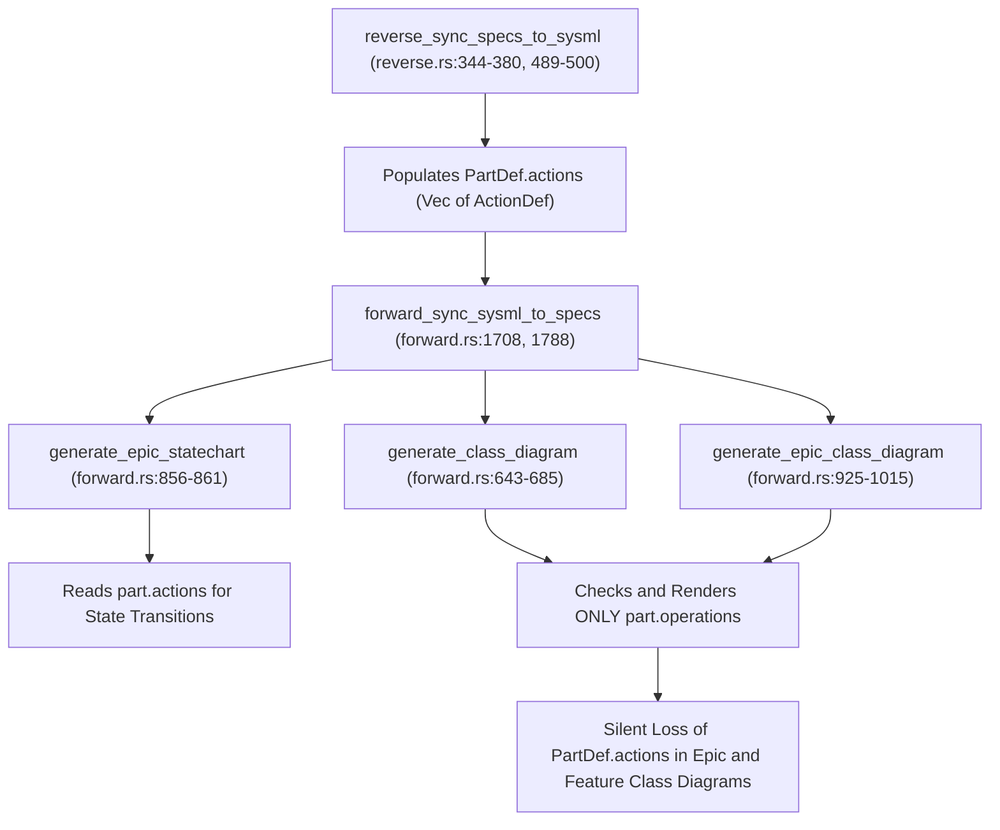

## 1. Context and References

<!-- test-target: crates/compile-sysml/src/sync/forward.rs -->

- **File**: `crates/compile-sysml/src/sync/forward.rs:643-1015`
- **Pillar**: Semantic Traceability
- **Symptom**: `reverse_sync_specs_to_sysml` (`reverse.rs:344-380`) populates `PartDef::actions` while `generate_class_diagram` and `generate_epic_class_diagram` (`forward.rs:643-1015`) only render `PartDef::operations`, breaking WP3 Epic/Feature diagram parity.
- **Test-Target**: `crates/compile-sysml/src/sync/forward.rs`

## 2. Root Cause Analysis (5 Whys)

1. **Why do generated Epic (`docs/epics/EPIC-*.md`) and Feature (`docs/features/FEAT-*.md`) Mermaid class diagrams omit behavioral actions that were reverse-synchronized or parsed into `PartDef::actions`?** Because `generate_class_diagram` (lines 643-685) and `generate_epic_class_diagram` (lines 925-1015) in `/Users/perkunas/jail/DEAP01-spec-core/crates/compile-sysml/src/sync/forward.rs` only check `!part.operations.is_empty()` and iterate over `&part.operations`, ignoring `part.actions`.
2. **Why does `PartDef` hold behavioral members in `part.actions` while the forward diagram generators only inspect `part.operations`?** Because `reverse_sync_specs_to_sysml` in `/Users/perkunas/jail/DEAP01-spec-core/crates/compile-sysml/src/sync/reverse.rs` (lines 366-371 and 492-496) deserializes `- \`+ActionName() : void\`` entries from `docs/features/FEAT-*.md` into `PartDef::actions` (`ActionDef`), while the forward class diagram serializers were coded against `PartDef::operations` (`OperationDef`) alone.
3. **Why was this representation asymmetry introduced between `/Users/perkunas/jail/DEAP01-spec-core/crates/compile-sysml/src/sync/reverse.rs` and `/Users/perkunas/jail/DEAP01-spec-core/crates/compile-sysml/src/sync/forward.rs`?** Because `deap_core::sysml_ast::PartDef` defines two separate behavioral collections (`pub actions: Vec<ActionDef>` and `pub operations: Vec<OperationDef>`), and forward vs. reverse synchronization modules were implemented without a shared behavioral member iterator or round-trip parity invariant.
4. **Why did existing unit tests in `/Users/perkunas/jail/DEAP01-spec-core/crates/compile-sysml/src/sync/forward.rs` and `/Users/perkunas/jail/DEAP01-spec-core/crates/compile-sysml/src/sync/reverse.rs` fail to catch the dropped actions?** Because `test_epic_statechart_and_class_diagram_generation` (lines 2867-2926 in `/Users/perkunas/jail/DEAP01-spec-core/crates/compile-sysml/src/sync/forward.rs`) only populated `ports` and `attributes` on `PartDef`, never asserting that `PartDef::actions` survive a reverse-to-forward sync round-trip or appear in both Epic and Feature class diagrams.
5. **Why does this violate the WP3 specification compiler architecture?** Because `generate_epic_statechart` (lines 856-861 in `/Users/perkunas/jail/DEAP01-spec-core/crates/compile-sysml/src/sync/forward.rs`) reads `pt.actions.iter()` to synthesize state transitions while `generate_class_diagram` and `generate_epic_class_diagram` ignore `pt.actions`, causing behavioral statecharts and structural class diagrams within the same Epic and Feature set to diverge.

## 3. Correctness Analysis

Trace of data flow from `reverse_sync_specs_to_sysml` to `forward_sync_sysml_to_specs`:

1. **Reverse Sync Populates `PartDef::actions`**:
   - In `/Users/perkunas/jail/DEAP01-spec-core/crates/compile-sysml/src/sync/reverse.rs` at lines 318-382 (`"feature"` match arm of `reverse_sync_specs_to_sysml`), each line matching `- \`+ActionName() : ReturnType\`` is parsed at lines 348-379.
   - At lines 366-371, `reverse_sync_specs_to_sysml` pushes `ActionDef { name: act_name_str, ..Default::default() }` into `entry.actions` (`PartDef::actions`).
   - At lines 490-500, `reverse_sync_specs_to_sysml` merges `part.actions` into `existing.actions` on the target `PartDef` in `PackageDef`.
   - `PartDef::operations` is never populated by `reverse_sync_specs_to_sysml`.

2. **Forward Sync Drops `PartDef::actions` in Feature Class Diagrams**:
   - In `/Users/perkunas/jail/DEAP01-spec-core/crates/compile-sysml/src/sync/forward.rs` at line 1788, `forward_sync_sysml_to_specs` calls `generate_class_diagram(ctx.part)` for each `FEAT-*.md`.
   - Inside `generate_class_diagram` (lines 643-685), line 647 computes:
     `let has_members = !part.ports.is_empty() || !part.attributes.is_empty() || !part.operations.is_empty();`
   - If a `PartDef` has non-empty `part.actions` but empty `ports`, `attributes`, and `operations`, `has_members` evaluates to `false` and the class body is omitted entirely (line 676).
   - Even when `has_members` is `true`, lines 669-672 only iterate over `for op in &part.operations`, never iterating over `&part.actions`.

3. **Forward Sync Drops `PartDef::actions` (and Root `operations`) in Epic Class Diagrams**:
   - In `/Users/perkunas/jail/DEAP01-spec-core/crates/compile-sysml/src/sync/forward.rs` at line 1708, `forward_sync_sysml_to_specs` calls `generate_epic_class_diagram(p, &primary_engine, is_root)` for each `EPIC-*.md`.
   - In the `if is_root` branch (lines 929-964), line 932 checks `!root_part.ports.is_empty() || !root_part.attributes.is_empty() || !root_part.operations.is_empty()`, omitting `!root_part.actions.is_empty()`, and lines 935-950 only render `root_part.ports` and `root_part.attributes` (dropping both `root_part.operations` and `root_part.actions`).
   - In the non-root branch (lines 971-998), line 972 checks `let has_members = !part.ports.is_empty() || !part.attributes.is_empty() || !part.operations.is_empty();` and lines 990-993 only render `for op in &part.operations`, dropping all `part.actions`.

- **Violated Invariant**: Universal Model Consistency & Bidirectional AST-Specification Parity (`REQ-SYSML-REVERSE-SYNC-ENGINE`, `REQ-SYNC-FORWARD-GENERATE-CLASS-DIAGRAM`, `REQ-SYNC-FORWARD-GENERATE-EPIC-CLASS-DIAGRAM`). Behavioral actions present in `PartDef::actions` must be rendered symmetrically with `PartDef::operations` across both Epic (`EPIC-*.md`) and Feature (`FEAT-*.md`) class diagrams.

## 4. UML Diagrams



## 5. Affected Callers / Downstream Impact

- `forward_sync_sysml_to_specs` in `/Users/perkunas/jail/DEAP01-spec-core/crates/compile-sysml/src/sync/forward.rs:1708` -- emits `docs/epics/EPIC-*.md` with `## System-Level UML Class Diagram` missing all `PartDef::actions` (and root `PartDef::operations`).
- `forward_sync_sysml_to_specs` in `/Users/perkunas/jail/DEAP01-spec-core/crates/compile-sysml/src/sync/forward.rs:1788` -- emits `docs/features/FEAT-*.md` with `## UML Class Diagram` missing all `PartDef::actions`.
- `reverse_sync_specs_to_sysml` in `/Users/perkunas/jail/DEAP01-spec-core/crates/compile-sysml/src/sync/reverse.rs:344-380` -- round-tripping `reverse-sync` followed by `forward-sync` loses all action signatures extracted from `docs/features/FEAT-*.md`.
- WP3 Verification & Parity Gates -- downstream consistency checks comparing Epic statecharts (which reference `part.actions` at `forward.rs:856-861`) against Epic/Feature class diagrams encounter undeclared behavioral methods.

## 6. Proposed Correction

<!-- MUST NOT use regex (Check 34: deterministic linear slice/char scanning, no regex crate). MUST be domain-agnostic for upstream crates (Check 19). -->

Render both `part.operations` and `part.actions` (deduplicated by name) in `generate_class_diagram` and `generate_epic_class_diagram` (including the `is_root` branch) in `/Users/perkunas/jail/DEAP01-spec-core/crates/compile-sysml/src/sync/forward.rs`:

```rust
fn render_part_class_block(lines: &mut Vec<String>, part: &PartDef, indent: &str) {
    let has_members = !part.ports.is_empty()
        || !part.attributes.is_empty()
        || !part.operations.is_empty()
        || !part.actions.is_empty();

    if has_members {
        lines.push(format!("{indent}class {} {{", part.name));

        for port in &part.ports {
            let dir_prefix = if port.direction == "in" {
                "in"
            } else if port.direction == "out" {
                "out"
            } else {
                "inout"
            };
            let p_type = if port.type_name.is_empty() { "Port" } else { &port.type_name };
            lines.push(format!("{indent}    +{} {} ({})", p_type, port.name, dir_prefix));
        }

        for attr in &part.attributes {
            let a_type = if attr.type_name.is_empty() { "String" } else { &attr.type_name };
            lines.push(format!("{indent}    +{} {}", a_type, attr.name));
        }

        let mut emitted_ops = BTreeSet::new();
        for op in &part.operations {
            let ret = op.return_type.as_deref().unwrap_or("void");
            if emitted_ops.insert(op.name.as_str()) {
                lines.push(format!("{indent}    +{}() {}", op.name, ret));
            }
        }

        for act in &part.actions {
            if emitted_ops.insert(act.name.as_str()) {
                lines.push(format!("{indent}    +{}() void", act.name));
            }
        }

        lines.push(format!("{indent}}}"));
    } else {
        lines.push(format!("{indent}class {}", part.name));
    }
}
```

## 7. Relationship to Existing Issues

Discovered in audit -- new finding (refs #442, refs #447).

## Audit Source

Adversarial Semantic Traceability Audit
SEVERITY: Important
FILE_LOCATION: crates/compile-sysml/src/sync/forward.rs:643-1015
