## 1. Context and References

<!-- test-target: crates/reconcile-backlog/src/checklist.rs -->

- **File**: `/Users/perkunas/jail/DEAP01-spec-core/crates/reconcile-backlog/src/checklist.rs` (lines 793-800, 862-868, 1198-1396) and `/Users/perkunas/jail/DEAP01-spec-core/crates/reconcile-backlog/src/frontmatter.rs` (lines 206-417, 446-575)
- **Pillar**: Domain Logic -- Boundary Conditions, Off-by-One Cardinality & Frontmatter Idempotency
- **Symptom**: synthesize_and_reconcile_hierarchy overcounts total_epics and total_features by + 1 when child_specs contains parent_spec, and parse_frontmatter / update_frontmatter_issue_id count HTML comments toward pre_table_count >= 25, injecting duplicate metadata tables
- **Test-Target**: `crates/reconcile-backlog/src/checklist.rs`

In `/Users/perkunas/jail/DEAP01-spec-core/crates/reconcile-backlog/src/checklist.rs`, `synthesize_and_reconcile_hierarchy` (lines 1198-1396) computes `total_epics` at line 1215 (`let total_epics = child_specs.iter().filter(|s| is_spec_epic(s)).count() + 1;`) and `total_features` at line 1322 (`let total_features = child_specs.iter().filter(|s| is_spec_feature(s)).count() + 1;`). However, in `/Users/perkunas/jail/DEAP01-spec-core/crates/reconcile-backlog/src/lib.rs` (lines 310-321), `run_reconciliation` snapshots the entire workspace specification vector (`let all_specs_snapshot = specs.clone();`) and passes `&all_specs_snapshot` as `child_specs` to `synthesize_and_reconcile_hierarchy(spec, &all_specs_snapshot, ...)`. Because `child_specs` already contains `parent_spec`, adding `+ 1` unconditionally overcounts `total_epics` and `total_features` by 1 (yielding `2` instead of `1` in single-Epic or single-Feature workspaces), which renders the `if total_epics <= 1` fallback in `spec_matches_epic` (line 797) and the `if total_features <= 1` fallback in `spec_matches_feature` (line 866) unreachable whenever `child_specs` includes `parent_spec`.

Concurrently, in `/Users/perkunas/jail/DEAP01-spec-core/crates/reconcile-backlog/src/frontmatter.rs`, both `parse_frontmatter` (lines 282-389, specifically lines 383-388) and `update_frontmatter_issue_id` (lines 506-546, specifically lines 540-545) increment `pre_table_count += 1` on every non-table line prior to the CommonMark 2-column metadata table, including leading HTML comment lines (`<!-- ... -->`) and multi-line HTML comments. When a specification file begins with 25 or more lines of HTML comments and blank lines before the `| Attribute | Specification Detail |` table, both loops terminate early at `if pre_table_count >= 25 { break; }` (lines 385 and 542). During WP3 `reconcile-backlog`, `update_frontmatter_issue_id` fails to detect the existing CommonMark metadata table (`table_header_idx`, `table_delim_idx`, `table_issue_id_idx`, and `table_fallback_id_idx` remain `None`) and executes the fallback branch at lines 558-568, injecting a duplicate CommonMark metadata table at line 1 of the file.

## 2. Root Cause Analysis (5 Whys)

1. **Why do single-Epic or single-Feature workspaces fail to bind child specifications via the single-parent fallback in `spec_matches_epic` and `spec_matches_feature`, while specifications with leading HTML comment blocks receive duplicate CommonMark metadata tables during WP3 `reconcile-backlog`?** Because `synthesize_and_reconcile_hierarchy` in `/Users/perkunas/jail/DEAP01-spec-core/crates/reconcile-backlog/src/checklist.rs` evaluates `total_epics` (line 1215) and `total_features` (line 1322) as `2` instead of `1` when `child_specs` contains `parent_spec`, and `parse_frontmatter` / `update_frontmatter_issue_id` in `/Users/perkunas/jail/DEAP01-spec-core/crates/reconcile-backlog/src/frontmatter.rs` abort table scanning after 25 pre-table lines (lines 385 and 542) including HTML comments.
2. **Why does `synthesize_and_reconcile_hierarchy` compute `total_epics = 2` and `total_features = 2` when only a single Epic or Feature exists in the workspace?** Because lines 1215 and 1322 compute `child_specs.iter().filter(|s| is_spec_epic(s)).count() + 1` and `child_specs.iter().filter(|s| is_spec_feature(s)).count() + 1` under the assumption that `parent_spec` is excluded from `child_specs`, whereas `run_reconciliation` in `/Users/perkunas/jail/DEAP01-spec-core/crates/reconcile-backlog/src/lib.rs` (lines 310-321) passes `&all_specs_snapshot` containing `parent_spec` itself.
3. **Why did `synthesize_and_reconcile_hierarchy` not guard against `parent_spec` already being present in `child_specs`?** Because `spec_matches_epic` (line 794) and `spec_matches_feature` (line 863) explicitly filter out self-matches via `if child.rel_path == epic.rel_path { return false; }`, which masked self-inclusion during child collection while leaving the `.count() + 1` cardinality expression unguarded against `s.rel_path == parent_spec.rel_path`.
4. **Why do `parse_frontmatter` and `update_frontmatter_issue_id` abort before reaching the CommonMark metadata table when HTML comments precede the table?** Because the pre-table line counter in `/Users/perkunas/jail/DEAP01-spec-core/crates/reconcile-backlog/src/frontmatter.rs` (lines 383-388 and 540-545) treats every line that does not start and end with `|` as a content line and increments `pre_table_count += 1` without skipping HTML comments (`<!-- ... -->`) or blank lines.
5. **Why does breaking at `pre_table_count >= 25` in `update_frontmatter_issue_id` corrupt specification files with duplicate metadata tables?** Because when the scan loop at lines 508-546 breaks before reaching the existing CommonMark metadata table, `table_issue_id_idx`, `table_fallback_id_idx`, `table_delim_idx`, and `table_header_idx` all remain `None`, triggering the `else if !has_yaml` branch at lines 558-568 which prepends a second `| Attribute | Specification Detail |` table at the top of the document.

## 3. Correctness Analysis

### 3.1 Off-by-One Hierarchy Cardinality in `/Users/perkunas/jail/DEAP01-spec-core/crates/reconcile-backlog/src/checklist.rs`

In `/Users/perkunas/jail/DEAP01-spec-core/crates/reconcile-backlog/src/checklist.rs`:
- `spec_matches_epic` (lines 793-800) defines the single-Epic fallback invariant:
  - Line 794-796: `if child.rel_path == epic.rel_path { return false; }`
  - Line 797-799: `if total_epics <= 1 { return true; }`
- `spec_matches_feature` (lines 862-868) defines the single-Feature fallback invariant:
  - Line 863-865: `if child.rel_path == feat.rel_path { return false; }`
  - Line 866-868: `if total_features <= 1 { return true; }`
- However, `synthesize_and_reconcile_hierarchy` (lines 1198-1396) calculates:
  - Line 1215: `let total_epics = child_specs.iter().filter(|s| is_spec_epic(s)).count() + 1;`
  - Line 1322: `let total_features = child_specs.iter().filter(|s| is_spec_feature(s)).count() + 1;`

Let $E$ be the set of Epic specifications in `all_specs_snapshot` with $|E| = 1$, and let `parent_spec` $\in E$. When `run_reconciliation` (`/Users/perkunas/jail/DEAP01-spec-core/crates/reconcile-backlog/src/lib.rs`, lines 315-321) invokes `synthesize_and_reconcile_hierarchy(spec, &all_specs_snapshot, ...)`, the filter `child_specs.iter().filter(|s| is_spec_epic(s)).count()` counts `parent_spec` inside `child_specs` and evaluates to $|E| = 1$. Adding `+ 1` yields `total_epics = 2`. Consequently, `total_epics <= 1` at line 797 evaluates to `2 <= 1` (`false`), violating the single-Epic fallback invariant. The identical defect occurs for `total_features` at line 1322 and line 866 when $|F| = 1$.

### 3.2 Frontmatter Pre-Table HTML Comment Exhaustion in `/Users/perkunas/jail/DEAP01-spec-core/crates/reconcile-backlog/src/frontmatter.rs`

In `/Users/perkunas/jail/DEAP01-spec-core/crates/reconcile-backlog/src/frontmatter.rs`:
- `parse_frontmatter` (lines 305-389) scans lines starting from `search_start` (line 280). For any line where `!(line_trimmed.starts_with('|') && line_trimmed.ends_with('|'))` and `!in_table`, lines 383-388 execute:
  - Line 384: `pre_table_count += 1;`
  - Line 385-387: `if pre_table_count >= 25 { break; }`
- `update_frontmatter_issue_id` (lines 508-546) executes the identical unguarded counter at lines 540-545:
  - Line 541: `pre_table_count += 1;`
  - Line 542-544: `if pre_table_count >= 25 { break; }`
- When a specification contains HTML comments (`<!-- ... -->`, such as copyright headers, `<!-- test-target: ... -->`, or traceability metadata blocks) and blank lines totaling 25 lines prior to the CommonMark metadata table:
  1. `parse_frontmatter` breaks at line 386 with `raw_fields.is_empty() == true` and returns `None` at line 392, causing `load_specifications` (`/Users/perkunas/jail/DEAP01-spec-core/crates/reconcile-backlog/src/lib.rs`, line 238) to silently ignore the specification file.
  2. `update_frontmatter_issue_id` breaks at line 543 before reaching the CommonMark table and falls through to `else if !has_yaml` at lines 558-568, prepending a duplicate `| Attribute | Specification Detail |` table at line 1.

## 4. UML Diagrams

```mermaid
flowchart TD
    subgraph HierarchyBug["checklist.rs: synthesize_and_reconcile_hierarchy (lines 1215, 1322)"]
        A["run_reconciliation passes all_specs_snapshot (includes parent_spec)"] --> B["filter(is_spec_epic / is_spec_feature).count() + 1"]
        B --> C["Single Epic/Feature workspace evaluates total = 2 instead of 1"]
        C --> D["spec_matches_epic (line 797) and spec_matches_feature (line 866) bypass total <= 1"]
    end
    subgraph FrontmatterBug["frontmatter.rs: parse_frontmatter (line 384) & update_frontmatter_issue_id (line 541)"]
        E["Leading HTML comment lines and blank lines before metadata table"] --> F["pre_table_count incremented on HTML comments up to 25"]
        F --> G["Loop breaks at pre_table_count >= 25 before reaching CommonMark table"]
        G --> H["parse_frontmatter returns None (line 392) / update_frontmatter_issue_id injects duplicate table (lines 558-568)"]
    end
```



## 5. Affected Callers / Downstream Impact

- **`run_reconciliation` (`/Users/perkunas/jail/DEAP01-spec-core/crates/reconcile-backlog/src/lib.rs`, lines 286-421)**:
  - At lines 310-321, `run_reconciliation` passes `spec` and `&all_specs_snapshot` into `checklist::synthesize_and_reconcile_hierarchy`. Because `all_specs_snapshot` contains `spec`, `total_epics` and `total_features` are always overcounted by `+ 1`.
  - At lines 238 and 345, `load_specifications` calls `parse_frontmatter(&content)` and `run_reconciliation` calls `update_frontmatter_issue_id(&spec.content, issue.number)`.
- **`synthesize_and_reconcile_hierarchy` (`/Users/perkunas/jail/DEAP01-spec-core/crates/reconcile-backlog/src/checklist.rs`, lines 1198-1396)**:
  - Calls `spec_matches_epic(parent_spec, child, total_epics)` at lines 1221, 1223, and 1225, and `spec_matches_feature(parent_spec, child, total_features)` at lines 1327 and 1329.
- **`parse_frontmatter` and `update_frontmatter_issue_id` (`/Users/perkunas/jail/DEAP01-spec-core/crates/reconcile-backlog/src/frontmatter.rs`, lines 206-417 and 446-575)**:
  - Called during WP3 `reconcile-backlog` and issue creation workflows across all Epic, Feature, Use Case, and User Story specifications.

## 6. Proposed Correction

In `/Users/perkunas/jail/DEAP01-spec-core/crates/reconcile-backlog/src/checklist.rs` (lines 1215 and 1322), exclude `parent_spec` (`s.rel_path != parent_spec.rel_path`) before adding `+ 1` so `total_epics` and `total_features` are exact whether `child_specs` includes `parent_spec` or not. In `/Users/perkunas/jail/DEAP01-spec-core/crates/reconcile-backlog/src/frontmatter.rs` (lines 280-389 and 500-546), track single-line and multi-line HTML comments (`<!--` through `-->`) and empty lines so they do not increment `pre_table_count`:

```rust
// 1. In crates/reconcile-backlog/src/checklist.rs (lines 1214-1216 and 1321-1323):
    if is_epic {
        let total_epics = child_specs
            .iter()
            .filter(|s| s.rel_path != parent_spec.rel_path && is_spec_epic(s))
            .count()
            + 1;
        // ...
    } else if is_feature {
        let total_features = child_specs
            .iter()
            .filter(|s| s.rel_path != parent_spec.rel_path && is_spec_feature(s))
            .count()
            + 1;
        // ...
    }

// 2. In crates/reconcile-backlog/src/frontmatter.rs (helper used in both parse_frontmatter and update_frontmatter_issue_id):
fn is_ignorable_pre_table_line(line_trimmed: &str, in_html_comment: &mut bool) -> bool {
    if *in_html_comment {
        if let Some(end_idx) = line_trimmed.find("-->") {
            *in_html_comment = false;
            let remainder = line_trimmed[end_idx + 3..].trim();
            return remainder.is_empty();
        }
        return true;
    }
    if line_trimmed.is_empty() {
        return true;
    }
    if let Some(after_open) = line_trimmed.strip_prefix("<!--") {
        if let Some(end_idx) = after_open.find("-->") {
            let remainder = after_open[end_idx + 3..].trim();
            return remainder.is_empty();
        } else {
            *in_html_comment = true;
            return true;
        }
    }
    false
}
```

## 7. Relationship to Existing Issues

- Relates to CommonMark 2-column metadata table parsing and frontmatter synchronization `(refs #430)`.
- Relates to placeholder purging and checklist reconciliation idempotency `(refs #439)`.
- Relates to hierarchical Epic/Feature checklist synthesis and tracker link projection `(refs #448)`.

## Audit Source

Adversarial Semantic Traceability Audit
SEVERITY: Important
FILE_LOCATION: crates/reconcile-backlog/src/checklist.rs:1214-1325
