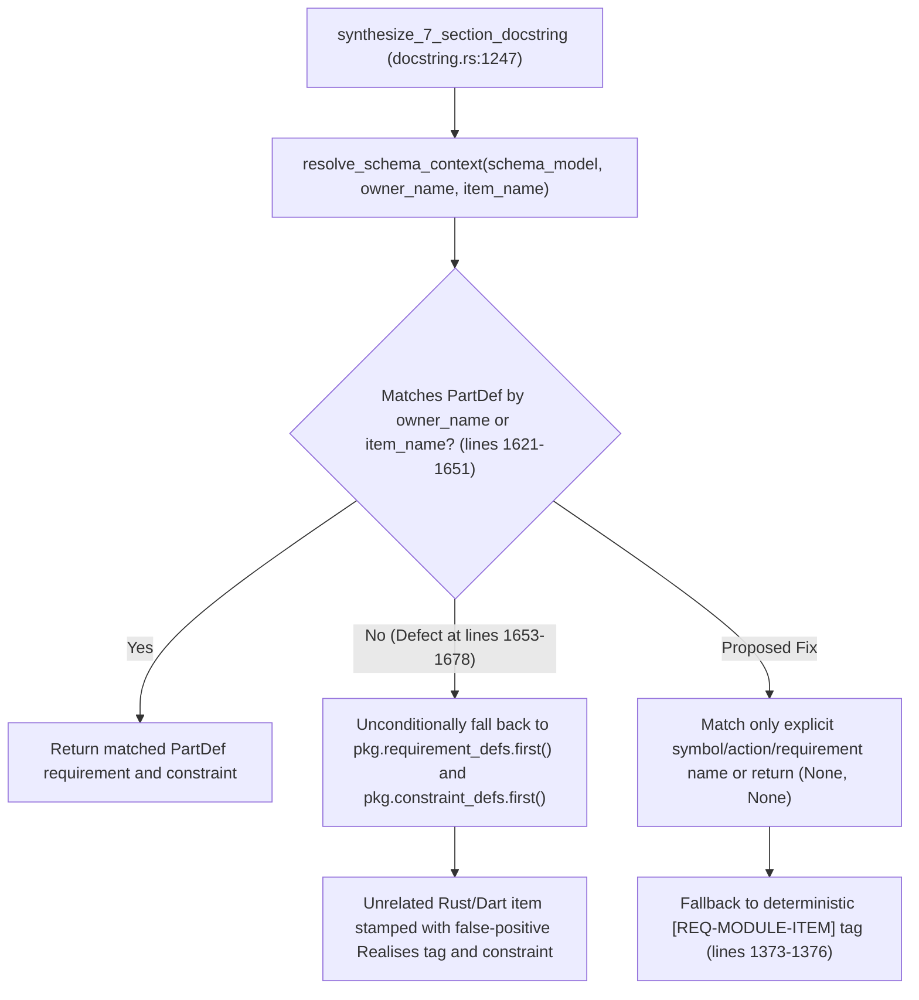

## 1. Context and References

<!-- test-target: crates/compile-sysml/src/docstring.rs -->

- **File**: `/Users/perkunas/jail/DEAP01-spec-core/crates/compile-sysml/src/docstring.rs` (lines 1246-1261, 1363-1376, and 1586-1681)
- **Pillar**: Pillar 2 (Nominal Contract Violation) and Pillar 5 (Resource Lifecycle and State Corruption)
- **Symptom**: `resolve_schema_context` unconditionally falls back to `pkg.requirement_defs.first()` (lines 1653-1667) and `pkg.constraint_defs.first()` (lines 1669-1678) when `.pipeline/schema.sysml` or `schema/*.sysml` is populated, stamping unrelated Rust and Dart items with false-positive requirement and constraint tags.
- **Test-Target**: crates/compile-sysml/src/docstring.rs
- **CLI Entrypoint Caller**: `/Users/perkunas/jail/DEAP01-spec-core/crates/compile-sysml/src/main.rs` (lines 204-234)
- **Governance Invariant**: DO-178C Level A / DO-330 TQL-4 / ISO 26262 ASIL D Bidirectional Requirements Traceability Invariant and FEAT-42 Section 3.2 Deterministic Requirement Binding

In `/Users/perkunas/jail/DEAP01-spec-core/crates/compile-sysml/src/docstring.rs`, `synthesize_7_section_docstring` (lines 1227-1430) calls `resolve_schema_context(ctx.schema_model, ctx.owner_name, ctx.item_name)` at lines 1247-1248 to look up an optional SysML v2 requirement ID and constraint expression from the loaded `PackageDef` AST when `/Users/perkunas/jail/DEAP01-spec-core/.pipeline/schema.sysml` or `schema/*.sysml` is populated.

However, in `resolve_schema_context` (`/Users/perkunas/jail/DEAP01-spec-core/crates/compile-sysml/src/docstring.rs` lines 1586-1681), after searching `pkg.part_defs` for a part matching `owner_name` (lines 1621-1636) or `item_name` (lines 1638-1651), lines 1653-1678 unconditionally fall back to `pkg.requirement_defs.first()` and `pkg.constraint_defs.first()` whenever `matched_req.is_none()` or `matched_constraint.is_none()`. As a result, every unrelated Rust or Dart AST item whose identifier does not match a `PartDef` in the schema is stamped with false-positive requirement and constraint bindings taken from the arbitrary first `requirement def` and `constraint def` in the package.

## 2. Root Cause Analysis (5 Whys)

1. **Why does `compile-sysml --inject-safety-docstrings` stamp unrelated Rust and Dart items with the same arbitrary schema requirement ID and constraint expression when `/Users/perkunas/jail/DEAP01-spec-core/.pipeline/schema.sysml` or `schema/` is populated?** Because `resolve_schema_context` in `/Users/perkunas/jail/DEAP01-spec-core/crates/compile-sysml/src/docstring.rs` (lines 1653-1678) executes an unconditional fallback to `pkg.requirement_defs.first()` and `pkg.constraint_defs.first()` whenever no `PartDef` matches `owner_name` or `item_name`.
2. **Why does `resolve_schema_context` fall back to `pkg.requirement_defs.first()` and `pkg.constraint_defs.first()` when `matched_req` or `matched_constraint` is `None`?** Because the function assumes that if a `PackageDef` schema model is provided via `DocstringInjectionOptions.schema_model`, every synthesized docstring must extract a requirement and constraint from the package even when the source symbol has no structural correspondence in `pkg.part_defs`.
3. **Why does returning a non-`None` `schema_req_id` from `resolve_schema_context` suppress item-specific requirement tag generation in `synthesize_7_section_docstring`?** Because lines 1371-1376 of `/Users/perkunas/jail/DEAP01-spec-core/crates/compile-sysml/src/docstring.rs` only execute the `else` branch (`format!("[REQ-{}-{}]", ctx.module_tag, item_tag)`) when `schema_req_id` is `None`, so any fallback `Some(s_req)` overrides the item-specific module tag.
4. **Why was this false-positive attribution not caught during unit testing of `resolve_schema_context`?** Because unit tests using a toy single-requirement schema asserted that `schema_model` injection produced the schema requirement ID in the output docstring without testing a mixed file containing both schema-mapped domain structs and unmapped helper functions.
5. **Why does stamping unmapped source symbols with `pkg.requirement_defs.first()` violate the DEAP MBSE compiler architecture?** Because DO-178C Level A and ISO 26262 ASIL D traceability require `Realises: [...]` bindings to be sound and specific to the realizing software unit; associating every unmapped helper function or utility struct with the first package requirement fabricates false-positive realization claims in reverse-extracted SysML models (`--extract-source`).

## 3. Correctness Analysis

- **Pillar 2 (Nominal Contract Violation)**: In `/Users/perkunas/jail/DEAP01-spec-core/crates/compile-sysml/src/docstring.rs` lines 1556-1584, the docstring contract of `resolve_schema_context` states that it binds SysML v2 `RequirementDef` and `ConstraintDef` declarations when a matching part, action, or requirement is present in the model. Returning `pkg.requirement_defs.first()` (lines 1653-1667) and `pkg.constraint_defs.first()` (lines 1669-1678) when zero symbol match exists directly violates this postcondition.
- **Pillar 5 (Resource Lifecycle and State Corruption)**: When `compile-sysml --inject-safety-docstrings` is followed by `compile-sysml --extract-source` (`/Users/perkunas/jail/DEAP01-spec-core/crates/compile-sysml/src/docstring.rs` lines 287-315), the extracted `PackageDef` ingests the `Realises: [...]` tags from source docstrings. Because every unmatched item in the codebase was stamped with `pkg.requirement_defs.first()`, the reverse-synchronized SysML model records false-positive requirement satisfaction edges across all unrelated functions and types.

## 4. UML Diagrams



## 5. Affected Callers / Downstream Impact

- `synthesize_7_section_docstring` in `/Users/perkunas/jail/DEAP01-spec-core/crates/compile-sysml/src/docstring.rs` (lines 1247-1261 and 1364-1376): Receives `Some(first_req)` and `Some(first_constraint)` for every unmatched item, injecting false-positive constraint prose into Section 1 and false-positive `Realises: [<first_req>]` tags into Section 7.
- `inject_rust_file_docstrings` (lines 561-806) and `inject_dart_file_docstrings` (lines 839-1080) in `/Users/perkunas/jail/DEAP01-spec-core/crates/compile-sysml/src/docstring.rs`: Propagate `schema_model` to every visited AST item in the workspace.
- `main` in `/Users/perkunas/jail/DEAP01-spec-core/crates/compile-sysml/src/main.rs` (lines 204-234): Automatically loads `schema_model` via `resolve_schema_targets` whenever `schema/*.sysml` exists on disk, triggering false-positive stamping across all workspace files during `--inject-safety-docstrings`.

## 6. Proposed Correction

Remove the unconditional `pkg.requirement_defs.first()` and `pkg.constraint_defs.first()` fallbacks in `resolve_schema_context` (`/Users/perkunas/jail/DEAP01-spec-core/crates/compile-sysml/src/docstring.rs` lines 1653-1678) and replace them with exact identifier matching against `pkg.action_defs`, `pkg.requirement_defs`, and `pkg.constraint_defs` (matching `owner_name` or `item_name`), returning `(None, None)` when no schema element matches the target symbol:

```rust
    if matched_req.is_none() {
        for pkg in &all_pkgs {
            if let Some(req_def) = pkg.requirement_defs.iter().find(|r| {
                r.name.eq_ignore_ascii_case(item_name)
                    || owner_name.is_some_and(|o| r.name.eq_ignore_ascii_case(o))
            }) {
                let id = if !req_def.req_id.is_empty() {
                    req_def.req_id.clone()
                } else {
                    req_def.name.clone()
                };
                if !id.is_empty() {
                    matched_req = Some(id);
                    break;
                }
            }
        }
    }

    if matched_constraint.is_none() {
        for pkg in &all_pkgs {
            if let Some(c_def) = pkg.constraint_defs.iter().find(|c| {
                c.name.eq_ignore_ascii_case(item_name)
                    || owner_name.is_some_and(|o| c.name.eq_ignore_ascii_case(o))
            }) {
                if let Some(formatted) = format_constraint(&c_def.name, &c_def.expression) {
                    matched_constraint = Some(formatted);
                    break;
                }
            }
        }
    }
```

## 7. Relationship to Existing Issues

- Relates to FEAT-42 safety docstring synthesis and source-to-schema bidirectional extraction (refs #42).

## Audit Source

Adversarial Semantic Traceability Audit
SEVERITY: Important
FILE_LOCATION: crates/compile-sysml/src/docstring.rs:1586-1681
