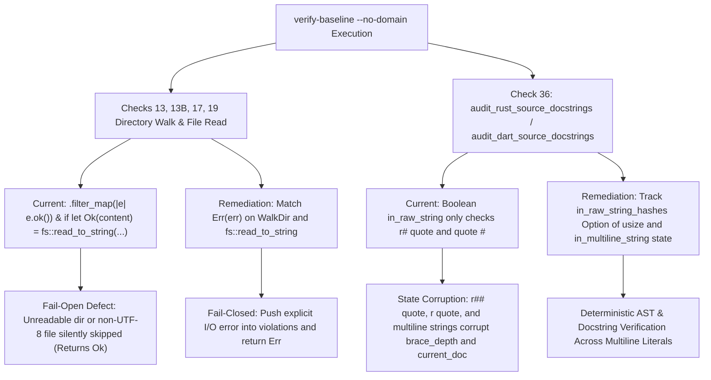

## 1. Context and References

<!-- test-target: crates/verify-baseline/src/checks/docstring_gate.rs -->
- **File**: `crates/verify-baseline/src/checks/docstring_gate.rs` (lines 593-736 and 773-883), `crates/verify-baseline/src/checks/domain_cleanliness_gate.rs` (lines 500-590), `crates/verify-baseline/src/checks/mermaid.rs` (lines 38-50), `crates/verify-baseline/src/checks/math_katex.rs` (lines 38-50), and `crates/verify-baseline/src/checks/safety_stpa.rs` (lines 751-875)
- **Pillar**: Pillar 2 -- Error Handling & Silent Failure Modes / Pillar 3 -- State & Lexical Boundary Completeness
- **Symptom**: `verify-baseline --no-domain` fails open on `WalkDir` and `fs::read_to_string` I/O errors across Checks 13, 13B, 17, and 19 while Check 36 misparses `r##"` and multiline strings
- **Test-Target**: crates/verify-baseline/src/checks/docstring_gate.rs

In the upstream baseline verification suite (`/Users/perkunas/jail/DEAP01-spec-core/crates/verify-baseline/src/checks/docstring_gate.rs`, `/Users/perkunas/jail/DEAP01-spec-core/crates/verify-baseline/src/checks/domain_cleanliness_gate.rs`, `/Users/perkunas/jail/DEAP01-spec-core/crates/verify-baseline/src/checks/mermaid.rs`, `/Users/perkunas/jail/DEAP01-spec-core/crates/verify-baseline/src/checks/math_katex.rs`, and `/Users/perkunas/jail/DEAP01-spec-core/crates/verify-baseline/src/checks/safety_stpa.rs`), two coupled verification integrity defects exist across the WP3 `verify-baseline --no-domain` gates:

1. **Silent Fail-Open Directory Traversal and File Read Errors**:
   - In `/Users/perkunas/jail/DEAP01-spec-core/crates/verify-baseline/src/checks/domain_cleanliness_gate.rs`, `check_domain_agnostic_ast_cleanliness` (lines 472-635) chains `.filter_map(|e| e.ok())` on `WalkDir::new(&crates_dir)` at line 510 and on `WalkDir::new(t_dir)` at line 576, and wraps `fs::read_to_string(path)` in `if let Ok(content) = fs::read_to_string(path)` without an `else` branch at lines 515 and 587.
   - In `/Users/perkunas/jail/DEAP01-spec-core/crates/verify-baseline/src/checks/mermaid.rs`, `check_mermaid_syntax` (lines 35-77) chains `.filter_map(|e| e.ok())` on `WalkDir::new(repo_root)` at line 48.
   - In `/Users/perkunas/jail/DEAP01-spec-core/crates/verify-baseline/src/checks/math_katex.rs`, `check_latex_katex_syntax` (lines 35-77) chains `.filter_map(|e| e.ok())` on `WalkDir::new(repo_root)` at line 48.
   - In `/Users/perkunas/jail/DEAP01-spec-core/crates/verify-baseline/src/checks/safety_stpa.rs`, `check_safety_integrity` (lines 740-1152) chains `.filter_map(|e| e.ok())` on `WalkDir::new(&safety_dir)` at lines 761 and 811, and uses `if let Ok(c) = fs::read_to_string(sf)` without an `else` error branch at line 865.

2. **Single-Hash-Only Raw String and Missing Multiline String State Tracking in Check 36**:
   - In `/Users/perkunas/jail/DEAP01-spec-core/crates/verify-baseline/src/checks/docstring_gate.rs`, `audit_rust_source_docstrings` (lines 593-736) tracks raw string state using a boolean `let mut in_raw_string = false;` (line 598), enters raw string mode only when `code.find("r#\"")` matches literally (line 659), and exits whenever `trimmed.contains("\"#")` matches (line 622). It neither tracks the exact opening hash count `k` for `r"..."`, `r##"..."##`, or `r###"..."###` nor tracks standard multiline string literals (`"..."`) or Dart triple-quoted strings (`'''...'''` / `"""..."""`) in `audit_dart_source_docstrings` (lines 773-883).

## 2. Root Cause Analysis (5 Whys)

1. **Why do Check 13 (`math_katex.rs`), Check 13B (`mermaid.rs`), Check 17 (`safety_stpa.rs`), and Check 19 (`domain_cleanliness_gate.rs`) return `Ok` when target directories or files are unreadable or contain non-UTF-8 bytes, while Check 36 (`docstring_gate.rs`) misparses multi-hash raw strings and multiline string literals?** Because those four check modules discard `WalkDir` and `fs::read_to_string` `Err` variants via `.filter_map(|e| e.ok())` and one-armed `if let Ok(...)` guards, while `audit_rust_source_docstrings` hardcodes a single-hash `"r#\""` / `"\"#"` substring check instead of a stateful lexical string tracker.
2. **Why were `.filter_map(|e| e.ok())` and `if let Ok(...)` used in `domain_cleanliness_gate.rs`, `mermaid.rs`, `math_katex.rs`, and `safety_stpa.rs`?** Because the directory walkers were written assuming all workspace paths are readable UTF-8 files, whereas Check 36 (`docstring_gate.rs` lines 327-333 and 347-356) was later hardened to match `entry_res` and `fs::read_to_string` explicitly and push fail-closed diagnostics into `violations`.
3. **Why does `audit_rust_source_docstrings` in `docstring_gate.rs` only look for `r#"` and `"#` on lines 622 and 659?** Because the line-by-line scanner was originally tested against single-hash raw string fixtures (`r#"..."#`) and did not record the delimiter hash count `Option<usize>` or unclosed standard double-quoted / triple-quoted string state across newline boundaries.
4. **Why does failing to track hash counts and multiline string literals corrupt Check 36 docstring verification?** Because any line inside an `r##"..."##`, `r"..."`, `"..."`, or Dart `'''...'''` / `"""..."""` literal is scanned as top-level source code: interior lines matching `fn `, `struct `, or `///` trigger false-positive missing or placeholder docstring violations, while interior braces `{` / `}` or parentheses `(` / `)` corrupt `brace_depth`, `paren_depth`, and `current_doc` for subsequent real declarations.
5. **Why did existing unit tests not catch these fail-open I/O paths and multi-hash raw string / multiline string state bugs?** Because unit tests in those modules only exercised readable temporary directories and single-hash `r#"..."#` fixtures without negative mutation probes for unreadable files/directories or multi-hash `r##"..."##` and multiline string literals containing declaration keywords or unbalanced delimiters.

## 3. Correctness Analysis

- **Fail-Closed Verification Invariant (DO-178C Level A / DO-330 TQL-4)**: Every baseline verification gate in `verify-baseline` must satisfy the fail-closed property: if any in-scope directory entry cannot be traversed (`Err(walkdir::Error)`) or any in-scope file cannot be read as UTF-8 (`Err(std::io::Error)`), the check must append a deterministic diagnostic to its error accumulator and return `Err(...)`.
  - In `/Users/perkunas/jail/DEAP01-spec-core/crates/verify-baseline/src/checks/domain_cleanliness_gate.rs`:
    - Line 510: `.filter_map(|e| e.ok())` silently drops `WalkDir` errors in `crates/`.
    - Line 515: `if let Ok(content) = fs::read_to_string(path)` silently skips unreadable `.rs` files in `crates/`.
    - Line 576: `.filter_map(|e| e.ok())` silently drops `WalkDir` errors in `template_dirs`.
    - Line 587: `if let Ok(content) = fs::read_to_string(path)` silently skips unreadable template/rule files in `template_dirs`.
  - In `/Users/perkunas/jail/DEAP01-spec-core/crates/verify-baseline/src/checks/mermaid.rs`:
    - Line 48: `.filter_map(|e| e.ok())` silently drops `WalkDir` errors across `repo_root`.
  - In `/Users/perkunas/jail/DEAP01-spec-core/crates/verify-baseline/src/checks/math_katex.rs`:
    - Line 48: `.filter_map(|e| e.ok())` silently drops `WalkDir` errors across `repo_root`.
  - In `/Users/perkunas/jail/DEAP01-spec-core/crates/verify-baseline/src/checks/safety_stpa.rs`:
    - Line 761: `.filter_map(|e| e.ok())` silently drops `WalkDir` errors in `docs/safety/` during upstream cleanliness verification.
    - Line 811: `.filter_map(|e| e.ok())` silently drops `WalkDir` errors in `docs/safety/` during downstream STPA verification.
    - Line 865: `if let Ok(c) = fs::read_to_string(sf)` silently skips citation verification on unreadable safety markdown files.
- **Lexical String State Machine Soundness in Check 36 (`/Users/perkunas/jail/DEAP01-spec-core/crates/verify-baseline/src/checks/docstring_gate.rs`)**:
  - A Rust raw string literal opened with `r` followed by $k \ge 0$ `#` bytes and `"` remains open until a closing `"` immediately followed by at least $k$ `#` bytes is encountered.
  - Because line 659 checks only `code.find("r#\"")`, a 2-hash raw string `r##" ... "##` containing `"#` inside its payload either fails to enter `in_raw_string` (if `r##"` does not match `r#"`) or prematurely exits `in_raw_string` on line 622 when `trimmed.contains("\"#")` is evaluated on an interior `"#` token.
  - Furthermore, a standard Rust multiline string `"..."` (or Dart `'''...'''` / `"""..."""` multiline string in `audit_dart_source_docstrings` at lines 773-883) spanning multiple lines is not tracked across line boundaries, causing `current_doc.clear()` (line 724 / line 841) or `update_line_delimiter_depths` (line 728 / line 870) to execute on string interior lines.

## 4. UML Diagrams



## 5. Affected Callers / Downstream Impact

- `verify_baseline::runner::run` (`crates/verify-baseline/src/runner.rs`): Invokes `check_latex_katex_syntax` (Check 13), `check_mermaid_syntax` (Check 13B), `check_safety_integrity` (Check 17), `check_domain_agnostic_ast_cleanliness` (Check 19), and `check_7_section_docstring_gate` / `check_docstring_completeness` (Check 36) during `verify-baseline . --no-domain`.
- `verify_baseline::checks::domain_cleanliness_gate::check_domain_agnostic_ast_cleanliness` (`/Users/perkunas/jail/DEAP01-spec-core/crates/verify-baseline/src/checks/domain_cleanliness_gate.rs:472-635`): Can silently pass when a `.rs` file or template file containing forbidden M1 domain dictionaries or Unicode em-dashes is unreadable or contains invalid UTF-8 bytes.
- `verify_baseline::checks::mermaid::check_mermaid_syntax` (`/Users/perkunas/jail/DEAP01-spec-core/crates/verify-baseline/src/checks/mermaid.rs:35-77`) and `verify_baseline::checks::math_katex::check_latex_katex_syntax` (`/Users/perkunas/jail/DEAP01-spec-core/crates/verify-baseline/src/checks/math_katex.rs:35-77`): Silently ignore unreadable subdirectories during repository-wide Markdown scanning.
- `verify_baseline::checks::safety_stpa::check_safety_integrity` (`/Users/perkunas/jail/DEAP01-spec-core/crates/verify-baseline/src/checks/safety_stpa.rs:740-1152`): Silently ignores `WalkDir` traversal failures inside `docs/safety/` and unreadable file errors during citation auditing.
- `verify_baseline::checks::docstring_gate::audit_rust_source_docstrings` and `audit_dart_source_docstrings` (`/Users/perkunas/jail/DEAP01-spec-core/crates/verify-baseline/src/checks/docstring_gate.rs:593-883`): Any Rust source file using `r##"..."##` (such as test fixtures or markdown/Mermaid code generators) or multiline string literals causes false-positive or false-negative Check 36 docstring verdicts.

## 6. Proposed Correction

1. In `/Users/perkunas/jail/DEAP01-spec-core/crates/verify-baseline/src/checks/domain_cleanliness_gate.rs`, `/Users/perkunas/jail/DEAP01-spec-core/crates/verify-baseline/src/checks/mermaid.rs`, `/Users/perkunas/jail/DEAP01-spec-core/crates/verify-baseline/src/checks/math_katex.rs`, and `/Users/perkunas/jail/DEAP01-spec-core/crates/verify-baseline/src/checks/safety_stpa.rs`, replace `.filter_map(|e| e.ok())` and one-armed `if let Ok(...) = fs::read_to_string(...)` with explicit `match` blocks that push fail-closed diagnostic messages into the violation vector.
2. In `/Users/perkunas/jail/DEAP01-spec-core/crates/verify-baseline/src/checks/docstring_gate.rs`, replace `in_raw_string: bool` with a stateful lexical scanner (`in_raw_string_hashes: Option<usize>` and `in_multiline_string: bool`) that accurately scans string and raw-string openings/closings for any hash count $k \ge 0$ across lines before classifying items or updating delimiter depths.

```rust
/// Advances Rust string, multi-hash raw string (`r"..."`, `r#"..."#`, `r##"..."##`),
/// and block comment state across a single source line while returning the non-string,
/// non-comment code slice for item classification and delimiter tracking.
fn scan_rust_line_preserving_lexical_state(
    line: &str,
    in_block_comment: &mut bool,
    in_raw_string_hashes: &mut Option<usize>,
    in_multiline_string: &mut bool,
) -> String {
    let bytes = line.as_bytes();
    let len = bytes.len();
    let mut i = 0usize;
    let mut out = String::with_capacity(len);

    while i < len {
        if *in_block_comment {
            if i + 1 < len && bytes[i] == b'*' && bytes[i + 1] == b'/' {
                *in_block_comment = false;
                i += 2;
            } else {
                i += 1;
            }
            continue;
        }

        if let Some(req_hashes) = *in_raw_string_hashes {
            if bytes[i] == b'"' {
                let mut h = 0usize;
                while i + 1 + h < len && bytes[i + 1 + h] == b'#' && h < req_hashes {
                    h += 1;
                }
                if h == req_hashes {
                    *in_raw_string_hashes = None;
                    i += 1 + req_hashes;
                    continue;
                }
            }
            i += 1;
            continue;
        }

        if *in_multiline_string {
            if bytes[i] == b'\\' {
                i = (i + 2).min(len);
                continue;
            }
            if bytes[i] == b'"' {
                *in_multiline_string = false;
            }
            i += 1;
            continue;
        }

        if i + 1 < len && bytes[i] == b'/' && bytes[i + 1] == b'/' {
            break;
        }
        if i + 1 < len && bytes[i] == b'/' && bytes[i + 1] == b'*' {
            *in_block_comment = true;
            i += 2;
            continue;
        }

        if bytes[i] == b'r' {
            let prev_is_ident = i > 0
                && (bytes[i - 1].is_ascii_alphanumeric() || bytes[i - 1] == b'_');
            if !prev_is_ident {
                let mut h = 0usize;
                while i + 1 + h < len && bytes[i + 1 + h] == b'#' {
                    h += 1;
                }
                if i + 1 + h < len && bytes[i + 1 + h] == b'"' {
                    *in_raw_string_hashes = Some(h);
                    i += 2 + h;
                    continue;
                }
            }
        }

        if bytes[i] == b'"' {
            *in_multiline_string = true;
            i += 1;
            continue;
        }

        if let Some(ch) = line.get(i..).and_then(|s| s.chars().next()) {
            out.push(ch);
            i += ch.len_utf8();
        } else {
            break;
        }
    }

    out
}

// Fail-closed WalkDir and fs::read_to_string handling for Check 13, 13B, 17, and 19:
for entry_res in WalkDir::new(&crates_dir).into_iter().filter_entry(|e| {
    if e.file_type().is_dir() {
        let name = e.file_name().to_string_lossy();
        name != "target" && name != ".git" && !EXCLUDED_DIRS.iter().any(|ex| name == ex)
    } else {
        true
    }
}) {
    let entry = match entry_res {
        Ok(val) => val,
        Err(err) => {
            violations.push(format!("Check 19 directory walk I/O error: {}", err));
            continue;
        }
    };
    if entry.file_type().is_file() {
        let path = entry.path();
        if path.extension().map(|ext| ext == "rs").unwrap_or(false) {
            let rel = path.strip_prefix(repo_root).unwrap_or(path).display().to_string();
            match fs::read_to_string(path) {
                Ok(content) => {
                    // Audit lines...
                    let _ = &content;
                }
                Err(err) => {
                    violations.push(format!("Check 19: Failed to read '{}': {}", rel, err));
                }
            }
        }
    }
}
```

## 7. Relationship to Existing Issues

- Relates to Check 36 per-item 7-section docstring completeness enforcement and zero-regex source AST scanning (refs #465, refs #466, refs #468).
- Complements Check 13 (`math_katex.rs`), Check 13B (`mermaid.rs`), Check 17 (`safety_stpa.rs` refs #212, refs #249, refs #472), and Check 19 (`domain_cleanliness_gate.rs`) by eliminating silent fail-open I/O error suppression across `verify-baseline`.

## Audit Source
Adversarial Test Integrity Audit
SEVERITY: Critical
FILE_LOCATION: crates/verify-baseline/src/checks/docstring_gate.rs:593-736
