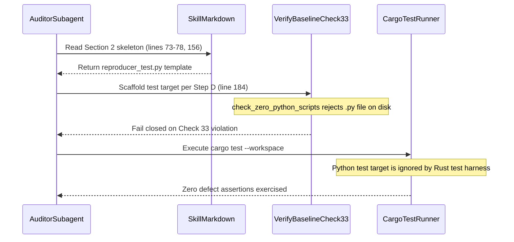

## 1. Context and References

<!-- test-target: crates/verify-baseline/src/checks/structural.rs -->

- **File**: `skills/adversarial-code-auditor/SKILL.md:73-78`
- **Pillar**: Semantic Traceability
- **Symptom**: Section 2 (lines 73 and 78), Step C.4 (line 156), and Section 4 (lines 262 and 267) prescribe legacy Python test-target paths (`[path/to/reproducer_test.py]` and `tests/test_bridge_reproducer.py`), which violate Check 33 (`check_zero_python_scripts`) when scaffolded on disk and cannot be executed by the native Rust test harness.
- **Test-Target**: `crates/verify-baseline/src/checks/structural.rs`

## 2. Root Cause Analysis (5 Whys)

1. **Why do defect dossiers generated from the canonical skeleton reference `.py` test targets that violate repository gates?** Because Section 2 (`skills/adversarial-code-auditor/SKILL.md:73-78`), Step C.4 (`line 156`), and the Section 4 compliant example (`lines 262-267`) hardcode `[path/to/reproducer_test.py]` and `tests/test_bridge_reproducer.py`.
2. **Why does referencing or scaffolding a `.py` test target break semantic traceability and baseline verification?** Because Step D (`line 184`) mandates that the subagent identify or scaffold the test target file in the repository, and Check 33 (`crates/verify-baseline/src/checks/structural.rs:404-453`) fails closed if any `.py` file exists on disk.
3. **Why was this contradiction not caught by the retired-script documentation gate (`check_zero_retired_scripts_in_documentation`)?** Because `crates/verify-baseline/src/checks/structural.rs:1228-1243` scans `skills/` only for a fixed allowlist of 14 specific retired script filenames (`reconcile_backlog.py`, `file_defect.py`, etc.) and ignores `reproducer_test.py` and `test_bridge_reproducer.py`.
4. **Why did `SKILL.md` retain `.py` placeholders after Step C.9 (`line 161`) was updated to mention Rust paths under `crates/`?** Because only the prose note in Step C.9 (`line 161`) and Step D (`line 184`) was partially updated, while the mandatory character-for-character skeleton in Section 2 (`lines 73, 78`), Step C.4 (`line 156`), and Section 4 (`lines 262, 267`) was left untouched.
5. **Why does the Section 4 compliant example (`lines 260-321`) fail to demonstrate semantic traceability?** Because it pairs a C++ FFI use-after-free defect (`cesium_native_bridge/src/bridge.cpp:56-61`) with an unimplemented Python script path (`tests/test_bridge_reproducer.py`) instead of a native Rust test target mapped to the violated invariant.

## 3. Correctness Analysis

In `skills/adversarial-code-auditor/SKILL.md`, Section 2 (`lines 69-78`) and Step C (`lines 154-156`) require subagents to copy the output skeleton character-for-character, specifying `<!-- test-target: [path/to/reproducer_test.py] -->` (`line 73` and `line 156`) and `- **Test-Target**: [path/to/reproducer_test.py]` (`line 78`). Section 4 (`lines 262, 267`) reinforces this pattern with `<!-- test-target: tests/test_bridge_reproducer.py -->`. Although Step C.9 (`line 161`) and Step D (`line 184`) parenthetically acknowledge `(e.g. crates/verify-baseline/src/... or relevant Rust test path)`, Step D (`line 184`) simultaneously requires the subagent to scaffold the target path in the repository. Under `.pipeline/ACTIVE_RULES_BUNDLE.md` Rule 16 (`rules/tdd-mandate.md:227`) and Check 33 (`crates/verify-baseline/src/checks/structural.rs:381-453`), any `.py` file in the workspace causes `check_zero_python_scripts` to fail closed. Invariant violated: every defect dossier `Test-Target` annotation in the upstream compiler repository and skill templates must resolve to a native Rust `#[test]` target under `crates/` without violating Check 33.

## 4. UML Diagrams



## 5. Affected Callers / Downstream Impact

All `adversarial-code-auditor` subagents dispatched across `DEAP01-spec-core` and downstream repositories -- copying the normative Section 2 skeleton (`lines 73-78`), Step C.4 (`line 156`), or Section 4 example (`lines 262-267`) produces legacy `.py` test target references that either fail Check 33 (`check_zero_python_scripts`) when scaffolded or remain unexecuted by `cargo test --workspace`.

## 6. Proposed Correction

```rust
// 1. In skills/adversarial-code-auditor/SKILL.md (lines 73, 78, 156, 262, 267),
//    replace [path/to/reproducer_test.py] and tests/test_bridge_reproducer.py
//    with native Rust test target paths under crates/ (e.g. crates/verify-baseline/src/defect_dossier.rs).
// 2. In crates/verify-baseline/src/checks/structural.rs (check_zero_retired_scripts_in_documentation):
retired_needles.push("reproducer_test.py".to_string());
retired_needles.push("test_bridge_reproducer.py".to_string());
```

## 7. Relationship to Existing Issues

Discovered in audit -- new finding (related to #441 and #450 retired Python script remediation).

## Audit Source

Adversarial Semantic Traceability Audit
SEVERITY: Important
FILE_LOCATION: skills/adversarial-code-auditor/SKILL.md:73-78
