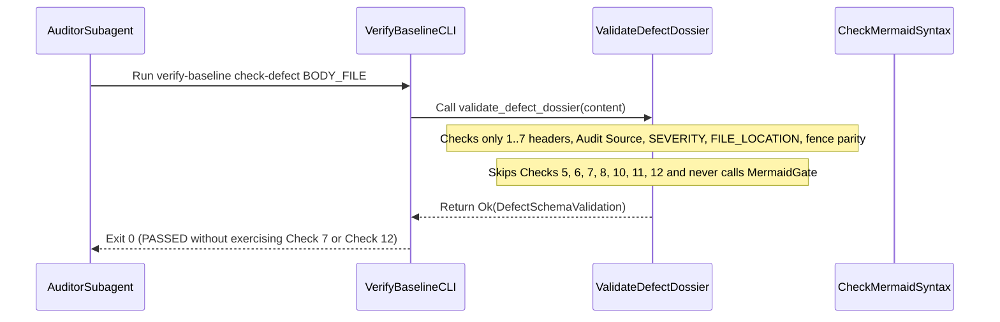

## 1. Context and References

<!-- test-target: crates/verify-baseline/src/defect_dossier.rs -->

- **File**: `skills/adversarial-code-auditor/SKILL.md:165-201`
- **Pillar**: Semantic Traceability
- **Symptom**: Step D (`lines 165-201`) mandates 12 verification checks and claims `./target/release/verify-baseline check-defect "$BODY_FILE"` is the executable offline syntax gate for Check 7 (`rules/platform-independence.md` Mermaid rules), but `validate_defect_dossier` (`crates/verify-baseline/src/defect_dossier.rs:50-159`) only implements Checks 1, 2, 3, 4, and 9, contains zero unit tests, and exits 0 without exercising Checks 5, 6, 7, 8, 10, 11, or 12.
- **Test-Target**: `crates/verify-baseline/src/defect_dossier.rs`

## 2. Root Cause Analysis (5 Whys)

1. **Why does `./target/release/verify-baseline check-defect "$BODY_FILE"` pass on dossiers with missing or invalid Mermaid diagrams and missing `test-target` annotations?** Because `validate_defect_dossier` in `crates/verify-baseline/src/defect_dossier.rs:50-159` only checks `## 1.`..`## 7.` numeric prefixes, `## Audit Source`, `SEVERITY:`, non-empty `FILE_LOCATION:`, and even triple-backtick fence counts.
2. **Why does `SKILL.md:186-201` claim that `verify-baseline check-defect` enforces Check 7 and `rules/platform-independence.md` Mermaid constraints?** Because `SKILL.md` was updated to reference `verify-baseline check-defect` as the replacement for the retired validator without porting Checks 5, 6, 7, 8, 10, 11, and 12 or delegating to `check_mermaid_syntax` in `crates/verify-baseline/src/defect_dossier.rs`.
3. **Why was the missing enforcement in `defect_dossier.rs` not detected by `cargo test --workspace`?** Because `crates/verify-baseline/src/defect_dossier.rs` (`lines 1-236`) has zero `#[test]` functions, so no unit or mutation test ever asserted that malformed Mermaid blocks or missing `test-target` annotations are rejected.
4. **Why does `SEVERITY:` and `FILE_LOCATION:` validation in `defect_dossier.rs:89-134` also allow malformed metadata to pass?** Because `val.starts_with(valid)` (`line 95`) accepts arbitrary trailing tokens after a valid severity prefix, and `FILE_LOCATION:` (`line 122`) only checks `!val.is_empty()` rather than requiring the `[path]:[line]` colon delimiter mandated by Check 4 (`SKILL.md:172`).
5. **Why does this constitute a Semantic Traceability violation?** Because the verification gate mandated in Step D (`SKILL.md:186-193`) passes with exit code 0 without exercising the Mermaid syntax invariant (`#283`) or the Check 12 `<!-- test-target: [path] -->` traceability invariant it claims to verify.

## 3. Correctness Analysis

In `skills/adversarial-code-auditor/SKILL.md`, Step D (`lines 165-182`) defines 12 mandatory checks before filing an issue, and `lines 186-201` explicitly state that Check 7 is executable via `./target/release/verify-baseline check-defect "$BODY_FILE"` and enforces `rules/platform-independence.md` (including no semicolons in `Note` statements and no curly braces in class members, `line 61`). Additionally, note that `SKILL.md:178` itself contains an unescaped arrow token in the Check 10 table row outside a Mermaid block. Tracing execution into `crates/verify-baseline/src/main.rs:169-173` and `crates/verify-baseline/src/defect_dossier.rs:161-235` shows `run_check_defect` calls `validate_defect_dossier(&content)` (`line 188`). In `validate_defect_dossier` (`lines 50-159`), only 5 checks are performed: section numbers `1.`..`7.` (`lines 54-70`), `## Audit Source` (`lines 73-86`), `SEVERITY:` prefix (`lines 89-114`), non-empty `FILE_LOCATION:` (`lines 117-134`), and balanced triple-backtick lines (`lines 137-143`). It never invokes `crates/verify-baseline/src/checks/mermaid.rs` (`check_mermaid_syntax`), never checks for a `mermaid` block when severity is `Critical` or `Important` (Check 7), never checks `N/A -- ` when severity is `Suggestion` or `Nitpick` (Check 8), never checks the four Section 1 bullets (Check 5) or five Section 2 Whys (Check 6), and never validates `<!-- test-target: [path] -->` or `- **Test-Target**:` (Check 12). Invariant violated: a verification gate must exercise every invariant declared in its specification before returning exit code 0.

## 4. UML Diagrams



## 5. Affected Callers / Downstream Impact

Every `adversarial-code-auditor` subagent running Step D (`skills/adversarial-code-auditor/SKILL.md:192`) and any caller of `verify_baseline::defect_dossier::validate_defect_dossier` -- defect dossiers missing `<!-- test-target: ... -->`, missing 5-Whys entries, or containing unrenderable Mermaid diagrams clear the gate with exit code 0 and get filed directly to the issue tracker.

## 6. Proposed Correction

```rust
// In crates/verify-baseline/src/defect_dossier.rs:
// Enforce Checks 4, 5, 6, 7, 8, 10, and 12 inside validate_defect_dossier(content: &str):
if !file_location.contains(':') {
    errors.push("FILE_LOCATION: must match [path]:[line] format.".to_string());
}
for label in ["File", "Pillar", "Symptom", "Test-Target"] {
    let bullet = format!("- **{}**:", label);
    let star_bullet = format!("* **{}**:", label);
    if !content.lines().any(|l| {
        let t = l.trim_start();
        t.starts_with(&bullet) || t.starts_with(&star_bullet)
    }) {
        errors.push(format!("Missing Section 1 bullet for '{}'.", label));
    }
}
if !content.lines().any(|l| {
    let t = l.trim();
    t.starts_with("<!--") && t.contains("test-target:") && t.ends_with("-->")
}) {
    errors.push("Missing mandatory <!-- test-target: [path] --> annotation.".to_string());
}
```

## 7. Relationship to Existing Issues

Discovered in audit -- new finding (traces to #283 cited in `SKILL.md:188`).

## Audit Source

Adversarial Semantic Traceability Audit
SEVERITY: Important
FILE_LOCATION: skills/adversarial-code-auditor/SKILL.md:165-201
