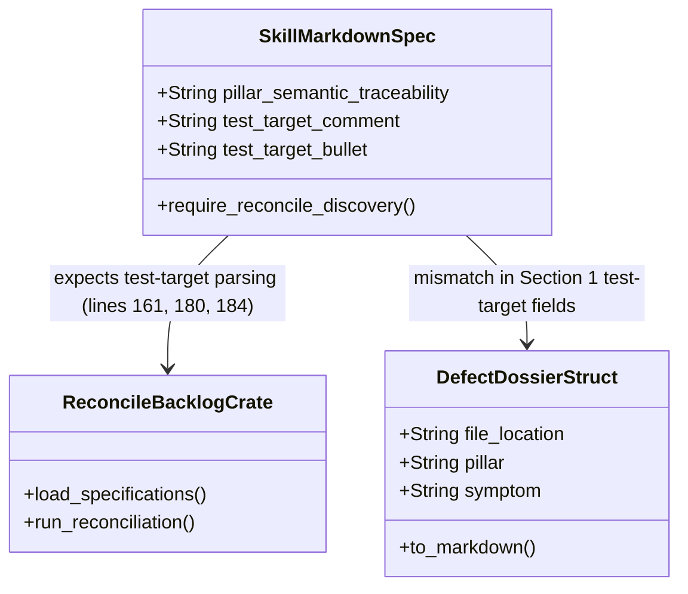

## 1. Context and References

<!-- test-target: crates/reconcile-backlog/src/lib.rs -->

- **File**: `skills/adversarial-code-auditor/SKILL.md:161-185`
- **Pillar**: Semantic Traceability
- **Symptom**: Step C.9 (`line 161`) and Step D Check 12 (`lines 180, 184`) declare that `./target/release/reconcile-backlog` automatically parses `<!-- test-target: [path] -->` and `- **Test-Target**:` to discover and execute test targets for filed defects, and Section 1.3 (`line 33`) defines the `Semantic Traceability` pillar, but `crates/reconcile-backlog` has zero parser or runner logic for `test-target` annotations, Section 2 (`lines 73-78`) binds only a file path rather than a specific `#[test]` assertion, Section 1.5 (`lines 48-58`) omits UML diagram mappings for `Semantic Traceability`, and frontmatter `line 4` still declares only four pillars.
- **Test-Target**: `crates/reconcile-backlog/src/lib.rs`

## 2. Root Cause Analysis (5 Whys)

1. **Why does `./target/release/reconcile-backlog` fail to discover or execute `<!-- test-target: [path] -->` annotations on filed defect issues?** Because `crates/reconcile-backlog/src/lib.rs` (`lines 98-269`) only loads specification markdown files from `docs/epics`, `docs/features`, `docs/user-stories`, and `docs/use-cases` and contains zero code referencing `test-target` or `Test-Target`.
2. **Why does a file-level `<!-- test-target: [path] -->` annotation allow tests to pass without exercising the reported defect symptom?** Because pointing only to a Rust source file (such as `crates/verify-baseline/src/checks/structural.rs`) without a test function identifier (`::test_fn_name`) or assertion-to-invariant mapping allows pre-existing unrelated tests in that module to pass while zero assertions exercise the reported defect invariant.
3. **Why does Section 1.5 (`skills/adversarial-code-auditor/SKILL.md:48-58`) fail to guide diagram selection for `Semantic Traceability` findings?** Because when `Semantic Traceability` was added as the fifth pillar in Section 1.3 (`line 33`) and Section 2 (`line 76`), neither the frontmatter description (`line 4`, which still says "four correctness risk pillars") nor the Section 1.5 UML mapping table (`lines 48-58`) was updated.
4. **Why was the `<!-- test-target: [path] -->` contract added to `SKILL.md:161, 180, 184` without a corresponding parser in `crates/reconcile-backlog`?** Because the skill prompt specification was updated in isolation without implementing a matching defect test-target extractor and runner in `crates/reconcile-backlog` or `crates/deap-core/src/diagnostics.rs` (`DefectDossier::to_markdown`, `lines 299-338`, which also omits `test-target`).
5. **Why was this specification-to-implementation gap not caught by verification gates?** Because no integration test in `crates/reconcile-backlog` or `crates/verify-baseline` verifies bijective parity between the `SKILL.md` `test-target` contract (`lines 161, 180, 184`), `DefectDossier::to_markdown`, and `reconcile-backlog`.

## 3. Correctness Analysis

`skills/adversarial-code-auditor/SKILL.md` establishes three unfulfilled contracts under the `Semantic Traceability` pillar:
1. Frontmatter `line 4` states `"Pre-emptive adversarial audit against four correctness risk pillars"`, whereas Section 1.3 (`lines 27-33`) and Section 2 (`line 76`) define five pillars (`Memory Safety`, `Resource Lifecycle`, `Concurrency`, `Test Integrity`, and `Semantic Traceability`), and Section 1.5 (`lines 48-58`) provides UML diagram selection mappings only for the first four pillars despite Step B.4 (`line 149`) requiring Critical/Important findings to select a diagram type from Section 1.5.
2. Step C.9 (`line 161`) and Step D Check 12 (`lines 180, 184`) state that `<!-- test-target: [path] -->` and `- **Test-Target**:` are parsed by `./target/release/reconcile-backlog` so defect reconciliation runs autonomously. However, scanning `crates/reconcile-backlog/src/lib.rs`, `main.rs`, `checklist.rs`, `create_issue.rs`, `frontmatter.rs`, and `tracker.rs` shows zero occurrences of `test-target` or `Test-Target`.
3. Even when a subagent populates `<!-- test-target: crates/... -->`, Section 2 (`lines 73-78`) records only a file path rather than a `#[test]` function selector and assertion-to-invariant mapping, and `crates/deap-core/src/diagnostics.rs:299-338` (`DefectDossier::to_markdown`) omits both `<!-- test-target: ... -->` and `- **Test-Target**:`. Invariant violated: every traceability annotation mandated in `SKILL.md` must map to a concrete parser, test function selector, and assertion verifier in the Rust toolchain.

## 4. UML Diagrams



## 5. Affected Callers / Downstream Impact

`adversarial-code-auditor` subagents, `./target/release/reconcile-backlog`, and `deap_core::diagnostics::DefectDossier::to_markdown` -- subagents annotate `<!-- test-target: [path] -->` expecting autonomous defect reconciliation by `reconcile-backlog`, but `reconcile-backlog` silently ignores all defect test-target annotations and `DefectDossier::to_markdown` synthesizes dossiers that fail Check 5 and Check 12 of `SKILL.md`.

## 6. Proposed Correction

```markdown
---
name: adversarial-code-auditor
version: "3.3"
description: "Pre-emptive adversarial audit against five correctness risk pillars."
---
### 1.5 UML
* Semantic traceability gap, unexercised invariant, or broken test-target contract: `sequenceDiagram` or `classDiagram`
```

## 7. Relationship to Existing Issues

Discovered in audit -- new finding.

## Audit Source

Adversarial Semantic Traceability Audit
SEVERITY: Important
FILE_LOCATION: skills/adversarial-code-auditor/SKILL.md:161-185
