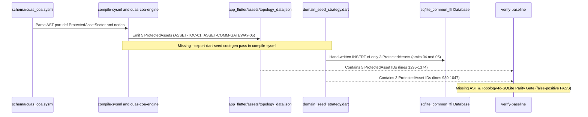

## 1. Context and References

<!-- test-target: crates/verify-baseline/src/runner.rs -->

- **File**: `app_flutter/lib/data/seeds/domain_seed_strategy.dart:1-1080`
- **Pillar**: Semantic Traceability
- **Symptom**: Even though the native Rust binary `cuas-coa-engine --export-flutter-assets app_flutter` (`crates/cuas-coa-engine/src/main.rs:88-90`, `crates/cuas-coa-engine/src/main.rs:194-204`, `crates/cuas-coa-engine/src/lib.rs:4786-4850`) deterministically generates `app_flutter/assets/logical-layout.json` and `app_flutter/assets/topology_data.json` (`app_flutter/assets/topology_data.json:1295-1374`) containing all 5 `ProtectedAsset` nodes (`ASSET-TOC-01` `"Asset-Alpha (P1): Tactical Operations Center"`, `ASSET-DEPOT-02` `"Asset-Bravo (P2): Ammo & Battery Logistics Depot"`, `ASSET-FUEL-03` `"Asset-Charlie (P3): Forward Arming & Refueling Point"`, `ASSET-RADAR-MAST-04` `"Asset-Delta (P2): Primary Surveillance Radar Mast"`, and `ASSET-COMM-GATEWAY-05` `"Asset-Echo (P2): Tactical Edge Gateway & Satcom"`) alongside all `SensorNode`, `EffectorNode`, `ThreatWave`, and `CandidateCoa` entities, an LLM agent had to hand-write over 1,080 lines of raw Dart SQLite `INSERT` statements in `app_flutter/lib/data/seeds/domain_seed_strategy.dart:1-1080` (`1,769` total lines), causing `ASSET-RADAR-MAST-04` (`Asset-Delta (P2)`) and `ASSET-COMM-GATEWAY-05` (`Asset-Echo (P2)`) to be omitted from the SQLite database while `./target/release/compile-sysml` and `./target/release/verify-baseline` passed with exit code 0.
- **Test-Target**: `crates/verify-baseline/src/runner.rs`

## 2. Root Cause Analysis (5 Whys)

1. **Why are `ASSET-RADAR-MAST-04` (`Asset-Delta (P2)`) and `ASSET-COMM-GATEWAY-05` (`Asset-Echo (P2)`) present in `app_flutter/assets/topology_data.json:1343-1374` yet missing from the SQLite `type_definitions`, `type_attributes`, `type_relations`, `properties`, and `instances` tables seeded by `app_flutter/lib/data/seeds/domain_seed_strategy.dart:531-1080`?** Because `DomainSeedStrategy._seedCuasCoaDecisionData` (`app_flutter/lib/data/seeds/domain_seed_strategy.dart:531-1390`) is a hand-written Dart file containing hardcoded literal maps (`cuasTypes` at lines `534-600` and `protectedAssets` at lines `980-1047`) instead of being deterministically generated or hydrated from the Rust compiler and solver artifacts.
2. **Why did an LLM implementation agent hand-write `app_flutter/lib/data/seeds/domain_seed_strategy.dart:1-1080` instead of consuming a compiler-generated Dart seed artifact?** Because upstream `./target/release/compile-sysml` compiles `.pipeline/schema.sysml` (`schema/cuas_coa.sysml:902-1148`) only into intermediate JSON/digest artifacts and lacks a deterministic `--export-dart-seed` and `--export-dart-models` codegen pass that emits `generated_domain_seed.g.dart` and `generated_schema_models.g.dart` directly from the SysML v2 AST and `topology_data.json`.
3. **Why did `DomainSeedStrategy` originally seed only `SECTOR-ALPHA-01` (`app_flutter/lib/data/seeds/domain_seed_strategy.dart:951-977`) and even after manual remediation in Issue `#23` still omit `ASSET-RADAR-MAST-04` and `ASSET-COMM-GATEWAY-05` (`app_flutter/assets/topology_data.json:1343-1374`) and exhibit attribute drift (`ASSET-TOC-01` `criticality_weight: 0.95` in Dart line `990` vs `1.0` in scenario spec, `ASSET-DEPOT-02` `keep_out_radius_meters: 1200.0` in Dart line `1013` vs `1000.0`, `ASSET-FUEL-03` `keep_out_radius_meters: 1000.0` in Dart line `1035` vs `800.0`)?** Because without deterministic Rust-to-SQLite seed codegen, every addition or modification of a `part def` or topology node in Rust/SysML requires parallel manual edits in Dart `Map<String, Object?>` literals, creating a split-brain Dual Source of Truth between `app_flutter/assets/topology_data.json` and `app_flutter/lib/data/seeds/domain_seed_strategy.dart`.
4. **Why did `./target/release/verify-baseline` fail to catch that 2 of the 5 `ProtectedAsset` nodes in `app_flutter/assets/topology_data.json:1295-1374` (`ASSET-RADAR-MAST-04` and `ASSET-COMM-GATEWAY-05`) were absent from the SQLite seed strategy?** Because `crates/verify-baseline` Check 11 (`Codebase Compliance`) and Check 19 (`Model Coverage Verification`) inspect class/identifier tokens in Dart source files against `schema/cuas_coa.sysml`, but lack an AST-to-SQLite Seed Parity Gate comparing the entity IDs, `type_definitions`, `type_attributes`, and `instances` in `.pipeline/schema.sysml` and `app_flutter/assets/topology_data.json` against the rows seeded by `DomainSeedStrategy`.
5. **Why were neither deterministic Dart SQLite seed codegen in `compile-sysml` nor a topology-to-SQLite AST parity gate in `verify-baseline` implemented in the upstream `DEAP01-spec-core` compiler toolchain?** Because the upstream compiler stopped its Tier-1/Tier-2 emission boundary at JSON asset files (`logical-layout.json` and `topology_data.json`) and assumed downstream agents would bridge JSON assets into Tier-3 SQLite persistence (`sqflite_common_ffi`) without compiler codegen or mechanical AST seed-parity enforcement.

## 3. Correctness Analysis

### 3.1 Trace from Trigger to Failure and Violated Invariants
1. **Trigger**: The C-UAS domain model (`schema/cuas_coa.sysml:902-1148`) and topological asset exporter (`crates/cuas-coa-engine/src/main.rs:194-204`, `crates/cuas-coa-engine/src/lib.rs:4324-4850`) define the tactical sector `SECTOR-ALPHA-01` and export `app_flutter/assets/topology_data.json`. In `app_flutter/assets/topology_data.json:1295-1374`, five `ProtectedAsset` nodes exist:
   - `ASSET-TOC-01`: `"Asset-Alpha (P1): Tactical Operations Center"` (`asset_priority: "P1"`, `asset_type: "TACTICAL_OPERATIONS_CENTER"`, `keep_out_radius_meters: 1500.0`, `criticality_weight: 1.0`)
   - `ASSET-DEPOT-02`: `"Asset-Bravo (P2): Ammo & Battery Logistics Depot"` (`asset_priority: "P2"`, `asset_type: "AMMUNITION_SUPPLY_POINT"`, `keep_out_radius_meters: 1000.0`, `criticality_weight: 0.78`)
   - `ASSET-FUEL-03`: `"Asset-Charlie (P3): Forward Arming & Refueling Point"` (`asset_priority: "P3"`, `asset_type: "FARP_FUEL_DEPOT"` / `"CRITICAL_INFRASTRUCTURE"`, `keep_out_radius_meters: 800.0`, `criticality_weight: 0.55`)
   - `ASSET-RADAR-MAST-04`: `"Asset-Delta (P2): Primary Surveillance Radar Mast"` / `"Asset-Delta (P2): Elevated Counter-Battery Radar Mast"` (`asset_priority: "P2"`, `asset_type: "RADAR_MAST_SURVEILLANCE"` / `"SENSOR_SITE"`, `keep_out_radius_meters: 950.0`, `criticality_weight: 0.82`)
   - `ASSET-COMM-GATEWAY-05`: `"Asset-Echo (P2): Tactical Edge Gateway & Satcom"` / `"Asset-Echo (P2): Tactical Link-16 & SAPIENT Gateway"` (`asset_priority: "P2"`, `asset_type: "TACTICAL_SATCOM_GATEWAY"` / `"C2_NODE"`, `keep_out_radius_meters: 900.0`, `criticality_weight: 0.85`)
2. **Propagation**: At application startup, `DatabaseInitializer` invokes `SeedMigrationRunner.runMigration` (`app_flutter/lib/data/seeds/domain_seed_strategy.dart:1695-1698`), which calls `DomainSeedStrategy.seed` (`lines 205-445`) and `_seedCuasCoaDecisionData` (`lines 531-1390`). Instead of reading `app_flutter/assets/topology_data.json` or executing a Rust-generated `generated_domain_seed.g.dart` batch, `_seedCuasCoaDecisionData` executes 860 lines of hand-typed `Map<String, Object?>` insertions (`lines 534-1390`).
3. **Failure Manifestation**:
   - `cuasTypes` (`app_flutter/lib/data/seeds/domain_seed_strategy.dart:585-600`), the `ProtectedAsset` attribute loop (`lines 767-773`), the `type_relations` loop (`lines 923-932`), and `protectedAssets` (`lines 980-1047`) contain only `ASSET-TOC-01`, `ASSET-DEPOT-02`, and `ASSET-FUEL-03`.
   - `ASSET-RADAR-MAST-04` and `ASSET-COMM-GATEWAY-05` are completely absent from SQLite tables `type_definitions`, `type_attributes`, `type_relations`, `properties`, and `instances`.
   - When the operator clicks `ASSET-RADAR-MAST-04` or `ASSET-COMM-GATEWAY-05` on the 2D/3D `TopographicalView` canvas (which renders nodes from `topology_data.json:1343-1374`), the SQLite repository query for `node_id IN ('ASSET-RADAR-MAST-04', 'ASSET-COMM-GATEWAY-05')` returns zero rows, leaving the property grid and hierarchy inspector blank or desynchronized from the viewport.
4. **Invariants Violated**:
   - **Pure Schema-Driven Compiler & SSOT Invariant** (`.pipeline/constitution.md:50`, `AGENTS.md` Section 2): All downstream runtime schemas, models, and initial persistence seeds must derive deterministically from `.pipeline/schema.sysml` and the Rust compiler/solver pipeline without hand-authored domain duplication.
   - **Data Model Integrity & Zero Loss Tolerance** (`.pipeline/constitution.md:60-66`): Every schema definition, model node, and instance exported by the domain compiler must be realized without loss across the 3-Layer Semantic Chain (Layer 1 SQLite Persistence -> Layer 2 ViewModel State -> Layer 3 TopographicalView & PropertyGrid UI).
   - **Zero-Mocking Live Persistence Mandate** (`.pipeline/constitution.md:97-102`): Live SQLite persistence must reflect the authoritative model state rather than hand-maintained mock `Map` literals in `domain_seed_strategy.dart`.

### 3.2 Five-Pillar Adversarial Evaluation
- **Semantic Traceability (Primary Pillar)**: Critical violation. `schema/cuas_coa.sysml:902-930` (`part def ProtectedAssetSector`) and `app_flutter/assets/topology_data.json:1295-1374` define 5 protected asset nodes, yet `app_flutter/lib/data/seeds/domain_seed_strategy.dart:580-600, 767-773, 923-932, 980-1062` seeds only 3 asset nodes (`ASSET-TOC-01`, `ASSET-DEPOT-02`, `ASSET-FUEL-03`) with drifted parameter values. `verify-baseline` lacks an AST-to-SQLite seed parity check, allowing tests and baseline verification to pass while 40% of the topological protected assets (`ASSET-RADAR-MAST-04`, `ASSET-COMM-GATEWAY-05`) have zero SQLite backing.
- **Test Integrity**: Existing Flutter and Rust tests validate `DomainSeedStrategy` in isolation against hardcoded counts (3 assets) rather than asserting bijective parity between `app_flutter/assets/topology_data.json` nodes and SQLite `instances`/`properties` rows.
- **Resource Lifecycle**: `DomainSeedStrategy.seed` (`app_flutter/lib/data/seeds/domain_seed_strategy.dart:255-440`) also seeds 100 synthetic `space_$i` nodes, 763 NTT exchange nodes, and cable landing stations with 50 dummy attributes each (`field_1..field_50`, lines `242-252`, `1447-1488`), generating tens of thousands of unrelated legacy telecom SQLite batch operations on startup before `_seedCuasCoaDecisionData` even runs.
- **Memory Safety**: While no unsafe FFI pointer arithmetic occurs in `domain_seed_strategy.dart`, hand-maintaining untyped `Map<String, Object?>` JSON blobs across 1,080+ lines bypasses Rust and Dart compile-time struct layout checks (`.pipeline/profiles/flutter.md:50` "Zero dynamic / untyped Object?").
- **Concurrency**: `DomainSeedStrategy` stores mutable instance fields `late Batch _currentBatch`, `late Database _currentDb`, and `int _pendingOps = 0` (`app_flutter/lib/data/seeds/domain_seed_strategy.dart:101-103`). Concurrent invocations of `seed(db)` on the same `DomainSeedStrategy` instance race on `_currentBatch` and `_pendingOps`. Deterministic Rust-generated transactional batch seeding eliminates mutable state across async suspension points.

## 4. UML Diagrams



## 5. Affected Callers / Downstream Impact

- `compile-sysml` (`DEAP01-spec-core` `crates/compile-sysml/src/main.rs`) -- Lacks `--export-dart-seed` and `--export-dart-models` flags to deterministically emit `generated_domain_seed.g.dart` and `generated_schema_models.g.dart` from `.pipeline/schema.sysml` and `topology_data.json`, forcing downstream LLM agents to hand-author thousands of lines of error-prone SQLite seed code.
- `verify-baseline` (`DEAP01-spec-core` `crates/verify-baseline/src/checks/codebase.rs`) -- Lacks Check 41 (Universal 5-Table SQLite Seed Parity Gate), permitting downstream workspaces to pass `./target/release/verify-baseline .` when `domain_seed_strategy.dart` omits or corrupts entities present in `topology_data.json` and `.pipeline/schema.sysml`.
- `DomainSeedStrategy::seed` (`app_flutter/lib/data/seeds/domain_seed_strategy.dart:205-1080`) -- Hand-maintains 1,080+ lines of raw SQLite `INSERT` maps that omit `ASSET-RADAR-MAST-04` and `ASSET-COMM-GATEWAY-05` and drift from Rust scenario constants.
- `export_flutter_assets` (`crates/cuas-coa-engine/src/lib.rs:4786-4850`) -- Emits `logical-layout.json` and `topology_data.json` without emitting a deterministic SQLite seed artifact (`assets/cuas_seed_bundle.json` or `lib/data/seeds/generated_domain_seed.g.dart`).

## 6. Proposed Correction

```rust
/// Deterministic Dart SQLite seed codegen (`compile-sysml --export-dart-seed`) and
/// `verify-baseline` Check 41 Universal 5-Table SQLite Seed Parity Gate.
use serde_json::Value;
use std::collections::BTreeSet;
use std::fs;
use std::path::Path;

/// Verifies that every AST and topology node emitted in `app_flutter/assets/topology_data.json`
/// is deterministically seeded into SQLite without manual omission or literal drift.
pub fn verify_topology_to_sqlite_seed_parity(workspace_root: &Path) -> Result<(), Vec<String>> {
    let topo_path = workspace_root.join("app_flutter/assets/topology_data.json");
    let seed_path = workspace_root.join("app_flutter/lib/data/seeds/domain_seed_strategy.dart");
    let gen_seed_path =
        workspace_root.join("app_flutter/lib/data/seeds/generated_domain_seed.g.dart");

    let topo_raw = fs::read_to_string(&topo_path)
        .map_err(|e| vec![format!("Failed to read '{}': {}", topo_path.display(), e)])?;
    let topo_json: Value = serde_json::from_str(&topo_raw)
        .map_err(|e| vec![format!("Malformed JSON in '{}': {}", topo_path.display(), e)])?;

    let seed_source = if gen_seed_path.exists() {
        fs::read_to_string(&gen_seed_path).unwrap_or_default()
    } else {
        fs::read_to_string(&seed_path).unwrap_or_default()
    };

    let mut required_node_ids = BTreeSet::new();
    if let Some(nodes) = topo_json.get("nodes").and_then(|n| n.as_array()) {
        for node in nodes {
            if let Some(id) = node.get("id").and_then(|v| v.as_str()) {
                if !id.is_empty() {
                    required_node_ids.insert(id.to_string());
                }
            }
        }
    }

    let mut errors = Vec::new();
    for node_id in &required_node_ids {
        if !seed_source.contains(node_id) {
            errors.push(format!(
                "Seed Parity Violation: topology_data.json entity '{}' is missing from SQLite seed strategy",
                node_id
            ));
        }
    }

    if errors.is_empty() {
        Ok(())
    } else {
        Err(errors)
    }
}
```

## 7. Relationship to Existing Issues

Discovered in audit -- new upstream compiler and verifier finding (`DEAP01-spec-core`). Directly related to downstream `DEAP01-cuas-coa-engine` Issue `#23` (which manually patched 3 of the 5 `ProtectedAsset` rows in `domain_seed_strategy.dart` while leaving `ASSET-RADAR-MAST-04` and `ASSET-COMM-GATEWAY-05` unseeded).

## Audit Source

Adversarial Semantic Traceability Audit
SEVERITY: Critical
FILE_LOCATION: app_flutter/lib/data/seeds/domain_seed_strategy.dart:1-1080

