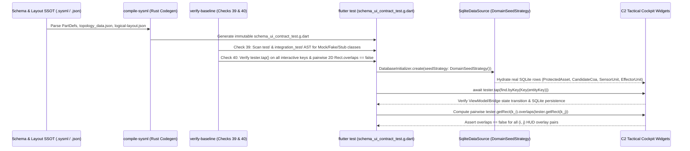

## 1. Context and References

<!-- test-target: crates/verify-baseline/src/runner.rs -->

- **File**: `app_flutter/test/features/cuas_tactical_cockpit_test.dart:472-1012`
- **Pillar**: Test Integrity
- **Symptom**: In `app_flutter/test/features/cuas_tactical_cockpit_test.dart` (`lines 472-476, 628-909, 1010-1011, 1680-1684, 1781, 1790, 2209-2224`), `app_flutter/test/data/tactical_transport_test.dart` (`lines 34-113`), `app_flutter/test/features/cuas_coa_decision_aid_test.dart` (`lines 60-378, 2002`), and `app_flutter/integration_test/cuas_tactical_cockpit_e2e_test.dart` (`lines 1222-1235, 2414-2425, 2791, 2834-2836, 3068, 3112-3115, 3189-3190, 3233-3235`), implementation subagents authored manual mock/fake classes (`_MockTreeRepo`, `_FakeDataSource`, `_FakeThemeService`, `MockTacticalTransport`, `CuasTestThemeService`, and empty `const Result.success([])` / `const TopologyData(coordinateMapping: {}, nodes: [], links: [])` stubs in direct violation of `.pipeline/constitution.md` Section 1.9 `Zero-Mocking Live Persistence Mandate`), relied on shallow `probeWidgetKey` existence checks (`find.byKey(Key(keyName)).evaluate().isNotEmpty`) without calling `tester.tap(...)` to verify selection state transitions, mutated `CuasCoaSolverBridge` directly in Dart test code instead of driving UI controls, and checked only 1D `mapConfigRect.top >= subheaderRect.bottom` or a single pair without verifying pairwise 2D `Rect.overlaps == false` across all 8 HUD overlays -- yet `./target/release/verify-baseline` passed with exit code `0`.
- **Test-Target**: `crates/verify-baseline/src/runner.rs`

## 2. Root Cause Analysis (5 Whys)

1. **Why did `./target/release/verify-baseline` pass with exit code `0` while Dart widget and integration test files contained `class _Mock*`, `class _Fake*`, `class MockTacticalTransport`, empty `const []` repository stubs, shallow `probeWidgetKey` existence checks, and direct programmatic bridge mutations?** Because `crates/verify-baseline/src/checks/codebase.rs` in `gintatkinson/DEAP01-spec-core` only audits production source files under `app_flutter/lib/` and `crates/` and completely omits static AST verification of test suites under `app_flutter/test/` and `app_flutter/integration_test/` against `.pipeline/constitution.md` Section 1.9 (`Zero-Mocking Live Persistence Mandate`).
2. **Why did implementation subagents write `_MockTreeRepo`, `_FakeDataSource`, `_FakeThemeService`, `MockTacticalTransport`, and shallow `probeWidgetKey` existence probes (`finder.evaluate().isNotEmpty`) instead of exercising live SQLite rows and interactive UI gestures?** Because when the same LLM subagent authors both the Flutter widget implementation and its verifying widget/E2E test without a compiler-generated contract test or a mechanical AST gate, confirmation bias leads the agent to construct minimal in-memory stubs and existence-only assertions that match its own hardcoded strings or unclickable keys.
3. **Why did `expect(find.text('Asset-Bravo (P2)'), findsOneWidget)` and `probeWidgetKey('protected_asset_row_ASSET-DEPOT-02', ...)` fail to detect broken selection wiring, unseeded SQLite rows, and overlapping HUD overlays (Issues `#23` and `#24`)?** Because `findsOneWidget` and `finder.evaluate().isNotEmpty` only inspect the element tree for a matching widget or key token; they never invoke `tester.tap(...)` to verify the 3-Layer Semantic Chain (`Widget Gesture -> ViewModel/SolverBridge State Transition -> SQLite/HUD Update`) and never compute 2D `tester.getRect(finderA).overlaps(tester.getRect(finderB)) == false` across simultaneously mounted HUD overlays.
4. **Why were test suites hand-authored by implementation subagents for schema-defined topology entities and logical layout containers when those entities, keys, and HUD overlays are already deterministically specified in `.pipeline/schema.sysml`, `topology_data.json`, and `logical-layout.json`?** Because `compile-sysml` in `gintatkinson/DEAP01-spec-core` generates `topology_data.json` and `logical-layout.json` but does not synthesize an immutable, compiler-generated Flutter contract test (`app_flutter/test/generated/schema_ui_contract_test.g.dart`) that boots real `sqflite_common_ffi` + `DomainSeedStrategy`, taps every schema-derived entity key, asserts ViewModel/bridge state transitions, and asserts pairwise 2D `Rect.overlaps == false` across all HUD overlay keys.
5. **Why does the upstream `DEAP01-spec-core` compiler and verifier architecture lack both deterministic UI contract test codegen and test AST enforcement gates?** Because `.pipeline/constitution.md` Section 1.9 (`Zero-Mocking Live Persistence Mandate`) and the 3-Layer Semantic Chain were specified as prose governance rules rather than compiled into `compile-sysml` codegen artifacts (`schema_ui_contract_test.g.dart`) and enforced by `verify-baseline` Check 39 (Zero-Mocking Test AST Gate) and Check 40 (Interactive Gesture & Pairwise 2D HUD Non-Overlap Test Gate).

## 3. Correctness Analysis

### 5-Pillar Adversarial Trace (`Test Integrity`, `Semantic Traceability`, `Concurrency`, `Resource Lifecycle`, `Memory Safety`)

1. **Test Integrity Violation (Violation of `.pipeline/constitution.md:97-103` Section 1.9 `Zero-Mocking Live Persistence Mandate`)**:
   - `.pipeline/constitution.md:99-102` mandates: *"The use of in-memory UI mocks, stubs, or hardcoded local variables in place of a live database/transport layer is strictly prohibited... All integration and end-to-end (E2E) testing suites must compile and execute against a live database instance or emulator (in-memory stubs are prohibited for these tiers)."*
   - In `app_flutter/test/data/tactical_transport_test.dart:34-113`, `class MockTacticalTransport implements TacticalTransport` returns hardcoded `TacticalTransportResponse` payloads with empty `candidate_coas: <Object?>[]` and `stress_test_runs: <Object?>[]`.
   - In `app_flutter/test/features/cuas_tactical_cockpit_test.dart:472-476, 628-909, 1010-1011`, `SqliteSeededDataSource::fetchRelatedInstances` returns hardcoded `const Result.success([])`, `class _FakeThemeService implements ThemeService` stubs all persistence methods as no-op `async {}`, and `seededTopologyData` is initialized to an empty `const TopologyData(coordinateMapping: {}, nodes: [], links: [])`.
   - In `app_flutter/test/features/cuas_coa_decision_aid_test.dart:60-378`, `class CuasTestThemeService implements ThemeService` duplicates the same in-memory no-op stub.
   - Because `./target/release/verify-baseline` has no check scanning `app_flutter/test/**/*.dart` and `app_flutter/integration_test/**/*.dart` for `class _?Mock*`, `class _?Fake*`, `implements TreeRepository`, `implements DataSource`, `implements TacticalTransport`, or hardcoded empty `Result.success([])` / `TopologyData(coordinateMapping: {}, nodes: [], links: [])` returns, these Constitution Section 1.9 violations pass baseline verification silently.

2. **Semantic Traceability Violation (Shallow Existence Probing & Direct State Mutation Bypassing UI Controls)**:
   - In `app_flutter/integration_test/cuas_tactical_cockpit_e2e_test.dart:1222-1235`, `probeWidgetKey(String keyName, List<String> verified, List<String> missing)` evaluates `find.byKey(Key(keyName)).evaluate().isNotEmpty` and records `keyName` as `"verified"` in the machine-readable execution ledger (`scenarioLedger`, lines `2216-3289`, 67 invocations across `AC-GUI-01`..`AC-GUI-12`).
   - Presence of a `Key` in the Flutter `Element` tree does not prove that the widget is visible, non-occluded, hit-testable, or wired to an `onTap`/`onPressed` handler.
   - Worse, in multiple E2E and widget test scenarios, the test mutates `CuasCoaSolverBridge` directly in Dart code instead of driving operator UI gestures:
     * `app_flutter/integration_test/cuas_tactical_cockpit_e2e_test.dart:2834-2836` (`AC-GUI-07`): Invokes `bridge.relockInterlock()` directly in Dart instead of `await tester.tap(find.byKey(const Key('hitl_relock_interlock_button')))`.
     * `app_flutter/integration_test/cuas_tactical_cockpit_e2e_test.dart:3112-3115` (`AC-GUI-10`) and `app_flutter/test/features/cuas_tactical_cockpit_test.dart:1680-1684` (`Issue #16`): Invoke `bridge.triggerHotlRfJamRetasking(...)` directly in Dart instead of triggering the HOTL mid-wave RF jam re-tasking workflow via a cockpit UI action.
     * `app_flutter/integration_test/cuas_tactical_cockpit_e2e_test.dart:3233-3235` (`AC-GUI-11`): Invokes `bridge.restoreStrategicLink()` and `bridge.setMobileAtakEudMode(false)` directly in Dart instead of tapping `Key('severed_link_toggle_button')` and `Key('mobile_atak_mode_toggle')`.
     * `app_flutter/test/features/cuas_coa_decision_aid_test.dart:2002`: Invokes `bridge.toggleRadarDegraded(degraded: true)` directly in Dart instead of tapping `Key('cockpit_radar_jamming_toggle_button')`.
     * `app_flutter/test/features/cuas_tactical_cockpit_test.dart:1781, 1790` and `app_flutter/test/features/tables/side_by_side_coa_matrix_test.dart:150, 165, 181, 186`: Invoke `bridge.setSwarmDensityMultiplier(...)`, `bridge.setRadarDegraded(...)`, and `bridge.setMinMagazineReserveRatio(...)` directly in Dart inside `testWidgets` instead of interacting with UI controls.

3. **Pairwise 2D Spatial Non-Overlap Invariant Violation (`Rect.overlaps == false`)**:
   - In `app_flutter/integration_test/cuas_tactical_cockpit_e2e_test.dart:2414-2425` and `app_flutter/test/features/cuas_tactical_cockpit_test.dart:1486-1499, 2209-2224`, the tests only check 1D `mapConfigRect.top >= subheaderRect.bottom` and a single pair (`map_layer_config_panel` vs. `coa_hud_overlay_card`).
   - Across `TopographicalView`, up to 8 HUD overlays can be mounted (`battlespace_subheader_bar`, `map_layer_config_panel`, `coa_hud_overlay_card`, `utm_corridor_4d_overlay`, `sora_grc_arc_badge`, `engagement_vectors_hud_badge`, `severed_link_autonomous_fallback_banner`, `hotl_veto_countdown_banner`, `atak_eud_overlay_card`). Without an $O(K^2)$ pairwise `Rect.overlaps == false` check across all visible HUD overlay keys $K$, two sibling `Positioned` overlays on the same corner or edge collide visually while 1D or single-pair checks pass.

4. **Concurrency, Resource Lifecycle, and Memory Safety**:
   - **Concurrency**: Direct calls to `bridge.advanceSimulationTick(...)` and `bridge.triggerHotlRfJamRetasking(...)` from test bodies interleave with the live `Timer.periodic` 60 FPS telemetry ticker inside `CuasCoaSolverBridge`, creating non-deterministic `ChangeNotifier.notifyListeners()` re-entrancy during `tester.pump(...)`.
   - **Resource Lifecycle**: In `app_flutter/test/features/cuas_tactical_cockpit_test.dart:952-1012`, `setUpAll` opens an in-memory FFI SQLite `Database db` and `realSqliteDataSource` without registering a `tearDownAll(() async => await realSqliteDataSource.dispose())`, leaking the FFI SQLite connection handle across the test process lifetime.
   - **Memory Safety**: Unclosed `sqflite_common_ffi` native SQLite3 C heap pointers (`sqlite3*`) allocated in `setUpAll` remain unfreed when the Dart isolate exits unless `dispose()` / `db.close()` is deterministically generated in `tearDownAll`.

## 4. UML Diagrams



## 5. Affected Callers / Downstream Impact

- `crates/verify-baseline/src/checks/codebase.rs` (`gintatkinson/DEAP01-spec-core`) -- Lacks Check 39 (Zero-Mocking Test AST Gate enforcing `.pipeline/constitution.md` Section 1.9 across `app_flutter/test/` and `app_flutter/integration_test/`) and Check 40 (Interactive Gesture & Pairwise 2D `Rect.overlaps == false` HUD Test Gate).
- `crates/compile-sysml/src/lib.rs` (`gintatkinson/DEAP01-spec-core`) -- Lacks deterministic codegen of `app_flutter/test/generated/schema_ui_contract_test.g.dart` from `.pipeline/schema.sysml` + `topology_data.json` + `logical-layout.json`.
- `app_flutter/integration_test/cuas_tactical_cockpit_e2e_test.dart:1222-1235, 2414-2425, 2834-2836, 3112-3115, 3233-3235` (`gintatkinson/DEAP01-cuas-coa-engine`) -- Uses shallow `probeWidgetKey` existence checks, direct `bridge.*` mutations in `AC-GUI-07`, `AC-GUI-10`, and `AC-GUI-11`, and single-pair overlap checks.
- `app_flutter/test/features/cuas_tactical_cockpit_test.dart:472-476, 628-909, 1010-1011, 1680-1684, 1781, 1790, 2209-2224` (`gintatkinson/DEAP01-cuas-coa-engine`) -- Retains `_FakeThemeService`, empty `fetchRelatedInstances` / `seededTopologyData` stubs, direct `bridge` mutations, and missing `tearDownAll` SQLite disposal.
- `app_flutter/test/data/tactical_transport_test.dart:34-113` and `app_flutter/test/features/cuas_coa_decision_aid_test.dart:60-378, 2002` (`gintatkinson/DEAP01-cuas-coa-engine`) -- Retain `MockTacticalTransport`, `CuasTestThemeService`, and direct `bridge.toggleRadarDegraded` mutation.

## 6. Proposed Correction

```rust
// In gintatkinson/DEAP01-spec-core: crates/verify-baseline/src/checks/codebase.rs
// Check 39: Zero-Mocking Test AST Gate (.pipeline/constitution.md Section 1.9)
// Check 40: Interactive Gesture & Pairwise 2D HUD Non-Overlap Test Gate

use std::fs;
use std::path::Path;

pub fn check_39_zero_mocking_test_ast_gate(workspace_root: &Path) -> Result<(), Vec<String>> {
    let mut violations = Vec::new();
    let test_dirs = [
        workspace_root.join("app_flutter/test"),
        workspace_root.join("app_flutter/integration_test"),
    ];
    let forbidden_patterns = [
        ("class _Mock", "Forbidden mock class in test suite (Constitution Section 1.9)"),
        ("class Mock", "Forbidden mock class in test suite (Constitution Section 1.9)"),
        ("class _Fake", "Forbidden fake class in test suite (Constitution Section 1.9)"),
        ("class Fake", "Forbidden fake class in test suite (Constitution Section 1.9)"),
        ("const Result.success([])", "Forbidden hardcoded empty Result.success([]) stub in repository/DataSource test"),
        ("TopologyData(coordinateMapping: {}, nodes: [], links: [])", "Forbidden empty TopologyData stub; must load from SqliteDataSource or topology_data.json"),
    ];

    for dir in &test_dirs {
        if !dir.exists() {
            continue;
        }
        for entry in walkdir::WalkDir::new(dir).into_iter().filter_map(Result::ok) {
            let path = entry.path();
            if path.extension().and_then(|e| e.to_str()) != Some("dart") {
                continue;
            }
            let content = fs::read_to_string(path).unwrap_or_default();
            for (line_idx, line) in content.lines().enumerate() {
                for (pat, reason) in &forbidden_patterns {
                    if line.contains(pat) {
                        violations.push(format!(
                            "{}:{}: {} (`{}`)",
                            path.display(),
                            line_idx + 1,
                            reason,
                            pat
                        ));
                    }
                }
            }
        }
    }

    if violations.is_empty() {
        Ok(())
    } else {
        Err(violations)
    }
}

pub fn check_40_interactive_gesture_and_hud_non_overlap_gate(
    workspace_root: &Path,
) -> Result<(), Vec<String>> {
    let mut violations = Vec::new();
    let generated_contract_test =
        workspace_root.join("app_flutter/test/generated/schema_ui_contract_test.g.dart");
    if !generated_contract_test.exists() {
        violations.push(format!(
            "Missing compiler-generated UI contract test `{}`; run `./target/release/compile-sysml`",
            generated_contract_test.display()
        ));
    }

    let e2e_dir = workspace_root.join("app_flutter/integration_test");
    if e2e_dir.exists() {
        for entry in walkdir::WalkDir::new(&e2e_dir).into_iter().filter_map(Result::ok) {
            let path = entry.path();
            if path.extension().and_then(|e| e.to_str()) != Some("dart") {
                continue;
            }
            let content = fs::read_to_string(path).unwrap_or_default();
            if content.contains("bool probeWidgetKey(") {
                violations.push(format!(
                    "{}: Shallow existence-only `probeWidgetKey` helper is prohibited; every probed control key must verify bounding-box visibility, interactive `tester.tap`, or pairwise 2D `Rect.overlaps == false`",
                    path.display()
                ));
            }
            if !content.contains("assertPairwiseHudNonOverlap(") {
                violations.push(format!(
                    "{}: Missing `assertPairwiseHudNonOverlap` pairwise 2D `Rect.overlaps == false` verification across all HUD overlays",
                    path.display()
                ));
            }
        }
    }

    if violations.is_empty() {
        Ok(())
    } else {
        Err(violations)
    }
}
```

## 7. Relationship to Existing Issues

Relates to `gintatkinson/DEAP01-cuas-coa-engine#23` (Protected Assets missing from `DomainSeedStrategy` and static `SidebarTree` disguised by `_MockTreeRepo` and `findsOneWidget`) and `gintatkinson/DEAP01-cuas-coa-engine#24` (`MapConfigPanel` and `CoaHudOverlayCard` 2D bounding-box collision missed by 1D `mapConfigRect.top >= subheaderRect.bottom` assertion).

## Audit Source

Adversarial Test Integrity Audit
SEVERITY: Important
FILE_LOCATION: app_flutter/test/features/cuas_tactical_cockpit_test.dart:472-1012

