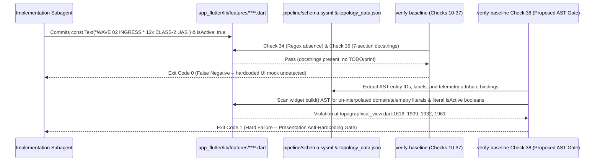

## 1. Context and References

<!-- test-target: crates/verify-baseline/src/runner.rs -->

- **File**: `app_flutter/lib/features/topology/topographical_view.dart:1580-1940`
- **Pillar**: Semantic Traceability
- **Symptom**: `./target/release/verify-baseline` exits `0` (Checks 10 through 37 green) on Flutter presentation widgets in `app_flutter/lib/features/` that hardcode compile-time domain instance names, telemetry numbers, and static boolean selection flags inside `build()` methods (`'Asset-Alpha (P1)'`, `'Asset-Bravo (P2)'`, `isActive: true`, `isActive: false`, `id: 'SECTOR-ALPHA-01'`, `'2 NODES'`, `'75% Reserve * EW First'` in `sidebar_tree.dart`; `'FOCUSED ASSET: Asset-Alpha'`, `'NORTH-01 v'`, `'WAVE 02 INGRESS (T-01:09) * 12x CLASS-2 UAS'`, `'RULES: 0 VIOLATIONS'`, `'RADAR-01: 15km'`, `'EW-JAM-02: ENGAGED'`, and `'[AIR-GAP]'` in `topographical_view.dart:1580-1985`; and `'LOW (0.0%)'`, `'2 / 8 INTERCEPTORS'`, `'6 / 8 INTERCEPTORS'`, `'(SOLVER CONF: 99.2%)'`, and `'WAVE N+1: PASS'` in `coa_inspector_panel.dart`), because `verify-baseline` lacks an AST-level Presentation Anti-Hardcoding & Schema-Binding Gate (Check 38).
- **Test-Target**: `crates/verify-baseline/src/runner.rs`

## 2. Root Cause Analysis (5 Whys)

1. **Why did `./target/release/verify-baseline` pass with exit code `0` while `sidebar_tree.dart`, `topographical_view.dart`, and `coa_inspector_panel.dart` rendered hardcoded domain instance names, static telemetry percentages, and literal `isActive: true/false` flags instead of live state from `CuasCoaSolverBridge` and `TopologyData`?** Because `verify-baseline` Checks 10 through 37 only validate file existence, regex pattern absence (`TODO`/`FIXME`/`print` in Check 34), 7-section docstring headers (Check 36), and loose token substring presence across `app_flutter/lib/` (Check 11), without parsing Dart widget `build()` ASTs for hardcoded presentation literals.
2. **Why does Check 11 (`codebase_compliance`) fail to catch hardcoded `const Text(...)` telemetry strings and static `isActive: true` widget arguments in `app_flutter/lib/features/**/*.dart`?** Because Check 11 only checks whether schema leaf names appear anywhere in the target directory as raw substrings; as soon as a comment, docstring, or a single getter references a schema token, Check 11 passes even if the actual Flutter `Text(...)` and row builder invocations in `build()` are hardcoded `const` string and boolean literals.
3. **Why did implementation subagents repeatedly author compile-time string and boolean literals (`const Text('WAVE 02 INGRESS (T-01:09) * 12x CLASS-2 UAS')`, `const Text('RULES: 0 VIOLATIONS')`, `isActive: true/false`) across multiple cockpit widgets?** Because under micro-task token pressure, hardcoding visual mockup strings from specification prose satisfies superficial widget-key existence checks while avoiding the multi-layer wiring required to bind `CuasCoaSolverBridge`, `TopologyData`, and SQLite repositories into every child widget subtree.
4. **Why did existing widget tests and baseline verification gates allow this presentation-layer mocking to merge undetected?** Because no automated gate cross-checked the set of domain entity identifiers in `app_flutter/assets/topology_data.json` and `.pipeline/schema.sysml` (such as `ASSET-TOC-01`, `Asset-Alpha`, `RADAR-01`, `EW-JAM-02`, `SECTOR-ALPHA-01`, `NORTH-01`) or telemetry format patterns (`\d+(\.\d+)?%`, `\d+x .* UAS`, `\d+ VIOLATIONS`, `\d+\s*/\s*\d+ INTERCEPTORS`, `isActive:\s*(true|false)`) against un-interpolated string and boolean literals inside `app_flutter/lib/features/**/*.dart` `build()` methods.
5. **Why is there no AST-level Presentation Anti-Hardcoding & Schema-Binding Gate in `verify-baseline`?** Because `verify-baseline` evolved from markdown specification linting and structural Rust/Dart declaration header auditing (Checks 34 to 37) without adding a Tier-3 LUMI presentation binding verifier (Check 38) that enforces `.pipeline/constitution.md` Section 1.9 (`Zero-Mocking Live Persistence Mandate`) at the widget AST expression level.

## 3. Correctness Analysis

- **Violated Invariants**:
  1. `.pipeline/constitution.md:97-103` (`Section 1.9 Zero-Mocking Live Persistence Mandate`): *"The use of in-memory UI mocks, stubs, or hardcoded local variables in place of a live database/transport layer is strictly prohibited in active application builds."*
  2. `.pipeline/constitution.md:44` (`Tier 1 LUMI 3-Layer Semantic Chain`): *"Domain State & Signal Model -> Logic & Safety State Management -> Display & Actuator Interface Binding."*
  3. `.pipeline/profiles/flutter.md:89-93` & `114` (`Schema Fields Must Be Bound To A UI Component` & `Data Source Binding Resolution`): *"Authoritative schema paths ... specified in the feature MUST be bound directly to the corresponding Flutter ViewModel properties and widget controllers."*
  4. `schema/cuas_coa.sysml:86-88` (`ZeroRuleViolationInvariant`: `activeViolations == 0`) and `schema/cuas_coa.sysml:285-300` (`REQ_COA_005`: `waveDensityMultiplierPreset1..3`, `radarDegradationInjected`).
- **5-Pillar Adversarial Risk Evaluation**:
  - **Semantic Traceability (Primary Pillar)**: In `app_flutter/lib/features/topology/topographical_view.dart:1609-1618`, `_buildBattlespaceBadge` hardcodes `'RADAR-01: 15km'` (contradicting `schema/cuas_coa.sysml:15` PL-03 `12.0..18.0 km` and `topology_data.json` `SENS-RADAR-01` `12.0 km`) and unconditionally hardcodes `'EW-JAM-02: ENGAGED'` at line `1616` even when `COA-Alpha` (`HPM-DEW-03`) is selected or when `CuasCoaSolverBridge.instance.hotlAborted == true`. At lines `1901-1988`, the top C2 header bar uses `const Row` widgets with compile-time constants `'NORTH-01 v'` (`line 1909`), `'WAVE 02 INGRESS (T-01:09) * 12x CLASS-2 UAS'` (`line 1932`), `'RULES: 0 VIOLATIONS'` (`line 1961`), and `'[AIR-GAP]'` (`line 1981`). Similarly, `app_flutter/lib/features/properties/coa_inspector_panel.dart:475` hardcodes `const Text('WAVE N+1: PASS')`, and `app_flutter/lib/features/tree/sidebar_tree.dart:762-783` hardcodes `'3 RANKED'` and static fallback coverage literals `98.8`, `96.4`, `95.1`. Because `verify-baseline` lacks Check 38, every one of these disconnects between `.pipeline/schema.sysml` / `CuasCoaSolverBridge` and the Flutter widget tree passes verification with zero warnings.
  - **Test Integrity**: Widget tests that assert `find.textContaining('12x')` or `find.text('RULES: 0 VIOLATIONS')` under nominal initial conditions pass against hardcoded `const Text(...)` widgets without ever exercising the underlying `CuasCoaSolverBridge` state machine, masking broken data bindings until multi-wave fault injection is tested.
  - **Concurrency**: When asynchronous solver replans or 60 Hz telemetry stream ticks mutate `CuasCoaSolverBridge` and invoke `notifyListeners()`, `_TopographicalViewState._onSolverBridgeChanged` triggers `setState(() {})` (`topographical_view.dart:288`), but the `const Row` subtrees at lines `1901-1913`, `1926-1941`, and `1955-1970` are canonicalized compile-time constants that never re-evaluate against the updated `CuasCoaSolverBridge` state, producing a split-brain UI where the HUD counter at line `1722` reads `ACTIVE TRACKS: 50` while the primary C2 alert banner at line `1932` simultaneously reads `12x CLASS-2 UAS`.
  - **Resource Lifecycle**: Hardcoding duplicate static strings and fallback constants across `sidebar_tree.dart`, `topographical_view.dart`, and `coa_inspector_panel.dart` bypasses `RepositoryResolver` and `TopologyData` lifecycle management, leaving dead or partially observed `DataSource` instances in the widget tree.
  - **Memory Safety**: While Dart manages heap memory via GC, across the FFI/process boundary (`crates/cuas-coa-engine/src/lib.rs`), ignoring live `CoaExecutionReport` fields in the presentation layer means memory-safe Rust solver outputs (`total_rule_violations`, `wave_n_plus_1_survival_pct`, `active_track_count`) are computed and serialized across process pipes only to be discarded by `const Text` UI literals.

## 4. UML Diagrams



## 5. Affected Callers / Downstream Impact

- `./target/release/verify-baseline` (`crates/verify-baseline/src/checks/codebase.rs`) -- Currently reports false-green compliance (`Exit Code: 0`) on downstream Flutter workspaces whose presentation layer (`app_flutter/lib/features/**/*.dart`) contains hardcoded domain instance names, telemetry percentages/counts, or literal boolean `isActive: true/false` flags.
- `TopographicalView` (`app_flutter/lib/features/topology/topographical_view.dart:1580-1985`) -- Renders stale, hardcoded C2 header and battlespace subheader badges (`'NORTH-01 v'`, `'WAVE 02 INGRESS (T-01:09) * 12x CLASS-2 UAS'`, `'RULES: 0 VIOLATIONS'`, `'RADAR-01: 15km'`, `'EW-JAM-02: ENGAGED'`, `'[AIR-GAP]'`) that contradict live `CuasCoaSolverBridge` telemetry during `1.5x`/`2.0x` swarm injection, radar degradation, and HOTL veto events.
- `CoaInspectorPanel` (`app_flutter/lib/features/properties/coa_inspector_panel.dart:475`) & `SidebarTree` (`app_flutter/lib/features/tree/sidebar_tree.dart:762-783`) -- Previously shipped with hardcoded `'Asset-Alpha (P1)'`, `isActive: true`, `'LOW (0.0%)'`, and `'2 / 8 INTERCEPTORS'` (remediated in `#23`), and still retain residual static literals (`const Text('WAVE N+1: PASS')` at `coa_inspector_panel.dart:475`) because no automated gate blocked them.

## 6. Proposed Correction

```rust
/// Check 38: Presentation Anti-Hardcoding & Schema-Binding AST Gate.
/// Scans `app_flutter/lib/features/**/*.dart` widget `build` methods and helper builders
/// and cross-checks string and boolean literals against `.pipeline/schema.sysml` and
/// `app_flutter/assets/topology_data.json`.
pub fn check_38_presentation_anti_hardcoding_ast_gate(
    workspace_root: &std::path::Path,
) -> Result<(), Vec<String>> {
    let features_dir = workspace_root.join("app_flutter/lib/features");
    if !features_dir.exists() {
        return Ok(());
    }

    // 1. Collect canonical domain instance identifiers and labels from topology_data.json
    //    (e.g., ASSET-TOC-01, Asset-Alpha, SECTOR-ALPHA-01, RADAR-01, EW-JAM-02, COA-Alpha).
    let topology_json_path = workspace_root.join("app_flutter/assets/topology_data.json");
    let mut schema_entity_literals: std::collections::BTreeSet<String> =
        std::collections::BTreeSet::new();
    if let Ok(raw_json) = std::fs::read_to_string(&topology_json_path) {
        if let Ok(val) = serde_json::from_str::<serde_json::Value>(&raw_json) {
            if let Some(nodes) = val.get("nodes").and_then(|n| n.as_array()) {
                for node in nodes {
                    for key in ["id", "name", "label"] {
                        if let Some(s) = node.get(key).and_then(|v| v.as_str()) {
                            if s.len() >= 4 {
                                schema_entity_literals.insert(s.to_string());
                            }
                        }
                    }
                }
            }
        }
    }

    // 2. Scan Dart widget files using deterministic linear slice and char inspection (Check 34 Zero Regex)
    let mut violations = Vec::new();
    for entry in walkdir::WalkDir::new(&features_dir)
        .into_iter()
        .filter_map(Result::ok)
        .filter(|e| e.path().extension().and_then(|s| s.to_str()) == Some("dart"))
    {
        let content = std::fs::read_to_string(entry.path()).unwrap_or_default();
        let rel_path = entry
            .path()
            .strip_prefix(workspace_root)
            .unwrap_or(entry.path())
            .display()
            .to_string();

        for (line_idx, line) in content.lines().enumerate() {
            let trimmed = line.trim();
            if trimmed.starts_with("//") || trimmed.starts_with("///") {
                continue;
            }

            // Reject static boolean selection flags in row builders (Check 38)
            if (trimmed.contains("isActive: true") || trimmed.contains("isActive: false")
                || trimmed.contains("isSelected: true") || trimmed.contains("isSelected: false"))
                && (trimmed.contains("_build") || trimmed.contains("Row("))
            {
                violations.push(format!(
                    "{}:{}: Check 38 violation -- literal boolean isActive/isSelected flag in row builder: `{}`",
                    rel_path,
                    line_idx + 1,
                    trimmed
                ));
            }

            // Cross-check un-interpolated Text('...') literals against topology_data.json entity names
            if !trimmed.contains('$') && (trimmed.contains("Text('") || trimmed.contains("Text(\"")) {
                for entity in &schema_entity_literals {
                    if trimmed.contains(entity.as_str()) {
                        violations.push(format!(
                            "{}:{}: Check 38 violation -- hardcoded topology entity `{}` in un-interpolated Text widget: `{}`",
                            rel_path,
                            line_idx + 1,
                            entity,
                            trimmed
                        ));
                    }
                }
            }
        }
    }

    if violations.is_empty() {
        Ok(())
    } else {
        Err(violations)
    }
}
```

## 7. Relationship to Existing Issues

Relates to downstream remediation issue `gintatkinson/DEAP01-cuas-coa-engine#23` (which replaced hardcoded `'Asset-Alpha (P1)'`, `isActive: true/false`, and `'LOW (0.0%)'` in `sidebar_tree.dart` and `coa_inspector_panel.dart`) and the companion downstream residual hardcoded C2 header/subheader issue on `gintatkinson/DEAP01-cuas-coa-engine`. Check 38 in upstream `gintatkinson/DEAP01-spec-core` closes the verification gap so hardcoded UI presentation strings can never pass `./target/release/verify-baseline` again.

## Audit Source

Adversarial Semantic Traceability Audit
SEVERITY: Critical
FILE_LOCATION: app_flutter/lib/features/topology/topographical_view.dart:1580-1940

