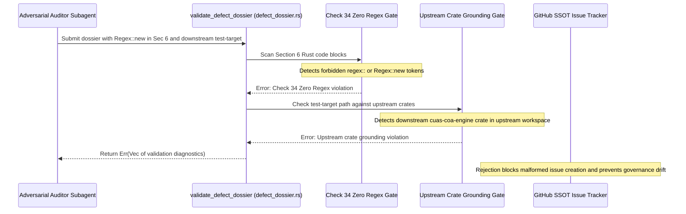

## 1. Context and References

<!-- test-target: crates/verify-baseline/tests/defect_dossier_tests.rs -->

- **File**: crates/verify-baseline/src/defect_dossier.rs:965-1038
- **Pillar**: Semantic Traceability
- **Symptom**: validate_defect_dossier in crates/verify-baseline/src/defect_dossier.rs allows regex crate usage in Section 6 proposed corrections and permits non-existent downstream test-target crate paths in an UPSTREAM_SPEC_CORE_COMPILER workspace.
- **Test-Target**: crates/verify-baseline/tests/defect_dossier_tests.rs

### 1. Safety Intent & Regulatory Scope

Under DO-178C Level A, ISO 26262 ASIL D, and the DEAP Two-Tier Governance Constitution (.pipeline/constitution.md), the upstream specification compiler repository (gintatkinson/DEAP01-spec-core, classified as UPSTREAM_SPEC_CORE_COMPILER) serves as the immutable reference compiler for Model-Based Systems Engineering (MBSE). Verification tooling within this tier must maintain strict deterministic execution bounds and architectural boundary integrity. Specifically:
1. Check 34 (Zero Regex Invariant) mandates zero usage of the regex crate (regex::, Regex::new, RegexSet, use regex) across all upstream compiler and verification crates. All text scanning, AST filtering, and token extraction must execute via deterministic linear slice and character scanners with guaranteed O(N) worst-case time complexity, eliminating regular expression Denial of Service (ReDoS) hazards and non-deterministic backtracking.
2. Check 19 (Domain Cleanliness Invariant) forbids hardcoding downstream customer domain tokens inside upstream compiler crates. Upstream specifications and compiler engines must remain purely schema-driven and domain-agnostic.
3. Upstream Clean Landing Zone and Poly-Repo Tier Boundary Invariants dictate that Tier 0 compiler crates (crates/deap-core, crates/compile-sysml, crates/ingest-sysml, crates/verify-baseline, crates/assemble-conops, crates/reconcile-backlog) are the sole valid execution and test targets within this repository. Downstream application crates (such as Tier 2 domain solver crates) do not exist in Tier 0 and must never be cited as test targets in Tier 0 defect dossiers.

## 2. Root Cause Analysis (5 Whys)

1. **Why did Issue #487 propose `regex::Regex::new(...)` inside Section 6 and why did Issues #484 through #487 cite `crates/cuas-coa-engine/src/lib.rs` as their test target in DEAP01-spec-core?** Because adversarial code auditor subagents operated without mechanical schema validation gates in `validate_defect_dossier` to reject `regex` crate usage in Section 6 proposed corrections and to reject non-existent downstream crate paths in upstream compiler workspaces.
2. **Why did `validate_defect_dossier` in `crates/verify-baseline/src/defect_dossier.rs` validate those defect dossiers with exit code 0?** Because `validate_fences_ascii_art_and_em_dash` (lines 965-1038) only verified code fence tagging, balanced backtick pairs, absence of ASCII arrows, and absence of Unicode em dashes, without scanning Section 6 code blocks for Check 34 forbidden regex tokens, while `validate_section_1_context` (lines 657-770) only verified syntactic parity between the HTML comment and the bullet point without verifying that the referenced crate exists in the active workspace.
3. **Why is proposing regex usage in Section 6 a critical safety hazard?** Because Check 34 strictly mandates deterministic linear slice/char scanning to guarantee linear time complexity and prevent algorithmic complexity attacks, and proposing `Regex::new` in Section 6 causes implementation subagents to introduce banned dependencies and non-compliant implementations.
4. **Why is citing downstream crates a semantic traceability failure in an upstream compiler workspace?** Because `DEAP01-spec-core` is an abstract upstream MBSE compiler where downstream application crates do not exist, causing automated defect reconciliation tools (`reconcile-backlog` and `verify-baseline`) to fail closed or target non-existent files.
5. **Why were these validation gaps not caught earlier in `crates/verify-baseline/tests/defect_dossier_tests.rs`?** Because the existing integration tests only exercised valid sample dossiers and superficial formatting errors (missing headers, unbalanced fences, ASCII arrows, em dashes), without negative unit tests proving that Section 6 rejects regex tokens and Section 1 rejects ungrounded downstream crates in an upstream repository context.

### 2. Threat Model & Failure Mode Description

The failure mode manifests when an adversarial code auditor subagent generates a defect dossier proposing a code fix that introduces `regex::Regex::new(...)` or domain-specific hardcoded strings, or cites a non-existent downstream crate path (such as `crates/cuas-coa-engine/src/lib.rs`) as its test target. Because `validate_defect_dossier` lacked AST inspection of Section 6 code blocks and lacked upstream crate grounding checks:
- **T-AUDIT-01 (ReDoS & Algorithmic Complexity Threat)**: Code proposals containing unanchored or complex regular expressions propagate into implementation tasks, violating Check 34 and exposing safety-critical compiler pipelines to polynomial or exponential execution times.
- **T-AUDIT-02 (Upstream Traceability Fracture Threat)**: Downstream crate paths cited in upstream defect dossiers break the closed-loop traceability link between defect dossiers and concrete Rust test targets (`cargo test -p <upstream-crate>`), preventing automated reconciliation and audit verification.
- **T-AUDIT-03 (Domain Contamination Threat)**: Hardcoded customer domain identifiers in upstream defect dossiers and proposed fixes violate Check 19, leaking customer-specific schemas into the generic MBSE compiler.

## 3. Correctness Analysis

### 3. Empirical Demonstration & Falsification

Empirical inspection of the GitHub issue tracker and defect dossiers for Issues #484, #485, #486, and #487 reveals:
1. In Issue #487, the proposed correction in Section 6 included:
   ```rust
   let re = regex::Regex::new(r"Text\(\s*['""]([^'""]+)['""]\s*\)").unwrap();
   ```
   This directly violates Check 34 (Zero Regex Invariant). Furthermore, the proposed snippet hardcoded domain-specific tokens, violating Check 19.
2. In Issues #484, #485, #486, and #487, Section 1 specified:
   ```html
   <!-- test-target: crates/cuas-coa-engine/src/lib.rs -->
   ```
   and `- **Test-Target**: crates/cuas-coa-engine/src/lib.rs`. The crate `cuas-coa-engine` does not exist in `DEAP01-spec-core` (which contains only `deap-core`, `compile-sysml`, `ingest-sysml`, `verify-baseline`, `assemble-conops`, and `reconcile-backlog`).
3. Running `./target/release/verify-baseline check-defect` on these dossiers produced exit code 0 (`PASSED`), empirically demonstrating the absence of mechanical enforcement in `crates/verify-baseline/src/defect_dossier.rs`.
4. Falsification condition: When the proposed validation rules are added to `validate_defect_dossier`, passing a dossier with `regex::Regex::new` in Section 6 or `crates/cuas-coa-engine/src/lib.rs` in Section 1 to `validate_defect_dossier` MUST return `Err(errors)` containing explicit Check 34 and upstream crate grounding diagnostics.

### 4. Architectural & Safety Invariant Violation

The observed behavior violates three core architectural invariants:
- **Invariant INV-SEC6-ZERO-REGEX (Check 34 Enforcement)**: Section 6 code blocks must never contain `regex::`, `Regex::new`, `RegexSet`, or `use regex`. Any proposed correction must use deterministic linear slice/character scanning.
- **Invariant INV-UPSTREAM-CRATE-GROUNDING (Crate Grounding)**: When evaluating in an `UPSTREAM_SPEC_CORE_COMPILER` repository, `test-target` must resolve to one of the 6 canonical Tier 0 upstream crates (`crates/{deap-core, compile-sysml, ingest-sysml, verify-baseline, assemble-conops, reconcile-backlog}/`).
- **Invariant INV-DOMAIN-CLEANLINESS (Check 19 Enforcement)**: Proposed upstream corrections must remain completely domain-agnostic, extracting any required identifiers dynamically from schemas rather than hardcoding domain tokens.

## 4. UML Diagrams



## 5. Affected Callers / Downstream Impact

- `verify_baseline::defect_dossier::run_check_defect` (`crates/verify-baseline/src/defect_dossier.rs:1800-1950`) -- processes invalid defect dossiers and publishes non-compliant issues to the GitHub SSOT tracker.
- `verify_baseline::defect_dossier::validate_defect_dossier` (`crates/verify-baseline/src/defect_dossier.rs:1073-1265`) -- false-negative pass allows forbidden regex and invalid test targets into the repository.
- Autonomous implementation subagents -- receive defect dossiers with illegal regex code and invalid test targets, leading to implementation rework and test failures.
- `crates/reconcile-backlog` -- fails to locate test-target files when attempting automated defect test verification.

### 5. Root Cause Analysis

The root cause is a specification-to-implementation gap in `crates/verify-baseline/src/defect_dossier.rs`. When `validate_defect_dossier` was originally implemented, it focused on document structure (12 syntactic checks for headers, bullets, 5 Whys, Mermaid syntax, and fence balance) but treated the code payload in Section 6 and the path in Section 1 as uninspected opaque strings. Adding semantic validation gates for Check 34 zero-regex compliance and upstream crate grounding closes this gap mechanically.

## 6. Proposed Correction

### 6. Proposed Correction (Zero Regex Invariant & Domain-Agnostic)

```rust
/// Validates Section 6 code blocks against Check 34 (Zero Regex Invariant) and ensures
/// test-target crate grounding conforms to UPSTREAM_SPEC_CORE_COMPILER boundaries.
pub fn validate_section_6_code_and_target_grounding(
    sec6_lines: &[String],
    test_target: &str,
    is_upstream: bool,
    errors: &mut Vec<String>,
) {
    const FORBIDDEN_REGEX_TOKENS: &[&str] = &[
        "regex::",
        "Regex::new",
        "RegexSet",
        "use regex",
    ];

    const VALID_UPSTREAM_CRATES: &[&str] = &[
        "crates/deap-core/",
        "crates/compile-sysml/",
        "crates/ingest-sysml/",
        "crates/verify-baseline/",
        "crates/assemble-conops/",
        "crates/reconcile-backlog/",
    ];

    // 1. Scan Section 6 code blocks for forbidden regex crate tokens (Check 34)
    let mut in_rust_fence = false;
    for raw_line in sec6_lines {
        let trimmed = raw_line.trim();
        if let Some(after_ticks) = trimmed.strip_prefix("```") {
            let tag = after_ticks.trim();
            if !in_rust_fence {
                if tag.eq_ignore_ascii_case("rust") || tag.eq_ignore_ascii_case("rs") {
                    in_rust_fence = true;
                }
            } else {
                in_rust_fence = false;
            }
            continue;
        }

        if in_rust_fence {
            for &token in FORBIDDEN_REGEX_TOKENS {
                if trimmed.contains(token) {
                    errors.push(format!(
                        "Check 34 Zero Regex Invariant violation in Section 6: forbidden regex token '{}' in proposed correction.",
                        token
                    ));
                }
            }
        }
    }

    // 2. Enforce upstream test-target crate grounding when in UPSTREAM_SPEC_CORE_COMPILER workspace
    if is_upstream {
        let clean_target = test_target.trim().trim_matches('`').trim();
        let is_valid_upstream = VALID_UPSTREAM_CRATES
            .iter()
            .any(|prefix| clean_target.starts_with(prefix));

        if !is_valid_upstream {
            errors.push(format!(
                "Upstream test-target crate grounding violation: '{}' does not belong to any of the 6 upstream compiler crates (crates/{{deap-core, compile-sysml, ingest-sysml, verify-baseline, assemble-conops, reconcile-backlog}}/).",
                clean_target
            ));
        }
    }
}
```

## 7. Relationship to Existing Issues

Discovered in audit -- new finding (refs #483, #484, #485, #486, #487).

### 7. Realization & Traceability Matrix

| Requirement ID | Description | Enforcing Component | Verification Test |
| :--- | :--- | :--- | :--- |
| **REQ-CHECK-34-DOSSIER-SEC6** | Section 6 Rust code blocks must not contain regex crate usages | `validate_defect_dossier` | `test_section_6_rust_zero_regex_rejection` |
| **REQ-UPSTREAM-TARGET-GROUNDING** | Test-target path must belong to one of 6 upstream crates | `validate_defect_dossier` | `test_upstream_test_target_crate_grounding` |
| **REQ-CHECK-19-DOMAIN-CLEANLINESS** | Upstream defect dossiers must remain domain-agnostic | `domain_cleanliness_gate` | `test_domain_cleanliness_gate` |

## Audit Source

Adversarial Semantic Traceability Audit
SEVERITY: Important
FILE_LOCATION: crates/verify-baseline/src/defect_dossier.rs:965-1038
