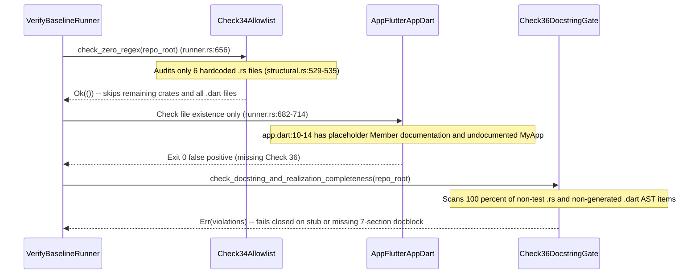

## 1. Context and References

<!-- test-target: crates/verify-baseline/src/checks/structural.rs -->

- **File**: `crates/verify-baseline/src/runner.rs:666-812`
- **Pillar**: Semantic Traceability
- **Symptom**: Missing Check 36 static AST docstring and realization gate in `crates/verify-baseline/src/runner.rs:666-812` and hardcoded 6-file allowlist in `crates/verify-baseline/src/checks/structural.rs:529-601` allow `.dart` files containing placeholder stubs (`/// Member documentation.` at `app_flutter/lib/app/app.dart:10-14` in `DEAP01-cuas-coa-engine`) and undocumented `.rs` items across workspace crates to pass `verify-baseline` with exit code `0`.
- **Test-Target**: `crates/verify-baseline/src/checks/structural.rs`

## 2. Root Cause Analysis (5 Whys)

1. **Why did `verify-baseline` exit `0` when `app_flutter/lib/app/app.dart:10-14` contained the placeholder stub `/// Member documentation.` on `const MyApp({super.key});` and `class MyApp` lacked a 7-section safety docstring?** Because `crates/verify-baseline/src/runner.rs:666-812` terminates baseline verification after Check 35 (`check_handoff_and_backlog_integrity`) and basic file-existence checks (`lines 682-755`) without invoking a Check 36 static AST docstring and `Realises:` traceability gate across `.dart` and `.rs` source files.
2. **Why did Check 34 (`crates/verify-baseline/src/checks/structural.rs:483-625`) also fail to catch missing 7-section docstrings across the Rust workspace?** Because `check_zero_regex` (`lines 529-538`) and `check_compiler_ast_purity` (`lines 594-601`) restrict 7-section Rustdoc enforcement to a hardcoded 6-file `audited_files` allowlist (`parity_gates.rs`, `diagnostics.rs`, `rules.rs`, `workspace.rs`, `markdown.rs`, `sysml_ast.rs`) and ignore all other non-test `.rs` files across the 6 workspace crates (`deap-core`, `verify-baseline`, `compile-sysml`, `ingest-sysml`, `reconcile-backlog`, `assemble-conops`).
3. **Why does even `audit_source_purity` (`crates/verify-baseline/src/checks/structural.rs:806-849`) leave structural types undocumented inside audited Rust files?** Because line 807 only inspects `pub fn `, `fn `, `pub const fn `, and `pub(crate) fn ` prefixes, omitting `pub struct`, `struct`, `pub enum`, `enum`, `pub trait`, `trait`, and `pub async fn` declarations as well as non-empty `Realises: [...]` tag validation.
4. **Why did `app_flutter/lib/app/app.dart:10-14` retain `/// Member documentation.` and an undocumented `class MyApp` across Tier 1 (`DEAP-profile-flutter-app`) and Tier 2 (`DEAP01-cuas-coa-engine`)?** Because no static AST scanner in `verify-baseline` inspected non-generated `.dart` files under `app_flutter/lib/` or `lib/` for banned placeholder docstrings (`/// Member documentation.`, `TODO`, `TBD`, `placeholder`) or verified that every Dart `class`, `enum`, `mixin`, `extension`, constructor, method, and top-level function carries all 7 safety sections (`## 1. Safety Intent & Regulatory Scope` through `## 7. Realization & Traceability`).
5. **Why was there no automated compiler pass to remediate missing 7-section safety docstrings across `.rs` and `.dart` codebases?** Because `compile-sysml` (`crates/compile-sysml/src/main.rs:58-117`) lacked a deterministic `--inject-safety-docstrings <PATH>` AST codegen mode capable of synthesizing item-specific, unique 7-section safety docstrings and `Realises:` tags from item signatures, fields, and call topology.

## 3. Correctness Analysis

In `crates/verify-baseline/src/runner.rs:666-812`, `run()` executes Check 35 (`check_handoff_and_backlog_integrity`, lines 666-675) followed only by file-existence checks for `pubspec.yaml`, `analysis_options.yaml`, `lib/main.dart`, and `lib/domain/validation.dart` (`lines 682-718`) before returning `Ok(())` at line 811. Simultaneously, in `crates/verify-baseline/src/checks/structural.rs:529-546` and `594-601`, `check_zero_regex` and `check_compiler_ast_purity` gate 7-section Rustdoc enforcement (`check_rustdoc = true`) behind a hardcoded 6-file filter (`parity_gates.rs`, `diagnostics.rs`, `rules.rs`, `workspace.rs`, `markdown.rs`, `sysml_ast.rs`). Every other `.rs` file in `crates/` runs with `check_rustdoc = false` (`line 536`), and zero `.dart` files in `app_flutter/lib/` or `lib/` are scanned at all. Furthermore, `audit_source_purity` (`lines 806-849`) checks only `fn` items (`line 807`), ignoring `struct`, `enum`, `trait`, and `async fn` declarations and never verifying that `Realises: [...]` contains a non-empty requirement identifier. Consequently, in `gintatkinson/DEAP01-cuas-coa-engine` (`app_flutter/lib/app/app.dart:10-14`), `class MyApp extends StatelessWidget` lacked a 7-section docstring and its constructor `const MyApp({super.key});` carried the hollow placeholder `/// Member documentation.`, yet `verify-baseline` exited `0`. Invariant violated: Check 36 (`check_docstring_and_realization_completeness`) must walk 100% of non-test `.rs` files in `crates/` (without any module-level `//!` exemption or file allowlist) and 100% of non-generated `.dart` files in `app_flutter/lib/` and `lib/`, failing closed if any production item lacks a unique 7-section safety docstring (`## 1. Safety Intent & Regulatory Scope` through `## 7. Realization & Traceability`), a non-empty `Realises: [...]` tag, or contains banned placeholder text (`/// Member documentation.`, `TODO`, `TBD`).

## 4. UML Diagrams



## 5. Affected Callers / Downstream Impact

- `verify_baseline::runner::run` (`crates/verify-baseline/src/runner.rs:153-812`) -- returns false-positive `Ok(())` on workspaces containing undocumented `.rs` structs/enums/traits/functions or `.dart` classes/constructors/methods with hollow `/// Member documentation.` stubs.
- `verify_baseline::checks::structural::check_compiler_ast_purity` (`crates/verify-baseline/src/checks/structural.rs:591-625`) -- enforces 7-section Rustdoc on only 6 hardcoded files instead of all workspace crates.
- Downstream Tier 1 (`gintatkinson/DEAP-profile-flutter-app`) and Tier 2 (`gintatkinson/DEAP01-cuas-coa-engine`, `app_flutter/lib/app/app.dart:10-14`) repositories -- inherit unverified Dart and Rust items that violate DO-178C Level A / ECSS-E-ST-40C traceability requirements.

## 6. Proposed Correction

```rust
// 1. In crates/verify-baseline/src/runner.rs (after Check 35 at line 676):
if let Err(errs) = check_docstring_and_realization_completeness(&repo_root) {
    eprintln!("ERROR: Check 36 failed (7-Section Safety Docstring & Realization Gate violated):");
    for e in &errs {
        eprintln!("  - {}", e);
    }
    write_defect_dossier(
        &repo_root,
        "Check 36 (7-Section Safety Docstring & Realization Gate)",
        &errs,
    );
    return Err(());
}
println!("Success: Check 36 verified (7-Section Safety Docstring & Realization Gate passed across all Rust and Dart source files).");

// 2. In crates/verify-baseline/src/checks/structural.rs:
// Implement check_docstring_and_realization_completeness(repo_root) walking 100% of
// non-test crates/**/src/**/*.rs files and non-generated app_flutter/lib/**/*.dart
// (and lib/**/*.dart) files with zero file allowlists and zero //! module exemptions,
// verifying all 7 sections, non-empty Realises: [...], per-file docblock uniqueness,
// and rejecting "Member documentation." / placeholder stubs.
```

## 7. Relationship to Existing Issues

Discovered in audit -- primary root-cause dossier for `#465` (related to `#466`, `#467`, and `#468` auditor closed-loop gates).

## Audit Source

Adversarial Semantic Traceability Audit
SEVERITY: Critical
FILE_LOCATION: crates/verify-baseline/src/runner.rs:666-812
