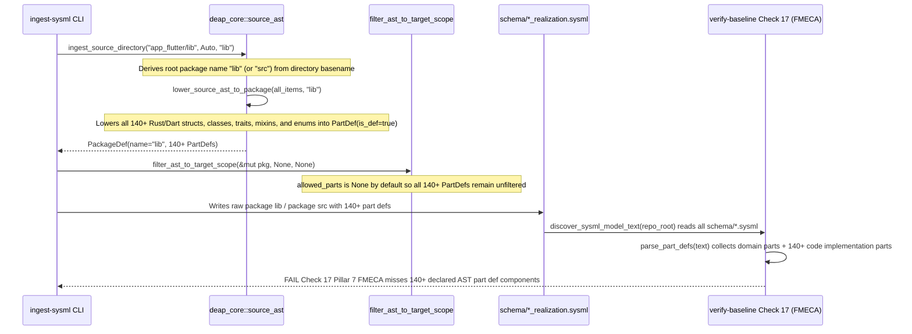

## 1. Context and References

<!-- test-target: crates/ingest-sysml/tests/code_realization_scoping_tests.rs -->

- **File**: `crates/ingest-sysml/src/main.rs:211-246`
- **Pillar**: Semantic Traceability
- **Symptom**: `ingest-sysml` lowers every Rust (`src/`) and Dart/Flutter (`lib/`) source struct, class, enum, trait, mixin, extension, and typedef into a top-level architectural `part def` inside unscoped `package src` or `package lib` namespaces unless a manual `--allowed-parts` CSV whitelist is supplied, polluting top-level schema namespaces and causing immediate Check 17 Pillar 7 FMECA coverage failure (`crates/verify-baseline/src/checks/safety_stpa.rs:1026-1098`) across 140+ internal implementation classes.
- **Test-Target**: `crates/ingest-sysml/tests/code_realization_scoping_tests.rs`

Cross-referenced pipeline components:
- `crates/ingest-sysml/src/main.rs:101-135` (`CliArgs`) and `crates/ingest-sysml/src/main.rs:204-390` (`run_ingestion`)
- `crates/ingest-sysml/src/lib.rs:189-301` (`filter_ast_to_target_scope`)
- `crates/ingest-sysml/src/translators/code.rs:74-77` (`CodeTranslator`) and `crates/ingest-sysml/src/translators/code.rs:328-334` (`CodeTranslator::translate_directory`)
- `crates/deap-core/src/source_ast.rs:1385-1608` (`lower_source_ast_to_package`) and `crates/deap-core/src/source_ast.rs:1642-1689` (`ingest_source_directory`)
- `crates/compile-sysml/src/docstring.rs:286-317` (`run_extract_source`)
- `crates/verify-baseline/src/checks/parity_gates.rs:681-730` (`discover_sysml_model_text`)
- `crates/verify-baseline/src/checks/safety_stpa.rs:1026-1098` (`check_safety_integrity` -- Check 17 Pillar 7 FMECA bidirectional AST closure)

## 2. Root Cause Analysis (5 Whys)

1. **Why does adding `ingest-sysml`-generated subsystem realization schemas (such as `schema/cuas_coa_cockpit_realization.sysml` and `schema/cuas_coa_solver_realization.sysml`) to `schema/` immediately break `verify-baseline` Check 17 (Pillar 7 FMECA closure) with 140+ uncovered `part def` errors?** Because Check 17 (`crates/verify-baseline/src/checks/safety_stpa.rs:1027-1068`) calls `discover_sysml_model_text(repo_root)` (`crates/verify-baseline/src/checks/parity_gates.rs:681-730`), which concatenates every `.sysml` file in `schema/`, extracts all `part def` declarations via `deap_core::sysml_ast::parse_part_defs`, and requires 100% of them to appear in `docs/safety/STPA_MATRIX.md` with at least 2 failure modes each (`crates/verify-baseline/src/checks/safety_stpa.rs:1000-1021`), while `ingest-sysml` emits every internal Rust/Dart implementation type as a `part def`.
2. **Why does `ingest-sysml` emit 140+ internal UI widgets, `State<T>` classes, DTO structs, and helper enums as architectural `part def` declarations?** Because `lower_source_ast_to_package` (`crates/deap-core/src/source_ast.rs:1385-1608`, specifically lines `1406-1510`) unconditionally maps every extracted `SourceItemKind::Struct`, `SourceItemKind::Class`, `SourceItemKind::Trait`, `SourceItemKind::Mixin`, `SourceItemKind::Extension`, `SourceItemKind::Typedef`, and `SourceItemKind::Enum` into `pkg.part_defs` as `PartDef { is_def: true, .. }` regardless of whether the source item carries a `Realises:` traceability tag (`item.satisfied_requirements`) or architectural component marker.
3. **Why does `ingest-sysml` not filter out non-architectural implementation helpers by default during source code ingestion?** Because in `run_ingestion` (`crates/ingest-sysml/src/main.rs:355-370`), `filter_ast_to_target_scope(&mut pkg, allowed_set.as_ref(), neg_vec.as_deref())` (`crates/ingest-sysml/src/lib.rs:189-301`) only prunes `pkg.part_defs` when `allowed_parts` is `Some(allowed)` (`crates/ingest-sysml/src/lib.rs:195`); when `--allowed-parts` is omitted on the CLI, `allowed_set` is `None` and zero scoping or realization filtering is applied. Furthermore, `run_ingestion` (`crates/ingest-sysml/src/main.rs:205-207`) rejects combining `--source` and `--schema` as mutually exclusive instead of allowing `--schema` to supply the target architectural `part def` scope for code ingestion.
4. **Why does `ingest-sysml` also emit raw top-level `package src { ... }` and `package lib { ... }` names that pollute the root SysML namespace?** Because `run_ingestion` (`crates/ingest-sysml/src/main.rs:220-224` and `236-240`) and `run_extract_source` (`crates/compile-sysml/src/docstring.rs:292-296`) derive `pkg_name` directly from `source_path.file_name().and_then(|s| s.to_str()).unwrap_or("SourceCodeModel")` (or `"ExtractedSourceModel"` in `run_extract_source`), so pointing `--source` at `src/` or `lib/` hardcodes the emitted root package name to `package src` or `package lib`, and `CliArgs` (`crates/ingest-sysml/src/main.rs:101-135`) provides no `--package` CLI flag or parent-directory qualification when the leaf folder is `src` or `lib`.
5. **Why does Check 17 (`check_safety_integrity`) treat implementation-level code realization schemas identically to system-level logical architecture schemas?** Because neither `ingest-sysml` (when emitting code-derived realization packages) nor `check_safety_integrity` (`crates/verify-baseline/src/checks/safety_stpa.rs:1027-1068`) distinguishes between system-level logical `part def` components and code-realization subpackages (or types that realize an existing logical requirement/component via `Realises: [REQ-...]`), causing every code-level struct or widget in a realization schema to be evaluated as an unanalyzed system-level hardware/software subsystem requiring independent FMECA hazard rows.

## 3. Correctness Analysis

Tracing the execution path across `ingest-sysml`, `deap-core::source_ast`, `compile-sysml`, and `verify-baseline`:

1. **Unscoped `package src` / `package lib` Emission (`crates/ingest-sysml/src/main.rs:211-246`, `crates/compile-sysml/src/docstring.rs:286-317`)**:
   - When `ingest-sysml --source app_flutter/lib --out schema/cuas_coa_cockpit_realization.sysml` or `ingest-sysml --source crates/solver/src --out schema/cuas_coa_solver_realization.sysml` is invoked, `source_path.file_name()` at `crates/ingest-sysml/src/main.rs:220-223` (and `target_path.file_name()` at lines `236-239`) evaluates to `"lib"` or `"src"`.
   - `CodeTranslator::with_language(lang).translate_directory(source_path, pkg_name)` (`crates/ingest-sysml/src/translators/code.rs:328-334`) delegates to `ingest_source_directory(source_dir, self.language, package_name)` (`crates/deap-core/src/source_ast.rs:1642-1689`), which lowers all discovered `.rs` or `.dart` files into a single root `PackageDef` named `"lib"` or `"src"`.
   - `CliArgs` in `crates/ingest-sysml/src/main.rs:101-135` lacks a `--package <NAME>` argument to scope ingested realization artifacts under a deterministic architectural namespace or parent domain package, and `run_extract_source` (`crates/compile-sysml/src/docstring.rs:292-295`) exhibits the identical leaf-basename defect.

2. **Unfiltered Lowering of Every Source Construct to `part def` (`crates/deap-core/src/source_ast.rs:1385-1608`)**:
   - In `lower_source_ast_to_package` (`crates/deap-core/src/source_ast.rs:1406-1510`):
     - Lines 1407-1481: Every `SourceItemKind::Struct`, `SourceItemKind::Class`, `SourceItemKind::Trait`, `SourceItemKind::Mixin`, `SourceItemKind::Extension`, and `SourceItemKind::Typedef` is pushed into `pkg.part_defs` as `PartDef { is_def: true, .. }`.
     - Lines 1482-1508: Every `SourceItemKind::Enum` is pushed into both `pkg.state_defs` and `pkg.part_defs` as `PartDef { is_def: true, .. }`.
   - Furthermore, `run_ingestion` (`crates/ingest-sysml/src/main.rs:205-207`) forbids passing both `--source` and `--schema` (`CLI options '--source' and '--schema' are mutually exclusive.`), preventing callers from supplying an architectural reference schema to automatically scope code extraction to declared architectural `part def` components or realized requirements.

3. **Collision with Check 17 Pillar 7 FMECA Closure (`crates/verify-baseline/src/checks/safety_stpa.rs:1026-1098`)**:
   - In `check_safety_integrity`:
     - Line 1027 calls `crate::checks::parity_gates::discover_sysml_model_text(repo_root)`.
     - `discover_sysml_model_text` (`crates/verify-baseline/src/checks/parity_gates.rs:681-730`) reads and concatenates all `.sysml` files in `schema/` in sorted order.
     - Line 1029 calls `deap_core::sysml_ast::parse_part_defs(text)`, extracting every `part def <Name>` across all files in `schema/` whose name does not start with `_` (lines 1030-1034).
     - Lines 1056-1068 enforce that every extracted `part def` matches at least one component in `fmeca.rows` from `docs/safety/STPA_MATRIX.md` (with `>= 2` distinct failure modes per component enforced at lines 1000-1021).
   - Because `ingest-sysml` emits 140+ implementation structs, Flutter widgets, `State` classes, and helper enums as top-level `part def` nodes across `schema/*_realization.sysml`, Check 17 immediately fails with 140+ missing FMECA component errors.

## 4. UML Diagrams



## 5. Affected Callers / Downstream Impact

- **`crates/ingest-sysml/src/main.rs`**:
  - `CliArgs` (lines 101-135)
  - `run_ingestion` (lines 204-390)
- **`crates/ingest-sysml/src/lib.rs`**:
  - `filter_ast_to_target_scope` (lines 189-301)
- **`crates/ingest-sysml/src/translators/code.rs`**:
  - `CodeTranslator::translate_directory` (lines 328-334)
- **`crates/deap-core/src/source_ast.rs`**:
  - `lower_source_ast_to_package` (lines 1385-1608)
  - `ingest_source_directory` (lines 1642-1689)
- **`crates/compile-sysml/src/docstring.rs`**:
  - `run_extract_source` (lines 286-317)
- **`crates/verify-baseline/src/checks/safety_stpa.rs`**:
  - `check_safety_integrity` Pillar 7 FMECA closure (lines 1026-1098)
- **Downstream Impact (`DEAP01-cuas-coa-engine` and all downstream application workspaces)**:
  - Running `ingest-sysml` against `src/` (Rust solver/backend) or `lib/` (Flutter cockpit) produces unscoped `package src` / `package lib` hierarchies containing 140+ internal implementation classes as `part def` components.
  - Storing those realization files in `schema/` causes immediate Check 17 (Pillar 7 FMECA coverage) and Check 31 (top-level package parity) failures.

## 6. Proposed Correction

1. **Add Deterministic Package Scoping (`--package`) and Parent-Qualified Package Naming in `crates/ingest-sysml/src/main.rs` and `crates/compile-sysml/src/docstring.rs`**:
   - Add `--package <NAME>` to `CliArgs` in `crates/ingest-sysml/src/main.rs` so callers can specify an explicit target package name, and when `--package` is omitted and the target directory leaf is `"src"` or `"lib"`, derive `<Parent>_<src|lib>_Realization` from the parent directory name (or output file stem) rather than emitting raw `package src` or `package lib`.
   - Allow `--schema <SCHEMA_PATH>` alongside `--source <DIR>` (or add a realization scoping mode) so that when `--allowed-parts` is not explicitly provided, `ingest-sysml` scopes extracted `part def` declarations to architectural `part def` names declared in the reference schema or source items carrying explicit `Realises:` traceability links (`!item.satisfied_requirements.is_empty()`).
2. **Scope Check 17 Pillar 7 FMECA Closure to Architectural `part def` Components (`crates/verify-baseline/src/checks/safety_stpa.rs` & `crates/verify-baseline/src/checks/parity_gates.rs`)**:
   - Ensure `discover_sysml_model_text` / Check 17 Pillar 7 FMECA closure excludes code-realization subpackages (`*_realization.sysml` or packages marked as code realization / `Realises:` implementation bindings) from requiring redundant system-level FMECA hazard rows for internal code structs, while still enforcing 100% FMECA coverage across all architectural `part def` components in the domain system model.

```rust
// In crates/ingest-sysml/src/main.rs:
/// Derive a meaningful package identifier instead of raw "src" or "lib" when
/// pointing at `<component>/src` or `<component>/lib`.
pub fn resolve_ingested_package_name(
    source_path: & std::path::Path,
    explicit_package: Option<&str>,
) -> String {
    if let Some(pkg) = explicit_package.map(str::trim).filter(|s| !s.is_empty()) {
        return pkg.to_string();
    }
    let leaf = source_path
        .file_name()
        .and_then(|n| n.to_str())
        .unwrap_or("SourceCodeModel");
    if matches!(leaf, "src" | "lib") {
        if let Some(parent_name) = source_path
            .parent()
            .and_then(|p| p.file_name())
            .and_then(|n| n.to_str())
            .filter(|s| !s.is_empty() && *s != "." && *s != "..")
        {
            return format!("{}_{}_Realization", parent_name, leaf);
        }
    }
    leaf.to_string()
}
```

Verification test specification in `crates/ingest-sysml/tests/code_realization_scoping_tests.rs`:
1. Create a temporary workspace containing a domain schema (`schema/domain.sysml` with declared architectural `part def` components) and a multi-file Rust/Dart source tree under `crates/solver/src` and `app_flutter/lib` containing both architectural components with `/// Realises: [REQ-001]` and internal UI/helper structs without realization links.
2. Run `ingest-sysml` and verify that:
   - The emitted package name is never raw `package src` or `package lib` (honoring `--package` or parent-qualified `<Parent>_<src|lib>_Realization`).
   - Unannotated internal UI widgets/helper structs are not emitted as unscoped architectural `part def` declarations that break Check 17 Pillar 7 FMECA closure.

## 7. Relationship to Existing Issues

- Complements `.pipeline/defects/DEFECT_SYSML_MULTI_FILE_NAMESPACE_WRAPPER.md` (Issue `#471`: `parse_sysml_tree` wrapping multi-file `schema/*.sysml` models in an extraneous `package SysML_Model` container that breaks Check 31 parity).

## Audit Source

Adversarial Semantic Traceability Audit
SEVERITY: Important
FILE_LOCATION: crates/ingest-sysml/src/main.rs:211-246
