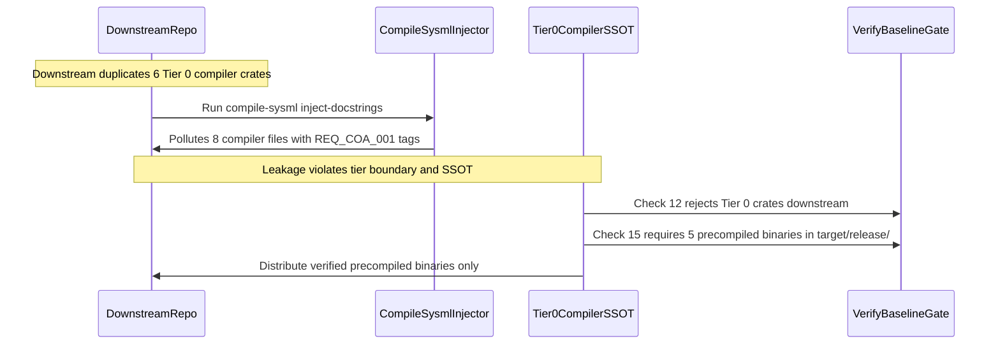

## 1. Context and References

<!-- test-target: crates/deap-core/src/source_ast.rs -->

- **File**: `crates/deap-core/src/source_ast.rs:921-935`
- **Pillar**: Functional Boundary Enforcement
- **Symptom**: Tier 0 compiler source crate leakage into downstream repos caused docstring pollution with REQ_COA_001 tags, while naive slash comment splitting in source_ast.rs corrupts AST tracking on URLs, multi-line Dart classes, and Dart 3 syntax.
- **Test-Target**: `crates/deap-core/src/source_ast.rs`

## 2. Root Cause Analysis (5 Whys)

1. **Why did downstream repositories (DEAP-profile-flutter-app and DEAP01-cuas-coa-engine) experience compiler source contamination with domain requirement tags (REQ_COA_001)?** Because the 6 Tier 0 compiler crates (deap-core, verify-baseline, compile-sysml, ingest-sysml, assemble-conops, reconcile-backlog) were duplicated directly into downstream repositories instead of distributing precompiled release binaries via target/release/.
2. **Why did downstream compile-sysml inject-docstrings inject REQ_COA_001 tags into compiler source files?** Because compile-sysml scanned all repository Rust files against local downstream domain schemas without verifying that compiler crates belong strictly to Tier 0.
3. **Why did Check 36 and docstring injection fail or misclassify valid Dart and Rust items?** Because source_ast.rs, docstring.rs, and docstring_gate.rs used naive split_once("//") comment stripping, which truncated string literals containing "://" (such as URLs), corrupted quote and brace delimiter depth tracking, and failed to parse multi-line Dart class headers, nested interpolation quotes, and Dart 3 getters.
4. **Why were mechanical checks (Check 12, Check 15, Check 37) unable to prevent Tier 0 compiler crate duplication and verify binary-only distribution in downstream repos?** Because Check 12 and Check 15 checked only master blueprints and single binary presence rather than enforcing complete crate directory exclusion and requiring all 5 precompiled binaries (verify-baseline, compile-sysml, ingest-sysml, assemble-conops, reconcile-backlog) with size greater than zero in downstream repositories.
5. **Why were the lexer fixes in downstream commit dd4c66bf not immediately incorporated into Tier 0?** Because downstream applied emergency fixes directly to duplicated compiler files alongside REQ_COA_001 contamination, bypassing the formal upstream defect dossier and clean porting process.

## 3. Correctness Analysis

A comprehensive architectural and lexical audit across Tier 0 (DEAP01-spec-core), Tier 1 (DEAP-profile-flutter-app), and Tier 2 (DEAP01-cuas-coa-engine) reveals two severe systemic failures:

1. **Compiler Source Leakage and Domain Pollution**:
   The 6 canonical compiler crates (`crates/deap-core`, `crates/verify-baseline`, `crates/compile-sysml`, `crates/ingest-sysml`, `crates/assemble-conops`, `crates/reconcile-backlog`) were copied into downstream application repositories. When `compile-sysml inject-docstrings` was run downstream to satisfy 100% docstring coverage, it evaluated AST nodes across these compiler crates against downstream SysML requirements (`REQ_COA_001`), injecting domain annotations into 8 compiler source files. Downstream repositories must be strictly binary-only consumers of Tier 0 release tools (`target/release/`) and must contain zero Tier 0 compiler crates or upstream architecture blueprints (`docs/architecture/blueprints/`).

2. **AST Lexer Defects in source_ast.rs and Check 36**:
   - **URL / Colon-Double-Slash in Strings**: `split_once("//")` was used to strip single-line comments in `crates/deap-core/src/source_ast.rs` (lines 921, 1229), `crates/compile-sysml/src/docstring.rs` (lines 628, 888, 1479, 1514), and `crates/verify-baseline/src/checks/docstring_gate.rs` (lines 649, 809). When source lines contained `"://"` inside string literals (e.g. `http://` or `find("://")`), the remainder of the line was discarded, corrupting quote tracking and delimiter depths.
   - **Multi-line Dart Class Headers**: Dart class declarations spanning multiple lines before the opening brace caused `active_class_name` to be reset prematurely, misclassifying methods as top-level functions.
   - **Nested String Interpolation Quotes**: In Dart, strings like `'$label ${sort ? \'up\' : \'down\'}'` caused quote state confusion unless tracked with an interpolation brace stack (`interp_stack`).
   - **Raw Strings**: Raw Dart strings (`r'...'`, `r"..."`) handle backslashes literally, which broke standard escape skipping.
   - **Multi-byte UTF-8 Character Literals**: Character literals containing non-ASCII glyphs (e.g. `'^'`, unicode arrows) exceeded 3-byte ASCII bounds.
   - **Dart 3 Syntax**: Class modifiers (`final class`, `base class`, `sealed class`), getters (`<Type> get <name> => ...`), and named constructors were not recognized by AST classifiers.

3. **Critical Package Resolution Invariant**:
   Issue #472 introduced `resolve_source_package_name` in `crates/deap-core/src/source_ast.rs` to uniquely qualify module packages. Downstream commit `dd4c66bf` omitted this function. Porting must preserve `resolve_source_package_name` and export it in `crates/deap-core/src/lib.rs`.

## 4. UML Diagrams



## 5. Affected Callers / Downstream Impact

- `crates/deap-core/src/source_ast.rs`: Naive comment splitting and incomplete Dart 3 classification corrupt AST extraction.
- `crates/deap-core/src/lib.rs`: Missing public re-exports for `strip_line_comment_preserving_strings` and `resolve_source_package_name`.
- `crates/compile-sysml/src/docstring.rs`: Truncates lines on `"://"` and mishandles multi-line Dart classes during docstring injection.
- `crates/verify-baseline/src/checks/docstring_gate.rs`: Check 36 produces false negatives/positives on string literals with `"://"` and Dart 3 getters.
- `crates/deap-core/src/workspace.rs`: Checks 12 and 15 lack downstream tier isolation and binary verification enforcement.
- `crates/verify-baseline/src/checks/structural.rs`: Check 37 requires grounding of all 13 canonical architecture blueprints.
- Downstream repositories `DEAP-profile-flutter-app` and `DEAP01-cuas-coa-engine`: Require decontamination of Tier 0 crates and adoption of precompiled binary tooling.

## 6. Proposed Correction

```rust
pub fn strip_line_comment_preserving_strings(line: &str) -> &str {
    let bytes = line.as_bytes();
    let mut in_single_quote = false;
    let mut in_double_quote = false;
    let mut is_escaped = false;
    let mut idx = 0;

    while idx < bytes.len() {
        let b = bytes[idx];
        if is_escaped {
            is_escaped = false;
            idx += 1;
            continue;
        }
        if b == b'\\' && (in_single_quote || in_double_quote) {
            is_escaped = true;
            idx += 1;
            continue;
        }
        if b == b'\'' && !in_double_quote {
            in_single_quote = !in_single_quote;
            idx += 1;
            continue;
        }
        if b == b'"' && !in_single_quote {
            in_double_quote = !in_double_quote;
            idx += 1;
            continue;
        }
        if !in_single_quote && !in_double_quote && b == b'/' && idx + 1 < bytes.len() && bytes[idx + 1] == b'/' {
            return &line[..idx];
        }
        idx += 1;
    }
    line
}
```

## 7. Relationship to Existing Issues

Extends issue #472 (preserving `resolve_source_package_name`) and issue #450 (scoped initialization), addressing DEAP poly-repo tier isolation architecture (DEAP-BLUEPRINT-POLYREPO-013) by eliminating compiler crate leakage and resolving Check 36 AST lexer edge cases.

## Audit Source

Adversarial Functional Boundary Enforcement Audit
SEVERITY: Critical
FILE_LOCATION: crates/deap-core/src/source_ast.rs:921-935
