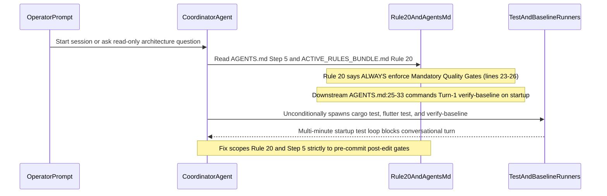

## 1. Context and References

<!-- test-target: crates/deap-core/src/workspace.rs -->

- **File**: `rules/verification-required.md:1-35`
- **Pillar**: Semantic Traceability
- **Symptom**: Rule 20 (`rules/verification-required.md:20-32`, bundled into `.pipeline/ACTIVE_RULES_BUNDLE.md:268-279` and mirrored in `AGENTS.md:27,92-97`) uses unconditional `**ALWAYS enforce:**` and `- **Mandatory Quality Gates**:` phrasing alongside startup Step 5 in `AGENTS.md:27`, causing agents to execute `cargo test --workspace`, `flutter test`, and `./target/release/verify-baseline` on session initialization and read-only conversational turns instead of strictly as a pre-commit/post-edit gate after modifying tracked source/model files, while downstream repositories (`DEAP01-cuas-coa-engine` and `DEAP-profile-flutter-app`) suffered unauthorized hand-edits and work-package / phase-report taxonomy contamination.
- **Test-Target**: `crates/deap-core/src/workspace.rs`

## 2. Root Cause Analysis (5 Whys)

1. **Why do autonomous coordinator and subagent sessions repeatedly trigger `cargo test --workspace`, `flutter test`, and `./target/release/verify-baseline` on session startup and during read-only conversational turns?** Because `rules/verification-required.md:23-26` (and `.pipeline/ACTIVE_RULES_BUNDLE.md:271-274`) declares `**ALWAYS enforce:** Never assert state or completion without direct, empirical verification` followed by `- **Mandatory Quality Gates**: Run cargo test --workspace, headless unit/widget tests (flutter test excluding integration_test/), and ./target/release/verify-baseline before declaring completion`, and `AGENTS.md:27` places Step 5 (`Verify Baseline When Modifying Repository State`) inside the `On session startup` initialization checklist without an explicit prohibition on running test suites or baseline verifiers during initialization or read-only turns.
2. **Why does Rule 20 fail to scope `cargo test --workspace` and `flutter test` to the specific language/model tiers modified in the active implementation task?** Because `rules/verification-required.md:26` lists `cargo test --workspace`, `flutter test`, and `./target/release/verify-baseline` as a single monolithic bullet rather than scoping `cargo test --workspace` strictly to Rust/SysML/layout generator modifications and headless `flutter test` strictly to Dart/Flutter or layout JSON modifications immediately prior to `git commit` / `git push`.
3. **Why did non-canonical work-package labels, phase completion report mandates, and the 5-Level Visual E2E Report Gate proliferate across `DEAP01-cuas-coa-engine` and `DEAP-profile-flutter-app`?** Because downstream governance files (`AGENTS.md`, `.agents/AGENTS.md`, `.pipeline/ACTIVE_RULES_BUNDLE.md`, and `rules/verification-required.md`) were hand-edited directly in downstream workspaces outside the Tier 0 `DEAP01-spec-core` Single Source of Truth, and `DEAP01-cuas-coa-engine/AGENTS.md:24-34` retained the legacy Turn-1 startup ceremony commanding unconditional skill, profile, and `verify-baseline` execution on every session startup.
4. **Why did `crates/deap-core/src/workspace.rs:830-867` (`test_issue_450_agents_md_scoped_initialization_invariants`) pass without catching the unconditional test loop in Rule 20 and `AGENTS.md` Step 5?** Because `test_issue_450_agents_md_scoped_initialization_invariants` asserted only that `AGENTS.md` conditioned platform profile loading (`flutter.md`) and on-demand skill loading, without asserting that `rules/verification-required.md`, `.pipeline/ACTIVE_RULES_BUNDLE.md`, and `AGENTS.md` explicitly forbid running `cargo test`, `flutter test`, or `verify-baseline` on session initialization or read-only turns.
5. **Why were previous governance cleanup commits applied directly without an upstream defect dossier?** Because the remediation bypassed the Tier 0 `adversarial-code-auditor` and `verify-baseline check-defect` closed-loop GitHub SSOT publication gate in `DEAP01-spec-core`.

## 3. Correctness Analysis

A cross-tier audit of `rules/verification-required.md:1-35`, `.pipeline/ACTIVE_RULES_BUNDLE.md:268-279`, `AGENTS.md:18-28,92-97`, and `crates/deap-core/src/workspace.rs:802-867` identifies three coupled governance and verification defects:

1. **Unconditional Verification Trigger in Rule 20 (`rules/verification-required.md:20-32` & `.pipeline/ACTIVE_RULES_BUNDLE.md:268-279`)**:
   - Line 23 states `**ALWAYS enforce:** Never assert state or completion without direct, empirical verification.`
   - Line 26 states `- **Mandatory Quality Gates**: Run cargo test --workspace, headless unit/widget tests (flutter test excluding integration_test/), and ./target/release/verify-baseline before declaring completion.`
   - Because agents treat every conversational response and session initialization sequence as a turn completion, `**ALWAYS enforce:**` combined with an unscoped `- **Mandatory Quality Gates**:` directive induces an initialization test loop where agents run `cargo test`, `flutter test`, and `verify-baseline` before answering questions or before modifying any tracked code/model files.
   - **Invariant Violated**: Role- & Phase-Scoped Lazy Loading (`AGENTS.md:18-28`, `rules/constitution-first.md`) and Scoped Pre-Commit Quality Gates. Rule 20 must declare `**TRIGGER SCOPE -- PRE-COMMIT / POST-EDIT GATE ONLY (NEVER ON INIT OR CONVERSATIONAL TURNS):**`, explicitly forbid running `cargo test`, `flutter test`, or `verify-baseline` on initialization or read-only turns, and run quality gates only once at the end of an implementation task after modifying tracked code/model files and immediately before `git commit` / `git push`.

2. **Ambiguous Startup Step 5 in `AGENTS.md` (`AGENTS.md:18-28`) and Legacy Turn-1 Ceremony in `DEAP01-cuas-coa-engine/AGENTS.md:24-34`**:
   - In `DEAP01-spec-core/AGENTS.md:19-27`, Step 5 (`Verify Baseline When Modifying Repository State`) is nested under `On session startup, before executing file modifications, the coordinator agent MUST execute the following lightweight initialization sequence`, without explicitly stating that `verify-baseline`, `cargo test`, and `flutter test` are strictly forbidden on session startup/initialization and read-only turns.
   - Worse, `DEAP01-cuas-coa-engine/AGENTS.md:24-34` (and `.agents/AGENTS.md:24-34`) still contains the legacy `Mandatory Session Initialization Gate (CRITICAL FIRST STEP)` commanding agents on EVERY new session startup in Turn 1 to preload `skills/feature-driven-implementation/SKILL.md`, read `.pipeline/profiles/flutter.md`, and run `./target/release/verify-baseline . --no-domain`.
   - **Invariant Violated**: Constitutional Upstream Authority & Scoped Initialization (`crates/deap-core/src/workspace.rs:831-867`).

3. **Missing Semantic Traceability Assertions in `crates/deap-core/src/workspace.rs:830-867`**:
   - `test_issue_450_agents_md_scoped_initialization_invariants` checks `.pipeline/profiles/flutter.md` and `SKILL.md` lazy loading in `AGENTS.md`, but never inspects `rules/verification-required.md` or `.pipeline/ACTIVE_RULES_BUNDLE.md` for `TRIGGER SCOPE -- PRE-COMMIT / POST-EDIT GATE ONLY (NEVER ON INIT OR CONVERSATIONAL TURNS)` and never verifies that `AGENTS.md` Step 5 forbids running `verify-baseline`, `cargo test`, or `flutter test` on startup/init or read-only turns.

## 4. UML Diagrams



## 5. Affected Callers / Downstream Impact

- `rules/verification-required.md` (`lines 1-35`) and `.pipeline/ACTIVE_RULES_BUNDLE.md` (`lines 268-279`) -- Unconditional `**ALWAYS enforce:**` and unscoped `- **Mandatory Quality Gates**:` trigger test suites and baseline verification on session initialization and read-only turns.
- `AGENTS.md` (`lines 18-28, 92-97`) in `DEAP01-spec-core`, `DEAP-profile-flutter-app` (`AGENTS.md` and `.agents/AGENTS.md`), and `DEAP01-cuas-coa-engine` (`AGENTS.md` and `.agents/AGENTS.md`) -- Ambiguous Step 5 wording in upstream and un-updated legacy Turn-1 startup ceremony in `DEAP01-cuas-coa-engine` cause startup verification loops and cross-tier governance drift.
- `crates/deap-core/src/workspace.rs` (`lines 802-867`) -- Unit tests pass without asserting the pre-commit / post-edit trigger scope in `rules/verification-required.md`, `.pipeline/ACTIVE_RULES_BUNDLE.md`, and `AGENTS.md` Step 5.

## 6. Proposed Correction

```markdown
<a id="rule-verification-required"></a>
## 20. Rule: Verification Required (`rules/verification-required.md`)

**TRIGGER SCOPE -- PRE-COMMIT / POST-EDIT GATE ONLY (NEVER ON INIT OR CONVERSATIONAL TURNS):**
- **FORBIDDEN on Initialization & Read-Only Turns**: NEVER run `cargo test`, `flutter test`, or `verify-baseline` on session startup/initialization, during read-only questions, architecture discussions, or turns where no tracked source/model files were modified.
- **WHEN TO RUN**: Execute quality gates **ONLY ONCE** at the end of an implementation task after modifying tracked code/model files and immediately before `git commit` / `git push`.

### Hard Constraints (When Modifying Tracked Code/Model Files)
- **Scoped Pre-Commit Quality Gates**:
  - Run `cargo test --workspace` ONLY when Rust (`*.rs`, `Cargo.toml`) or SysML/layout generator files were modified.
  - Run headless `flutter test` (excluding `integration_test/`) ONLY when Dart/Flutter (`app_flutter/`) or layout JSON files were modified.
  - Run `./target/release/verify-baseline` once immediately prior to committing.
- **Remote Sync Verification**: When committing changes, push to the remote tracking branch and verify `git diff origin/<branch>` is empty.
- **Canonical DEAP Taxonomy**: Organize work strictly by Pipeline Steps (`Step 1..Step 4`), Epics (`EPIC-XX`), Features (`FEAT-XX`), User Stories (`US-XX`), Use Cases (`UC-XX`), Micro-Tasks (`Task 1..Task N`), and GitHub Issue IDs (`#Issue`).
- **Opt-In Desktop Visual E2E Suites**: Never run `flutter test integration_test/... -d macos` unless explicitly commanded by the user in the current prompt.
- **Desktop Layout & Readability Invariants**: Multi-panel workspace tiers default to equal split proportions (`1/3 : 1/3 : 1/3`) unless specified otherwise by the deterministic Rust LUI AST, with zero `RenderFlex` overflows or truncated headers across standard desktop viewports (`>= 1920x1200`).
```

## 7. Relationship to Existing Issues

Extends `gintatkinson/DEAP01-spec-core` issue `#450` (role- and phase-scoped lazy loading initialization gate in `AGENTS.md` and `.pipeline/ACTIVE_RULES_BUNDLE.md`) by scoping Rule 20 (`rules/verification-required.md`) and `AGENTS.md` Step 5 strictly to pre-commit/post-edit gates and eliminating session initialization test loops and downstream governance drift across Tier 0, Tier 1, and Tier 2 repositories.

## Audit Source

Adversarial Semantic Traceability Audit
SEVERITY: Critical
FILE_LOCATION: rules/verification-required.md:1-35
