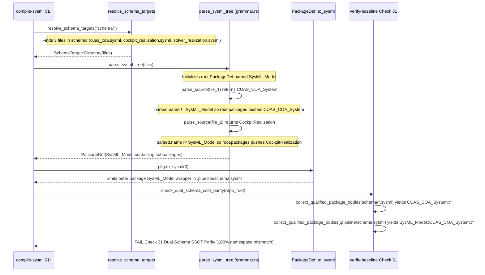

## 1. Context and References

<!-- test-target: crates/compile-sysml/tests/multi_file_compilation_tests.rs -->

- **File**: `crates/compile-sysml/src/parser/grammar.rs:3392-3423`
- **Pillar**: Semantic Traceability
- **Symptom**: `parse_sysml_tree` wraps multi-file `schema/*.sysml` models in a synthetic outer `package SysML_Model { ... }` container when compiling `.pipeline/schema.sysml`, causing Check 31 (`check_dual_schema_ssot_parity` in `crates/verify-baseline/src/checks/parity_gates.rs:4198-4374`) to fail 100% of scoped package and definition parity assertions whenever `schema/` contains more than one `.sysml` file (such as a domain model alongside subsystem realization schemas).
- **Test-Target**: `crates/compile-sysml/tests/multi_file_compilation_tests.rs`

Cross-referenced pipeline components:
- `crates/compile-sysml/src/main.rs:515-631` (`run_compilation_gate`) and `crates/compile-sysml/src/main.rs:663-693` (`resolve_schema_targets`)
- `crates/compile-sysml/src/parser/grammar.rs:217-262` (`SysmlParser::parse_package_or_file`), `crates/compile-sysml/src/parser/grammar.rs:3349-3397` (`merge_package_defs`), `crates/compile-sysml/src/parser/grammar.rs:3392-3423` / `3402-3439` (`parse_sysml_tree`), and `crates/compile-sysml/src/parser/grammar.rs:3467-3476` (`parse_sysml_directory`)
- `crates/compile-sysml/src/semantic/serializer.rs:1218-1325` (`PackageDef::to_sysml`)
- `crates/verify-baseline/src/checks/parity_gates.rs:4049-4101` (`collect_qualified_package_bodies`), `4128-4167` (`compare_scoped_defs`), and `4198-4374` (`check_dual_schema_ssot_parity` -- Check 31)

## 2. Root Cause Analysis (5 Whys)

1. **Why does Check 31 (`check_dual_schema_ssot_parity`) fail with 100% bidirectional AST mismatch whenever `compile-sysml --compile --schema schema/ --out .pipeline/schema.sysml` is executed on a multi-file `schema/` directory?** Because Check 31 (`crates/verify-baseline/src/checks/parity_gates.rs:4222-4248`) concatenates the raw text of `schema/*.sysml` directly into `schema_dir_content` without wrapping it in `package SysML_Model`, whereas `.pipeline/schema.sysml` produced by `compile-sysml` wraps every file's top-level package inside an outer `package SysML_Model { ... }` block, shifting every qualified package key from `<Pkg>::<Def>` in `schema/*.sysml` to `SysML_Model::<Pkg>::<Def>` in `.pipeline/schema.sysml`.
2. **Why does `.pipeline/schema.sysml` contain an outer `package SysML_Model { ... }` wrapper when `schema/` has multiple `.sysml` files (e.g., `schema/cuas_coa.sysml`, `schema/cuas_coa_cockpit_realization.sysml`, `schema/cuas_coa_solver_realization.sysml`), but NOT when `schema/` has a single `.sysml` file?** Because `resolve_schema_targets` (`crates/compile-sysml/src/main.rs:663-693`) branches on file count: when `files.as_slice()` has length 1 (`if let [only] = files.as_slice()`), it returns `SchemaTarget::SingleFile(only.clone())` (`main.rs:672-674`, `685-687`), which calls `parse_sysml(&content)` (`main.rs:548`) and returns `first_pkg` directly without a wrapper (`grammar.rs:223-227`); when `files.len() >= 2`, it returns `SchemaTarget::Directory(dir, files)` (`main.rs:675`, `688`), which calls `parse_sysml_tree(files)` (`main.rs:565`).
3. **Why does `parse_sysml_tree` wrap each file's top-level package inside `SysML_Model`?** Because `parse_sysml_tree` (`crates/compile-sysml/src/parser/grammar.rs:3392-3423` / `3402-3439`) unconditionally initializes `let mut root = PackageDef { name: "SysML_Model".to_string(), ..Default::default() };` (`grammar.rs:3410-3413`) and, for every parsed file whose top-level package is not literally named `"SysML_Model"`, pushes or merges the file's top-level `PackageDef` as a child subpackage inside `root.packages` (`grammar.rs:3425-3429`).
4. **Why does `PackageDef::to_sysml(0)` emit `package SysML_Model { ... }` around those child packages during compilation?** Because `PackageDef` represents a single root AST node rather than a forest of top-level packages, and `PackageDef::to_sysml` (`crates/compile-sysml/src/semantic/serializer.rs:1218-1325`) emits `package <self.name> { ... }` (`serializer.rs:1258`) whenever `root` is not unwrapped into a forest of top-level packages (including when top-level doc comments or imports are attached to the synthetic `SysML_Model` container).
5. **Why was this contradiction between `compile-sysml` multi-file compilation and `verify-baseline` Check 31 not caught earlier?** Because single-file `schema/` workspaces take the `SchemaTarget::SingleFile` fast-path in `resolve_schema_targets` (`main.rs:672-674`, `685-687`), bypassing `parse_sysml_tree` completely, while existing unit tests for `parse_sysml_tree` never validated the compiled output of a multi-file `schema/` directory against `check_dual_schema_ssot_parity` (Check 31).

## 3. Correctness Analysis

The pipeline exhibits an architectural contract contradiction between `compile-sysml` (`crates/compile-sysml/src/parser/grammar.rs` and `crates/compile-sysml/src/main.rs`) and `verify-baseline` Check 31 (`crates/verify-baseline/src/checks/parity_gates.rs`):

- **Single-File Behavior (`files.len() == 1`)**:
  - `resolve_schema_targets` (`crates/compile-sysml/src/main.rs:672-674`, `685-687`) returns `SchemaTarget::SingleFile`.
  - `parse_sysml` (`crates/compile-sysml/src/parser/grammar.rs:217-227`) returns `first_pkg` (for example, `PackageDef { name: "CUAS_COA_System", ... }`).
  - `pkg.to_sysml(0)` (`crates/compile-sysml/src/main.rs:599`) serializes `package CUAS_COA_System { ... }` at the root of `.pipeline/schema.sysml`.
  - In Check 31 (`crates/verify-baseline/src/checks/parity_gates.rs:4243-4248`), `collect_qualified_package_bodies` collects keys `["CUAS_COA_System"]` for both `schema/*.sysml` and `.pipeline/schema.sysml`. Check 31 passes.

- **Multi-File Behavior (`files.len() >= 2`)**:
  - When a downstream workspace adds subsystem realization schemas alongside the domain model in `schema/` (for example, `schema/cuas_coa.sysml` defining `package CUAS_COA_System`, `schema/cuas_coa_cockpit_realization.sysml` defining `package CockpitRealization`, and `schema/cuas_coa_solver_realization.sysml` defining `package SolverRealization`, or multiple files contributing to `package CUAS_COA_System`), `resolve_schema_targets` returns `SchemaTarget::Directory(dir, files)` (`main.rs:675`, `688`).
  - `run_compilation_gate` calls `parse_sysml_tree(files)` (`main.rs:565`).
  - In `parse_sysml_tree` (`grammar.rs:3402-3439`):
    - `root` is initialized with `name: "SysML_Model"` (`grammar.rs:3410-3413`).
    - Each file's top-level package (`CUAS_COA_System`, `CockpitRealization`, `SolverRealization`) has `parsed.name != "SysML_Model"` and is placed into `root.packages`.
  - When `pkg.to_sysml(0)` (`main.rs:599`) writes `.pipeline/schema.sysml` with an outer `package SysML_Model { package CUAS_COA_System { ... } package CockpitRealization { ... } package SolverRealization { ... } }`:
  - When `verify-baseline` runs Check 31 (`check_dual_schema_ssot_parity` at `parity_gates.rs:4198-4374`):
    - `schema_dir_content` is formed by concatenating `schema/*.sysml` directly (`parity_gates.rs:4222-4234`).
    - `collect_qualified_package_bodies(&schema_dir_content, "", &mut dir_bodies)` (`parity_gates.rs:4243-4244`) records package scopes `CUAS_COA_System`, `CockpitRealization`, and `SolverRealization`.
    - `collect_qualified_package_bodies(&pipeline_schema_content, "", &mut pipe_bodies)` (`parity_gates.rs:4246-4247`) records package scopes `SysML_Model`, `SysML_Model::CUAS_COA_System`, `SysML_Model::CockpitRealization`, and `SysML_Model::SolverRealization`.
    - `compare_scoped_defs` (`parity_gates.rs:4128-4167`, invoked at `4358-4367`) compares scoped keys `(pkg_scope, def_name)` between `dir_bodies` and `pipe_bodies`. Because `"CUAS_COA_System" != "SysML_Model::CUAS_COA_System"`, every `part def`, `port def`, `action def`, `requirement def`, `constraint def`, `state def`, `calc def`, `connection def`, `test case def`, and `attribute def` is reported as both missing in `.pipeline/schema.sysml` and extraneous in `.pipeline/schema.sysml`.

Furthermore, if two files in `schema/` declare the same top-level package name (e.g., both declare `package CUAS_COA_System { ... }`) or a single file contains multiple blocks of the same package name (`SysmlParser::parse_package_or_file` at `grammar.rs:230-247`), `parse_sysml_tree` and `parse_package_or_file` must merge subpackages by name via `merge_package_defs` (`grammar.rs:3349-3397`) and unwrap single-package or multi-package synthetic `SysML_Model` roots so that `.pipeline/schema.sysml` preserves identical top-level package qualification to `schema/*.sysml`.

## 4. UML Diagrams



## 5. Affected Callers / Downstream Impact

- **`crates/compile-sysml/src/parser/grammar.rs`**:
  - `parse_sysml_tree` (lines 3392-3423 / 3402-3439)
  - `parse_sysml_directory` (lines 3467-3476)
  - `SysmlParser::parse_package_or_file` (lines 217-262), which also synthesizes `SysML_Model` when a single file contains multiple top-level `package` blocks (`packages.len() > 1` at lines 230-247).
- **`crates/compile-sysml/src/main.rs`**:
  - `run_compilation_gate` (lines 515-631)
  - `resolve_schema_targets` (lines 663-693)
- **`crates/compile-sysml/src/semantic/serializer.rs`**:
  - `PackageDef::to_sysml` (lines 1218-1325)
- **`crates/verify-baseline/src/checks/parity_gates.rs`**:
  - `check_dual_schema_ssot_parity` (Check 31, lines 4198-4374)
- **Downstream Impact (`DEAP01-cuas-coa-engine` and all multi-file DEAP workspaces)**:
  - Any project that separates domain architecture (`schema/<domain>.sysml`) from ingested realization models (`schema/<subsystem>_realization.sysml`) or modularizes `schema/` into multiple `.sysml` files cannot pass both `compile-sysml --compile` and `verify-baseline` Check 31 unless `parse_sysml_tree` and `PackageDef::to_sysml` unwrap synthetic `SysML_Model` containers.
  - Emitting an outer `package SysML_Model { ... }` wrapper into `.pipeline/schema.sysml` violates Check 31 (`Dual-Schema SSOT Parity`).

## 6. Proposed Correction

1. **Deduplicate and Merge Top-Level Packages by Name in `parse_sysml_tree` and `parse_package_or_file` (`crates/compile-sysml/src/parser/grammar.rs:217-262`, `3349-3439`)**:
   - In `parse_sysml_tree` (and `parse_package_or_file`), when aggregating multiple files or top-level packages into `root`:
     - If a child package with the same `name` already exists in `root.packages`, merge into the existing child `PackageDef` via `merge_package_defs(existing, parsed)` instead of pushing a duplicate `PackageDef`.
     - If after parsing and merging all files in `parse_sysml_tree`, `root.packages.len() == 1` and `(root.name == "SysML_Model" || root.name.is_empty())`, unwrap that single `PackageDef` and merge any top-level declarations from `root` into `single` so multi-file schemas sharing one root package name (e.g., `package CUAS_COA_System`) never get wrapped in `SysML_Model`.
2. **Unwrap Synthetic `SysML_Model` Root Container During Serialization (`crates/compile-sysml/src/semantic/serializer.rs:1218-1250`)**:
   - When `indent == 0` and `(self.name.is_empty() || self.name == "SysML_Model")` and `!self.packages.is_empty()` and `self` has no direct structural items outside `self.packages`, `PackageDef::to_sysml(0)` must serialize each child `sub.to_sysml(0)` at top-level indentation (`indent = 0`) joined by `"\n\n"` without emitting an enclosing `package SysML_Model { ... }` wrapper.

```rust
// In crates/compile-sysml/src/parser/grammar.rs:
pub fn parse_sysml_tree(files: &[PathBuf]) -> Result<PackageDef, ParseError> {
    if files.is_empty() {
        return Err(ParseError {
            message: "No .sysml files provided for tree parsing".to_string(),
            span: Span::default(),
        });
    }

    let mut root = PackageDef {
        name: "SysML_Model".to_string(),
        ..Default::default()
    };

    for file in files {
        let content = fs::read_to_string(file).map_err(|e| ParseError {
            message: format!("Failed to read SysML file '{}': {}", file.display(), e),
            span: Span::default(),
        })?;

        let parsed = SysmlParser::parse_source(&content, "SysML_Model")?;

        if parsed.name == "SysML_Model" || parsed.name == root.name {
            merge_package_defs(&mut root, parsed);
        } else if let Some(existing) = root.packages.iter_mut().find(|p| p.name == parsed.name) {
            merge_package_defs(existing, parsed);
        } else {
            root.packages.push(parsed);
        }
    }

    if root.packages.len() == 1 && (root.name == "SysML_Model" || root.name.is_empty()) {
        let mut single = root.packages.remove(0);
        merge_package_defs(&mut single, root);
        return Ok(single);
    }

    Ok(root)
}
```

And in `crates/compile-sysml/src/semantic/serializer.rs` (`PackageDef::to_sysml`):

```rust
let is_synthetic_multi_root = indent == 0
    && (self.name.is_empty() || self.name == "SysML_Model")
    && !self.packages.is_empty()
    && self.doc.is_none()
    && self.imports.is_empty()
    && self.attribute_defs.is_empty()
    && self.port_defs.is_empty()
    && self.action_defs.is_empty()
    && self.constraint_defs.is_empty()
    && self.calc_defs.is_empty()
    && self.requirement_defs.is_empty()
    && self.satisfied_requirements.is_empty()
    && self.state_defs.is_empty()
    && self.connection_defs.is_empty()
    && self.use_case_defs.is_empty()
    && self.item_defs.is_empty()
    && self.hazard_defs.is_empty()
    && self.risk_defs.is_empty()
    && self.test_case_defs.is_empty()
    && self.capability_defs.is_empty()
    && self.operation_defs.is_empty()
    && self.interaction_defs.is_empty()
    && self.part_defs.is_empty();
if is_synthetic_multi_root {
    return self
        .packages
        .iter()
        .map(|sub| sub.to_sysml(0))
        .collect::<Vec<_>>()
        .join("\n\n");
}
```

Verification test specification in `crates/compile-sysml/tests/multi_file_compilation_tests.rs`:
1. Create a temporary directory containing multiple `.sysml` files under `schema/` (both (a) multiple files declaring distinct top-level packages `package CUAS_COA_System` and `package CockpitRealization` and (b) multiple files contributing to the same top-level `package CUAS_COA_System`).
2. Run `parse_sysml_tree` and `to_sysml(0)` to produce `.pipeline/schema.sysml`.
3. Assert that `.pipeline/schema.sysml` does NOT wrap the packages in `package SysML_Model { ... }`, preserves all top-level package scopes, and passes `check_dual_schema_ssot_parity` (Check 31) with zero errors.

## 7. Relationship to Existing Issues

- Complements `.pipeline/defects/DEFECT_INGEST_SYSML_REALIZATION_SCOPING.md` (Defect Area B: `ingest-sysml` raw `package src` / `package lib` emission and unfiltered `part def` generation vs. Check 17 FMECA closure). Together, Defect Area A (`#471`) and Defect Area B (`#472`) explain the complete end-to-end failure chain when extracting and compiling subsystem realization schemas alongside the domain model in downstream DEAP repositories.

## Audit Source

Adversarial Semantic Traceability Audit
SEVERITY: Important
FILE_LOCATION: crates/compile-sysml/src/parser/grammar.rs:3392-3423
