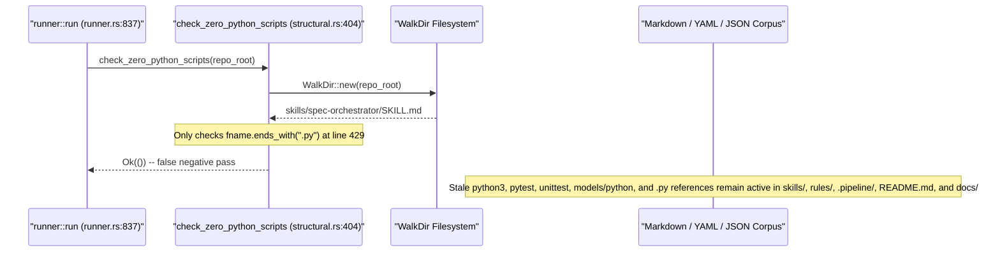

## 1. Context and References

<!-- test-target: crates/verify-baseline/src/checks/structural.rs -->

- **File**: `crates/verify-baseline/src/checks/structural.rs:404-453`
- **Pillar**: Semantic Traceability
- **Symptom**: Check 33 (`check_zero_python_scripts`) only inspects whether `.py` file extensions exist on disk (`fname.to_ascii_lowercase().ends_with(".py")`), completely failing to scan Markdown, YAML, and JSON files across `skills/`, `.agents/skills/`, `rules/`, `.pipeline/`, `README.md`, and `docs/` for stale operational Python and Pytest references (`python3`, `pytest`, `unittest`, `.py` script invocations, `models/python`, `pyproject.toml`, `PyYAML`).
- **Test-Target**: `crates/verify-baseline/src/checks/structural.rs`

## 2. Root Cause Analysis (5 Whys)

1. **Why does Check 33 report zero Python violations while operational documentation, skills, and rules still instruct agents to run Python scripts, `pytest`, and `models/python` engines?** Because `check_zero_python_scripts` at `crates/verify-baseline/src/checks/structural.rs:404-453` only checks filesystem entry extensions (`fname.to_ascii_lowercase().ends_with(".py")`) and never inspects file contents.
2. **Why does `check_zero_python_scripts` only inspect file extensions on disk instead of scanning text payloads?** Because Check 33 was originally implemented as a shallow directory-entry filter after deleting `.py` files from the working tree, assuming file deletion alone was sufficient to enforce the Pure-Rust Toolchain Invariant (`[REQ-CHECK-33-ZERO-PYTHON-SCRIPTS]`).
3. **Why did companion check `check_zero_retired_scripts_in_documentation` (`crates/verify-baseline/src/checks/structural.rs:1225-1319`) also fail to catch these stale Python references?** Because `check_zero_retired_scripts_in_documentation` only matches a static 14-item list of specific deleted script filenames (`create_issue.sh`, `verify_downstream_baseline.py`, etc.) and completely omits `rules/`, `.agents/skills/`, `.pipeline/` YAML/JSON configs, `docs/architecture/blueprints/`, and general Python/Pytest toolchain tokens (`python3`, `pytest`, `unittest`, `models/python`, `pyproject.toml`, `source_reference_validator.py`).
4. **Why did the existing unit tests (`test_check_33_zero_python_clean`, `test_check_33_zero_python_exempts_build_dirs_and_rejects_others`, and `test_check_33_zero_python_violation` at `crates/verify-baseline/src/checks/structural.rs:1603-1642`) pass without detecting this semantic gap?** Because the tests only create empty dummy `.py` and `.rs` files in temporary directories and never assert that Check 33 rejects operational `.md`, `.yaml`, `.yml`, or `.json` files containing `python3`, `pytest`, `unittest`, `.py` invocations, or `models/python` paths.
5. **Why is this a Semantic Traceability violation against `[REQ-CHECK-33-ZERO-PYTHON-SCRIPTS]`?** Because the stated safety intent of Check 33 (`crates/verify-baseline/src/checks/structural.rs:384-385`) is to enforce Rust-native toolchain purity, yet the verification assertion is mapped only to `.py` filename suffixes on disk rather than the complete invariant that zero operational Python/Pytest commands or references exist across the governing skills, rules, CI configurations, and documentation.

## 3. Correctness Analysis

When `verify_baseline::runner::run` (`crates/verify-baseline/src/runner.rs:837`) executes Check 33, it calls `check_zero_python_scripts(&repo_root)` (`crates/verify-baseline/src/checks/structural.rs:404-453`). Inside the `WalkDir` traversal loop (`crates/verify-baseline/src/checks/structural.rs:407-445`), every regular file is evaluated solely via:

- `let fname = entry.file_name().to_string_lossy();` (`structural.rs:428`)
- `let is_py = fname.to_ascii_lowercase().ends_with(".py") || entry.path().extension().map(|ext| ext.to_string_lossy().eq_ignore_ascii_case("py")).unwrap_or(false);` (`structural.rs:429-434`)

If `is_py` is `false`, the file is unconditionally ignored without reading its contents. Consequently, any `.md`, `.yaml`, `.yml`, or `.json` file across `skills/`, `.agents/skills/`, `rules/`, `.pipeline/`, `README.md`, and `docs/` can embed arbitrary operational Python toolchain instructions while Check 33 returns `Ok(())`.

Furthermore, `check_zero_retired_scripts_in_documentation` (`crates/verify-baseline/src/checks/structural.rs:1225-1319`) only scans `docs/` (excluding `designs`, `audits`, `blueprints`, `decisions` at lines `1256-1259`), `skills/`, `README.md`, `.pipeline/constitution.md`, and `.pipeline/upstream/pipeline-tooling.md` against 14 hardcoded filenames (`structural.rs:1229-1242`). It never scans `rules/`, `.agents/skills/`, or `.pipeline/` JSON/YAML files, and it ignores generic `.py` script references, `python3`, `pytest`, `unittest`, `pyproject.toml`, `PyYAML`, and `models/python`.

Empirical contamination currently bypassing Check 33 in the live repository includes:
- `README.md:151,177,195-200` -- declares `pyproject.toml`, `### 5.1 Prerequisites & Python 3.12 Setup`, and `Python scripts require PyYAML`.
- `skills/spec-orchestrator/SKILL.md:108,354` -- instructs agents that source references are enforced offline by `source_reference_validator.py` and that the backlog script parses frontmatter using `PyYAML`.
- `skills/feature-driven-implementation/SKILL.md:57-58` -- mandates Track B headless simulation engines at `models/python/<feature_slug>_domain.py`, `models/python/<feature_slug>_engine.py`, and `tests/test_<feature_slug>_simulation.py`.
- `rules/dual-track-mbd-verification.md:35-37,67,90-95,132` -- mandates `models/python/`, `*_domain.py`, `*_engine.py`, `test_*_simulation.py`, and `pytest-cov`.
- `rules/codebase-compliance.md:19,55-57` -- references `codebase.py` and `Python Source Must Not Hardcode Token Constants`.

This violates the Semantic Traceability invariant for `[REQ-CHECK-33-ZERO-PYTHON-SCRIPTS]`: the gate's test assertions pass on a repository that actively instructs subagents to invoke non-existent Python scripts and `pytest` runners.

## 4. UML Diagrams



## 5. Affected Callers / Downstream Impact

- `verify_baseline::runner::run` (`crates/verify-baseline/src/runner.rs:836-845`) -- reports `Success: Check 33 verified (Zero Python Scripts Invariant passed -- zero .py files exist on disk)` even when operational markdown, YAML, and JSON files instruct agents to run `python3`, `pytest`, or retired `.py` scripts.
- `check_handoff_and_backlog_integrity` (`crates/verify-baseline/src/checks/structural.rs:1082-1085`) and `check_zero_retired_scripts_in_documentation` (`crates/verify-baseline/src/checks/structural.rs:1225-1319`) -- leaves `rules/`, `.agents/skills/`, `docs/architecture/blueprints/`, and `.pipeline/` configs unscanned for stale Python/Pytest references.
- `crates/verify-baseline/src/checks/structural.rs:1603-1642` (`test_check_33_zero_python_clean`, `test_check_33_zero_python_exempts_build_dirs_and_rejects_others`, `test_check_33_zero_python_violation`) -- unit tests pass vacuously without testing content-level Python reference rejection.
- Autonomous subagents dispatched under `skills/spec-orchestrator/SKILL.md`, `skills/feature-driven-implementation/SKILL.md`, and `rules/dual-track-mbd-verification.md` -- receive conflicting governance instructions referencing `source_reference_validator.py`, `models/python/*_engine.py`, `pytest`, and `Python 3.12+` in a pure-Rust repository.

## 6. Proposed Correction

```rust
pub fn check_zero_python_scripts(repo_root: &Path) -> Result<(), Vec<String>> {
    let mut violations = Vec::new();

    for entry_res in WalkDir::new(repo_root)
        .into_iter()
        .filter_entry(|e| {
            if e.file_type().is_dir() {
                let name = e.file_name().to_string_lossy();
                name != "target"
                    && name != ".git"
                    && name != "build"
                    && name != "Pods"
                    && name != "ephemeral"
                    && name != ".dart_tool"
            } else {
                true
            }
        })
    {
        let entry = match entry_res {
            Ok(e) => e,
            Err(err) => {
                violations.push(format!("Check 33 I/O error: {}", err));
                continue;
            }
        };
        if entry.file_type().is_file() {
            let fname = entry.file_name().to_string_lossy();
            let is_py = fname.to_ascii_lowercase().ends_with(".py")
                || entry
                    .path()
                    .extension()
                    .map(|ext| ext.to_string_lossy().eq_ignore_ascii_case("py"))
                    .unwrap_or(false);
            if is_py {
                let rel = entry
                    .path()
                    .strip_prefix(repo_root)
                    .unwrap_or(entry.path())
                    .display()
                    .to_string();
                violations.push(rel);
            }
        }
    }

    scan_governed_files_for_python_references(repo_root, &mut violations);

    if violations.is_empty() {
        Ok(())
    } else {
        violations.sort();
        violations.dedup();
        Err(violations)
    }
}
```

## 7. Relationship to Existing Issues

Discovered in audit -- new finding (refs #441, #450, #465).

## Audit Source

Adversarial Semantic Traceability Audit
SEVERITY: Important
FILE_LOCATION: crates/verify-baseline/src/checks/structural.rs:404-453
