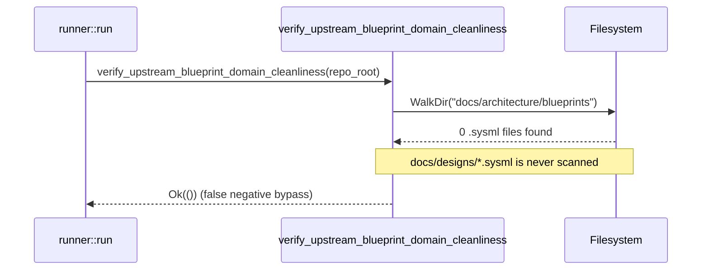

## 1. Context and References

<!-- test-target: crates/verify-baseline/src/checks/structural.rs -->

- **File**: `crates/verify-baseline/src/checks/structural.rs:260-291`
- **Pillar**: Semantic Traceability
- **Symptom**: Check 18 (`verify_upstream_blueprint_domain_cleanliness`) hardcodes `docs/architecture/blueprints` when scanning for forbidden `.sysml` modeling files and never traverses `docs/designs/`, allowing `docs/designs/blueprint-01..06-*.sysml` or any orphan `.sysml` files under `docs/designs/` to bypass upstream blueprint cleanliness verification.
- **Test-Target**: `crates/verify-baseline/src/checks/structural.rs`

## 2. Root Cause Analysis (5 Whys)

1. **Why do `.sysml` modeling files in `docs/designs/` bypass Check 18 in `UPSTREAM_SPEC_CORE_COMPILER`?** Because `verify_upstream_blueprint_domain_cleanliness` in `crates/verify-baseline/src/checks/structural.rs:261` constructs only `let blueprints_dir = repo_root.join("docs").join("architecture").join("blueprints");` and never inspects `repo_root.join("docs").join("designs")`.
2. **Why does line 261 only inspect `docs/architecture/blueprints` instead of both blueprint directories?** Because the Step 2 `.sysml` directory scan was implemented against a single path variable rather than iterating over all directories that house blueprint artifacts (`docs/architecture/blueprints` and `docs/designs`).
3. **Why did engineering design blueprints come to reside in `docs/designs/` alongside `docs/architecture/blueprints/`?** Because the `spec-blueprint-engineering` skill and `blueprint_gate` (`crates/verify-baseline/src/blueprint_gate.rs`) store contract-bounded design blueprints (`blueprint-01..06-*.md`) and their companion SysML v2 models (`blueprint-01..06-*.sysml`) under `docs/designs/`.
4. **Why did existing unit tests for Check 18 not catch the omission of `docs/designs/`?** Because the negative test fixtures for `verify_upstream_blueprint_domain_cleanliness` only seeded `.sysml` files inside `docs/architecture/blueprints/` and never asserted that `.sysml` files inside `docs/designs/` trigger a Check 18 failure.
5. **Why is there a semantic traceability gap between `[REQ-CHECK-18-UPSTREAM-BLUEPRINT-CLEANLINESS]` and its implementation?** Because the requirement mandates zero concrete `.sysml` modeling files across upstream blueprint directories, but the implementation bound that invariant to a single hardcoded directory path without covering `docs/designs/`.

## 3. Correctness Analysis

In `crates/verify-baseline/src/checks/structural.rs:206-308`, `verify_upstream_blueprint_domain_cleanliness(repo_root: &Path)` enforces `[REQ-CHECK-18-UPSTREAM-BLUEPRINT-CLEANLINESS]` whenever `is_upstream_compiler(repo_root)` returns `true` (line 207).

At line 260, comment `// 2. Enforce zero concrete modeling files (.sysml) in upstream blueprints` declares the invariant that no `.sysml` files may exist in upstream blueprint directories. However, line 261 binds a single path:
`let blueprints_dir = repo_root.join("docs").join("architecture").join("blueprints");`
Lines 262-291 traverse only `blueprints_dir` with `WalkDir::new(&blueprints_dir)` and push `"Upstream blueprint contains SysML model: {rel}"` when `fname.to_lowercase().ends_with(".sysml")` (lines 280-288).

When downstream design blueprint `.sysml` artifacts (such as `docs/designs/blueprint-01-*.sysml` through `docs/designs/blueprint-06-*.sysml` or any orphan `.sysml` file) are present under `docs/designs/` in an `UPSTREAM_SPEC_CORE_COMPILER` repository, `verify_upstream_blueprint_domain_cleanliness` never visits `docs/designs/` and returns `Ok(())` at line 299. Consequently, `verify_baseline::runner::run` (`crates/verify-baseline/src/runner.rs:522-525`) falsely prints `"Success: Check 18 verified (Upstream architecture blueprints are clean with zero domain concept papers or sysml models)."` even when concrete `.sysml` models exist in `docs/designs/`.

## 4. UML Diagrams



## 5. Affected Callers / Downstream Impact

- `verify_baseline::runner::run` (`crates/verify-baseline/src/runner.rs:522`) -- invokes `verify_upstream_blueprint_domain_cleanliness(&repo_root)` for Check 18 and falsely reports upstream blueprint cleanliness when `.sysml` files exist under `docs/designs/`.
- `verify-baseline` CLI binary (`crates/verify-baseline/src/main.rs`) -- exits `0` during upstream baseline verification despite concrete `.sysml` models residing in `docs/designs/`.

## 6. Proposed Correction

<!-- MUST NOT use regex (Check 34: deterministic linear slice/char scanning, no regex crate). MUST be domain-agnostic for upstream crates (Check 19). -->

```rust
    // 2. Enforce zero concrete modeling files (.sysml) in upstream blueprints and designs
    let blueprint_dirs = [
        repo_root.join("docs").join("architecture").join("blueprints"),
        repo_root.join("docs").join("designs"),
    ];
    for blueprints_dir in &blueprint_dirs {
        if blueprints_dir.is_dir() {
            for entry_res in WalkDir::new(blueprints_dir)
                .into_iter()
                .filter_entry(|e| {
                    if e.file_type().is_dir() {
                        let name = e.file_name().to_string_lossy();
                        !EXCLUDED_DIRS.iter().any(|ex| name == ex)
                    } else {
                        true
                    }
                })
            {
                let entry = match entry_res {
                    Ok(e) => e,
                    Err(_) => continue,
                };
                if entry.file_type().is_file() {
                    let fname = entry.file_name().to_string_lossy();
                    if fname.to_lowercase().ends_with(".sysml") {
                        let rel = entry
                            .path()
                            .strip_prefix(repo_root)
                            .unwrap_or(entry.path())
                            .display()
                            .to_string();
                        violations.push(format!("Upstream blueprint contains SysML model: {}", rel));
                    }
                }
            }
        }
    }
```

## 7. Relationship to Existing Issues

Discovered in audit -- new finding.

## Audit Source

Adversarial Semantic Traceability Audit
SEVERITY: Important
FILE_LOCATION: crates/verify-baseline/src/checks/structural.rs:260-291
