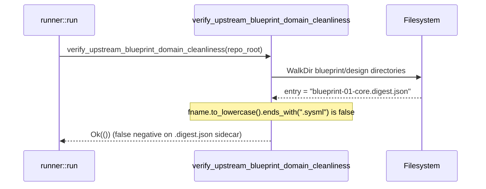

## 1. Context and References

<!-- test-target: crates/verify-baseline/src/checks/structural.rs -->

- **File**: `crates/verify-baseline/src/checks/structural.rs:255-308`
- **Pillar**: Semantic Traceability
- **Symptom**: Check 18 (`verify_upstream_blueprint_domain_cleanliness`) at `crates/verify-baseline/src/checks/structural.rs:280` checks only `fname.to_lowercase().ends_with(".sysml")` and ignores `.digest.json` compiled model sidecars (`blueprint-01..06-*.digest.json`), allowing compiled schema digests to reside in upstream blueprint and design directories without triggering a cleanliness violation.
- **Test-Target**: `crates/verify-baseline/src/checks/structural.rs`

## 2. Root Cause Analysis (5 Whys)

1. **Why do `.digest.json` compiled model sidecars in upstream blueprint directories bypass Check 18?** Because `verify_upstream_blueprint_domain_cleanliness` in `crates/verify-baseline/src/checks/structural.rs:280` predicates its file extension check solely on `fname.to_lowercase().ends_with(".sysml")` and does not test for `.digest.json`.
2. **Why does line 280 only check for `.sysml` instead of both `.sysml` and `.digest.json`?** Because the Step 2 upstream blueprint cleanliness filter was written assuming raw `.sysml` source files were the only concrete model artifacts generated alongside blueprints.
3. **Why do `.digest.json` sidecar files exist alongside `.sysml` blueprint models?** Because the `spec-blueprint-engineering` workflow and `blueprint_gate` compile each `blueprint-01..06-*.sysml` model into a companion `blueprint-01..06-*.digest.json` deterministic SHA-256/AST digest sidecar file.
4. **Why did existing unit tests for `verify_upstream_blueprint_domain_cleanliness` not detect that `.digest.json` sidecars bypass Check 18?** Because the unit tests only seeded `.sysml` files when testing Check 18 negative cases and never tested whether residual `blueprint-01..06-*.digest.json` sidecar artifacts are rejected in `UPSTREAM_SPEC_CORE_COMPILER` mode.
5. **Why does this violate semantic traceability for `[REQ-CHECK-18-UPSTREAM-BLUEPRINT-CLEANLINESS]`?** Because `[REQ-CHECK-18-UPSTREAM-BLUEPRINT-CLEANLINESS]` mandates that upstream specification core compiler repositories remain free of concrete domain modeling artifacts, yet compiled `.digest.json` model sidecars bypass the predicate at line 280 and pass verification silently.

## 3. Correctness Analysis

In `crates/verify-baseline/src/checks/structural.rs:206-308`, `verify_upstream_blueprint_domain_cleanliness(repo_root: &Path)` enforces `[REQ-CHECK-18-UPSTREAM-BLUEPRINT-CLEANLINESS]` when `is_upstream_compiler(repo_root)` is `true`.

During Step 2 (`crates/verify-baseline/src/checks/structural.rs:260-291`), the directory walker inspects each file entry (lines 278-289):
- Line 279 extracts the filename: `let fname = entry.file_name().to_string_lossy();`
- Line 280 evaluates: `if fname.to_lowercase().ends_with(".sysml")`
- Only when that predicate is true does lines 281-287 record a violation (`"Upstream blueprint contains SysML model: {rel}"`).

When a compiled model digest sidecar such as `blueprint-01-architecture.digest.json` (or any `*.digest.json` artifact produced from `blueprint-01..06-*.sysml`) is left in an upstream blueprint or design directory, `fname.to_lowercase().ends_with(".sysml")` evaluates to `false`. The loop continues without recording a violation, and `verify_upstream_blueprint_domain_cleanliness` returns `Ok(())` at line 299, violating `[REQ-CHECK-18-UPSTREAM-BLUEPRINT-CLEANLINESS]`.

## 4. UML Diagrams



## 5. Affected Callers / Downstream Impact

- `verify_baseline::runner::run` (`crates/verify-baseline/src/runner.rs:522`) -- calls `verify_upstream_blueprint_domain_cleanliness(&repo_root)` for Check 18 and erroneously passes when `.digest.json` compiled model sidecars contaminate upstream blueprint or design directories.
- `verify-baseline` CLI binary (`crates/verify-baseline/src/main.rs`) -- exits `0` during upstream baseline verification without flagging residual `blueprint-01..06-*.digest.json` files.

## 6. Proposed Correction

<!-- MUST NOT use regex (Check 34: deterministic linear slice/char scanning, no regex crate). MUST be domain-agnostic for upstream crates (Check 19). -->

```rust
            if entry.file_type().is_file() {
                let fname = entry.file_name().to_string_lossy();
                let lower = fname.to_lowercase();
                if lower.ends_with(".sysml") || lower.ends_with(".digest.json") {
                    let rel = entry
                        .path()
                        .strip_prefix(repo_root)
                        .unwrap_or(entry.path())
                        .display()
                        .to_string();
                    violations.push(format!(
                        "Upstream blueprint contains concrete model or digest sidecar: {}",
                        rel
                    ));
                }
            }
```

## 7. Relationship to Existing Issues

Discovered in audit -- new finding.

## Audit Source

Adversarial Semantic Traceability Audit
SEVERITY: Important
FILE_LOCATION: crates/verify-baseline/src/checks/structural.rs:255-308
