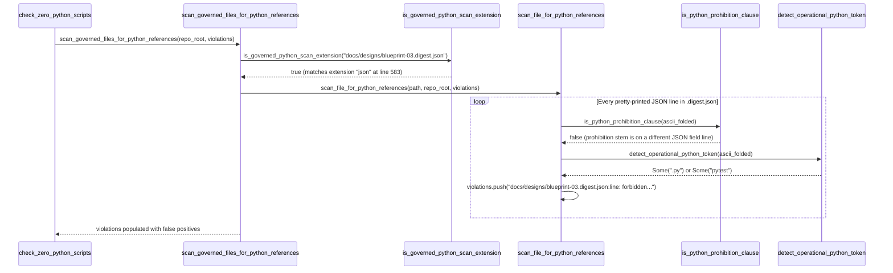

## 1. Context and References

<!-- test-target: crates/verify-baseline/tests/check33_digest_sidecar_tests.rs -->

- **File**: `crates/verify-baseline/src/checks/structural.rs:499-645`
- **Pillar**: Semantic Traceability
- **Symptom**: `scan_governed_files_for_python_references` (`structural.rs:499-551`) walks `docs/` (line 505) and scans every `.json` file matched by `is_governed_python_scan_extension` (line 583) line-by-line via `scan_file_for_python_references` (`structural.rs:613-643`). When machine-generated `docs/designs/blueprint-01..06-*.digest.json` sidecar files contain serialized Rust docstrings or requirement fields referencing `.py` or `pytest` split across JSON property lines from their governance prohibition keywords (`is_python_prohibition_clause`, lines 671-680), Check 33 falsely fails closed.
- **Test-Target**: `crates/verify-baseline/tests/check33_digest_sidecar_tests.rs`

## 2. Root Cause Analysis (5 Whys)

1. **Why does Check 33 (`check_zero_python_scripts`) falsely fail closed when `docs/designs/blueprint-01..06-*.digest.json` sidecars are present on disk?** Because `scan_file_for_python_references` (`crates/verify-baseline/src/checks/structural.rs:613-643`) flags individual JSON property lines inside `.digest.json` sidecar files that mention `.py` or `pytest` without containing a prohibition keyword on that exact same line.
2. **Why do lines inside `docs/designs/blueprint-01..06-*.digest.json` mention `.py` or `pytest` without a prohibition keyword on the same line?** Because `.digest.json` files are machine-generated structured AST and docstring digests produced by `emit-blueprint-digest`, where `serde_json::to_string_pretty` serializes multi-part requirement records and 7-section Rust docstrings (`summary`, `invariants`, `postconditions`, `failure_modes`) onto separate JSON lines from the prohibition context.
3. **Why does `scan_file_for_python_references` evaluate `.digest.json` sidecar files as line-oriented prose?** Because `scan_governed_files_for_python_references` (`structural.rs:505, 539-541`) recursively walks all of `docs/` and invokes `scan_file_for_python_references` on every file where `is_governed_python_scan_extension(entry.path())` returns `true`.
4. **Why does `is_governed_python_scan_extension` (`structural.rs:578-584`) return `true` for `docs/designs/blueprint-*.digest.json`?** Because `is_governed_python_scan_extension` only inspects the final path extension via `path.extension()` and matches `"json"` at line 583 without checking whether the file is a machine-generated `.digest.json` sidecar artifact.
5. **Why was no exclusion guard added for `.digest.json` sidecars in `is_governed_python_scan_extension` or `scan_governed_files_for_python_references`?** Because Check 33 (`[REQ-CHECK-33-SCAN-GOVERNED-FILES]` and `[REQ-CHECK-33-GOVERNED-EXTENSIONS]`) assumed all `.json` files under `docs/` are hand-authored configuration files rather than machine-generated blueprint verification digest sidecars (`*.digest.json`) that mirror Rust source docstrings.

## 3. Correctness Analysis

The violated invariant is **Semantic Traceability of Normative Prohibition Context across Machine-Generated Blueprint Digests** (`[REQ-CHECK-33-SCAN-GOVERNED-FILES]` / `[REQ-CHECK-33-GOVERNED-EXTENSIONS]`): Check 33 must reject operational Python/Pytest invocations in governed prose and configuration without raising false-positive violations on machine-generated blueprint AST digest sidecars (`*.digest.json`) that serialize Rust compiler docstrings describing Check 33 itself.

Data flow from trigger to failure:
1. `check_zero_python_scripts(repo_root)` (`crates/verify-baseline/src/checks/structural.rs:413-468`) invokes `scan_governed_files_for_python_references(repo_root, &mut violations)` at line 459.
2. `scan_governed_files_for_python_references` (`structural.rs:499-551`) includes `repo_root.join("docs")` in `governed_dirs` at line 505 and walks every descendant entry via `WalkDir::new(dir_path)` at lines 516-542.
3. When `WalkDir` visits `docs/designs/blueprint-01..06-*.digest.json`, `entry.file_type().is_file()` is `true` and `is_governed_python_scan_extension(entry.path())` (`structural.rs:578-584`) extracts `path.extension()` (`"json"`) and returns `true` at line 583.
4. `scan_file_for_python_references(entry.path(), repo_root, violations)` (`structural.rs:613-643`) reads the pretty-printed JSON file and iterates over `content.lines().enumerate()` at line 627.
5. In `.digest.json` sidecars, serialized docstring fields such as `"postconditions": "Returns true if at least one boundary-terminated .py token exists..."` or `"summary": "Detects operational Python/Pytest references..."` occupy isolated JSON string lines that do not contain any stem from `is_python_prohibition_clause` (`structural.rs:671-680`: `"prohibit"`, `"forbid"`, `"retired"`, `"eliminat"`, `"zero python"`, `"never"`, `"ban"`, `"check 33"`).
6. Line 630 (`is_python_prohibition_clause(&ascii_folded)`) evaluates to `false`, and line 633 (`detect_operational_python_token(&ascii_folded)`) matches `"pytest"` (line 713) or `".py"` (line 723), pushing a false-positive violation at lines 634-640 and causing `check_zero_python_scripts` to return `Err(violations)` at line 466.

## 4. UML Diagrams



## 5. Affected Callers / Downstream Impact

- `check_zero_python_scripts` (`crates/verify-baseline/src/checks/structural.rs:413-468`) -- Falsely returns `Err(violations)` whenever `docs/designs/blueprint-01..06-*.digest.json` sidecar artifacts exist in the workspace and contain serialized docstrings mentioning `.py` or `pytest`.
- `verify-baseline` CLI (`./target/release/verify-baseline . --no-domain` and `check-blueprint`) -- Baseline verification fails closed on Check 33 after `emit-blueprint-digest` generates `.digest.json` sidecars under `docs/designs/`.

## 6. Proposed Correction

<!-- MUST NOT use regex (Check 34: deterministic linear slice/char scanning, no regex crate). MUST be domain-agnostic for upstream crates (Check 19). -->

Update `is_governed_python_scan_extension` in `crates/verify-baseline/src/checks/structural.rs:578-584` to deterministically exclude machine-generated `.digest.json` sidecar files using linear ASCII case-insensitive suffix scanning (`ends_with(".digest.json")`) with zero regular expressions:

```rust
fn is_governed_python_scan_extension(path: &Path) -> bool {
    if let Some(file_name) = path.file_name() {
        let lower_name = file_name.to_string_lossy().to_ascii_lowercase();
        if lower_name.ends_with(".digest.json") {
            return false;
        }
    }
    let ext = match path.extension() {
        Some(e) => e.to_string_lossy().to_ascii_lowercase(),
        None => return false,
    };
    matches!(ext.as_str(), "md" | "yaml" | "yml" | "json" | "toml")
}
```

## 7. Relationship to Existing Issues

Discovered in audit -- new finding.

## Audit Source

Adversarial Semantic Traceability Audit
SEVERITY: Important
FILE_LOCATION: crates/verify-baseline/src/checks/structural.rs:499-645
