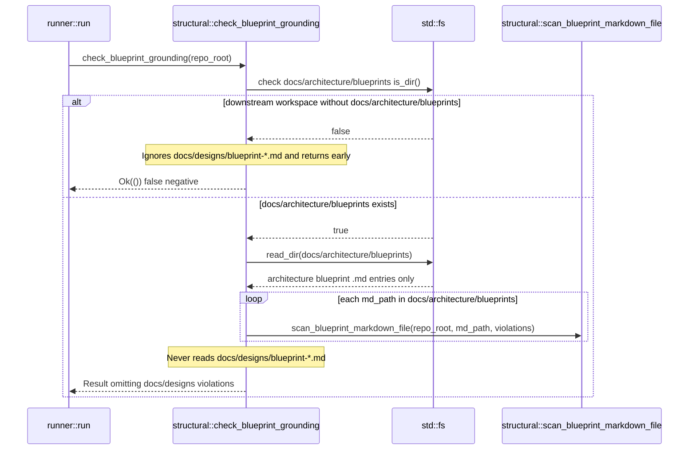

## 1. Context and References

<!-- test-target: crates/verify-baseline/tests/check_37_designs_blueprint_grounding_tests.rs -->

- **File**: `crates/verify-baseline/src/checks/structural.rs:1813-1891`
- **Pillar**: Semantic Traceability
- **Symptom**: `check_blueprint_grounding` (Check 37, `crates/verify-baseline/src/checks/structural.rs:1813-1891`) hardcodes `let blueprints_dir = repo_root.join("docs").join("architecture").join("blueprints");` at lines 1814-1817 and only enumerates `.md` files inside `docs/architecture/blueprints` at lines 1849-1877, completely ignoring engineering design blueprints stored at `docs/designs/blueprint-*.md` (such as `docs/designs/blueprint-01..06-*.md`).
- **Test-Target**: `crates/verify-baseline/tests/check_37_designs_blueprint_grounding_tests.rs`

## 2. Root Cause Analysis (5 Whys)

1. **Why does Check 37 (`check_blueprint_grounding`) pass when `docs/designs/blueprint-01..06-*.md` contain ungrounded `crates/...` paths, fictional crate names, retired Python/shell scripts, or Unicode em dashes?** Because `check_blueprint_grounding` never scans any files under `docs/designs/`.
2. **Why does `check_blueprint_grounding` never scan `docs/designs/`?** Because lines 1814-1817 bind a single directory `let blueprints_dir = repo_root.join("docs").join("architecture").join("blueprints");` and lines 1850-1877 only call `fs::read_dir(&blueprints_dir)`.
3. **Why does `check_blueprint_grounding` return early in downstream workspaces that contain `docs/designs/blueprint-*.md`?** Because lines 1818-1820 evaluate `if !blueprints_dir.is_dir() && !is_upstream_compiler(repo_root) { return Ok(()); }` without checking whether `repo_root.join("docs").join("designs")` exists and contains `blueprint-*.md` files.
4. **Why was `docs/designs/blueprint-*.md` omitted from `check_blueprint_grounding`?** Because Check 37 was originally scoped only to upstream `CanonicalArchitectureBlueprint::ALL` files in `docs/architecture/blueprints/` and was not updated when contract-bounded design blueprints (`docs/designs/blueprint-XX-<slug>.md`, governed by `crates/verify-baseline/src/blueprint_gate.rs`) were introduced as a second blueprint landing zone.
5. **Why did existing tests not catch this traceability gap?** Because unit tests for `check_blueprint_grounding` only seeded fixtures under `docs/architecture/blueprints/` and never asserted that `docs/designs/blueprint-*.md` files are subjected to `scan_blueprint_markdown_file` grounding checks.

## 3. Correctness Analysis

In `crates/verify-baseline/src/checks/structural.rs:1813-1891`, `check_blueprint_grounding(repo_root: &Path)` enforces Check 37 (Blueprint Grounding Gate):
- At lines 1814-1817, it constructs `blueprints_dir = repo_root.join("docs").join("architecture").join("blueprints")`.
- At lines 1818-1820, if `!blueprints_dir.is_dir() && !is_upstream_compiler(repo_root)` holds, the function immediately returns `Ok(())`. In downstream workspaces (`!is_upstream_compiler(repo_root)`), `docs/architecture/blueprints/` is absent by design (Check 12 forbids duplicating upstream master blueprints in downstream projects), whereas engineering design blueprints reside in `docs/designs/blueprint-01..06-*.md`. Consequently, Check 37 unconditionally short-circuits to `Ok(())` in downstream projects even when `docs/designs/blueprint-*.md` exist.
- At lines 1849-1882, even when `docs/architecture/blueprints/` is present, `md_files` is populated exclusively from `fs::read_dir(&blueprints_dir)` before invoking `scan_blueprint_markdown_file(repo_root, md_path, &mut violations)` (lines 1880-1882, defined at lines 1922-1955).
- This violates the **Blueprint Grounding Semantic Traceability Invariant**: every blueprint markdown artifact in both `docs/architecture/blueprints/*.md` and `docs/designs/blueprint-*.md` must be scanned by `scan_blueprint_markdown_file` for forbidden Unicode em dashes (`\u{2014}`), fictional crate tokens, retired Python/shell tooling references, and non-existent `crates/...` paths.

## 4. UML Diagrams



## 5. Affected Callers / Downstream Impact

- `verify_baseline::runner::run` (`crates/verify-baseline/src/runner.rs:887-901`) -- invokes `check_blueprint_grounding(&repo_root)` for Check 37 and falsely reports Check 37 passing when `docs/designs/blueprint-01..06-*.md` contain ungrounded crate paths, fictional crate names, retired script references, or Unicode em dashes.
- `verify_baseline::blueprint_gate` (`crates/verify-baseline/src/blueprint_gate.rs:1-71`) -- validates structural 7-section layout and metadata tables of `docs/designs/blueprint-*.md` via `check-blueprint`, relying on Check 37 during full baseline runs to verify workspace path and crate grounding.

## 6. Proposed Correction

<!-- MUST NOT use regex (Check 34: deterministic linear slice/char scanning, no regex crate). MUST be domain-agnostic for upstream crates (Check 19). -->

```rust
pub fn check_blueprint_grounding(repo_root: &Path) -> Result<(), Vec<String>> {
    let blueprints_dir = repo_root
        .join("docs")
        .join("architecture")
        .join("blueprints");
    let designs_dir = repo_root.join("docs").join("designs");
    let has_designs_dir = designs_dir.is_dir();

    if !blueprints_dir.is_dir() && !has_designs_dir && !is_upstream_compiler(repo_root) {
        return Ok(());
    }

    let mut violations = Vec::new();
    if !blueprints_dir.is_dir() && is_upstream_compiler(repo_root) {
        violations.push(
            "Missing docs/architecture/blueprints directory in upstream specification compiler repository."
                .to_string(),
        );
        return Err(violations);
    }

    if blueprints_dir.is_dir() {
        for bp in CanonicalArchitectureBlueprint::ALL {
            if !is_upstream_compiler(repo_root)
                && matches!(
                    bp,
                    CanonicalArchitectureBlueprint::SysmlSsotBidirectionalSynchronizationArchitecture
                )
            {
                continue;
            }
            let bp_path = blueprints_dir.join(bp.as_str());
            if !bp_path.is_file() {
                violations.push(format!(
                    "Missing canonical architecture blueprint: docs/architecture/blueprints/{}",
                    bp.as_str()
                ));
            }
        }
    }

    let mut md_files = Vec::new();
    if blueprints_dir.is_dir() {
        match fs::read_dir(&blueprints_dir) {
            Ok(entries) => {
                for entry_res in entries {
                    match entry_res {
                        Ok(entry) => {
                            let path = entry.path();
                            if path.is_file()
                                && path.extension().map(|ext| ext == "md").unwrap_or(false)
                            {
                                md_files.push(path);
                            }
                        }
                        Err(err) => {
                            violations.push(format!(
                                "docs/architecture/blueprints: directory entry read error: {}",
                                err
                            ));
                        }
                    }
                }
            }
            Err(err) => {
                violations.push(format!(
                    "docs/architecture/blueprints: unable to read directory: {}",
                    err
                ));
            }
        }
    }

    if has_designs_dir {
        match fs::read_dir(&designs_dir) {
            Ok(entries) => {
                for entry_res in entries {
                    match entry_res {
                        Ok(entry) => {
                            let path = entry.path();
                            let is_blueprint_md = path
                                .file_name()
                                .and_then(|n| n.to_str())
                                .map(|name| name.starts_with("blueprint-") && name.ends_with(".md"))
                                .unwrap_or(false);
                            if path.is_file() && is_blueprint_md {
                                md_files.push(path);
                            }
                        }
                        Err(err) => {
                            violations.push(format!(
                                "docs/designs: directory entry read error: {}",
                                err
                            ));
                        }
                    }
                }
            }
            Err(err) => {
                violations.push(format!(
                    "docs/designs: unable to read directory: {}",
                    err
                ));
            }
        }
    }

    md_files.sort();
    for md_path in &md_files {
        scan_blueprint_markdown_file(repo_root, md_path, &mut violations);
    }

    if violations.is_empty() {
        Ok(())
    } else {
        violations.sort();
        violations.dedup();
        Err(violations)
    }
}
```

## 7. Relationship to Existing Issues

Discovered in audit -- new finding.

## Audit Source

Adversarial Semantic Traceability Audit
SEVERITY: Important
FILE_LOCATION: crates/verify-baseline/src/checks/structural.rs:1813-1891
