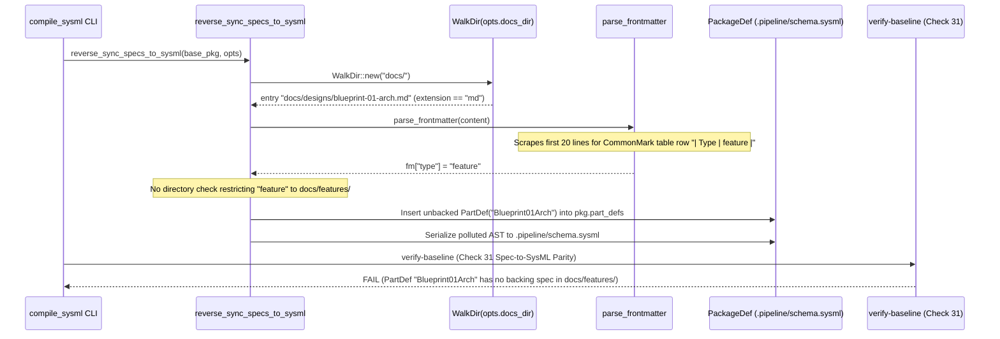

## 1. Context and References

<!-- test-target: crates/compile-sysml/tests/reverse_sync_designs_scope_tests.rs -->

- **File**: `crates/compile-sysml/src/sync/reverse.rs:288-446`
- **Pillar**: Semantic Traceability
- **Symptom**: `reverse_sync_specs_to_sysml` (`crates/compile-sysml/src/sync/reverse.rs:288-295`) recursively walks all of `opts.docs_dir` (`docs/`, descending into `docs/designs/`) while filtering only on `.md` extension (`line 295`). Because `parse_frontmatter` (`crates/compile-sysml/src/sync/reverse.rs:109-169`) parses YAML frontmatter or scrapes the first 20 lines for any 2-column CommonMark table (`lines 134-166`), any design document in `docs/designs/*.md` containing `| Type | feature |` (or `epic`, `user-story`, `use-case`) matches `doc_type` (`lines 302-446`) and injects unbacked `CapabilityDef`, `PartDef`, `InteractionDef`, or `UseCaseDef` AST nodes into `.pipeline/schema.sysml`, breaking Check 31 bidirectional specification-to-SysML parity.
- **Test-Target**: `crates/compile-sysml/tests/reverse_sync_designs_scope_tests.rs`

## 2. Root Cause Analysis (5 Whys)

1. **Why does `reverse_sync_specs_to_sysml` inject unbacked AST nodes into `.pipeline/schema.sysml` when `docs/designs/*.md` files are present?** Because `WalkDir::new(&opts.docs_dir)` (`crates/compile-sysml/src/sync/reverse.rs:288-295`) traverses every subdirectory under `docs/` -- including `docs/designs/` -- and feeds every `.md` file into `parse_frontmatter` and the `match doc_type` AST extraction arms (`lines 299-446`).
2. **Why does a design blueprint in `docs/designs/*.md` match `doc_type` values reserved for Agile backlog specifications (`"epic"`, `"feature"`, `"user-story"`, `"use-case"`)?** Because `parse_frontmatter` (`crates/compile-sysml/src/sync/reverse.rs:134-166`) falls back to scraping the first 20 lines of any Markdown file without YAML frontmatter for any 2-column pipe table `| key_cell | value_cell |`, normalizing `key_cell` to lowercase (`line 147`) and populating `fm["type"]` whenever a table row starts with `| Type |`.
3. **Why does `reverse_sync_specs_to_sysml` rely solely on `fm.get("type")` instead of verifying the file's parent directory under `opts.docs_dir`?** Because the traversal loop (`crates/compile-sysml/src/sync/reverse.rs:288-302`) assumed that `opts.docs_dir` would only contain canonical Agile backlog directories (`docs/epics/`, `docs/features/`, `docs/user-stories/`, `docs/use-cases/`) and `docs/safety/STPA_MATRIX.md`, omitting directory-scope predicates before executing backlog AST extraction.
4. **Why is skipping `.sysml` and `.digest.json` via `path.extension().map(|e| e == "md")` (`line 295`) insufficient once `docs/designs/` is populated?** Because Level 3B design engineering produces Markdown blueprints (`docs/designs/blueprint-XX-<slug>.md`) alongside companion `.sysml` and `.digest.json` artifacts; filtering by `.md` extension excludes `.sysml` and `.digest.json` but admits `blueprint-XX-<slug>.md` directly into backlog frontmatter scraping.
5. **Why was this directory scoping boundary violation not caught by existing reverse-sync unit tests?** Because the unit tests in `crates/compile-sysml/src/sync/reverse.rs:549-575` only populate `docs/features/` inside temporary directories and never test `reverse_sync_specs_to_sysml` with sibling `docs/designs/*.md` files containing CommonMark metadata tables.

## 3. Correctness Analysis

When `compile-sysml` runs reverse synchronization (`reverse_sync_specs_to_sysml` at `crates/compile-sysml/src/sync/reverse.rs:252-546`), it walks `&opts.docs_dir` using `WalkDir::new(&opts.docs_dir)` (`line 288`). At `line 295`, the only file filter applied is `if path.extension().map(|e| e == "md").unwrap_or(false)`. While this filter ignores `docs/designs/blueprint-XX-<slug>.sysml` and `docs/designs/blueprint-XX-<slug>.digest.json`, it reads every `docs/designs/blueprint-XX-<slug>.md` file (`line 296`) and passes its contents to `parse_frontmatter(&content)` (`line 299`).

Inside `parse_frontmatter` (`crates/compile-sysml/src/sync/reverse.rs:109-169`), if the Markdown file does not open with a `---` YAML frontmatter block (`lines 112-132`), execution enters the CommonMark 2-column metadata table fallback (`lines 134-166`), which inspects the first 20 lines (`for line in content.lines().take(20)` at `line 135`). Any 2-column Markdown table row such as `| Type | feature |` (or `| **Type** | `feature` |`, or `epic`, `user-story`, `use-case`) is normalized at `lines 141-152` into `fm.insert("type", "feature")`. Even if YAML frontmatter is present and declares `type: feature`, `parse_frontmatter` returns `fm["type"] = "feature"`.

Back in `reverse_sync_specs_to_sysml` (`line 300`), `doc_type` evaluates to `"feature"` (or `"epic"`, `"user-story"`, `"use-case"`):
- For `"epic"` (`lines 303-316`), an unbacked `CapabilityDef` derived from the design file's title or stem is pushed into `extracted_capabilities` and merged into `pkg.capability_defs` (`lines 483-487`).
- For `"feature"` (`lines 317-382`), `part_name` is resolved from `fm.get("part")`, `fm.get("part_def")`, or `to_pascal_case(&path.file_stem())` (`lines 318-334`), inserting a spurious `PartDef` into `extracted_parts` (`lines 337-342`), scraping any bulleted `` - `+Action() : Type` `` items from the entire design document body (`lines 346-380`), and merging them into `pkg.part_defs` (`lines 490-500`).
- For `"user-story"` (`lines 383-413`) and `"use-case"` (`lines 414-446`), unbacked `InteractionDef` and `UseCaseDef` nodes are pushed into `pkg.interaction_defs` (`lines 502-506`) and `pkg.use_case_defs` (`lines 508-512`).

Finally, `to_sysml(&pkg)` (`line 521`) serializes these polluted AST definitions into `.pipeline/schema.sysml` (`lines 529-534`). This violates the **Bidirectional Specification-to-SysML Parity Invariant (Check 31)** and **Model Coverage Invariant (Check 19)**, which mandate that every `CapabilityDef`, `PartDef`, `InteractionDef`, and `UseCaseDef` in `.pipeline/schema.sysml` traces 1-to-1 to an authoritative backlog specification under `docs/epics/`, `docs/features/`, `docs/user-stories/`, or `docs/use-cases/`.

## 4. UML Diagrams



## 5. Affected Callers / Downstream Impact

- `crates/compile-sysml/src/sync/reverse.rs:252` (`reverse_sync_specs_to_sysml`) -- Directly corrupts `.pipeline/schema.sysml` and `.pipeline/schema.sysml.digest.json` whenever any non-backlog Markdown document under `docs/` (such as `docs/designs/blueprint-XX-*.md`, `docs/architecture/*.md`, or `docs/research/*.md`) contains a frontmatter `type` key or a 2-column table row with key `Type` in its first 20 lines.
- `crates/compile-sysml/src/main.rs` (`--reverse-sync` / bidirectional sync mode) -- Propagates unbacked `PartDef`, `CapabilityDef`, `InteractionDef`, and `UseCaseDef` nodes into the workspace SSOT schema.
- `crates/verify-baseline` (Check 19 Model Coverage & Check 31 Bidirectional Spec-to-SysML Parity) -- Fails downstream baseline verification because the injected SysML AST nodes have no corresponding specification files in `docs/epics/`, `docs/features/`, `docs/user-stories/`, or `docs/use-cases/`.

## 6. Proposed Correction

<!-- MUST NOT use regex (Check 34: deterministic linear slice/char scanning, no regex crate). MUST be domain-agnostic for upstream crates (Check 19). -->

Scope backlog AST extraction inside `reverse_sync_specs_to_sysml` by inspecting the relative directory path under `opts.docs_dir` so that only canonical backlog directories (`epics`, `features`, `user-stories`, `use-cases`) and `safety/STPA_MATRIX.md` are processed, explicitly excluding `docs/designs/` and other non-backlog subdirectories:

```rust
    for entry in WalkDir::new(&opts.docs_dir)
        .sort_by_file_name()
        .into_iter()
        .filter_map(|e| e.ok())
        .filter(|e| e.file_type().is_file())
    {
        let path = entry.path();
        if path.extension().map(|e| e == "md").unwrap_or(false) {
            let rel_subdir = path
                .strip_prefix(&opts.docs_dir)
                .ok()
                .and_then(|rel| rel.components().next())
                .and_then(|comp| comp.as_os_str().to_str())
                .unwrap_or("");

            let is_stpa_matrix = rel_subdir == "safety"
                && path.file_name().map(|f| f == "STPA_MATRIX.md").unwrap_or(false);
            let is_backlog_dir = matches!(
                rel_subdir,
                "epics" | "features" | "user-stories" | "use-cases"
            );
            if !is_backlog_dir && !is_stpa_matrix {
                continue;
            }

            let content = fs::read_to_string(path)
                .map_err(|e| format!("Failed to read {}: {}", path.display(), e))?;

            let (fm, body) = parse_frontmatter(&content);
            let doc_type = fm.get("type").map(|s| s.as_str()).unwrap_or("");

            match (rel_subdir, doc_type) {
                ("epics", "epic") => {
                    // existing epic extraction
                }
                ("features", "feature") => {
                    // existing feature extraction
                }
                ("user-stories", "user-story") => {
                    // existing user-story extraction
                }
                ("use-cases", "use-case") => {
                    // existing use-case extraction
                }
                _ if is_stpa_matrix => {
                    // existing STPA_MATRIX.md extraction
                }
                _ => {}
            }
        }
    }
```

## 7. Relationship to Existing Issues

Discovered in audit -- new finding.

## Audit Source

Adversarial Semantic Traceability Audit
SEVERITY: Important
FILE_LOCATION: crates/compile-sysml/src/sync/reverse.rs:288-446
