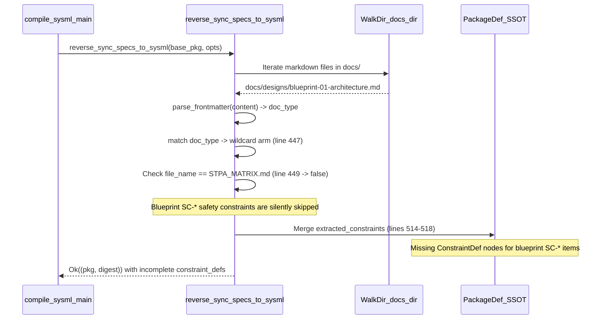

## 1. Context and References

<!-- test-target: crates/compile-sysml/tests/reverse_sync_blueprint_sc_reproducer_tests.rs -->

- **File**: `crates/compile-sysml/src/sync/reverse.rs:447-477`
- **Pillar**: Semantic Traceability
- **Symptom**: In `reverse_sync_specs_to_sysml` (`crates/compile-sysml/src/sync/reverse.rs:447-477`), the `_` wildcard arm checks exclusively `if path.file_name().map(|f| f == "STPA_MATRIX.md").unwrap_or(false)` (line 449), completely ignoring `SC-*` safety constraints declared in `docs/designs/blueprint-01..06-*.md`.
- **Test-Target**: `crates/compile-sysml/tests/reverse_sync_blueprint_sc_reproducer_tests.rs`

## 2. Root Cause Analysis (5 Whys)

1. **Why are `SC-*` safety constraints declared in `docs/designs/blueprint-01..06-*.md` omitted from `.pipeline/schema.sysml` after running `reverse_sync_specs_to_sysml`?** Because the `_` match arm in `reverse_sync_specs_to_sysml` (`crates/compile-sysml/src/sync/reverse.rs:447-477`) only scans markdown table rows when `path.file_name()` equals `"STPA_MATRIX.md"`.
2. **Why does the `_` match arm gate `SC-*` table extraction exclusively on `path.file_name() == "STPA_MATRIX.md"`?** Because line 449 hardcodes a single-filename equality check (`if path.file_name().map(|f| f == "STPA_MATRIX.md").unwrap_or(false)`) instead of matching design blueprint documents (`docs/designs/blueprint-*.md` or frontmatter `type: blueprint`).
3. **Why do design blueprint documents fall into the `_` wildcard arm without a dedicated or shared constraint extraction path?** Because `match doc_type` (`crates/compile-sysml/src/sync/reverse.rs:302-478`) only defines explicit arms for `"epic"`, `"feature"`, `"user-story"`, and `"use-case"`, routing all other specification documents to `_`.
4. **Why was `SC-*` constraint extraction not generalized across all safety-bearing specification artifacts in `docs/`?** Because reverse synchronization was initially implemented assuming `STPA_MATRIX.md` was the sole markdown carrier of `SC-*` rows, overlooking that contract-bounded design blueprints (`docs/designs/blueprint-XX-<slug>.md`) also declare normative 5-column STPA/FMECA `SC-*` safety constraint tables.
5. **Why did existing unit tests not catch the dropped blueprint `SC-*` constraints during reverse synchronization?** Because `crates/compile-sysml/src/sync/reverse.rs:556-576` only tests `parse_frontmatter` in isolation and lacks a semantic traceability test verifying that `SC-*` rows inside `docs/designs/blueprint-*.md` are reverse-synced into `PackageDef::constraint_defs`.

## 3. Correctness Analysis

When `reverse_sync_specs_to_sysml` (`crates/compile-sysml/src/sync/reverse.rs:252-554`) walks `opts.docs_dir` via `WalkDir::new(&opts.docs_dir)` (lines 288-295), it reads each `.md` file and extracts `(fm, body)` via `parse_frontmatter(&content)` (line 299) and `doc_type` from `fm.get("type")` (line 300).

For engineering design blueprints located under `docs/designs/blueprint-01..06-*.md` (which either carry `type: blueprint` in YAML frontmatter or have no `epic`/`feature`/`user-story`/`use-case` type), execution enters the `_ =>` wildcard arm at `crates/compile-sysml/src/sync/reverse.rs:447-477`. At line 449:
- `if path.file_name().map(|f| f == "STPA_MATRIX.md").unwrap_or(false)` evaluates to `false` for every `blueprint-*.md` file.
- Consequently, the table row scanner at lines 450-475 is completely bypassed for all `docs/designs/blueprint-01..06-*.md` files.
- Any `SC-*` safety constraint rows defined solely in design blueprints (or refined in design blueprints before `STPA_MATRIX.md` regeneration) are never pushed to `extracted_constraints` (lines 465-471) and never merged into `pkg.constraint_defs` (lines 514-518).

This violates the **Bidirectional Safety Constraint Traceability Invariant** (`[REQ-SYSML-SYNC-REVERSE/ENGINE-SYNC]`, `crates/compile-sysml/src/sync/reverse.rs:251`) and the **Schema Compliance Zero Loss Tolerance Invariant** (`.pipeline/constitution.md:60-63`), silently dropping blueprint safety constraints from the serialized `.pipeline/schema.sysml` SSOT model and its SHA-256 digest.

## 4. UML Diagrams



## 5. Affected Callers / Downstream Impact

- `crates/compile-sysml/src/main.rs:588` (`compile-sysml --reverse-sync`) -- Invokes `reverse_sync_specs_to_sysml(base_pkg.as_ref(), &opts)` to synchronize markdown specifications under `docs/` back into `.pipeline/schema.sysml`; any `SC-*` safety constraints authored in `docs/designs/blueprint-01..06-*.md` are silently omitted from `.pipeline/schema.sysml` and `.pipeline/schema-digest.json`.
- `crates/compile-sysml/src/sync/reverse.rs:252` (`reverse_sync_specs_to_sysml`) -- Library callers performing round-trip specification-to-SysML synchronization lose `ConstraintDef` AST nodes for blueprint-declared `SC-*` constraints, causing downstream verification and MBD export gates (`--export-mbd`) to operate on an incomplete safety constraint set.

## 6. Proposed Correction

<!-- MUST NOT use regex (Check 34: deterministic linear slice/char scanning, no regex crate). MUST be domain-agnostic for upstream crates (Check 19). -->

```rust
                _ => {
                    let is_stpa_or_blueprint = doc_type.eq_ignore_ascii_case("blueprint")
                        || path
                            .file_name()
                            .and_then(|f| f.to_str())
                            .map(|name| {
                                name == "STPA_MATRIX.md"
                                    || (name.starts_with("blueprint-") && name.ends_with(".md"))
                            })
                            .unwrap_or(false);
                    if is_stpa_or_blueprint {
                        for line in content.lines() {
                            let trimmed = line.trim();
                            if !trimmed.starts_with('|') {
                                continue;
                            }
                            let cols: Vec<&str> = trimmed.split('|').map(|s| s.trim()).collect();
                            if let &[_, sc_cell, stmt_cell, _, ..] = cols.as_slice() {
                                let raw_sc = sc_cell.trim_matches('*').trim_matches('`').trim();
                                if raw_sc
                                    .strip_prefix("SC-")
                                    .is_some_and(|digits| {
                                        !digits.is_empty()
                                            && digits.chars().all(|c| c.is_ascii_digit())
                                    })
                                {
                                    let stmt = stmt_cell.trim();
                                    if !stmt.is_empty() {
                                        let sc_id = raw_sc.replace('-', "_");
                                        let constraint_name = format!("{}_SafetyConstraint", sc_id);
                                        if !extracted_constraints
                                            .iter()
                                            .any(|c: &ConstraintDef| c.name == constraint_name)
                                        {
                                            extracted_constraints.push(ConstraintDef {
                                                name: constraint_name,
                                                doc: Some(stmt.to_string()),
                                                expression: format!("{} == true", sc_id),
                                                is_assertion: true,
                                                ..Default::default()
                                            });
                                        }
                                    }
                                }
                            }
                        }
                    }
                }
```

## 7. Relationship to Existing Issues

Discovered in audit -- new finding.

## Audit Source

Adversarial Semantic Traceability Audit
SEVERITY: Important
FILE_LOCATION: crates/compile-sysml/src/sync/reverse.rs:447-477
