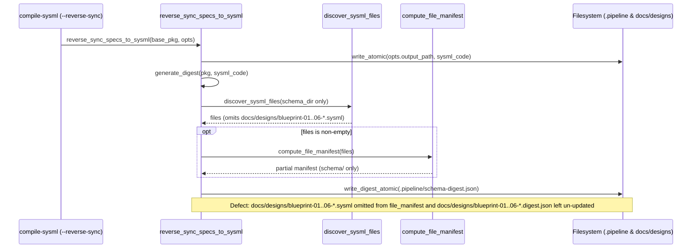

## 1. Context and References

<!-- test-target: crates/compile-sysml/tests/reproducer_tests.rs -->

- **File**: `crates/compile-sysml/src/sync/reverse.rs:515-547`
- **Pillar**: Semantic Traceability
- **Symptom**: reverse_sync_specs_to_sysml computes digest file_manifest only from schema/, omitting docs/designs/blueprint-*.sysml and leaving docs/designs/blueprint-*.digest.json un-updated
- **Test-Target**: `crates/compile-sysml/tests/reproducer_tests.rs`

## 2. Root Cause Analysis (5 Whys)

1. **Why does `.pipeline/schema-digest.json` omit `docs/designs/blueprint-01..06-*.sysml` from `file_manifest` and leave `docs/designs/blueprint-01..06-*.digest.json` un-updated after `reverse_sync_specs_to_sysml` executes?** Because `reverse_sync_specs_to_sysml` (`crates/compile-sysml/src/sync/reverse.rs:532-544`) discovers `.sysml` files exclusively from `schema_dir` (`opts.schema_path.as_deref().unwrap_or_else(|| std::path::Path::new("schema"))`) and writes only `opts.digest_path` (`.pipeline/schema-digest.json`).
2. **Why does `reverse_sync_specs_to_sysml` only call `discover_sysml_files(schema_dir)` at line 538?** Because lines 533-543 were authored under the assumption that all authoritative `.sysml` metamodel sources reside inside the root `schema/` directory.
3. **Why does that assumption fail when engineering design blueprints (`docs/designs/blueprint-01..06-*.md`) are present under `opts.docs_dir`?** Because the blueprint compilation gate (`verify-baseline check-blueprint` Check 10) compiles and persists in-repo SysML v2 metamodel fragments (`docs/designs/blueprint-01..06-*.sysml`) and companion digests (`docs/designs/blueprint-01..06-*.digest.json`) inside `docs/designs/` rather than `schema/`.
4. **Why are `docs/designs/blueprint-01..06-*.digest.json` files left stale or un-updated during reverse synchronization?** Because line 544 invokes `write_digest_atomic(&opts.digest_path, &digest)` only once for the aggregate `.pipeline/schema-digest.json` output and never iterates over discovered `docs/designs/blueprint-*.sysml` artifacts to recompute and persist their companion `.digest.json` files.
5. **Why was no test catching the missing `docs/designs/blueprint-*.sysml` manifest entries and un-updated blueprint digests during `--reverse-sync`?** Because unit tests in `crates/compile-sysml/src/sync/reverse.rs` only asserted AST entity merging (`pkg.part_defs`, `pkg.capability_defs`) and root digest creation without verifying `digest.file_manifest` coverage across `docs/designs/*.sysml` or companion `docs/designs/*.digest.json` synchronization.

## 3. Correctness Analysis

In `crates/compile-sysml/src/sync/reverse.rs:515-547`, after merging extracted capabilities, parts, interactions, use cases, and constraints into `pkg` and serializing `sysml_code = to_sysml(&pkg)` to `opts.output_path` (lines 515-529), `reverse_sync_specs_to_sysml` computes the cryptographic `SchemaDigest`:

- At line 532, `let mut digest = generate_digest(&pkg, &sysml_code);` initializes `digest` with an empty `file_manifest: Vec::new()`.
- At lines 533-536, `schema_dir` is bound exclusively to `opts.schema_path.as_deref().unwrap_or_else(|| std::path::Path::new("schema"))`.
- At lines 537-543, if `schema_dir.is_dir()` is true, `discover_sysml_files(schema_dir)` scans only `schema_dir`. When `opts.schema_path` points to a single file (such as `.pipeline/schema.sysml`, where `schema_dir.is_dir()` is `false`) or when `schema/` is a clean upstream landing zone containing only `.gitkeep` (`files.is_empty()` is `true`), `with_file_manifest` is skipped altogether. Even when `schema/` contains `.sysml` files, `discover_sysml_files` is never invoked on `opts.docs_dir.join("designs")` (i.e. `docs/designs/`).
- At line 544, `write_digest_atomic(&opts.digest_path, &digest)` writes only `.pipeline/schema-digest.json`.

This violates the **Cryptographic Digest & Semantic Traceability Invariant** (`crates/compile-sysml/src/sync/reverse.rs:14-15, 233`):
1. Any `.sysml` metamodel fragments residing under `docs/designs/` (`docs/designs/blueprint-01..06-*.sysml`) are excluded from `digest.file_manifest` in `.pipeline/schema-digest.json`, breaking file-level SHA-256 provenance tracking between `docs/designs/` and `.pipeline/schema-digest.json`.
2. Companion per-blueprint digest files (`docs/designs/blueprint-01..06-*.digest.json`) are never refreshed when `reverse_sync_specs_to_sysml` synchronizes `opts.docs_dir`, leaving their `file_manifest` and digest metadata out of sync with the reverse-synced specification state.

## 4. UML Diagrams



## 5. Affected Callers / Downstream Impact

- `crates/compile-sysml/src/main.rs:568-593` (`--reverse-sync` CLI dispatch) -- invokes `reverse_sync_specs_to_sysml(base_pkg.as_ref(), &opts)` with `opts.docs_dir` defaulting to `"docs/"` and `opts.digest_path` defaulting to `".pipeline/schema-digest.json"`, producing an incomplete `file_manifest` in `.pipeline/schema-digest.json` that omits `docs/designs/blueprint-*.sysml` and leaves `docs/designs/blueprint-*.digest.json` un-updated.
- `crates/verify-baseline` (Check 31 schema-digest parity and blueprint metamodel digest consumers) -- observes missing `docs/designs/blueprint-*.sysml` entries in `.pipeline/schema-digest.json` `file_manifest` and stale per-blueprint `.digest.json` files after reverse synchronization.

## 6. Proposed Correction

<!-- MUST NOT use regex (Check 34: deterministic linear slice/char scanning, no regex crate). MUST be domain-agnostic for upstream crates (Check 19). -->

```rust
    // Compute and write digest including both schema_dir and docs/designs/*.sysml
    let mut digest = generate_digest(&pkg, &sysml_code);
    let schema_dir = opts
        .schema_path
        .as_deref()
        .unwrap_or_else(|| std::path::Path::new("schema"));
    let mut manifest_files = Vec::new();
    if schema_dir.is_dir() {
        manifest_files.extend(crate::parser::grammar::discover_sysml_files(schema_dir));
    } else if schema_dir.is_file() {
        manifest_files.push(schema_dir.to_path_buf());
    }

    let designs_dir = opts.docs_dir.join("designs");
    if designs_dir.is_dir() {
        let design_sysml_files = crate::parser::grammar::discover_sysml_files(&designs_dir);
        for design_sysml in &design_sysml_files {
            if let Ok(design_src) = fs::read_to_string(design_sysml) {
                if let Ok(design_pkg) = crate::parser::grammar::parse_sysml(&design_src) {
                    let single_manifest = crate::semantic::digest::compute_file_manifest(
                        std::slice::from_ref(design_sysml),
                    );
                    let bp_digest = generate_digest(&design_pkg, &design_src)
                        .with_file_manifest(single_manifest);
                    let stem = design_sysml
                        .file_stem()
                        .and_then(|s| s.to_str())
                        .unwrap_or("blueprint");
                    let bp_digest_path = designs_dir.join(format!("{stem}.digest.json"));
                    let _ = write_digest_atomic(&bp_digest_path, &bp_digest);
                }
            }
            if !manifest_files.contains(design_sysml) {
                manifest_files.push(design_sysml.clone());
            }
        }
    }

    manifest_files.sort();
    manifest_files.dedup();
    if !manifest_files.is_empty() {
        let manifest = crate::semantic::digest::compute_file_manifest(&manifest_files);
        digest = digest.with_file_manifest(manifest);
    }
    write_digest_atomic(&opts.digest_path, &digest).map_err(|e| e.to_string())?;
```

## 7. Relationship to Existing Issues

Discovered in audit -- new finding.

## Audit Source

Adversarial Semantic Traceability Audit
SEVERITY: Important
FILE_LOCATION: crates/compile-sysml/src/sync/reverse.rs:515-547
