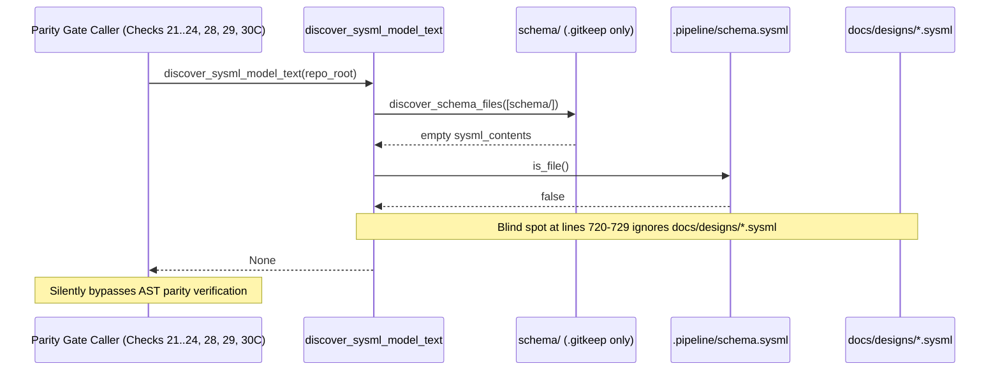

## 1. Context and References

<!-- test-target: crates/verify-baseline/tests/parity_gates_discover_sysml_tests.rs -->

- **File**: `crates/verify-baseline/src/checks/parity_gates.rs:681-735`
- **Pillar**: Semantic Traceability
- **Symptom**: `discover_sysml_model_text` inspects only `repo_root.join("schema")` (line 682) and `repo_root.join(".pipeline").join("schema.sysml")` (line 720), returning `None` (line 729) when `schema/` contains only `.gitkeep` even when `docs/designs/blueprint-01..06-*.sysml` models exist on disk, causing Checks 21, 22, 23, 24, 28, 29, and 30C to silently bypass model verification.
- **Test-Target**: `crates/verify-baseline/tests/parity_gates_discover_sysml_tests.rs`

## 2. Root Cause Analysis (5 Whys)

1. **Why do Checks 21, 22, 23, 24, 28, 29, and 30C bypass SysML v2 AST verification when `schema/` contains only `.gitkeep` and `docs/designs/*.sysml` files are present?** Because each of those checks invokes `discover_sysml_model_text(repo_root)` (`crates/verify-baseline/src/checks/parity_gates.rs:681-730`) and exits early when it returns `None`.
2. **Why does `discover_sysml_model_text(repo_root)` return `None` when six `docs/designs/blueprint-01..06-*.sysml` files exist in the repository?** Because lines 682-727 search only `repo_root.join("schema")` and `repo_root.join(".pipeline").join("schema.sysml")` before falling through to `None` at line 729.
3. **Why were `docs/designs/*.sysml` files omitted from `discover_sysml_model_text`?** Because the discovery helper was originally written assuming all SysML v2 models reside exclusively in `schema/` or `.pipeline/schema.sysml`.
4. **Why did engineering blueprint design models (`docs/designs/blueprint-XX-*.sysml`) become decoupled from `discover_sysml_model_text`?** Because design blueprint `.sysml` artifacts were introduced under `docs/designs/` while `schema/` is required to remain a clean landing zone (`.gitkeep` only) in upstream specification compiler repositories.
5. **Why was this blind spot not caught by existing baseline verification tests?** Because existing tests either populated `schema/` in temporary fixtures or accepted the silent early-return `Ok(())` path when `discover_sysml_model_text` returned `None`.

## 3. Correctness Analysis

In `crates/verify-baseline/src/checks/parity_gates.rs:681-730`, `discover_sysml_model_text(repo_root: &Path) -> Option<String>` performs two sequential filesystem probes:
1. At line 682, `let schema_dir = repo_root.join("schema");` is scanned via `deap_core::sysml_ast::UnifiedSchemaModelExtractor::discover_schema_files(&[&schema_dir])`. When `schema/` contains only `.gitkeep`, both `sysml_contents` (line 686) and `non_sysml_paths` (line 687) remain empty.
2. At line 720, `let pipeline_model = repo_root.join(".pipeline").join("schema.sysml");` is checked via `pipeline_model.is_file()`. When `.pipeline/schema.sysml` is absent, execution falls through to line 729 and returns `None`.

This violates the **Semantic Traceability & Model Coverage Invariant** (`.pipeline/constitution.md` Universal Model Consistency Rules and Quality Gates Checks 21-24, 28-29, 30C): when authoritative SysML v2 blueprint models exist under `docs/designs/` (`docs/designs/blueprint-01..06-*.sysml`), returning `None` from `discover_sysml_model_text` causes every downstream caller (`check_21` at line 903, `check_22` at line 1062, `check_23` at line 2131, `check_24` at line 2586, `check_28` at line 3540, `check_29` at line 3610, and `check_30c` at line 4151) to treat the workspace as having no SysML model at all and silently skip verification.

## 4. UML Diagrams



## 5. Affected Callers / Downstream Impact

- `crates/verify-baseline/src/checks/parity_gates.rs:903` (Check 21 Behavioral Trigger Coverage) -- returns early without verifying triggers when `discover_sysml_model_text` returns `None`.
- `crates/verify-baseline/src/checks/parity_gates.rs:1062` (Check 22 Structural & Behavioral Parity) -- bypasses model parity verification when `discover_sysml_model_text` returns `None`.
- `crates/verify-baseline/src/checks/parity_gates.rs:2131` (Check 23 Requirement & Constraint Traceability) -- skips SysML requirement verification when `discover_sysml_model_text` returns `None`.
- `crates/verify-baseline/src/checks/parity_gates.rs:2586` (Check 24 Use Case & Interaction Parity) -- skips interaction AST verification when `discover_sysml_model_text` returns `None`.
- `crates/verify-baseline/src/checks/parity_gates.rs:3540` (Check 28 Document Cross-Reference Integrity) -- skips SysML cross-reference validation when `discover_sysml_model_text` returns `None`.
- `crates/verify-baseline/src/checks/parity_gates.rs:3610` (Check 29 Constitution Amendment Integrity) -- skips model alignment verification when `discover_sysml_model_text` returns `None`.
- `crates/verify-baseline/src/checks/parity_gates.rs:4151` (Check 30C Source Reference Integrity) -- skips SysML AST symbol verification when `discover_sysml_model_text` returns `None`.

## 6. Proposed Correction

<!-- MUST NOT use regex (Check 34: deterministic linear slice/char scanning, no regex crate). MUST be domain-agnostic for upstream crates (Check 19). -->

```rust
pub fn discover_sysml_model_text(repo_root: &Path) -> Option<String> {
    let schema_dir = repo_root.join("schema");
    if schema_dir.is_dir() {
        let mut paths = deap_core::sysml_ast::UnifiedSchemaModelExtractor::discover_schema_files(&[&schema_dir]);
        paths.sort();
        let mut sysml_contents = Vec::new();
        let mut non_sysml_paths = Vec::new();

        for p in paths {
            let is_sysml = p.extension().is_some_and(|ext| ext == "sysml");
            if is_sysml {
                if let Ok(content) = fs::read_to_string(&p) {
                    if !content.trim().is_empty() {
                        sysml_contents.push(content);
                    }
                }
            } else {
                non_sysml_paths.push(p);
            }
        }

        if !sysml_contents.is_empty() {
            return Some(sysml_contents.join("\n\n"));
        }

        if !non_sysml_paths.is_empty() {
            let parts = deap_core::sysml_ast::UnifiedSchemaModelExtractor::extract_subsystem_parts(&non_sysml_paths);
            if !parts.is_empty() {
                let mut synthetic = String::new();
                synthetic.push_str("package DownstreamSchema {\n");
                for part in parts {
                    synthetic.push_str(&format!("    part def {};\n", part));
                }
                synthetic.push_str("}\n");
                return Some(synthetic);
            }
        }
    }

    let pipeline_model = repo_root.join(".pipeline").join("schema.sysml");
    if pipeline_model.is_file() {
        if let Ok(content) = fs::read_to_string(&pipeline_model) {
            if !content.trim().is_empty() {
                return Some(content);
            }
        }
    }

    let designs_dir = repo_root.join("docs").join("designs");
    if designs_dir.is_dir() {
        let mut paths = deap_core::sysml_ast::UnifiedSchemaModelExtractor::discover_schema_files(&[&designs_dir]);
        paths.sort();
        let mut design_sysml_contents = Vec::new();
        for p in paths {
            if p.extension().is_some_and(|ext| ext == "sysml") {
                if let Ok(content) = fs::read_to_string(&p) {
                    if !content.trim().is_empty() {
                        design_sysml_contents.push(content);
                    }
                }
            }
        }
        if !design_sysml_contents.is_empty() {
            return Some(design_sysml_contents.join("\n\n"));
        }
    }

    None
}
```

## 7. Relationship to Existing Issues

Discovered in audit -- new finding.

## Audit Source

Adversarial Semantic Traceability Audit
SEVERITY: Important
FILE_LOCATION: crates/verify-baseline/src/checks/parity_gates.rs:681-735
