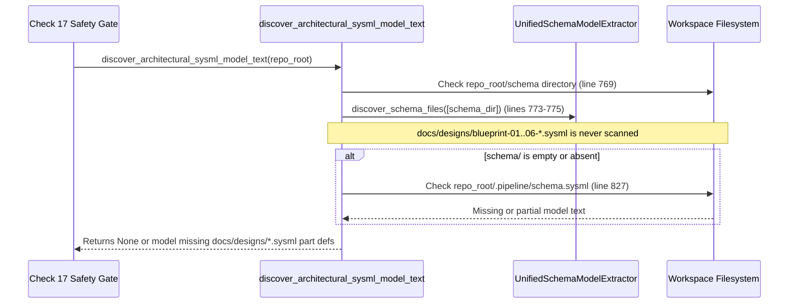

## 1. Context and References

<!-- test-target: crates/verify-baseline/tests/reproducer_tests.rs -->

- **File**: `crates/verify-baseline/src/checks/parity_gates.rs:767-871`
- **Pillar**: Semantic Traceability
- **Symptom**: `discover_architectural_sysml_model_text` (`crates/verify-baseline/src/checks/parity_gates.rs:767-871`) scans only `repo_root.join("schema")` (line 769) and `repo_root.join(".pipeline").join("schema.sysml")` (line 827), completely ignoring `docs/designs/blueprint-01..06-*.sysml` (`docs/designs/*.sysml`) architectural SysML v2 companion models.
- **Test-Target**: `crates/verify-baseline/tests/reproducer_tests.rs`

## 2. Root Cause Analysis (5 Whys)

1. **Why do architectural `part def` components declared in `docs/designs/blueprint-01..06-*.sysml` fail to participate in architectural SysML model discovery and Check 17 FMECA component coverage verification?** Because `discover_architectural_sysml_model_text` (`crates/verify-baseline/src/checks/parity_gates.rs:767-871`) never inspects `repo_root.join("docs").join("designs")` when discovering `.sysml` files.
2. **Why does `discover_architectural_sysml_model_text` never inspect `docs/designs/`?** Because line 769 hardcodes `let schema_dir = repo_root.join("schema");` and passes only `&[&schema_dir]` to `UnifiedSchemaModelExtractor::discover_schema_files(&[&schema_dir])` at lines 773-775.
3. **Why does the fallback path at lines 826-835 also miss `docs/designs/blueprint-01..06-*.sysml`?** Because when `resolved.is_none()`, line 827 only checks the single file `repo_root.join(".pipeline").join("schema.sysml")` and returns `None` at line 836 if neither `schema/` nor `.pipeline/schema.sysml` yields text.
4. **Why was `docs/designs/` omitted from `discover_architectural_sysml_model_text`?** Because the function was originally authored assuming all SysML v2 structural files reside exclusively in `schema/` or `.pipeline/schema.sysml`, before `spec-blueprint-engineering` introduced persisted `docs/designs/blueprint-XX-<slug>.sysml` metamodel artifacts.
5. **Why did existing verification tests not catch this discovery blind spot?** Because unit tests for `discover_architectural_sysml_model_text` only populated fixtures under `schema/` and `.pipeline/schema.sysml`, leaving `docs/designs/*.sysml` discovery untested against the Semantic Traceability invariant.

## 3. Correctness Analysis

When `discover_architectural_sysml_model_text(repo_root: &Path)` is invoked (`crates/verify-baseline/src/checks/parity_gates.rs:767`), execution proceeds through two hardcoded discovery locations:
1. Lines 769-824: Checks `let schema_dir = repo_root.join("schema");` and invokes `UnifiedSchemaModelExtractor::discover_schema_files(&[&schema_dir])` (lines 773-775), partitioning `.sysml` files into `domain_sysml_contents` (non-realization files, lines 794-796) and `all_sysml_contents` (line 797).
2. Lines 826-835: If `resolved.is_none()`, checks only `repo_root.join(".pipeline").join("schema.sysml")`.
3. Line 836: Evaluates `resolved?`, returning `None` if neither location produced model text, or omitting any `docs/designs/blueprint-01..06-*.sysml` definitions when `schema/` is present.

This violates the **100% Architectural SysML Metamodel Discovery & Check 17 FMECA Component Coverage Invariant** (`.pipeline/constitution.md` Phase 0 System Safety Assurance Gate Pillar 7 and Repository Artifact Management Mandate):
- In workspaces where design blueprints persist `docs/designs/blueprint-01..06-*.sysml` companion metamodels alongside `schema/`, any `part def` declared in `docs/designs/*.sysml` is silently excluded from `discover_architectural_sysml_model_text`, allowing `docs/safety/STPA_MATRIX.md` Pillar 7 FMECA tables to pass Check 17 with 0% failure-mode coverage of blueprint-defined `part def` components.
- In workspaces where `docs/designs/blueprint-01..06-*.sysml` are present before `schema/` or `.pipeline/schema.sysml` is populated, `discover_architectural_sysml_model_text` returns `None` at line 836 instead of discovering the blueprint SysML models.

## 4. UML Diagrams



## 5. Affected Callers / Downstream Impact

- `check_stpa_safety_matrix` (Check 17 in `crates/verify-baseline/src/checks/parity_gates.rs`) -- Uses `discover_architectural_sysml_model_text` to enumerate all architectural `part def` components requiring at least 3 failure modes in Pillar 7 FMECA and `docs/research/FAILURE_MODE_REGISTRY.md`. Because `docs/designs/*.sysml` is ignored, blueprint-declared `part def` components evade Check 17 FMECA completeness verification.
- Downstream verification callers of `discover_architectural_sysml_model_text` -- Receive `None` or an incomplete SysML AST whenever architectural `part def` declarations reside in `docs/designs/blueprint-01..06-*.sysml`.

## 6. Proposed Correction

<!-- MUST NOT use regex (Check 34: deterministic linear slice/char scanning, no regex crate). MUST be domain-agnostic for upstream crates (Check 19). -->

```rust
pub fn discover_architectural_sysml_model_text(repo_root: &Path) -> Option<String> {
    let raw_text = {
        let schema_dir = repo_root.join("schema");
        let designs_dir = repo_root.join("docs").join("designs");
        let mut resolved: Option<String> = None;

        let mut scan_roots: Vec<&Path> = Vec::new();
        if schema_dir.is_dir() {
            scan_roots.push(schema_dir.as_path());
        }
        if designs_dir.is_dir() {
            scan_roots.push(designs_dir.as_path());
        }

        if !scan_roots.is_empty() {
            let mut paths =
                deap_core::sysml_ast::UnifiedSchemaModelExtractor::discover_schema_files(
                    &scan_roots,
                );
            paths.sort();
            let mut domain_sysml_contents = Vec::new();
            let mut all_sysml_contents = Vec::new();
            let mut non_sysml_paths = Vec::new();

            for p in paths {
                let is_sysml = p.extension().is_some_and(|ext| ext == "sysml");
                if is_sysml {
                    let is_realization_file = p
                        .file_stem()
                        .and_then(|s| s.to_str())
                        .map(|stem| {
                            let lower = stem.to_ascii_lowercase();
                            lower == "realization" || lower.ends_with("_realization")
                        })
                        .unwrap_or(false);
                    if let Ok(content) = fs::read_to_string(&p) {
                        if !content.trim().is_empty() {
                            if !is_realization_file {
                                domain_sysml_contents.push(content.clone());
                            }
                            all_sysml_contents.push(content);
                        }
                    }
                } else if p.starts_with(&schema_dir) {
                    non_sysml_paths.push(p);
                }
            }

            if !domain_sysml_contents.is_empty() {
                resolved = Some(domain_sysml_contents.join("\n\n"));
            } else if !all_sysml_contents.is_empty() {
                resolved = Some(all_sysml_contents.join("\n\n"));
            } else if !non_sysml_paths.is_empty() {
                let parts =
                    deap_core::sysml_ast::UnifiedSchemaModelExtractor::extract_subsystem_parts(
                        &non_sysml_paths,
                    );
                if !parts.is_empty() {
                    let mut synthetic = String::new();
                    synthetic.push_str("package DownstreamSchema {\n");
                    for part in parts {
                        synthetic.push_str(&format!("    part def {};\n", part));
                    }
                    synthetic.push_str("}\n");
                    resolved = Some(synthetic);
                }
            }
        }

        if resolved.is_none() {
            let pipeline_model = repo_root.join(".pipeline").join("schema.sysml");
            if pipeline_model.is_file() {
                if let Ok(content) = fs::read_to_string(&pipeline_model) {
                    if !content.trim().is_empty() {
                        resolved = Some(content);
                    }
                }
            }
        }
        resolved?
    };

    let mut filtered_lines = Vec::new();
    let mut skip_depth: usize = 0;
    for line in raw_text.lines() {
        let trimmed = line.trim();
        if skip_depth == 0 {
            if let Some(after_pkg) = trimmed.strip_prefix("package ") {
                let pkg_ident = after_pkg
                    .split(|c: char| c.is_whitespace() || c == '{')
                    .next()
                    .unwrap_or("");
                let pkg_lower = pkg_ident.to_ascii_lowercase();
                if pkg_lower == "src" || pkg_lower == "lib" || pkg_lower.ends_with("_realization") {
                    let opens = line.chars().filter(|&c| c == '{').count();
                    let closes = line.chars().filter(|&c| c == '}').count();
                    skip_depth = opens.saturating_sub(closes);
                    continue;
                }
            }
            filtered_lines.push(line);
        } else {
            let opens = line.chars().filter(|&c| c == '{').count();
            let closes = line.chars().filter(|&c| c == '}').count();
            skip_depth = skip_depth.saturating_add(opens).saturating_sub(closes);
        }
    }

    let stripped = filtered_lines.join("\n");
    if !deap_core::sysml_ast::parse_part_defs(&stripped).is_empty() {
        Some(stripped)
    } else {
        Some(raw_text)
    }
}
```

## 7. Relationship to Existing Issues

Discovered in audit -- new finding.

## Audit Source

Adversarial Semantic Traceability Audit
SEVERITY: Important
FILE_LOCATION: crates/verify-baseline/src/checks/parity_gates.rs:767-871
