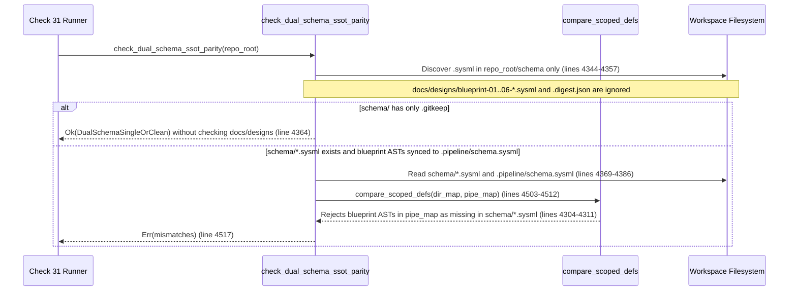

## 1. Context and References

<!-- test-target: crates/verify-baseline/tests/reproducer_tests.rs -->

- **File**: `crates/verify-baseline/src/checks/parity_gates.rs:4343-4519`
- **Pillar**: Semantic Traceability
- **Symptom**: `check_dual_schema_ssot_parity` (`crates/verify-baseline/src/checks/parity_gates.rs:4343-4365`) inspects only `repo_root.join("schema")` (line 4344) and `.pipeline/schema.sysml` (line 4345). When `schema/` contains only `.gitkeep`, `has_schema_files` is `false` (line 4361) and Check 31 returns `Ok(ParityOutcome::DualSchemaSingleOrClean)` (line 4364) without verifying `docs/designs/blueprint-01..06-*.{sysml,digest.json}` parity; and if blueprint ASTs are written to `.pipeline/schema.sysml`, `compare_scoped_defs` (lines 4273-4312, 4503-4512) rejects them as missing from `schema/*.sysml`.
- **Test-Target**: `crates/verify-baseline/tests/reproducer_tests.rs`

## 2. Root Cause Analysis (5 Whys)

1. **Why does Check 31 (`check_dual_schema_ssot_parity`) silently return `Ok(ParityOutcome::DualSchemaSingleOrClean)` when `schema/` contains only `.gitkeep` even when `docs/designs/blueprint-01..06-*.{sysml,digest.json}` and `.pipeline/schema.sysml` are present, or falsely reject blueprint ASTs synced into `.pipeline/schema.sysml`?** Because `check_dual_schema_ssot_parity` (`crates/verify-baseline/src/checks/parity_gates.rs:4343-4519`) discovers modular SysML files exclusively from `repo_root.join("schema")` (lines 4344-4357) and ignores `docs/designs/*.sysml` and `.digest.json` blueprint triplet files.
2. **Why does `check_dual_schema_ssot_parity` discover modular SysML files exclusively from `schema/`?** Because line 4344 binds only `let schema_dir = repo_root.join("schema");` and line 4349 passes `&[&schema_dir]` to `UnifiedSchemaModelExtractor::discover_schema_files(&[&schema_dir])`, omitting `repo_root.join("docs").join("designs")`.
3. **Why does omitting `docs/designs/` cause two opposing verification failures depending on whether `schema/*.sysml` is populated?** Because when `schema/` holds only `.gitkeep`, `schema_sysml_files` is empty (`has_schema_files == false` at line 4361), causing line 4364 to short-circuit with `Ok(ParityOutcome::DualSchemaSingleOrClean)` without checking `docs/designs/blueprint-01..06-*.{sysml,digest.json}`; conversely, when `schema/*.sysml` is populated and blueprint AST nodes are compiled into `.pipeline/schema.sysml`, `schema_dir_content` (lines 4367-4379) excludes `docs/designs/*.sysml` so `compare_scoped_defs` (lines 4304-4311, invoked at lines 4503-4512) flags every blueprint AST node in `pipe_map` as `"defined in .pipeline/schema.sysml but missing in schema/*.sysml"`.
4. **Why was `check_dual_schema_ssot_parity` designed around a two-location (`schema/` vs `.pipeline/schema.sysml`) assumption?** Because Check 31 was authored before `spec-blueprint-engineering` introduced `docs/designs/blueprint-XX-<slug>.{md,sysml,digest.json}` triplets as first-class modular SysML v2 metamodel sources.
5. **Why did existing unit tests for Check 31 not expose this parity blind spot and false-positive rejection?** Because Check 31 test fixtures only exercised `schema/*.sysml` against `.pipeline/schema.sysml` and never tested workspaces containing `docs/designs/blueprint-01..06-*.{sysml,digest.json}` with either a `.gitkeep`-only `schema/` landing zone or a merged `.pipeline/schema.sysml`.

## 3. Correctness Analysis

In `crates/verify-baseline/src/checks/parity_gates.rs:4343-4519`, `check_dual_schema_ssot_parity(repo_root: &Path)` enforces Check 31 (`[REQ-DUAL-SCHEMA-SSOT-PARITY]`):
1. Lines 4344-4357: Searches only `let schema_dir = repo_root.join("schema");` via `UnifiedSchemaModelExtractor::discover_schema_files(&[&schema_dir])` and filters for non-empty `.sysml` files into `schema_sysml_files`.
2. Lines 4359-4365: Sets `has_pipeline_schema` (lines 4359-4360) and `has_schema_files = !schema_sysml_files.is_empty()` (line 4361). If `!(has_schema_files && has_pipeline_schema)` (line 4363), it immediately returns `Ok(ParityOutcome::DualSchemaSingleOrClean)` (line 4364).
3. Lines 4367-4379: Concatenates only `schema_sysml_files` into `schema_dir_content`, completely ignoring `docs/designs/blueprint-01..06-*.sysml` and their companion `docs/designs/blueprint-01..06-*.digest.json` sidecars.
4. Lines 4388-4500: Parses all 10 SysML v2 AST definition kinds (`part def`, `port def`, `action def`, `requirement def`, `constraint def`, `state def`, `calc def`, `connection def`, `test case def`, `attribute def`) into `*_dir` maps (from `schema_dir_content`) and `*_pipe` maps (from `.pipeline/schema.sysml`).
5. Lines 4502-4518: Calls `compare_scoped_defs` (`crates/verify-baseline/src/checks/parity_gates.rs:4273-4312`) across all 10 AST maps (lines 4503-4512). At lines 4304-4311, any `qual_name` present in `pipe_map` that is not in `dir_map` pushes `"{} defined in .pipeline/schema.sysml but missing in schema/*.sysml: [\"{}\"]"`.

This violates the **Dual-Schema SSOT Parity Invariant (`[REQ-DUAL-SCHEMA-SSOT-PARITY]`)** and the **Repository Artifact Management Mandate** (`.pipeline/constitution.md:155`):
- **Silent False-Negative Bypass**: When `schema/` contains only `.gitkeep` and architectural models reside in `docs/designs/blueprint-01..06-*.{sysml,digest.json}`, `has_schema_files` is `false` (line 4361) and Check 31 returns `Ok(ParityOutcome::DualSchemaSingleOrClean)` (line 4364), failing to verify parity between `docs/designs/*.sysml`, `.digest.json` sidecars, and `.pipeline/schema.sysml`.
- **False-Positive Divergence Rejection**: When `compile-sysml` or blueprint synchronization merges `docs/designs/blueprint-01..06-*.sysml` AST declarations into `.pipeline/schema.sysml` alongside `schema/*.sysml`, `compare_scoped_defs` (lines 4304-4311, 4503-4512) rejects every blueprint AST definition in `.pipeline/schema.sysml` as missing from `schema/*.sysml`.

## 4. UML Diagrams



## 5. Affected Callers / Downstream Impact

- `run_all_checks` / Check 31 Dual-Schema SSOT Parity Gate (`crates/verify-baseline/src/lib.rs` and `crates/verify-baseline/src/checks/parity_gates.rs:4343`) -- Either bypasses parity verification completely when `schema/` contains only `.gitkeep` and blueprints reside in `docs/designs/blueprint-01..06-*.{sysml,digest.json}`, or fails with false-positive AST mismatch errors when blueprint SysML definitions are consolidated into `.pipeline/schema.sysml`.
- `compile-sysml` and `spec-blueprint-engineering` workflows -- Cannot consolidate `docs/designs/blueprint-01..06-*.sysml` definitions into `.pipeline/schema.sysml` without triggering Check 31 `compare_scoped_defs` rejections at lines 4503-4512.

## 6. Proposed Correction

<!-- MUST NOT use regex (Check 34: deterministic linear slice/char scanning, no regex crate). MUST be domain-agnostic for upstream crates (Check 19). -->

```rust
pub fn check_dual_schema_ssot_parity(repo_root: &Path) -> Result<ParityOutcome, Vec<String>> {
    let schema_dir = repo_root.join("schema");
    let designs_dir = repo_root.join("docs").join("designs");
    let pipeline_schema = repo_root.join(".pipeline").join("schema.sysml");

    let mut scan_roots: Vec<&Path> = Vec::new();
    if schema_dir.is_dir() {
        scan_roots.push(schema_dir.as_path());
    }
    if designs_dir.is_dir() {
        scan_roots.push(designs_dir.as_path());
    }

    let mut schema_sysml_files = Vec::new();
    if !scan_roots.is_empty() {
        let all_files =
            deap_core::sysml_ast::UnifiedSchemaModelExtractor::discover_schema_files(&scan_roots);
        schema_sysml_files = all_files
            .into_iter()
            .filter(|p| {
                p.extension().is_some_and(|ext| ext == "sysml")
                    && fs::metadata(p).map(|m| m.len() > 0).unwrap_or(false)
            })
            .collect();
    }

    for sysml_path in &schema_sysml_files {
        if sysml_path.starts_with(&designs_dir) {
            let digest_path = sysml_path.with_extension("digest.json");
            let has_valid_digest = digest_path.is_file()
                && fs::metadata(&digest_path).map(|m| m.len() > 0).unwrap_or(false);
            if !has_valid_digest {
                return Err(vec![format!(
                    "Check 31 failed: Blueprint SysML '{}' is missing non-empty companion sidecar '{}'",
                    sysml_path.display(),
                    digest_path.display()
                )]);
            }
        }
    }

    let has_pipeline_schema = pipeline_schema.is_file()
        && fs::metadata(&pipeline_schema).map(|m| m.len() > 0).unwrap_or(false);
    let has_schema_files = !schema_sysml_files.is_empty();

    if !(has_schema_files && has_pipeline_schema) {
        return Ok(ParityOutcome::DualSchemaSingleOrClean);
    }

    let mut schema_dir_content = String::new();
    schema_sysml_files.sort();
    for fpath in &schema_sysml_files {
        match fs::read_to_string(fpath) {
            Ok(c) => {
                schema_dir_content.push_str(&c);
                schema_dir_content.push_str("\n\n");
            }
            Err(e) => {
                return Err(vec![format!(
                    "Check 31 failed: Unable to read {}: {}",
                    fpath.display(),
                    e
                )]);
            }
        }
    }

    let pipeline_schema_content = match fs::read_to_string(&pipeline_schema) {
        Ok(c) => c,
        Err(e) => {
            return Err(vec![format!(
                "Check 31 failed: Unable to read {}: {}",
                pipeline_schema.display(),
                e
            )]);
        }
    };

    let mut dir_bodies = Vec::new();
    collect_qualified_package_bodies(&schema_dir_content, "", &mut dir_bodies);

    let mut pipe_bodies = Vec::new();
    collect_qualified_package_bodies(&pipeline_schema_content, "", &mut pipe_bodies);
```

## 7. Relationship to Existing Issues

Discovered in audit -- new finding.

## Audit Source

Adversarial Semantic Traceability Audit
SEVERITY: Important
FILE_LOCATION: crates/verify-baseline/src/checks/parity_gates.rs:4343-4519
